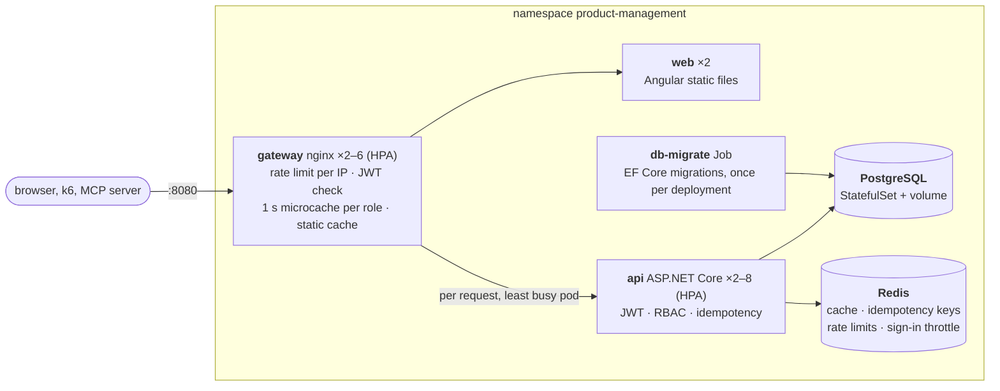

# Product Management

A product and stock management system:

* **Backend:** .NET 10 / ASP.NET Core Web API, Entity Framework Core and PostgreSQL, with a Redis read cache, JWT
  authentication (tokens issued by the API to registered consumers), role-based authorization and rate limiting.
* **Frontend:** Angular 22 with Tailwind CSS, served behind an nginx gateway that also caches API reads.
* **Deployment:** Kubernetes (Docker Desktop or MicroK8s), with an autoscaled API (2–8 replicas) and k6 load
  tests run inside the cluster, including one with ten teams on 850,000 products and 5 million stock movements.
* **Stock ledger and idempotency:** every stock change is recorded with who made it; retried requests
  (`Idempotency-Key`) are applied exactly once, whichever replica they reach.
* **MCP server:** lets AI assistants search the catalogue and record stock movements, under the same rules as
  everyone else.


> **".NET Core":** since .NET 5 Microsoft dropped "Core" from the runtime's name. **.NET 10 is the current release
> of .NET Core** (cross-platform, not the Windows-only .NET Framework) and the current LTS. The web and data layers
> keep the name: **ASP.NET Core** and **Entity Framework Core**.

## Contents

- [Run it](#run-it)
- [Develop](#develop)
- [Tests](#tests)
- [Requirements checklist](#requirements-checklist)
- [Architecture](#architecture) (diagrams and what each component does: [docs/architecture.md](docs/architecture.md))
- [API reference](#api-reference)
- [Security](#security)
- [Performance and scaling](#performance-and-scaling)
- [MCP (AI assistants)](#mcp-ai-assistants)
- [Key decisions](#key-decisions)
- [Assumptions](#assumptions)
- [Trade-offs and deviations from common practice](#trade-offs-and-deviations-from-common-practice)
- [Production readiness and next steps](#production-readiness-and-next-steps)
- [Repository layout](#repository-layout)

---

## Run it

Everything runs on Kubernetes. Pick one of two local clusters; the manifests are identical.

### Option A: Docker Desktop's Kubernetes (recommended; everything visible in Docker Desktop)

1. Docker Desktop → **Settings → Kubernetes → Enable Kubernetes** → Apply & restart (single-node, `kubeadm`).
2. Deploy (the backend first, then the frontend; each can also be deployed on its own):

   ```bash
   kubectl config use-context docker-desktop
   scripts/deploy-all.sh
   ```

3. Open **http://localhost:8080** (the gateway is a `LoadBalancer` Service on localhost).

### Option B: MicroK8s

```bash
scripts/cluster-up.sh                         # MicroK8s in a Multipass VM (macOS/Windows); native on Linux
export KUBECONFIG="$PWD/.kube/microk8s"
scripts/deploy-all.sh
kubectl -n product-management port-forward service/gateway 8080:8080     # http://localhost:8080
```

### Sign in

The API issues its own JWTs to **registered API consumers** (client id + secret). The web app's login page, the MCP
server and the load tests all use `POST /api/auth/token`. Local demo consumers:

| Client id / user | Secret      | Role          | Can                                    |
| ---------------- | ----------- | ------------- | -------------------------------------- |
| `viewer`         | `viewer`    | `viewer`      | browse and search                      |
| `clerk`          | `clerk`     | `stock-clerk` | + add and remove stock                 |
| `manager`        | `manager`   | `manager`     | + create, edit and delete products     |
| `mcp-server`     | `mcp-local-dev-secret` | `stock-clerk` | the MCP server               |

They are defined (with PBKDF2 hashes only) in `backend/deploy/kubernetes.yaml` and `appsettings.Development.json`.

```bash
# Get a token and call the API from a terminal
TOKEN=$(curl -s -X POST localhost:8080/api/auth/token -H 'Content-Type: application/json' \
  -d '{"clientId":"manager","clientSecret":"manager"}' | jq -r .accessToken)
curl -H "Authorization: Bearer $TOKEN" localhost:8080/api/products
```

| What        | How |
| ----------- | --- |
| Application | http://localhost:8080 |
| Swagger UI  | `kubectl -n product-management port-forward service/api 5080:8080` → http://localhost:5080/swagger (click *Authorize* and paste a token) |

### What gets deployed



Full topology and **what each component does** (every Service, workload, Secret and policy):
[docs/architecture.md](docs/architecture.md). Every flow (sign-in, token check at the gateway, the cache layers,
stock changes with idempotency, rate limiting, deployment, autoscaling, load tests) as a diagram:
[docs/flows.md](docs/flows.md).

The API scales on its own (HorizontalPodAutoscaler, 2–8 replicas at 60 % CPU; the gateway 2–6 at 70 %; needs
metrics-server: `scripts/cluster-addons.sh`). Change its range without touching the frontend:

```bash
kubectl -n product-management patch hpa api -p '{"spec":{"minReplicas":4}}'
kubectl -n product-management get hpa api -w
```

Large dataset for scale testing: `load-tests/seed-bulk.sh` (850,000 products, 5 million stock movements, ~3–6
minutes), checked by `load-tests/verify-data.sh`.

---

## Develop

| Tool      | Version |
| --------- | ------- |
| .NET SDK  | 10.0.401+ (pinned in `backend/global.json`) |
| Node.js   | 24 LTS (`frontend/.nvmrc`; 22.22+ also supported) |
| Docker    | for the integration tests (Testcontainers) and the images |
| kubectl   | for deployment |

**Backend:** open `backend/ProductManagement.sln` in **Visual Studio 2026** (the release that supports .NET 10) or
JetBrains Rider. Projects sit directly under `backend/`, grouped by the `Source`, `Tests` and `Mcp` solution folders.
`ProductManagement.Api.http` has a request for every endpoint. To run the API from the IDE against the cluster's
database:

```bash
kubectl -n product-management port-forward statefulset/postgres 5432:5432    # matches appsettings.Development.json
dotnet run --project backend/ProductManagement.Api
```

**Frontend:**

```bash
cd frontend && npm ci && npm start    # http://localhost:4200; /api proxied to :5080
```

| Script                 | Purpose |
| ---------------------- | ------- |
| `npm start`            | dev server with live reload |
| `npm test` / `test:ci` | Vitest (watch / single run) |
| `npm run lint`         | ESLint (angular-eslint) |
| `npm run format:check` | Prettier |
| `npm run build`        | production build |

---

## Tests

```bash
cd backend && dotnet test --solution ProductManagement.sln     # 236 tests (Docker must be running)
cd frontend && npm run test:ci                                   # 93 tests
scripts/check-requirements.py                                    # the assessment PDF, checked against the running system
load-tests/run.sh smoke                                          # against the running cluster
```

| Suite                                 | Tests | What it proves |
| ------------------------------------- | ----: | -------------- |
| `Domain.UnitTests`                    | 32 | Invariants (six-digit ids, price precision, stock range); a failed update leaves no partial changes; the stock rule at its edges, including deltas that would overflow naive arithmetic. |
| `Application.UnitTests`               | 59 | Use-case orchestration: validation first, no id consumed by invalid requests, version checks, conflicts mapped to 409/412, stock errors carry the available quantity; validators at their boundaries. |
| `Api.IntegrationTests`                | 123 | Real HTTP against **real PostgreSQL and Redis** (Testcontainers). Every endpoint and the problem-details contract. **Concurrency:** 60 parallel orders on 25 units → exactly 25 succeed; no lost updates; two API instances never produce a duplicate id. **Ledger:** every kind of change recorded, ledger sum = stock under concurrency. **Idempotency:** 20 simultaneous copies over two replicas run once; a retry on the other replica is replayed; a retry after Redis lost the claim is still not applied twice (database guard), for stock changes and creates; reused or invalid keys refused; no Redis → refused rather than risk a duplicate. **Cache:** hits, invalidation visible across replicas, lists kept across stock changes yet showing current stock, 404s not cached, works with Redis down. **Security:** token endpoint (valid, invalid, missing, throttled, failed attempts adding up across two replicas); 30-case role × operation matrix; missing, expired, foreign and forged tokens, `alg: none`, HS256 signed with the public key; the published JWKS has no private part and matches the tokens' `kid`; anonymous probes. **Rate limiting:** per user, shared by two replicas, stricter for writes, `Retry-After`. |
| `Api.AcceptanceTests` (BDD, Reqnroll) | 10 | Gherkin scenarios from the user's point of view (`Features/*.feature`). |
| `Mcp.UnitTests`                       | 12 | MCP tools → API contract, token caching (fake clock, concurrent callers), API errors surfaced to the assistant. |
| Frontend (Vitest)                     | 93 | API client contract (URLs, `If-Match`, `Idempotency-Key`, cache bypass after own changes), **browser cache** (fresh hit without a request, stale-while-revalidate, bypass, cleared after writes, LRU eviction), store (next-page prefetch, page change vs background refresh), pipes, progress bar, stock history dialog, a retried stock change reuses its key, login opened without `returnUrl`, error normalisation, store (no duplicate requests, no flicker, background refresh paused in hidden tabs), auth (login against the token endpoint, session restore and expiry, role → permission mapping, guard, interceptor never leaks the token to other origins), login page (safe `returnUrl`, 401/429 messages), dialogs (validation, server field errors, 412 conflict + reload), role-specific UI, paginator, toasts. |
| Load (k6, in cluster)                 | 8 scenarios | smoke, load (SLO thresholds), stress, spike, **stock consistency across replicas**, rate limiting, **teams** (ten consumers on 850,000 products, 30 % duplicate retries, then ledger = applied changes; `PEAK=` turns it into a capacity staircase), **browse** (read capacity with a hot set). See the [results](docs/load-test-results.md). |

CI (`.github/workflows/ci.yml`) runs:
* build with warnings as errors, every test suite, lint and format checks;
* Kubernetes schema validation (kubeconform);
* an **end-to-end job that deploys to MicroK8s on the runner** and runs the k6 smoke and stock-consistency
  scenarios inside the cluster.

---

## Requirements checklist

Every row below is also **checked against the running system** by `scripts/check-requirements.py` (14 checks
through the gateway: the 9 endpoints, add and decrement by any quantity, partial search, stock range, 40 concurrent
creates over the replicas → 40 unique 6-digit ids, validation, stock in every list).

| Requirement (assessment PDF)                                | Where / how |
| ----------------------------------------------------------- | ----------- |
| CRUD endpoints                                              | `ProductsController`: `GET/POST /api/products`, `GET/PUT/DELETE /api/products/{id}` |
| `POST /api/products/{id}/decrement-stock/{quantity}` → OK    | One atomic conditional UPDATE; 200 + updated product ([ADR 0003](docs/adr/0003-atomic-stock-updates.md)) |
| `POST /api/products/{id}/add-to-stock/{quantity}` → OK       | Same mechanism, upper bound enforced. Any quantity: in the UI the + / − buttons move 1, 5, 10, 25 or 100 units per click, and *Adjust stock* takes any amount |
| `GET /api/products/search?name=` (partial match)            | Case-insensitive `ILIKE`, wildcards escaped, trigram index |
| `GET /api/products/stock-level?min=&max=`                   | Inclusive range, either bound optional |
| Unique 6-digit id, no duplicates across instances           | PostgreSQL sequence `100000–999999 NO CYCLE` ([ADR 0002](docs/adr/0002-product-id-generation.md)); tested with two API hosts, with 40 concurrent creates over the replicas (`check-requirements.py`) and on 850,000 products (`verify-data.sh`) |
| Validation of create/update                                 | FluentValidation + domain guards + database check constraints ([ADR 0005](docs/adr/0005-error-handling.md)) |
| Stock included in every list response                       | `stockQuantity` on every `ProductResponse` |
| EF Core code-first migrations                               | `backend/ProductManagement.Infrastructure/Persistence/Migrations` (generated by `dotnet ef`), applied by a Kubernetes Job |
| Database seeding                                            | Categories via `HasData`; sample products via `UseSeeding`/`UseAsyncSeeding` |
| Angular frontend; reflects changes made through the API     | `frontend/`: every endpoint used; refetch after changes + background refresh ([ADR 0007](docs/adr/0007-frontend-state.md)) |
| Unit tests for various scenarios                            | 103 backend unit tests + 93 frontend tests (plus 133 integration and acceptance tests) |
| *Optional:* BDD tests                                       | `ProductManagement.Api.AcceptanceTests` (Reqnroll / Gherkin) |
| Documentation for running locally                           | This README and [`docs/`](docs) |

---

## Architecture

### Backend (clean architecture)

```
ProductManagement.Api ──► ProductManagement.Application ──► ProductManagement.Domain
        │                           ▲
        └──► ProductManagement.Infrastructure ──► EF Core / PostgreSQL, Redis
ProductManagement.Mcp ──(HTTP)──► the API, through the gateway
```

| Project          | Responsibility |
| ---------------- | -------------- |
| `Domain`         | `Product`, `Category`, invariants, `ProductRules` (single source of limits), the stock rule as an expression. No dependencies. |
| `Application`    | Use cases (`ProductQueryService`, `ProductCommandService`), contracts, FluentValidation, `Result`/`Error`, ports (`IProductRepository`, `IProductQueries`, `IProductIdGenerator`, `IUnitOfWork`). |
| `Infrastructure` | `DbContext`, configurations, migrations, repositories and queries, sequence-based id generator, **Redis cache decorator**, seeding, health checks. |
| `Api`            | Thin controllers, HTTP mapping (status codes, ETag/If-Match, problem details), **token endpoint, JWT verification, authorization policies, rate limiting**, OpenAPI, health endpoints, the `migrate` and `hash-secret` commands. |
| `Mcp`            | MCP server for AI assistants; a client of the HTTP API. |

A request end to end (`PUT /api/products/{id}`):

1. **Gateway:** checks the per-IP limit and picks the least busy API replica (reads may be answered from its
   1 s microcache).
2. **API pipeline:** validates the JWT, applies the per-user limit (stricter for writes) and checks the
   `products:write` permission.
3. **Controller:** parses `If-Match` and calls the use case. It has no other logic.
4. **Use case:** validates the request, loads the aggregate, compares versions (412 if stale), checks the category
   and calls `product.Update(...)`. The **domain** enforces the invariants.
5. **Unit of work:** saves. EF Core puts the loaded `xmin` in the `WHERE`, so a concurrent change becomes 412 or
   409. After the commit, the **cache generation** is incremented and every replica stops serving the old data.
6. **Response:** the query side re-reads the product, and the controller returns it with a fresh `ETag`.

**EF Core:**
* reads are no-tracking projections;
* writes load tracked aggregates only for load-modify-save;
* stock changes are atomic `ExecuteUpdateAsync` statements;
* everything is async and honours cancellation, with `DbContext` pooling;
* the database repeats the domain constraints;
* migrations run once per deployment in a Job (EF Core's migration lock makes concurrent runs safe anyway).

### Frontend

```
src/app/
  core/       auth (session, guard, interceptor), http (ApiError + interceptor), config, notifications
  features/auth/login/  sign-in page
  shared/     forms (validators, messages), models, ui (icon, paginator, toasts, confirm dialog)
  features/products/
    data-access/  ProductsApi, CategoriesApi, ProductsStore (signals + rxResource), models
    product-list/, product-form-dialog/, stock-adjust-dialog/, stock-status/
```

The frontend uses Angular 22 (standalone, zoneless, OnPush by default, signals), Tailwind CSS v4 for the look and
Angular CDK for accessible dialogs and menus ([ADR 0013](docs/adr/0013-ui-tailwind-cdk.md)).

---

## API reference

Base path `/api`. Every endpoint except the token endpoint requires a bearer token (see [Security](#security)). The
full schema is in Swagger.

| Method | Path                                              | Permission       | Success                        | Errors             |
| ------ | ------------------------------------------------- | ---------------- | ------------------------------ | ------------------ |
| POST   | `/auth/token` `{ clientId, clientSecret }`        | anonymous        | 200 `{ accessToken, tokenType, expiresIn }` | 400, 401, 429 |
| GET    | `/.well-known/jwks.json` (outside `/api`; the gateway reads it in-cluster) | anonymous | 200 JWKS: the public key that verifies tokens | – |
| GET    | `/products?page=&pageSize=`                       | `products:read`  | 200 `PagedResponse<Product>`   | 400                |
| GET    | `/products/{id}`                                  | `products:read`  | 200 `Product` + `ETag`         | 404                |
| GET    | `/products/search?name=&page=&pageSize=`          | `products:read`  | 200 `PagedResponse<Product>`   | 400                |
| GET    | `/products/stock-level?min=&max=&page=&pageSize=` | `products:read`  | 200 `PagedResponse<Product>`   | 400                |
| POST   | `/products`                                       | `products:write` | 201 `Product` + `Location` + `ETag` | 400           |
| PUT    | `/products/{id}` (optional `If-Match`)            | `products:write` | 200 `Product` + `ETag`         | 400, 404, 409, 412 |
| DELETE | `/products/{id}` (optional `If-Match`)            | `products:write` | 204                            | 404, 409, 412      |
| POST   | `/products/{id}/decrement-stock/{quantity}`       | `stock:write`    | 200 `Product` + `ETag`         | 400, 404, 409      |
| POST   | `/products/{id}/add-to-stock/{quantity}`          | `stock:write`    | 200 `Product` + `ETag`         | 400, 404, 409      |
| GET    | `/products/{id}/stock-movements?page=&pageSize=`  | `products:read`  | 200 `PagedResponse<StockMovement>`, newest first | 404 |
| GET    | `/categories`                                     | `products:read`  | 200 `Category[]`               | –                  |

Every endpoint may also answer **401** (no or invalid token), **403** (missing permission) or **429** (rate limited,
with `Retry-After`).

**Product:**

```json
{
  "id": 100004, "name": "Office Lens Desk", "description": "Near-to-intermediate lens optimised for screen work.",
  "price": 189.00, "stockQuantity": 5, "categoryId": 1, "categoryName": "Spectacle Lenses",
  "createdAt": "2026-10-09T13:38:11.29+00:00", "updatedAt": "2026-10-09T13:55:02.10+00:00", "version": 812
}
```

**Idempotency-Key** (optional, recommended) on `POST /products`, `decrement-stock` and `add-to-stock`: one key per
operation (1–128 chars of `A-Z a-z 0-9 - _ . :`, e.g. a UUID), reused when retrying. The operation runs once,
whichever replica the copies reach. Copies get the original response with `Idempotent-Replayed: true`
([ADR 0017](docs/adr/0017-idempotency-keys.md)).

**StockMovement:** `{ id, quantityChange, stockAfter, reason, performedBy, occurredAt }`, with `reason` one of
`InitialStock`, `StockAdded`, `StockRemoved`, `Correction`. A product's stock always equals the sum of its movements
([ADR 0016](docs/adr/0016-stock-ledger.md)).

**Create / update body:** `name` (required, ≤ 200), `description` (≤ 2000), `price` (0.01–1,000,000, ≤ 2
decimals), `stockQuantity` (0–1,000,000), `categoryId` (must exist). `PUT` replaces all fields.

**Paging:** `page` ≥ 1, `pageSize` 1–100 (default 20). Responses have the shape
`{ items, page, pageSize, totalCount, totalPages }`.

**Errors:** always `application/problem+json` with a stable `errorCode`.

| `errorCode`                       | Status | Meaning |
| --------------------------------- | ------ | ------- |
| `validation_failed`               | 400    | see `errors` (field → messages) |
| `product.not_found`               | 404    | |
| `product.insufficient_stock`      | 409    | includes `requested` and `available` |
| `product.stock_limit_exceeded`    | 409    | stock would exceed 1,000,000 |
| `product.concurrent_modification` | 409    | changed between read and write (no `If-Match` sent) |
| `product.version_mismatch`        | 412    | `If-Match` no longer matches: reload and retry |
| `invalid_client`                  | 401    | wrong client id or secret (deliberately not saying which) |
| `rate_limited`                    | 429    | see `Retry-After` |
| `too_many_failed_attempts`        | 429    | too many failed sign-ins from this IP; see `Retry-After` |
| `idempotency_key_invalid`         | 400    | the `Idempotency-Key` header is empty, too long or has invalid characters |
| `idempotency_key_in_progress`     | 409    | a copy of this request is still running: retry shortly |
| `idempotency_key_reused`          | 422    | the key was already used for a different request |
| `idempotency_unavailable`         | 503    | the key store (Redis) is unreachable; the request was not run |
| `http_<status>`                   | any    | framework errors: `http_401`, `http_403`, `http_404` (unknown route), ... |
| `internal_error`                  | 500    | details only in the logs (correlate with `traceId`) |

---

## Security

| Concern        | How |
| -------------- | --- |
| Authentication | The API issues **ES256** JWTs to registered consumers at `POST /api/auth/token` and publishes only its public key (`/.well-known/jwks.json`). **The gateway verifies every token** (signature, `ES256` only, issuer, audience, expiry) and rejects bad ones at the edge; the API verifies again. Consumer secrets are stored only as PBKDF2 hashes; unknown client and wrong secret are indistinguishable ([ADR 0009](docs/adr/0009-authentication-authorization.md), [ADR 0020](docs/adr/0020-edge-token-verification.md)). |
| Authorization  | Permission policies (`products:read`, `stock:write`, `products:write`) mapped from roles (`viewer`, `stock-clerk`, `manager`) in one place. Secure by default: an endpoint without a policy still requires a signed-in user. The UI hides what a role can't do, and the API enforces it. |
| Machine access | The MCP server is its own consumer (`mcp-server`) with only the `stock-clerk` role. |
| Brute force    | Failed sign-ins are counted per IP in Redis across all replicas: 10 per minute, then `429` even with the right secret. |
| Rate limiting  | The gateway limits per IP; the API per user (stricter for writes), with token buckets **shared by all replicas in Redis**, so the limit does not grow as the autoscaler adds pods. Both answer `429` + `Retry-After` ([ADR 0010](docs/adr/0010-rate-limiting.md)). |
| Network        | NetworkPolicies: the database and cache are reachable only from the API (and the migration Job); the API and web app only from the gateway. |
| Containers     | Non-root, read-only root filesystem where possible, no capabilities, no privilege escalation, `RuntimeDefault` seccomp, resource limits. |
| Edge           | Strict **Content-Security-Policy** (`'self'` only, no inline scripts, no framing), `Permissions-Policy`, COOP/CORP, `nosniff`, `X-Frame-Options: DENY`, referrer policy, 1 MB body limit, `server_tokens off` ([ADR 0019](docs/adr/0019-content-security-policy.md)). |
| Privacy        | No third-party requests: the font is self-hosted (no user IPs sent to Google). The browser cache lives in memory only and is cleared on sign-out. |
| Exactly-once   | Retries with an `Idempotency-Key` are answered from Redis; the ledger's unique `request_key` makes a second execution impossible even if Redis forgets ([ADR 0017](docs/adr/0017-idempotency-keys.md)). |
| Errors         | Problem details never include stack traces or internals; serializer messages are hidden. |

---

## Performance and scaling

* **Redis cache:** cache-aside with generation-based invalidation, shared by all replicas, fails open
  ([ADR 0008](docs/adr/0008-redis-cache.md)).
* **nginx gateway:** per-request balancing over the API's headless Service (new replicas are picked up within 5 s),
  edge cache for the bundles, **1 s microcache for API reads** (keyed per token, bypassed after the user's own
  changes; 38 % of product GETs served by nginx in the load test), gzip, keep-alive pools
  ([ADR 0012](docs/adr/0012-gateway.md)).
* **Two cache layers, two jobs:** nginx absorbs identical requests within a second; Redis is shared, invalidated
  on every write and keeps entries for minutes.
* **Lists survive stock changes:** the page's ids and count are cached under a generation that only catalogue
  edits move; the rows are read fresh by primary key, so the stock shown is always current
  ([ADR 0008](docs/adr/0008-redis-cache.md)).
* **Autoscaling:** HPA 2–8 replicas, with the pool sized so the maximum stays within what PostgreSQL can serve
  ([ADR 0018](docs/adr/0018-autoscaling-and-scale-testing.md)).
* **Browser cache:** pages already seen open instantly (stale-while-revalidate), the next page is prefetched, and
  paging quickly cancels obsolete requests ([ADR 0007](docs/adr/0007-frontend-state.md)).
* **Capacity on one 8-CPU laptop** (everything, load generator included, on the same machine): **18,177 req/s** of
  catalogue reads (p95 47 ms, 96 % answered by the gateway, which verifies tokens itself and shares its microcache per
  role) and **~2,400 req/s** of the worst-case mix (25 % writes, uniform reads over 850,000 products), both with
  **0 errors** ([ADR 0020](docs/adr/0020-edge-token-verification.md)).
* **Load test highlights** ([full results](docs/load-test-results.md)):
  * **ten teams on 850,000 products**, 30 % of stock changes sent twice: **281 req/s, 0 errors, p95 13 ms**;
    17,213 changes applied → exactly 17,213 ledger rows (no duplicate among 6,916 copies); the API scaled 3 → 7.
    The first run at this scale failed (123 req/s, 12 % errors); measuring found an unindexed sort, a cache
    invalidated by every stock change and too many connections, and fixing those got here;
  * p95 of **3 ms** at 150 req/s with 2 replicas;
  * **0 errors in 255k requests** up to ~1,000 req/s, on a single-node 4-vCPU cluster;
  * **300 concurrent orders for 100 units across replicas → exactly 100 sold, stock 0**;
  * scaling the API to 4 replicas exposed PostgreSQL as the bottleneck. Sizing the connection pool to the database's
    capacity and giving it 2 CPUs removed every error.

---

## MCP (AI assistants)

`backend/ProductManagement.Mcp` is a Model Context Protocol server (official C# SDK, `dotnet new mcpserver`) with
tools such as `search_products`, `list_low_stock`, `add_stock` and `remove_stock`. It calls the REST API like any
other client, so the same authentication, RBAC (it is a `stock-clerk`), validation and rate limits apply
([ADR 0014](docs/adr/0014-mcp-server.md)).

`.mcp.json` (Claude Code) and `.vscode/mcp.json` (VS Code) register it, together with development MCP servers:
Kubernetes (read-only), PostgreSQL (restricted mode) and Playwright. With the app running, ask your assistant
*"Which products are low on stock?"* or *"Record a delivery of 20 units for product 100004."*

---

## Key decisions

Each decision has an ADR in [`docs/adr`](docs/adr/README.md):

| #    | Decision |
| ---- | -------- |
| [0001](docs/adr/0001-clean-architecture.md) | Clean architecture, CQRS-lite (projections for reads, aggregates for writes) |
| [0002](docs/adr/0002-product-id-generation.md) | Six-digit ids from a bounded PostgreSQL sequence, safe across instances |
| [0003](docs/adr/0003-atomic-stock-updates.md) | Stock changes as one conditional UPDATE: no overselling, no retries |
| [0004](docs/adr/0004-optimistic-concurrency.md) | Optimistic concurrency with `xmin`, ETag and If-Match |
| [0005](docs/adr/0005-error-handling.md) | Result pattern and RFC 9457 problem details with stable error codes |
| [0006](docs/adr/0006-postgresql.md) | PostgreSQL, tested against the real engine |
| [0007](docs/adr/0007-frontend-state.md) | Frontend state with signals and `rxResource` |
| [0008](docs/adr/0008-redis-cache.md) | Redis read cache with generation-based invalidation |
| [0009](docs/adr/0009-authentication-authorization.md) | API-issued JWTs for registered consumers, permission-based RBAC |
| [0010](docs/adr/0010-rate-limiting.md) | Rate limiting in two layers |
| [0011](docs/adr/0011-kubernetes-deployment.md) | Kubernetes deployment, one manifest per project |
| [0012](docs/adr/0012-gateway.md) | nginx gateway in front of the application |
| [0013](docs/adr/0013-ui-tailwind-cdk.md) | Tailwind CSS + Angular CDK instead of Angular Material |
| [0014](docs/adr/0014-mcp-server.md) | MCP server for AI assistants |
| [0015](docs/adr/0015-load-testing.md) | Load testing with k6 inside the cluster |
| [0016](docs/adr/0016-stock-ledger.md) | Stock ledger written in the same statement as the stock change |
| [0017](docs/adr/0017-idempotency-keys.md) | Idempotency keys for create and stock changes |
| [0018](docs/adr/0018-autoscaling-and-scale-testing.md) | Autoscaling and testing at scale |

---

## Assumptions

* Single currency (EUR in the UI), two decimals, prices from 0.01 to 1,000,000.
* Stock is a whole number from 0 to 1,000,000. A decrement larger than the available stock is **rejected** (409),
  not clamped, so the shortage is never hidden from the caller.
* "Return an OK response" for the stock endpoints means **200 with the updated product**.
* Search is a case-insensitive "contains" on the name. Stock-level bounds are inclusive and optional.
* All list endpoints are paged (default 20, maximum 100).
* Categories are reference data, seeded by the migration and read-only through the API.
* Deletion is a hard delete. Ids are never reused.
* Three roles cover the business (`viewer`, `stock-clerk`, `manager`). The set of callers is small and known, so
  consumers live in configuration rather than in a user database or an external identity provider.

---

## Trade-offs and deviations from common practice

| Choice | Why |
| ------ | --- |
| Stock changes bypass load-modify-save | Atomicity under concurrency. The rule stays in the domain as an expression ([0003](docs/adr/0003-atomic-stock-updates.md)). |
| Nullable value types in request DTOs | A missing field becomes a validation error instead of a silent `0`. |
| No `EnableRetryOnFailure` | A blind retry inside the API after an ambiguous commit could apply a stock change twice. Retries belong to the client, with an `Idempotency-Key`. |
| `If-Match` optional | Easy to try with Swagger or curl. The UI always sends it, and making it mandatory (428) is one line. |
| Global cache generation (any write invalidates all cached reads) | Simple and race-free across replicas. It costs hit rate under heavy writes, as the load tests measured. |
| In-memory API rate limiter | Fairness per replica with no extra network hop. Global quotas would need Redis; the gateway provides the coarse cluster-wide limit. |
| Real PostgreSQL and Redis in tests (Docker required) | In-memory fakes would hide exactly the behaviour under test. |
| The API issues its own tokens (no identity provider) | One API and a handful of known callers: an IdP would add a component without solving a problem here. HS256 with one shared key is the simplest secure option while only the API verifies tokens ([0009](docs/adr/0009-authentication-authorization.md)). |
| Stateless JWTs (no revocation list) | No session store; a 1-hour lifetime and key rotation bound the risk. A `jti` deny-list in Redis is the next step if needed. |
| 1 s nginx microcache | Up to 1 s of staleness for repeated reads, in exchange for absorbing bursts; never shared between tokens and bypassed after the user's own changes. |
| Polling instead of push in the UI | Works across replicas with no extra infrastructure, at the cost of up to 15 s of staleness. |

---

## Production readiness and next steps

**In place:**
* health probes, zero-downtime rolling updates, PodDisruptionBudgets, NetworkPolicies;
* hardened non-root containers, immutable image tags;
* JSON logs with trace ids;
* authentication, RBAC, rate limiting, caching, optimistic concurrency, database constraints;
* migrations as a deployment step;
* CI with an end-to-end deployment, and load tests with SLO thresholds.

**Next:**

* **Secrets** from a secret manager (External Secrets, Vault or Sealed Secrets) instead of values in the manifests.
* **TLS** at the edge (cert-manager) with HSTS, and a Content-Security-Policy (which needs Angular's
  `inlineCritical` turned off).
* **Managed PostgreSQL** (or CloudNativePG) with backups, PgBouncer and read replicas.
* **Preserve client IPs** at the load balancer (`externalTrafficPolicy: Local` / PROXY protocol) so per-IP limits
  apply per caller; consider RS256 + JWKS if other services need to verify tokens; a `jti` deny-list for revocation.
* **Observability:** OpenTelemetry traces and metrics (ASP.NET Core, EF Core, Npgsql, Redis), with dashboards and
  alerts on the SLOs used by the load tests.
* A **HorizontalPodAutoscaler** for the API, once the database has headroom.
* **Keyset pagination** (`?after=`) for constant-time deep pages; monthly partitions for `stock_movements`.
* A replicated Redis, so idempotency claims survive a Redis restart.
* **GitOps** (Argo CD or Flux) with per-environment overlays (Kustomize or Helm) instead of deploy scripts.

---

## Repository layout

```
.
├── backend/                                  # .NET solution (its own repository in real life)
│   ├── ProductManagement.sln                 # solution folders: Source, Tests, Mcp
│   ├── Dockerfile                            # API image (also runs the migrate command)
│   ├── global.json · Directory.Build.props · Directory.Packages.props · dotnet-tools.json · .editorconfig
│   ├── ProductManagement.Domain/
│   ├── ProductManagement.Application/
│   ├── ProductManagement.Infrastructure/     # EF Core, migrations, Redis cache
│   ├── ProductManagement.Api/                # controllers, security, rate limiting, .http requests
│   ├── ProductManagement.Mcp/                # MCP server
│   ├── ProductManagement.{Domain,Application,Mcp}.UnitTests/
│   ├── ProductManagement.Api.IntegrationTests/ · ProductManagement.Api.AcceptanceTests/
│   ├── ProductManagement.Testing/            # shared test infrastructure
│   └── deploy/                               # kubernetes.yaml + deploy.sh (API, PostgreSQL, Redis, auth secrets)
├── frontend/                                 # Angular workspace (its own repository in real life)
│   ├── Dockerfile · nginx.conf               # web image (static files)
│   ├── gateway/                              # nginx gateway image (Dockerfile, config template)
│   └── deploy/                               # kubernetes.yaml + deploy.sh (web, gateway)
├── load-tests/                               # k6 scenarios + run.sh (runs them as a Kubernetes Job)
├── scripts/                                  # cluster-up / cluster-down (MicroK8s), deploy-all
├── docs/                                     # ADRs, load test results, scaffolding, presentation guide (PT)
├── .mcp.json · .vscode/mcp.json              # MCP servers for Claude Code / VS Code
└── .github/workflows/ci.yml
```

### Tech stack

| Area     | Stack |
| -------- | ----- |
| Backend  | .NET 10, ASP.NET Core, EF Core 10, Npgsql, FluentValidation, StackExchange.Redis, JWT bearer, rate limiting, OpenAPI + Swagger UI |
| Data     | PostgreSQL 18, Redis 8 |
| Security | JWT (ES256) issued by the API and verified at the gateway (nginx njs), PBKDF2 secret hashes, ASP.NET Core authorization and rate limiting |
| Frontend | Angular 22 (standalone, zoneless, signals), Tailwind CSS 4, Angular CDK, Vitest, ESLint, Prettier |
| AI       | Model Context Protocol C# SDK |
| Testing  | xUnit v3 (Microsoft Testing Platform), Shouldly, NSubstitute, Testcontainers, Respawn, Reqnroll, k6 |
| Delivery | Docker, Kubernetes (Docker Desktop / MicroK8s), nginx, GitHub Actions |
