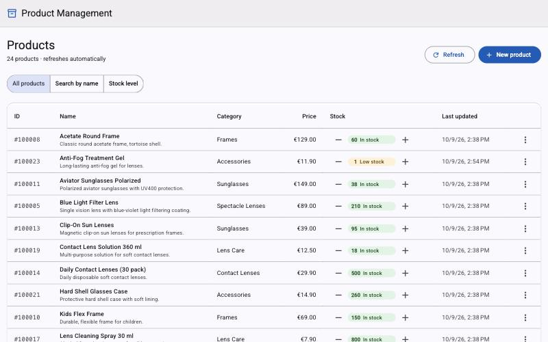

# Product Management

A product and stock management system:

* **Backend:** .NET 10 / ASP.NET Core Web API, Entity Framework Core and PostgreSQL, with a Redis read cache, JWT
  authentication (tokens issued by the API to registered consumers), role-based authorization and rate limiting.
* **Frontend:** Angular 22 with Tailwind CSS, served behind an nginx gateway that also caches API reads.
* **Deployment:** everything on Kubernetes, one Kustomize folder per environment (local, staging, production): the
  application (gateway, web app, API autoscaled 2–8 replicas) in the namespace `product-management`, and the shared
  infrastructure that any service on the cluster can use (PostgreSQL, Redis and the logs: Loki, Grafana and Alloy,
  optional) in the namespace `infra`. GitOps: what runs in an environment is what `deploy/` holds, and only its
  workflow applies it. Releases are pulled: the Backend and Frontend workflows only publish SemVer versions (a tag
  `backend/v1.4.0` publishes `api:1.4.0`), and `deploy/` chooses which version each environment runs.
* **At scale:** k6 load tests run inside the cluster, including ten teams on 850,000 products; the stock ledger
  measured at 20 million rows.
* **Stock ledger and idempotency:** every stock change is recorded with who made it; retried requests
  (`Idempotency-Key`) are applied exactly once, whichever replica they reach.
* **Observability:** the logs of every component, the browser's errors included, in one Loki, with Grafana
  dashboards and alerts.



> **".NET Core":** since .NET 5 Microsoft dropped "Core" from the runtime's name. **.NET 10 is the current release
> of .NET Core** (cross-platform, not the Windows-only .NET Framework) and the current LTS. The web and data layers
> keep the name: **ASP.NET Core** and **Entity Framework Core**.

## Layout

This folder is one repository, [github.com/RubenCipriano/zeiss-product-management](https://github.com/RubenCipriano/zeiss-product-management)
(`git clone https://github.com/RubenCipriano/zeiss-product-management.git`); its CI/CD is GitHub Actions, in
`.github/workflows/`:

| Folder | What it holds | Workflows |
| --- | --- | --- |
| `backend/` | the API, its tests and Dockerfile ([README](backend/README.md)) | [Backend](.github/workflows/backend.yml): test, build, scan; a tag `backend/vX.Y.Z` publishes `api:X.Y.Z` and a GitHub Release |
| `frontend/` | the web app, the gateway, the Playwright tests and Dockerfiles ([README](frontend/README.md)) | [Frontend](.github/workflows/frontend.yml): the same for `web` and `gateway`, tag `frontend/vX.Y.Z` |
| `deploy/` | the manifests of every environment, the shared infrastructure and the deploy scripts ([README](deploy/README.md)) | [Deploy](.github/workflows/deploy.yml) (validate, apply), [Update staging](.github/workflows/update-staging.yml), [Propose production](.github/workflows/propose-production.yml) |
| `docs/`, `tools/` | the documentation; the load tests (`tools/load-tests/`) and the requirements check (`tools/check-requirements.py`) | none ([CodeQL](.github/workflows/codeql.yml) analyses the whole repository) |

## Quick start

With Docker Desktop's Kubernetes enabled (Settings → Kubernetes), from this folder:

```bash
kubectl config use-context docker-desktop
deploy/scripts/infra.sh up        # namespace infra: PostgreSQL, Redis, Loki + Grafana + Alloy (+ metrics-server)
deploy/scripts/deploy.sh local    # database and keys (first run), api + web + gateway images, rollout (the API migrates)
open http://localhost:8080        # (macOS) sign in as viewer/viewer, clerk/clerk or manager/manager
```

Or the same from a menu: `deploy/menu.sh` (numbered items, a status line, each command shown before it runs). Here
`deploy.sh local` builds the images from `backend/` and `frontend/`, the checkouts next to `deploy/` (`../backend`,
`../frontend` as seen from it); with `--version` (a server, a demo) it runs the published images
instead: [deploy/README.md → Where the images come from](deploy/README.md#where-the-images-come-from-backend-frontend-or-the-registry).

On Windows (Docker Desktop with WSL 2) and on an Ubuntu server (k3s, set up by `deploy/scripts/setup-ubuntu.sh`):
[deploy/README.md → Where it runs](deploy/README.md#where-it-runs).

To start over from nothing (deletes every row and log line), see [deploy/README.md → Start over](deploy/README.md#start-over);
the first deployment of staging or production follows the same section.

## Documentation

The full documentation starts at **[docs/README.md](docs/README.md)**: a guide in thirteen short chapters (a 20-minute
path and a full path), the decision records, the flows and the load-test results. Each folder's README covers
running, releasing or deploying it on its own: [backend](backend/README.md), [frontend](frontend/README.md),
[deploy](deploy/README.md).

## Contents

- [Run it](#run-it) and [without Kubernetes](#run-without-kubernetes)
- [Deploy](#deploy)
- [What runs where](#what-runs-where)
- [Observability](#observability)
- [Develop](#develop)
- [Tests](#tests)
- [Requirements checklist](#requirements-checklist)
- [Architecture](#architecture) (diagrams and what each component does: [docs/architecture.md](docs/architecture.md))
- [API reference](#api-reference)
- [Security](#security)
- [Performance and scaling](#performance-and-scaling)
- [Key decisions](#key-decisions)
- [Assumptions](#assumptions)
- [Trade-offs and deviations from common practice](#trade-offs-and-deviations-from-common-practice)
- [Production readiness and next steps](#production-readiness-and-next-steps)
- [Repository layout](#repository-layout)
- [Tech stack](#tech-stack)

---

## Run it

The [Quick start](#quick-start) above is the whole local deployment. The details (prerequisites, what
`deploy/scripts/deploy.sh local` does step by step, `LOGS=off`, Swagger and Grafana through `kubectl port-forward`,
checking for drift with `kubectl diff -k deploy/environments/local`) are in [deploy/README.md](deploy/README.md#local-quick-start).

### Run without Kubernetes

The API with `dotnet run` and the Angular dev server with `npm start`, for working on the code:
[backend/README.md](backend/README.md#with-dotnet-run) and [frontend/README.md](frontend/README.md#run-locally).

---

## Deploy

Every environment is a folder of `deploy/` (`deploy/environments/local`, `staging`, `production`) and is applied by
`deploy/scripts/deploy.sh <environment> [infra|apps|all]`: locally by hand, in staging and production by the Deploy
workflow (GitHub Actions; production after a required reviewer approves). The database schema needs no step of its
own: each new API pod applies its version's EF Core migrations when it starts (as the schema owner, one pod at a
time), before it serves. A release is a version tag (`backend/v1.4.0` or `frontend/v1.4.0`): its workflow publishes
the images `X.Y.Z` to ghcr.io; `deploy/` pulls them in (after every release the workflow Update staging commits the
newest versions to `deploy/environments/staging`; production changes through a pull request made with
`deploy/scripts/set-version.sh` or the workflow Propose production).
A rollback is the same command with an older version. The shared infrastructure, databases and passwords, nodes,
the environments' secrets and Argo CD: [deploy/README.md](deploy/README.md). Each application's workflow and how to
release a version: [backend/README.md](backend/README.md#ci), [frontend/README.md](frontend/README.md#ci). The full
setup from an empty GitHub repository: [chapter 12](docs/guide/12-from-zero.md).

---

## What runs where


Everything runs in the cluster, in two namespaces: `product-management` (this application) and `infra` (the shared
infrastructure any service on the cluster can use). Only the gateway is reachable from outside.

| Where | What | Part | Defined in |
| --- | --- | --- | --- |
| Namespace `product-management` | **gateway** (nginx, 2–6 pods, HPA): the only way in; per-IP rate limit, token check, 1 s microcache per role, routing | frontend | `deploy/apps/frontend/`; Service `gateway`, `LoadBalancer` on localhost:8080 locally (staging/production: an Ingress with TLS) |
| | **web** (nginx, 2 pods): the Angular files | frontend | `deploy/apps/frontend/` |
| | **api** (ASP.NET Core, 2–8 pods, HPA): its only Service, `api`, is headless, so the gateway balances per request and new pods get traffic at once. Each new pod first applies the database migrations as `pm_migrator` (a PostgreSQL advisory lock lets one pod at a time do it), then serves as `pm_app`. Its configuration is plain environment variables in the Deployment; the connection strings name `postgres.infra.svc.cluster.local:5432` and `redis.infra.svc.cluster.local:6379` | backend | `deploy/apps/backend/`; the connection strings in `deploy/environments/<environment>/api.yaml` (the same addresses in every environment) |
| | **Secrets**: `api-secrets` (the token signing key, the registered consumers), `database-credentials` (the database users and passwords; the API reads `pm_app`'s for its requests and `pm_migrator`'s for its migrations), `redis-credentials` (a copy of the Redis password) | deploy | `api-secrets`: `deploy/scripts/lib/local-secrets.sh` locally, `deploy/scripts/deploy.sh` from the GitHub environment's secrets elsewhere; `database-credentials`: `deploy/scripts/lib/create-database.sh`; `redis-credentials`: `deploy/scripts/deploy.sh` |
| Namespace `infra` | **postgres** (StatefulSet, 1 pod): PostgreSQL 18, one database per service, data on the volume `data-postgres-0` (20 GiB); users `pm_migrator` (owns the schema; the API's migration step at startup) and `pm_app` (the API: rows only, 30 s statement timeout) | deploy | `deploy/infra/postgres.yaml`, `deploy/scripts/lib/create-database.sh` |
| | **postgres-backup** (CronJob): every night at 02:30 a `pg_dump` of every database into the volume `postgres-backups`, kept 7 days | deploy | `deploy/infra/postgres.yaml` |
| | **redis** (Deployment, 1 pod): Redis 8 for cache, idempotency keys, rate limits, failed sign-ins; memory only, password | deploy | `deploy/infra/redis.yaml` |
| | **loki** (StatefulSet; stores the logs, 14 days, volume `data-loki-0`) and **grafana** (Deployment; two dashboards, 12 alert rules, all provisioned from ConfigMaps). Optional | deploy | `deploy/infra/logs.yaml`, `deploy/infra/dashboards/` |
| | **alloy** (Deployment): reads the log of every pod in every namespace and pushes it to Loki; also receives the browser's error reports (Service `alloy-faro`, `faro.receiver`, reachable only from the gateway pods). Optional | deploy | `deploy/infra/logs.yaml` |
| `kube-system` | **metrics-server**: CPU per pod for the autoscalers | deploy | installed by `deploy/scripts/infra.sh up` when missing (k3s ships it) |

Every object, Secret and policy: [docs/architecture.md](docs/architecture.md). Every flow (sign-in, token check at the
gateway, the cache layers, stock changes with idempotency, rate limiting, deployment, CI/CD, logs, autoscaling, load
tests) as a diagram: [docs/flows.md](docs/flows.md). How the environments, the folders and the workflows work:
[ADR 0021](docs/adr/0021-deployment-layout.md) and [deploy/README.md](deploy/README.md).

The API scales on its own (HorizontalPodAutoscaler, 2–8 replicas at 60 % CPU; the gateway 2–6 at 70 %). Change its
range without touching the frontend:

```bash
kubectl -n product-management patch hpa api -p '{"spec":{"minReplicas":4}}'
kubectl -n product-management get hpa api -w
```

Large dataset for scale testing: `tools/load-tests/seed-bulk.sh` (850,000 products, 5 million stock movements, ~3–6
minutes; `PRODUCTS=0 LEDGER_ROWS=20000000 tools/load-tests/seed-bulk.sh` grows the ledger to 20 million rows, ~20
minutes), checked by `tools/load-tests/verify-data.sh`.

---

## Observability

Logs only, in one place: **Loki** in the namespace `infra`, kept for **14 days** (on its volume `data-loki-0`).
What goes there:

| Source | How it gets to Loki | Query |
| --- | --- | --- |
| **Browser** (the Angular app): errors only | Grafana Faro SDK in the page → gateway `POST /collect` (same origin) → Alloy's `faro.receiver` | `{namespace="browser"}` |
| **Gateway and web** (nginx) and the **API** | they write JSON to stdout; Alloy reads every pod's log | `{namespace="product-management", app="gateway"}` (or `"web"`, `"api"`) |
| **Shared infrastructure**: PostgreSQL, Redis, Loki, Grafana, the nightly backup | the same Alloy: they are pods too | `{namespace="infra", app="postgres"}` (or `"redis"`, `"loki"`, `"grafana"`, `"postgres-backup"`) |

**Grafana** (`kubectl -n infra port-forward svc/grafana 3000:3000` → http://localhost:3000) has two dashboards:
**Product Management** (traffic, errors, latency and microcache from the gateway's access log, the API's warnings and
errors, PostgreSQL's slow statements and lock waits, Redis) and **Logs — where everything goes** (the raw lines of the
frontend, backend and shared infrastructure side by side), plus **12 LogQL alert rules**, each with a runbook. The
gateway gives every request a W3C trace id and logs it; the API's JSON log lines carry the same id, so one id finds
every line of a request. Browser reports carry the error, the route without its query string, the release, the
browser and the user id; never the token, form values or a session id.

Why logs only, what each browser report contains, the runbooks and what would come next (traces and metrics):
[chapter 8](docs/guide/08-observability.md).

**The logs are optional.** Loki, Grafana and Alloy are the infra's `logs` component: without it
(`deploy/scripts/infra.sh up postgres redis`, and the application deployed with `LOGS=off deploy/scripts/deploy.sh
local`) the application works the same, the pods log to stdout (`kubectl logs`), and the gateway answers the
browser's error reports with 204 and drops them. To use another Loki (e.g. Grafana Cloud), start the logs with
`LOKI_URL`: [deploy/README.md](deploy/README.md#infrash-the-shared-infrastructure).

---

## Develop

| Tool      | Version |
| --------- | ------- |
| .NET SDK  | 10.0.401+ (pinned in `backend/global.json`) |
| Node.js   | 24 LTS (`frontend/.nvmrc`; 22.22+ also supported) |
| Docker    | the images, Docker Desktop's Kubernetes, and the integration tests (Testcontainers) |
| kubectl   | for deployment (Kustomize is built in) and to reach the shared PostgreSQL and Redis |

**Backend:** open `backend/ProductManagement.sln` in **Visual Studio 2026** (the release that supports .NET 10) or
JetBrains Rider. Projects sit directly under `backend/`, grouped by the `Source` and `Tests` solution folders.
`ProductManagement.Api.http` has a request for every endpoint. Run the API from the IDE (profile `http`, port 5080)
as described in [backend/README.md](backend/README.md#with-dotnet-run).

**Frontend:**

```bash
cd frontend && npm ci && npm start    # http://localhost:4200; /api proxied to :5080
```

| Script                 | Purpose |
| ---------------------- | ------- |
| `npm start`            | dev server with live reload |
| `npm test` / `test:ci` | Vitest (watch / single run) |
| `npm run lint`         | ESLint (angular-eslint) |
| `npm run format:check` | Prettier |
| `npm run build`        | production build |

---

## Tests

```bash
cd backend && dotnet test --solution ProductManagement.sln     # 390 tests (Docker must be running)
cd frontend && npm run test:ci                                   # 187 tests
cd frontend && npm run e2e                                       # 22 Playwright tests against the running system
python3 tools/check-requirements.py                              # the assessment PDF, checked against the running system
tools/load-tests/run.sh smoke                                    # against the running cluster
deploy/scripts/ci/validate.sh                                    # every environment's manifests and the infra
```

| Suite                                 | Tests | What it proves |
| ------------------------------------- | ----: | -------------- |
| `UnitTests`, folder `Core/`           | 116 | **Domain:** invariants (six-digit ids, price precision, stock range); a failed update leaves no partial changes; the stock rule at its edges, including deltas that would overflow naive arithmetic. **Use cases:** validation first, no id consumed by invalid requests, version checks, conflicts mapped to 409/412, stock errors carry the available quantity, an exhausted id sequence becomes `product.ids_exhausted`; validators at their boundaries. |
| `UnitTests`, folder `Infrastructure/` | 38 | Registration (refuses to start without Redis outside development, in-memory fallbacks in development, invalid options rejected), cache invalidation only after a successful commit, single-flight, the caching decorator, a cancelled or abandoned Redis command treated like a Redis outage, the migrations' connection (the migrator's user and password, unpooled, a long command timeout). |
| `UnitTests`, folder `Api/`            | 65 | Token service (blocked callers refused before checking credentials), PBKDF2 secret hashing, authentication options validation, idempotency key rules and request fingerprints, the shared token-bucket rate limiter, `If-Match` and `If-None-Match` parsing. |
| `Api.IntegrationTests`                | 155 | Real HTTP against **real PostgreSQL and Redis** (Testcontainers). Every endpoint and the problem-details contract. **Concurrency:** 60 parallel orders on 25 units → exactly 25 succeed; no lost updates; two API instances never produce a duplicate id. **Ledger:** every kind of change recorded, ledger sum = stock under concurrency. **Idempotency:** 20 simultaneous copies over two replicas run once; a retry on the other replica is replayed; a retry after Redis lost the claim is still not applied twice (database guard), for stock changes and creates; reused or invalid keys refused, also when Redis has forgotten the key (`422` from the ledger); no Redis → refused rather than risk a duplicate. **Ids:** an exhausted sequence answers `503 product.ids_exhausted`. **Conditional GET:** `If-None-Match` with the current `ETag` → `304`. **Readiness:** stays ready while the request pool is saturated. **Cache:** hits, invalidation visible across replicas, lists kept across stock changes yet showing current stock, 404s not cached, works with Redis down. **Security:** token endpoint (valid, invalid, missing, throttled, failed attempts adding up across two replicas); 30-case role × operation matrix; missing, expired, foreign and forged tokens, `alg: none`, HS256 signed with the public key; the published JWKS has no private part and matches the tokens' `kid`; anonymous probes. **Rate limiting:** per user, shared by two replicas, stricter for writes, `Retry-After`. **Migrations at startup:** two API instances starting at once on an empty database both start and migrate it once; the schema is owned by `pm_migrator` and the API stays connected as `pm_app` only. |
| `Api.AcceptanceTests` (BDD, Reqnroll) | 16 | Gherkin scenarios from the user's point of view (`Features/*.feature`): create, browse with stock, search, low stock, update, delete, conflicting edits, invalid details naming each problem, stock in and out, no overselling, unknown products → not found. |
| Frontend (Vitest)                     | 187 | API client contract (URLs, `If-Match`, `Idempotency-Key`, cache bypass after own changes), **browser cache** (fresh hit without a request, stale-while-revalidate, bypass, cleared after writes, LRU eviction), store (next-page prefetch, page change vs background refresh), pipes, progress bar, stock history dialog, a retried stock change reuses its key, login opened without `returnUrl`, error normalisation, store (no duplicate requests, no flicker, background refresh paused in hidden tabs), auth (login against the token endpoint, session restore and expiry, role → permission mapping, guard, interceptor never leaks the token to other origins), login page (safe `returnUrl`, 401/429 messages), dialogs (validation, server field errors, 412 conflict + reload of the latest version past the gateway's microcache), role-specific UI, paginator, toasts, the product table's caption for screen readers, **browser error reporting** (errors only, queued until the SDK loads, no query string or token sent, never throws, off in dev mode), idempotency keys also over plain HTTP on a server's address. 35 spec files. |
| End-to-end (Playwright)               | 22 | 11 scenarios on a desktop and a phone viewport against the running system: sign-in per role, the manager's full journey, paging served by the browser cache, security headers, `401` at the gateway, missing files are `404`, a real error thrown in the page read back from Loki (skipped when no Loki is reachable, e.g. with `LOGS=off`); any CSP violation or uncaught error fails the test. |
| Load (k6, in cluster)                 | 8 scenarios | smoke, load (SLO thresholds), stress, spike, **stock consistency across replicas**, rate limiting, **teams** (many teams on 850,000 products, 30 % duplicate retries, then ledger = applied changes; `PEAK=` turns it into a capacity staircase), **browse** (read capacity with a hot set). See the [results](docs/load-test-results.md). |

The GitHub Actions workflows (`.github/workflows/`, GitHub-hosted `ubuntu-24.04` runners):

* **Backend** (`backend.yml`, on changes to `backend/` and on tags `backend/v*`): test (build with warnings as errors,
  `dotnet format --verify-no-changes`, unit, integration and acceptance tests, Testcontainers on the runner's Docker)
  → build (API image `api:<short sha>` for amd64 and arm64; the migration SQL as an artifact) → scan (Trivy, to
  Security → Code scanning); on a version tag `backend/vX.Y.Z` also → publish (the tag `X.Y.Z` on the same image) →
  release (a GitHub Release with the image digest and the commits since the previous version). It touches no
  environment;
* **Frontend** (`frontend.yml`, on changes to `frontend/` and on tags `frontend/v*`): test (ESLint and Prettier, unit,
  build) → build (web and gateway images) → scan, and on a version tag publish (`web:X.Y.Z`, `gateway:X.Y.Z`) →
  release, the same way;
* **Deploy** (`deploy.yml`, on changes to `deploy/`): validate on every change (`validate-manifests`: every
  environment, the infra and the prepared Argo CD objects with `deploy/scripts/ci/validate.sh`, kubeconform and the
  project's rules, no Secret where there must be none; `validate-scripts`: shellcheck; `validate-alloy`:
  `alloy validate` and `alloy fmt`) → `deploy-staging` (apply, then the smoke check; the new API pods migrate the
  database as they start) when main changes staging, `apps/`, `infra/` or the deploy scripts → `deploy-production`
  after a production pull request is merged and a required reviewer approves; `infra-staging` / `infra-production`
  and redeploys are started by hand (Run workflow);
* **Update staging** (`update-staging.yml`, after every successful release run of Backend or Frontend): the newest
  published versions, committed to main, then deployed and smoke-checked in the same job;
* **Propose production** (`propose-production.yml`, by hand): a pull request with staging's versions;
* **CodeQL** (`codeql.yml`): static analysis of the C#, the TypeScript and the workflows; secrets are covered by
  GitHub's secret scanning and push protection.

The requirements check, the Playwright tests and the load tests need a running system and are not workflow jobs: run
them by hand against an environment (`BASE_URL=<environment URL> E2E_<ROLE>_SECRET=... npm run e2e`,
`BASE_URL=... CHECK_CLIENT_ID=... CHECK_CLIENT_SECRET=... python3 tools/check-requirements.py`). The workflows pass
`actionlint`; the jobs that deploy need clusters, which do not exist yet. The setup is
[chapter 12](docs/guide/12-from-zero.md).

What each kind of test proves, with examples: [docs/guide/10-testing-and-quality.md](docs/guide/10-testing-and-quality.md).

---

## Requirements checklist

Every row below is also **checked against the running system** by `tools/check-requirements.py` (14 checks
through the gateway: the 9 endpoints, add and decrement by any quantity, partial search, stock range, 40 concurrent
creates over the replicas → 40 unique 6-digit ids, validation, stock in every list).

| Requirement (assessment PDF)                                | Where / how |
| ----------------------------------------------------------- | ----------- |
| CRUD endpoints                                              | `ProductsController`: `GET/POST /api/products`, `GET/PUT/DELETE /api/products/{id}` |
| `POST /api/products/{id}/decrement-stock/{quantity}` → OK    | One atomic conditional UPDATE; 200 + updated product ([ADR 0003](docs/adr/0003-atomic-stock-updates.md)) |
| `POST /api/products/{id}/add-to-stock/{quantity}` → OK       | Same mechanism, upper bound enforced. Any quantity: in the UI the + / − buttons move 1, 5, 10, 25 or 100 units per click, and *Adjust stock* takes any amount |
| `GET /api/products/search?name=` (partial match)            | Case-insensitive `ILIKE`, wildcards escaped, trigram index |
| `GET /api/products/stock-level?min=&max=`                   | Inclusive range, either bound optional |
| Unique 6-digit id, no duplicates across instances           | PostgreSQL sequence `100000–999999 NO CYCLE` ([ADR 0002](docs/adr/0002-product-id-generation.md)); tested with two API hosts, with 40 concurrent creates over the replicas (`check-requirements.py`) and on 850,000 products (`verify-data.sh`) |
| Validation of create/update                                 | FluentValidation + domain guards + database check constraints ([ADR 0005](docs/adr/0005-error-handling.md)) |
| Stock included in every list response                       | `stockQuantity` on every `ProductResponse` |
| EF Core code-first migrations                               | `backend/ProductManagement.Infrastructure/Persistence/Migrations` (generated by `dotnet ef`), applied by the API itself when it starts, before it serves, as the schema owner `pm_migrator`, one replica at a time (a PostgreSQL advisory lock), in every environment |
| Database seeding                                            | Categories via `HasData`; sample products via `UseSeeding`/`UseAsyncSeeding` |
| Angular frontend; reflects changes made through the API     | `frontend/`: every endpoint used; refetch after changes + background refresh ([ADR 0007](docs/adr/0007-frontend-state.md)) |
| Unit tests for various scenarios                            | 219 backend unit tests + 187 frontend tests (plus 155 integration tests, 16 BDD scenarios and 22 end-to-end tests) |
| *Optional:* BDD tests                                       | `ProductManagement.Api.AcceptanceTests` (Reqnroll / Gherkin) |
| Documentation for running locally                           | [Quick start](#quick-start), [deploy/README.md](deploy/README.md), [backend/README.md](backend/README.md), [frontend/README.md](frontend/README.md) |

---

## Architecture

### Backend (clean architecture)

```
ProductManagement.Api ──────────────────────────────► ProductManagement.Core
        │                                                     ▲
        └──► ProductManagement.Infrastructure ────────────────┘
                     └──► EF Core / PostgreSQL, Redis
```

| Project          | Responsibility |
| ---------------- | -------------- |
| `Core`           | The domain and the use cases, organised by feature (`Products/`, `Categories/`, `Common/`). **Domain:** `Product`, `Category`, invariants, `ProductRules` (single source of limits), the stock rule (`StockAdjustment`: the change, its ledger entry and the range the current stock must be in), `StockMovement`. **Use cases:** `ProductQueryService`, `ProductCommandService`, `StockCommandService`, contracts, FluentValidation, `Result`/`Error`, ports (`IProductRepository`, `IProductQueries`, `IProductIdGenerator`, `IUnitOfWork`). No EF Core, no ASP.NET Core: the compiler keeps it that way, because the project does not reference them. |
| `Infrastructure` | `DbContext`, configurations, migrations and the migrator that applies them at startup (as the schema owner, under an advisory lock), repositories and queries (stock changes as one SQL statement), sequence-based id generator, **Redis cache decorator**, seeding, health checks. |
| `Api`            | Thin controllers, HTTP mapping (status codes, ETag/If-Match, problem details), **token endpoint, JWT verification, authorization policies, rate limiting**, OpenAPI, health endpoints, the `hash-secret` and `generate-signing-key` commands. |

A request end to end (`PUT /api/products/{id}`):

1. **Gateway:** checks the per-IP limit and picks the least busy API replica (reads may be answered from its
   1 s microcache).
2. **API pipeline:** validates the JWT, applies the per-user limit (stricter for writes) and checks the
   `products:write` permission.
3. **Controller:** parses `If-Match` and calls the use case. It has no other logic.
4. **Use case:** validates the request, loads the aggregate, compares versions (412 if stale), checks the category
   and calls `product.Update(...)`. The **domain** enforces the invariants.
5. **Unit of work:** saves. EF Core puts the loaded `xmin` in the `WHERE`, so a concurrent change becomes 412 or
   409. After the commit, the **cache generation** is incremented and every replica stops serving the old data.
6. **Response:** the query side re-reads the product, and the controller returns it with a fresh `ETag`.

**EF Core:**
* reads are no-tracking projections;
* writes load tracked aggregates only for load-modify-save;
* a stock change is one raw SQL statement in `ProductRepository`: a data-modifying CTE with the conditional
  `UPDATE` and the ledger `INSERT`, so they succeed or fail together;
* everything is async and honours cancellation, with `DbContext` pooling;
* the database repeats the domain constraints;
* the API applies its migrations when it starts, before it serves: as `pm_migrator` on short-lived connections of its
  own, one replica at a time (a PostgreSQL advisory lock); its requests use `pm_app`, which cannot change the schema.

### Frontend

```
src/app/
  core/       auth (session, guard, interceptor), http (ApiError + interceptor), config, notifications,
              observability (browser errors to Loki: ReportingErrorHandler + Grafana Faro, loaded lazily)
  shared/     forms (validators, messages), models, pipes, util, ui (dialog, confirm dialog, icon, paginator,
              progress bar, toasts)
  features/auth/login/  sign-in page
  features/products/
    data-access/  ProductsApi, CategoriesApi, ProductsStore (signals + rxResource), models
    feature/      products page, ProductActions, form, stock-adjust and stock-history dialogs
    ui/           presentational components: inventory summary, filters, product table, stock status, pipes
```

`data-access` talks to the API, `feature` wires pages and user actions, `ui` only takes inputs and emits outputs
(no services).

The frontend uses Angular 22 (standalone, zoneless, OnPush by default, signals), Tailwind CSS v4 for the look and
Angular CDK for accessible dialogs and menus ([ADR 0013](docs/adr/0013-ui-tailwind-cdk.md)).

---

## API reference

Base path `/api`. Every endpoint except the token endpoint requires a bearer token (see [Security](#security)). The
full schema is in Swagger (`kubectl -n product-management port-forward deployment/api 5080:8080` →
http://localhost:5080/swagger, *Authorize* with a token). The local demo consumers are `viewer`/`viewer` (role
`viewer`: browse and search), `clerk`/`clerk` (`stock-clerk`: + add and remove stock) and `manager`/`manager`
(`manager`: + create, edit and delete products); their secret hashes and the signing key are generated on each machine
by `deploy/scripts/lib/local-secrets.sh`, never committed.

```bash
# Get a token and call the API from a terminal
TOKEN=$(curl -s -X POST localhost:8080/api/auth/token -H 'Content-Type: application/json' \
  -d '{"clientId":"manager","clientSecret":"manager"}' | jq -r .accessToken)
curl -H "Authorization: Bearer $TOKEN" localhost:8080/api/products
```

| Method | Path                                              | Permission       | Success                        | Errors             |
| ------ | ------------------------------------------------- | ---------------- | ------------------------------ | ------------------ |
| POST   | `/auth/token` `{ clientId, clientSecret }`        | anonymous        | 200 `{ accessToken, tokenType, expiresIn }` | 400, 401, 429 |
| GET    | `/.well-known/jwks.json` (outside `/api`; the gateway reads it in-cluster) | anonymous | 200 JWKS: the public key that verifies tokens | – |
| GET    | `/products?page=&pageSize=`                       | `products:read`  | 200 `PagedResponse<Product>`   | 400                |
| GET    | `/products/{id}` (optional `If-None-Match`)       | `products:read`  | 200 `Product` + `ETag`, or 304 if unchanged | 404   |
| GET    | `/products/search?name=&page=&pageSize=`          | `products:read`  | 200 `PagedResponse<Product>`   | 400                |
| GET    | `/products/stock-level?min=&max=&page=&pageSize=` | `products:read`  | 200 `PagedResponse<Product>`   | 400                |
| POST   | `/products`                                       | `products:write` | 201 `Product` + `Location` + `ETag` | 400, 503      |
| PUT    | `/products/{id}` (optional `If-Match`)            | `products:write` | 200 `Product` + `ETag`         | 400, 404, 409, 412 |
| DELETE | `/products/{id}` (optional `If-Match`)            | `products:write` | 204                            | 404, 409, 412      |
| POST   | `/products/{id}/decrement-stock/{quantity}`       | `stock:write`    | 200 `Product` + `ETag`         | 400, 404, 409      |
| POST   | `/products/{id}/add-to-stock/{quantity}`          | `stock:write`    | 200 `Product` + `ETag`         | 400, 404, 409      |
| GET    | `/products/{id}/stock-movements?page=&pageSize=`  | `products:read`  | 200 `PagedResponse<StockMovement>`, newest first | 404 |
| GET    | `/categories`                                     | `products:read`  | 200 `Category[]`               | –                  |

Every endpoint may also answer **401** (no or invalid token), **403** (missing permission) or **429** (rate limited,
with `Retry-After`).


**Product:**

```json
{
  "id": 100004, "name": "Office Lens Desk", "description": "Near-to-intermediate lens optimised for screen work.",
  "price": 189.00, "stockQuantity": 5, "categoryId": 1, "categoryName": "Spectacle Lenses",
  "createdAt": "2026-10-09T13:38:11.29+00:00", "updatedAt": "2026-10-09T13:55:02.10+00:00", "version": 812
}
```

**Idempotency-Key** (optional, recommended) on `POST /products`, `decrement-stock` and `add-to-stock`: one key per
operation (1–128 chars of `A-Z a-z 0-9 - _ . :`, e.g. a UUID), reused when retrying. The operation runs once,
whichever replica the copies reach. Copies get the original response with `Idempotent-Replayed: true`
([ADR 0017](docs/adr/0017-idempotency-keys.md)).

**Conditional GET:** `GET /products/{id}` with `If-None-Match: <ETag>` answers `304 Not Modified` (no body) while the
product is unchanged. It serves clients that call the API directly; through the gateway, the 1 s microcache answers
repeated reads and does not forward conditional headers.

**StockMovement:** `{ id, quantityChange, stockAfter, reason, performedBy, occurredAt }`, with `reason` one of
`InitialStock`, `StockAdded`, `StockRemoved`, `Correction`. A product's stock always equals the sum of its movements
([ADR 0016](docs/adr/0016-stock-ledger.md)).

**Create / update body:** `name` (required, ≤ 200), `description` (≤ 2000), `price` (0.01–1,000,000, ≤ 2
decimals), `stockQuantity` (0–1,000,000), `categoryId` (must exist). `PUT` replaces all fields.

**Paging:** `page` ≥ 1, `pageSize` 1–100 (default 20). Responses have the shape
`{ items, page, pageSize, totalCount, totalPages }`.

**Errors:** always `application/problem+json` with a stable `errorCode`.

| `errorCode`                       | Status | Meaning |
| --------------------------------- | ------ | ------- |
| `validation_failed`               | 400    | see `errors` (field → messages; keys in camelCase as in the request, e.g. `min`, `clientId`) |
| `product.not_found`               | 404    | |
| `product.insufficient_stock`      | 409    | includes `requested` and `available` |
| `product.stock_limit_exceeded`    | 409    | stock would exceed 1,000,000 |
| `product.concurrent_modification` | 409    | changed between read and write (no `If-Match` sent) |
| `product.version_mismatch`        | 412    | `If-Match` no longer matches: reload and retry |
| `product.ids_exhausted`           | 503    | all 900,000 six-digit ids are used: no product can be created until the id range is widened. A 503, not a 409: nothing in the request can fix it, it must alert as a server-side failure, and a retry with the same `Idempotency-Key` stays allowed |
| `invalid_client`                  | 401    | wrong client id or secret (deliberately not saying which) |
| `rate_limited`                    | 429    | see `Retry-After` |
| `too_many_failed_attempts`        | 429    | too many failed sign-ins from this IP; see `Retry-After` |
| `idempotency_key_invalid`         | 400    | the `Idempotency-Key` header is empty, too long or has invalid characters |
| `idempotency_key_in_progress`     | 409    | a copy of this request is still running: retry shortly |
| `idempotency_key_reused`          | 422    | the key was already used for a different request; also detected by the database (the ledger row holding the key) after Redis has forgotten it |
| `idempotency_unavailable`         | 503    | the key store (Redis) is unreachable; the request was not run |
| `http_<status>`                   | any    | framework errors: `http_401`, `http_403`, `http_404` (unknown route), ... |
| `internal_error`                  | 500    | details only in the logs (correlate with `traceId`) |

---

## Security

| Concern        | How |
| -------------- | --- |
| Authentication | The API issues **ES256** JWTs to registered consumers at `POST /api/auth/token` and publishes only its public key (`/.well-known/jwks.json`). **The gateway verifies every token** (signature, `ES256` only, issuer, audience, expiry) and rejects bad ones at the edge; the API verifies again. Consumer secrets are stored only as PBKDF2 hashes; unknown client and wrong secret are indistinguishable ([ADR 0009](docs/adr/0009-authentication-authorization.md), [ADR 0020](docs/adr/0020-edge-token-verification.md)). |
| Authorization  | Permission policies (`products:read`, `stock:write`, `products:write`) mapped from roles (`viewer`, `stock-clerk`, `manager`) in one place. Secure by default: an endpoint without a policy still requires a signed-in user. The UI hides what a role can't do, and the API enforces it. |
| Brute force    | Failed sign-ins are counted per IP in Redis across all replicas: 10 per minute, then `429` even with the right secret. |
| Rate limiting  | The gateway limits per IP; the API per user (stricter for writes), with token buckets **shared by all replicas in Redis**, so the limit does not grow as the autoscaler adds pods. Both answer `429` + `Retry-After` ([ADR 0010](docs/adr/0010-rate-limiting.md)). |
| Network        | NetworkPolicies: the API and the web app accept connections only from the gateway; Alloy's browser-error receiver only from the gateway pods. PostgreSQL and Redis run in the namespace `infra` behind cluster-internal Services, never published outside the cluster, and protected by random passwords that live only in Secrets (production's firewall opens only the k3s ports between the nodes). |
| Database users | Least privilege: [`deploy/scripts/lib/create-database.sh`](deploy/scripts/lib/create-database.sh) creates the users with random passwords, and the API's migration [`GrantAppPermissions`](backend/ProductManagement.Infrastructure/Persistence/Migrations/20261010164241_GrantAppPermissions.cs) grants `pm_app` what it may do. The API connects as `pm_app` (read and write rows, use the id sequence; no `CREATE`, `ALTER` or `DROP`, 30 s statement timeout, 60 s idle-in-transaction timeout); only the migration step uses the schema owner `pm_migrator`. |
| Cache server   | Redis with a password, no persistence, `volatile-lru`, and `FLUSHALL`, `FLUSHDB` and `DEBUG` disabled (the ConfigMap `redis-config` in [`deploy/infra/redis.yaml`](deploy/infra/redis.yaml)). |
| Containers     | Non-root, read-only root filesystem where possible, no capabilities, no privilege escalation, `RuntimeDefault` seccomp, resource limits. |
| Edge           | Strict **Content-Security-Policy** (`'self'` only, no inline scripts, no framing), `Permissions-Policy`, COOP/CORP, `nosniff`, `X-Frame-Options: DENY`, referrer policy, 1 MB body limit, `server_tokens off` ([ADR 0019](docs/adr/0019-content-security-policy.md)). |
| Privacy        | No third-party requests: the font is self-hosted (no user IPs sent to Google), and browser error reports go to the same origin (`/collect`). The browser cache lives in memory only and is cleared on sign-out. Error reports carry the user id but never the token, form values, query strings or a session id. |
| Exactly-once   | Retries with an `Idempotency-Key` are answered from Redis; the ledger's unique `request_key` makes a second execution impossible even if Redis forgets ([ADR 0017](docs/adr/0017-idempotency-keys.md)). |
| Errors         | Problem details never include stack traces or internals; serializer messages are hidden. |

---

## Performance and scaling

* **Redis cache:** cache-aside with generation-based invalidation, shared by all replicas, fails open
  ([ADR 0008](docs/adr/0008-redis-cache.md)).
* **nginx gateway:** per-request balancing over the API's headless Service (new replicas are picked up within 5 s),
  edge cache for the bundles, **1 s microcache for API reads** (keyed per role from a token the gateway verified, bypassed after the user's own
  changes; 38 % of product GETs served by nginx in the load test), gzip, keep-alive pools
  ([ADR 0012](docs/adr/0012-gateway.md)).
* **Two cache layers, two jobs:** nginx absorbs identical requests within a second; Redis is shared, invalidated
  on every write and keeps entries for minutes.
* **Lists survive stock changes:** the page's ids and count are cached under a generation that only catalogue
  edits move; the rows are read fresh by primary key, so the stock shown is always current
  ([ADR 0008](docs/adr/0008-redis-cache.md)).
* **Autoscaling:** HPA 2–8 replicas, with the pool sized so the maximum stays within what PostgreSQL can serve
  ([ADR 0018](docs/adr/0018-autoscaling-and-scale-testing.md)).
* **Browser cache:** pages already seen open instantly (stale-while-revalidate), the next page is prefetched, and
  paging quickly cancels obsolete requests ([ADR 0007](docs/adr/0007-frontend-state.md)).
* **The database at scale** ([ADR 0022](docs/adr/0022-database-at-scale.md)): every index serves a query the API
  runs (the inventory is pinned by `DatabaseAtScaleTests`); with the ledger grown to **20 million rows**, the last
  page of a busy product's history went from 1.3–6.3 s to 8–22 ms in SQL (late row lookup: ids from the index first,
  then only those rows); per-table autovacuum settings keep index-only scans index-only under constant stock
  changes; the server's memory, WAL and checkpoint settings were sized from the measurements.
* **Capacity on one 8-CPU laptop** (everything, load generator included, on the same machine): **18,177 req/s** of
  catalogue reads (p95 47 ms, 96 % answered by the gateway, which verifies tokens itself and shares its microcache per
  role) and **~2,400 req/s** of the worst-case mix (25 % writes, uniform reads over 850,000 products), both with
  **0 errors** ([ADR 0020](docs/adr/0020-edge-token-verification.md)).
* The load tests sign in as the three demo accounts and lift the per-user rate limits for the run (`rate-limit`
  keeps the real ones): they measure capacity with a few accounts, not many distinct users. The runs below used ten
  load-test accounts, since removed.
* **Load test highlights** ([full results](docs/load-test-results.md)):
  * **ten teams on 850,000 products**, 30 % of stock changes sent twice: **281 req/s, 0 errors, p95 13 ms**;
    17,213 changes applied → exactly 17,213 ledger rows (no duplicate among 6,916 copies); the API scaled 3 → 7.
    The first run at this scale failed (123 req/s, 12 % errors); measuring found an unindexed sort, a cache
    invalidated by every stock change and too many connections, and fixing those got here;
  * p95 of **3 ms** at 150 req/s with 2 replicas;
  * **0 errors in 255k requests** up to ~1,000 req/s, on a single-node 4-vCPU cluster;
  * **300 concurrent orders for 100 units across replicas → exactly 100 sold, stock 0**;
  * scaling the API to 4 replicas exposed PostgreSQL as the bottleneck. Sizing the connection pool to the database's
    capacity and giving it 2 CPUs removed every error.

---

## Key decisions

Each decision has an ADR in [`docs/adr`](docs/adr/README.md):

| #    | Decision |
| ---- | -------- |
| [0001](docs/adr/0001-clean-architecture.md) | Clean architecture, CQRS-lite (projections for reads, aggregates for writes) |
| [0002](docs/adr/0002-product-id-generation.md) | Six-digit ids from a bounded PostgreSQL sequence, safe across instances |
| [0003](docs/adr/0003-atomic-stock-updates.md) | Stock changes as one conditional UPDATE: no overselling, no retries |
| [0004](docs/adr/0004-optimistic-concurrency.md) | Optimistic concurrency with `xmin`, ETag and If-Match |
| [0005](docs/adr/0005-error-handling.md) | Result pattern and RFC 9457 problem details with stable error codes |
| [0006](docs/adr/0006-postgresql.md) | PostgreSQL, tested against the real engine |
| [0007](docs/adr/0007-frontend-state.md) | Frontend state with signals and `rxResource` |
| [0008](docs/adr/0008-redis-cache.md) | Redis read cache with generation-based invalidation |
| [0009](docs/adr/0009-authentication-authorization.md) | API-issued JWTs for registered consumers, permission-based RBAC |
| [0010](docs/adr/0010-rate-limiting.md) | Rate limiting in two layers |
| [0011](docs/adr/0011-kubernetes-deployment.md) | Kubernetes deployment, one manifest per project (superseded in part by 0021) |
| [0012](docs/adr/0012-gateway.md) | nginx gateway in front of the application |
| [0013](docs/adr/0013-ui-tailwind-cdk.md) | Tailwind CSS + Angular CDK instead of Angular Material |
| [0014](docs/adr/0014-mcp-server.md) | MCP server for AI assistants (**removed** on 2026-10-10: not required, not deployed) |
| [0015](docs/adr/0015-load-testing.md) | Load testing with k6 inside the cluster |
| [0016](docs/adr/0016-stock-ledger.md) | Stock ledger written in the same statement as the stock change |
| [0017](docs/adr/0017-idempotency-keys.md) | Idempotency keys for create and stock changes |
| [0018](docs/adr/0018-autoscaling-and-scale-testing.md) | Autoscaling and testing at scale |
| [0019](docs/adr/0019-content-security-policy.md) | Strict Content Security Policy, no third-party assets |
| [0020](docs/adr/0020-edge-token-verification.md) | Token verification at the gateway, microcache shared per role |
| [0021](docs/adr/0021-deployment-layout.md) | Deployment layout: a deploy repository applied by its own pipeline (GitOps), one Kustomize folder per environment, revised: pull model with SemVer releases; revised: the API applies its migrations at startup; revised: one GitHub repository (`deploy/` a folder of it), GitHub Actions |
| [0022](docs/adr/0022-database-at-scale.md) | The database at scale: indexes, vacuum, the ledger beyond 20 million rows |

---

## Assumptions

* Single currency (EUR in the UI), two decimals, prices from 0.01 to 1,000,000.
* Stock is a whole number from 0 to 1,000,000. A decrement larger than the available stock is **rejected** (409),
  not clamped, so the shortage is never hidden from the caller.
* "Return an OK response" for the stock endpoints means **200 with the updated product**.
* Search is a case-insensitive "contains" on the name. Stock-level bounds are inclusive and optional.
* All list endpoints are paged (default 20, maximum 100).
* Categories are reference data, seeded by the migration and read-only through the API.
* Deletion is a hard delete. Ids are never reused.
* Three roles cover the business (`viewer`, `stock-clerk`, `manager`). The set of callers is small and known, so
  consumers live in configuration rather than in a user database or an external identity provider.

---

## Trade-offs and deviations from common practice

| Choice | Why |
| ------ | --- |
| Stock changes bypass load-modify-save | Atomicity under concurrency. The rule stays in the domain; the SQL only applies the range it computes ([0003](docs/adr/0003-atomic-stock-updates.md)). |
| Nullable value types in request DTOs | A missing field becomes a validation error instead of a silent `0`. |
| No `EnableRetryOnFailure` | A blind retry inside the API after an ambiguous commit could apply a stock change twice. Retries belong to the client, with an `Idempotency-Key`. |
| `If-Match` optional | Easy to try with Swagger or curl. The UI always sends it, and making it mandatory (428) is one line. |
| Cache invalidated by generations (data, listing, per product) | Race-free across replicas and O(1); a stock change invalidates only that product and the stock-level lists. Finer than this (per key) was not needed by the measurements ([0008](docs/adr/0008-redis-cache.md)). |
| Per-user rate limits in Redis | One Redis round trip per API request, so a user's limit does not grow as the autoscaler adds replicas; falls back to per-replica limits if Redis is down ([0010](docs/adr/0010-rate-limiting.md)). |
| Real PostgreSQL and Redis in tests (Docker required) | In-memory fakes would hide exactly the behaviour under test. |
| The API issues its own tokens (no identity provider) | One API and a handful of known callers: an IdP would add a component without solving a problem here. ES256: only the API can sign; the gateway and other services verify with the public key ([0009](docs/adr/0009-authentication-authorization.md), [0020](docs/adr/0020-edge-token-verification.md)). |
| Stateless JWTs (no revocation list) | No session store; a 1-hour lifetime and key rotation bound the risk. A `jti` deny-list in Redis is the next step if needed. |
| 1 s nginx microcache | Up to 1 s of staleness for repeated reads, in exchange for absorbing bursts; shared only between callers with the same roles (tokens verified at the gateway), bypassed after the user's own changes. |
| Polling instead of push in the UI | Works across replicas with no extra infrastructure, at the cost of up to 15 s of staleness. |

---

## Production readiness and next steps

**In place:**
* health probes, zero-downtime rolling updates, PodDisruptionBudgets, NetworkPolicies;
* hardened non-root containers, immutable image tags;
* authentication, RBAC, rate limiting, caching, optimistic concurrency, database constraints;
* least-privilege database users; migrations applied by the API at startup, as the schema owner, one replica at a
  time (no separate step to forget);
* a nightly `pg_dump` of every database (CronJob `postgres-backup`, 7 days), on the database's node;
* one Kustomize folder per environment in `deploy/`, local, staging and production (Ingress with a cert-manager
  certificate in staging and production); Secrets created by the Deploy workflow from the GitHub environments'
  secrets or, for the database and Redis passwords, generated at random in the cluster; none stored in the repository;
* logs of every component, the browser's errors included, in Grafana (Loki, 14 days' retention), with two
  dashboards, 12 alert rules and their runbooks;
* GitHub Actions workflows per folder, GitOps with a pull release model: the Backend and Frontend workflows only
  publish SemVer versions and GitHub Releases; `deploy/` pulls the newest into staging after every release and
  promotes to production by pull request with a required reviewer, then applies (the new API pods migrate the
  database as they start); rollback is the same command with an older version (written and linted, the deploy jobs not
  yet run against a cluster); CodeQL and Trivy in Security → Code scanning; load tests with SLO thresholds.

**Next** (full assessment: [chapter 11](docs/guide/11-production-readiness.md); runbook: [chapter 12](docs/guide/12-from-zero.md)):

* **Secrets** from a secret manager (External Secrets or Vault) instead of the GitHub environments' secrets, for audit
  and rotation.
* **Backups off the node** and restores rehearsed: the nightly dumps shipped to object storage, or volume snapshots
  (chapter 12); for a standby and point-in-time recovery, a PostgreSQL operator such as CloudNativePG
  ([ADR 0006](docs/adr/0006-postgresql.md)); later PgBouncer and read replicas.
* **TLS inside the cluster** if required (today the API reaches PostgreSQL and Redis over the pod network; a database
  outside the cluster would use `SSL Mode=VerifyFull`).
* **Client IPs** preserved by the load balancer in front of the Ingress controller (`externalTrafficPolicy: Local` /
  PROXY protocol), so per-IP limits apply per caller; a `jti` deny-list (checked at the gateway too) for revocation.
* **Traces and metrics** if logs stop being enough: OpenTelemetry in the API, exporters for PostgreSQL and Redis
  ([chapter 8](docs/guide/08-observability.md#what-we-would-add-next)).
* **Keyset pagination** (`?after=`) for constant-time deep pages; monthly partitions for `stock_movements` past
  50–100 million rows ([ADR 0022](docs/adr/0022-database-at-scale.md)).
* A replicated Redis, so idempotency claims survive a Redis restart.
* **Argo CD** pointed at `deploy/environments/<environment>` instead of `kubectl apply` from the Deploy workflow
  (pruning, drift detection), with Argo CD Image Updater for staging (no migration hook needed: the API migrates
  itself): prepared and validated in `deploy/argocd/`, not installed.

---

## Repository layout

The three application folders, their subfolders and scripts are described in their own READMEs:
[backend/README.md](backend/README.md) (the solution's projects, the image and its commands),
[frontend/README.md](frontend/README.md) (the Angular structure, the gateway, the images) and
[deploy/README.md](deploy/README.md) (`apps/`, `environments/`, `infra/`, `argocd/`, `scripts/`). The workflows are in `.github/workflows/` (and the
composite action `.github/actions/environment-secrets`). The other folders: `docs/` (this documentation) and `tools/` (`load-tests/`: the k6 scenarios, `run.sh`, the bulk seed and the data
checks; `check-requirements.py`: the assessment's requirements, checked against the running system).

## Tech stack

| Area     | Stack |
| -------- | ----- |
| Backend  | .NET 10, ASP.NET Core, EF Core 10, Npgsql, FluentValidation, StackExchange.Redis, JWT bearer, rate limiting, OpenAPI + Swagger UI |
| Data     | PostgreSQL 18, Redis 8 |
| Security | JWT (ES256) issued by the API and verified at the gateway (nginx njs), PBKDF2 secret hashes, ASP.NET Core authorization and rate limiting |
| Frontend | Angular 22 (standalone, zoneless, signals), Tailwind CSS 4, Angular CDK, Vitest, ESLint, Prettier |
| Testing  | xUnit v3 (Microsoft Testing Platform), Shouldly, NSubstitute, Testcontainers, Respawn, Reqnroll, k6 |
| Delivery | Docker (images), Kubernetes for everything (Docker Desktop locally; k3s as the production target), Kustomize, nginx, GitHub Actions, ghcr.io, Trivy, CodeQL |
| Operations | Grafana 12, Loki 3, Grafana Alloy (logs only), Grafana Faro (browser errors) |
