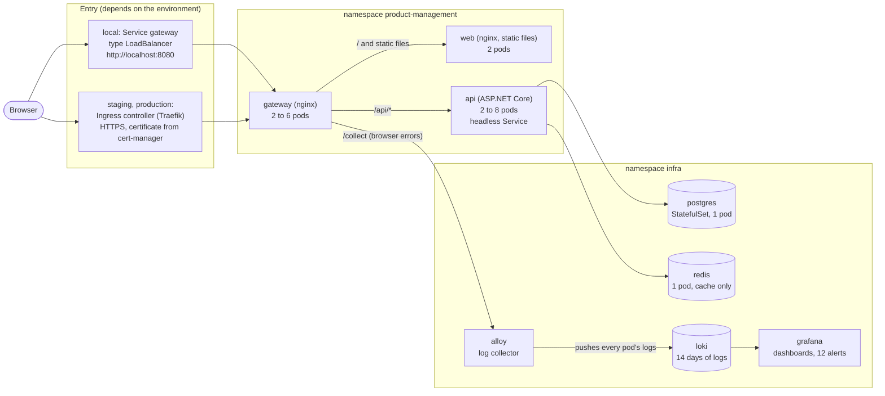

# Deploy

This folder (`deploy/` of the [zeiss-product-management](https://github.com/RubenCipriano/zeiss-product-management)
repository) describes everything that runs on the Kubernetes clusters of the Product Management system, and it is
the only place that changes them. It holds the Kubernetes manifests (YAML files that describe what should run), one
folder per environment with the versions it runs, the shared infrastructure (PostgreSQL, Redis, logs), the scripts
that a person or a workflow runs (with a menu in front of them, `menu.sh`), and the Argo CD objects that can take
over the applying later. The application code lives in the two sibling folders of the same repository: the API in
[backend/](../backend/README.md), the web app and the gateway in [frontend/](../frontend/README.md). Its GitHub Actions
workflow is [`.github/workflows/deploy.yml`](../.github/workflows/deploy.yml) (with
[`update-staging.yml`](../.github/workflows/update-staging.yml) and
[`propose-production.yml`](../.github/workflows/propose-production.yml)); see [CI/CD](#cicd).

The assessment asked for the API and the web app only, not for a deployment: everything in this folder goes beyond
it. It is how the system would run in production.

This README is the complete specification of the deployment: what runs, why it is built this way, how to configure,
deploy, use and operate it, and what every file and script is for. It assumes you know what a web server and a
database are, but not Kubernetes; every Kubernetes term is explained in [Concepts in plain words](#concepts-in-plain-words).

## Contents

- [Start here: the menu](#start-here-the-menu)
- [What this folder is](#what-this-folder-is)
- [The system in one picture](#the-system-in-one-picture)
- [Concepts in plain words](#concepts-in-plain-words)
- [Why Kubernetes and not Docker Compose](#why-kubernetes-and-not-docker-compose)
- [Repository layout](#repository-layout)
- [Scripts](#scripts)
- [Configuration](#configuration)
- [Secrets](#secrets)
- [Environments](#environments)
- [Where the images come from](#where-the-images-come-from-backend-frontend-or-the-registry)
- [Where it runs](#where-it-runs)
- [Deploy](#deploy)
- [Use it](#use-it)
- [Operations](#operations)
- [CI/CD](#cicd)
- [Troubleshooting](#troubleshooting)
- [Status](#status)

## Start here: the menu

`./menu.sh` is the front door for people: a numbered menu of the common tasks, with a status line on top (the
`kubectl` context and its kind, whether the shared infrastructure runs, which api, web and gateway versions run, the
application's URL). Each item asks only what it needs, shows the exact command it is about to run, then runs it, so
the menu also teaches the scripts behind it. Nothing depends on it: every item is a plain script
([Scripts](#scripts)), and `./menu.sh --help` lists them.

```text
Product Management: deploy menu
  Cluster:      default (k3s on this machine)
  Infra:        5 of 5 pods running
  Application:  api 1.0.0, web 1.0.0, gateway 1.0.0 (published)
  URL:          http://10.20.30.40:8080

  1) Prepare this Ubuntu server
  2) Shared infrastructure: up, status, stop
  3) Deploy the application
  4) Published versions
  5) Change an environment's version
  6) Add a node
  7) Status
  8) Smoke check
  9) Start over (deletes all data)
  0) Exit
Choose:
```

| Item | Runs | Asks |
| --- | --- | --- |
| 1 Prepare this Ubuntu server | `scripts/setup-ubuntu.sh` | a confirmation; offered on Ubuntu only |
| 2 Shared infrastructure | `scripts/infra.sh up`, `status` or `down` | which; stopping asks for a confirmation, deleting the data a second one (type the context's name) |
| 3 Deploy the application | `scripts/deploy.sh local --version <X.Y.Z\|latest>`, or `scripts/deploy.sh local --build` | the version (default `latest`) and, when no registry login is set, your GitHub user and a token with `read:packages` (typed hidden); building is offered only when `../backend` and `../frontend` exist. Staging and production: explains that the Deploy workflow deploys them and offers item 5 |
| 4 Published versions | `scripts/versions.sh all` | the registry login, when none is set |
| 5 Change an environment's version | `scripts/set-version.sh <staging\|production> <image> <version\|latest>` | environment, image, version; then says what to commit (production: a pull request) |
| 6 Add a node | `scripts/add-node.sh <user@host> <role> [--server <url>]` | the machine, its role and the server; offers `--dry-run` first |
| 7 Status | `kubectl get pods,pvc,services` in `product-management` and `infra` | nothing; prints the application's URL and the Grafana and Swagger port-forward commands |
| 8 Smoke check | `scripts/ci/smoke.sh <url>` | the URL (default: the detected one) |
| 9 Start over | the [Start over](#start-over) block | the image source; then you type `delete everything`. Only on a cluster of this machine |

A token typed in the menu is read without echo, kept in the menu's own process and given only to the command that
needs it, as `REGISTRY_PASSWORD` in that command's environment (the screen shows `<hidden>`). Variables reach the
scripts as they are (`LOGS=off ./menu.sh`). Ctrl-C stops the running command and returns to the menu; at the menu's
prompt it leaves. The commands behind a first deploy are in [Local quick start](#local-quick-start).

## What this folder is

The system has three parts of its own and three shared services:

* **Application** (namespace `product-management`): the **api** (ASP.NET Core, from backend), the **web** app (static
  Angular files, from frontend) and the **gateway** (nginx, from frontend), the single entry point in front of both.
* **Shared infrastructure** (namespace `infra`), used by any service on the cluster: **PostgreSQL**, **Redis**, and the
  logs: **Loki** (stores them), **Grafana** (shows them, raises alerts) and **Alloy** (collects them).

The rule of this folder is **GitOps**: what is committed is what runs. Each environment is a folder
(`environments/local`, `environments/staging`, `environments/production`) whose `kustomization.yaml` names the
version of each image. Releases follow a **pull model**: the Backend and Frontend workflows only build, test, scan and
*publish* their images; a git tag `backend/v1.4.0` (or `frontend/v1.4.0`) publishes `<image>:1.4.0` in the
repository's container registry (ghcr.io). They never touch `deploy/` or a cluster. `deploy/` *pulls* versions in: the
workflow Update staging moves staging to the newest published versions after every release, and production changes
through a pull request. The Deploy workflow (or, locally, `scripts/deploy.sh`) applies what is committed; the API's new
pods then bring the database schema up to date themselves when they start (EF Core migrations, as the schema owner),
before they serve.

Why this split:

* **One source of truth.** "What runs in production?" is answered by reading
  `environments/production/kustomization.yaml` (`api 1.4.0`, `web 2.1.0`, ...). Its git history is the release history.
* **Apps publish, deploy decides.** Developers change backend and frontend and release versions; only `deploy/`
  changes the clusters and chooses versions. The Backend and Frontend workflows need no rights on any cluster and never
  write to `deploy/`: nothing outside it can change an environment.
* **Versions, not commits.** An environment runs `1.4.0`, a SemVer version that says what changed (major: breaking,
  minor: features, patch: fixes) and has a GitHub Release with its changes; not an anonymous commit hash.
* **Promotion and rollback are the same command.** `scripts/set-version.sh <env> <image> <version>` moves an
  environment up or down. Staging gets every release automatically; production changes through a pull request that a
  person approves.
* **Ready for Argo CD.** The workflows' jobs do exactly what Argo CD (applying) and Argo CD Image Updater (pulling
  versions into staging) would do; `argocd/` holds those objects, validated and ready (see
  [Moving to Argo CD](#moving-to-argo-cd)). No migration step has to move: the API migrates itself.
* **One migration path everywhere.** The API applies its own EF Core migrations at startup, as the schema owner
  (`pm_migrator`, from the Secret `database-credentials`), while its requests use `pm_app`. Local, staging and
  production, `kubectl apply`, Argo CD or a plain `docker run`: the schema always comes from exactly the code that
  starts, and there is no separate job or pod to forget. Replicas starting together take turns on a database lock.
* **Shared infrastructure with plain names.** PostgreSQL, Redis and the logs run once per cluster (`postgres`,
  `redis`, `loki`, `grafana` in `infra`) and serve every service. A new service gets its own database with
  `scripts/lib/create-database.sh` and its logs without doing anything.
* **Configuration you can read.** Every setting is a plain environment variable in the YAML. Only passwords, the
  token signing key and the accounts are Secrets, and none of them is committed.

## The system in one picture

A request from a browser, and where the logs go:



Step by step:

1. The browser opens the application's address. **Locally** that is a Service of type `LoadBalancer` that Docker
   Desktop (or k3s' ServiceLB) publishes on port 8080. **In staging and production** it is an **Ingress**: the
   cluster's HTTP front door (Traefik), which terminates HTTPS and forwards to the gateway.
2. The **gateway** (nginx) decides by path: `/api/*` goes to the API, `/collect` to the log collector, everything else
   to the web app. For `/api/*` it first checks the access token, applies a rate limit per client IP and may answer a
   read from a 1-second cache. Details: the [frontend README](../frontend/README.md).
3. The **web** pods serve the Angular files. The **api** pods answer API calls and use PostgreSQL (data) and Redis
   (cache, rate limits, idempotency keys) in the namespace `infra`.
4. Every pod writes its logs to stdout. **Alloy** reads them through the Kubernetes API and pushes them to **Loki**.
   **Grafana** shows them and evaluates 12 alert rules on them. The browser's own errors take a different road:
   browser → gateway `/collect` → Alloy → Loki.

Every component that runs:

| Name | Namespace | Kind | Replicas | Port | What it does | Defined in |
| --- | --- | --- | --- | --- | --- | --- |
| `gateway` | product-management | Deployment + Service | 2 to 6 (autoscaled) | 8080 | single entry point: routing, token check, rate limits, microcache, security headers | `apps/frontend/gateway.yaml` |
| `web` | product-management | Deployment + Service | 2 | 8080 | serves the built Angular app | `apps/frontend/web.yaml` |
| `api` | product-management | Deployment + headless Service | 2 to 8 (autoscaled) | 8080 | the REST API; each new pod first brings the database schema up to date (migrations) | `apps/backend/` |
| `gateway` | product-management | Ingress (staging, production) | none | 443 | HTTPS host routing to the gateway | `environments/<env>/ingress.yaml` |
| `postgres` | infra | StatefulSet + Service | 1 | 5432 | PostgreSQL 18, one database per service | `infra/postgres.yaml` |
| `postgres-backup` | infra | CronJob | 1 job per night | none | `pg_dump` of every database at 02:30, kept 7 days | `infra/postgres.yaml` |
| `redis` | infra | Deployment + Service | 1 | 6379 | Redis 8, cache only (nothing persisted) | `infra/redis.yaml` |
| `loki` | infra | StatefulSet + Service | 1 | 3100 | stores the logs for 14 days | `infra/logs.yaml` |
| `grafana` | infra | Deployment + Service | 1 | 3000 | dashboards and alert rules | `infra/logs.yaml`, `infra/dashboards/` |
| `alloy` | infra | Deployment + Service `alloy-faro` | 1 | 12345 (its own UI), 12347 (browser errors) | collects every pod's logs and the browser errors | `infra/logs.yaml` |
| `metrics-server` | kube-system | Deployment | 1 | none | CPU and memory per pod, for the autoscalers | k3s ships it; `scripts/infra.sh` installs v0.8.0 elsewhere |

## Concepts in plain words

Each term is explained the way it is used here. Read them in order the first time; later, use them as a glossary.

### Containers and images

**Container.** A process that runs with its own filesystem, network and limits, isolated from the rest of the
machine. Each component above runs as one or more containers.

**Image.** The packaged filesystem a container starts from: the program and everything it needs. The API's image is
built from backend's `Dockerfile`, the web and gateway images from frontend's `Dockerfile` and `gateway/Dockerfile`.
An image has a name and a **tag** (a version label). Every build is tagged with its git commit, the first 8
characters of its SHA (`ghcr.io/rubencipriano/zeiss-product-management/api:1a2b3c4d`); a released version also gets
its **SemVer** tag (`ghcr.io/rubencipriano/zeiss-product-management/api:1.4.0`) on the same image. Environments run
versions. A version tag is never overwritten (the Backend and Frontend workflows' publish jobs refuse to move an
existing `X.Y.Z` to another image), so a version always means exactly one build.

**SemVer (Semantic Versioning).** A version `MAJOR.MINOR.PATCH`: a breaking change raises MAJOR (1.4.0 → 2.0.0), new
backward-compatible functionality MINOR (1.4.0 → 1.5.0), fixes only PATCH (1.4.0 → 1.4.1). `1.5.0-rc.1` is a
pre-release (release candidate) of 1.5.0 and sorts before it. The backend and frontend READMEs say when to raise which.

**Registry.** A server that stores images. Staging and production pull from the repository's GitHub container registry
(`ghcr.io/rubencipriano/zeiss-product-management/...`). Locally, either the images are built on the same machine and
used from there, or a published version is pulled from that registry, like staging
([Where the images come from](#where-the-images-come-from-backend-frontend-or-the-registry)).

### Kubernetes and its parts

**Kubernetes.** A system that runs containers on one or more machines and keeps them running as described. You do not
start containers yourself. You write **manifests** (YAML) that describe the *desired state* ("two API pods with this
image and these settings"), apply them, and Kubernetes works continuously to make reality match: it starts what is
missing, restarts what crashed and replaces what changed.

**Cluster, node, control plane.** A **cluster** is a set of machines (**nodes**) managed together. The **control
plane** is the part that decides: the API server (every command and every component talks to it), the scheduler
(chooses a node for each new pod) and the controllers (compare desired and actual state and act). Here a cluster is
one node (Docker Desktop, or k3s on one Ubuntu server); `scripts/add-node.sh` can add more.

**etcd, and where k3s keeps its state.** The control plane stores every object you apply (the desired state) in a
database. Standard Kubernetes uses **etcd**, a small, consistent key-value store. Docker Desktop runs etcd as a pod
(`etcd-docker-desktop` in the namespace `kube-system`). **k3s on a single server**, as `scripts/setup-ubuntu.sh`
installs it (`server`, without `--cluster-init`), uses an **embedded SQLite** database instead, through **Kine**, a
layer that answers the etcd API on top of SQLite. k3s switches to embedded etcd only when the first server is started
with `--cluster-init`, which is what several control-plane servers (high availability) need. `scripts/add-node.sh`
adds *agents* (worker nodes), not servers, so the state stays in that SQLite file on the first server
(`/var/lib/rancher/k3s/server/db/`). You never edit it: you change it through `kubectl`, and the source of truth for
the application is still this repository.

**kubelet.** The agent on every node. It receives the pods the scheduler assigned to its node, starts their
containers, runs their health checks (probes) and reports back.

**kubectl, kubeconfig, context.** `kubectl` is the command-line client of the API server. It reads a **kubeconfig**
file (`~/.kube/config` by default, or the file in `KUBECONFIG`), which lists clusters and credentials. A **context**
is one named entry (cluster + user) in it: `docker-desktop` for Docker Desktop, `default` for k3s.
`kubectl config use-context <name>` selects one; every script works on the current context.

**Namespace.** A named folder inside a cluster for objects. Names are unique within a namespace, permissions and
network rules can be set per namespace, and a pod can read only the Secrets of its own namespace. Here:
`product-management` (the application), `infra` (shared services), `kube-system` (Kubernetes' own parts).

**Pod.** The smallest thing Kubernetes runs: one or more containers that share a network address and volumes. Pods
are disposable: when one dies or is replaced, a new one with a new address takes its place. You almost never create
pods directly; a Deployment or StatefulSet creates them.

### Workloads

**Deployment, ReplicaSet, rolling update.** A **Deployment** keeps N identical pods running from a pod *template*.
When the template changes (a new image tag, a new setting), it creates a new **ReplicaSet** (the set of pods of one
template version) and moves pods over gradually: a **rolling update**. Here every application Deployment uses
`maxSurge: 1, maxUnavailable: 0`: one new pod starts, becomes ready, then one old pod stops, so capacity never drops
during a deploy. The last 5 ReplicaSets are kept (`revisionHistoryLimit: 5`), which is what
`kubectl rollout undo` returns to. Used by: api, web, gateway, redis, grafana, alloy.

**StatefulSet.** Like a Deployment, but each pod has a stable name (`postgres-0`) and its own volume that follows it.
A replacement pod starts only after the old one is gone, so two database servers never open the same data directory.
Used by: postgres, loki.

**CronJob, Job.** A **Job** runs pods to completion (instead of keeping them running). A **CronJob** creates a Job on a
schedule. Here: `postgres-backup`, every night at 02:30 (`"30 2 * * *"`, in the control plane's time zone, normally
UTC), dumps every database into the volume `postgres-backups` and deletes dumps older than 7 days.

### Networking

**Service.** A stable name and address in front of a changing set of pods (selected by label). Pods find each other by
DNS name: `<service>.<namespace>.svc.cluster.local`, for example `postgres.infra.svc.cluster.local:5432`. Kinds used
here:

| Kind | What it does | Used for |
| --- | --- | --- |
| `ClusterIP` (default) | one virtual IP inside the cluster; connections are spread over the ready pods | web, postgres, redis, loki, grafana, alloy-faro |
| headless (`clusterIP: None`) | no virtual IP: the DNS name returns the IP of every ready pod | `api` |
| `LoadBalancer` | also published outside the cluster, on a load balancer the platform provides | `gateway`, locally only |

**Why the API's Service is headless.** nginx keeps its connections to the API open and reuses them. Behind a normal
Service the balancing happens once per TCP connection, so those long-lived connections would stay on the pods that
existed when they were opened, and pods added by the autoscaler would get no traffic until the connections closed.
With a headless Service, the gateway gets every pod's IP, re-resolves the name every 5 seconds, and picks the pod with
the fewest requests in flight *for each request* (nginx `least_conn`). A new replica gets traffic within seconds.

**LoadBalancer locally.** Docker Desktop publishes a `LoadBalancer` Service on `localhost`; k3s' built-in **ServiceLB**
publishes it on the server's own addresses. That is why the application is http://localhost:8080 locally and
http://&lt;server-ip&gt;:8080 on an Ubuntu server, with no Ingress.

**Ingress, Ingress controller.** An **Ingress** is a set of HTTP routing rules ("host `products.example.com`, path
`/` → Service `gateway`, with TLS from the Secret `gateway-tls`"). An **Ingress controller** is the program that
implements them: a reverse proxy at the edge of the cluster that receives every HTTP(S) connection and routes it by
host name and path. k3s includes **Traefik** as its Ingress controller; staging and production use it
(`ingressClassName: traefik`, entry point `websecure` = port 443). The controller **terminates TLS**: it holds the
certificate, decrypts HTTPS, and forwards plain HTTP inside the cluster.

**cert-manager and Let's Encrypt.** **cert-manager** is a Kubernetes add-on that obtains and renews TLS certificates.
The annotation `cert-manager.io/cluster-issuer: letsencrypt` on the Ingress asks it for a certificate for the
Ingress' hosts from the **ClusterIssuer** named `letsencrypt` (an issuer configured once per cluster, here for
**Let's Encrypt**, a free certificate authority). cert-manager proves to Let's Encrypt that it controls the host, stores
the certificate in the Secret `gateway-tls`, and renews it before it expires. Neither cert-manager nor the
ClusterIssuer is in this repository: they are installed once per cluster (see
[A new environment, the first time](#a-new-environment-the-first-time)).

**Ingress versus gateway: why both.** They solve different problems.

| | Ingress controller (Traefik) | Gateway (our nginx) |
| --- | --- | --- |
| Belongs to | the cluster (shared by every application on it) | this application (built and versioned in frontend) |
| Does | accepts HTTPS on the cluster's public address, chooses the application by host name, terminates TLS | routes inside the application (`/api`, `/collect`, static files), checks access tokens, rate-limits per client, caches API reads for 1 s, adds security headers and the trace id, writes the access log |
| Exists in | staging, production | every environment, locally too |

The Ingress is the cluster's front door for HTTP and TLS; the gateway is the application's front door with
application logic. Keeping the logic in the gateway means it behaves the same locally (no Ingress there) and on any
cluster, whatever Ingress controller it has. Behind the Ingress, the gateway trusts the controller's pod network to
tell it the real client address (`GATEWAY_TRUSTED_PROXIES`), so rate limits and logs still see each client.

**NetworkPolicy.** A firewall rule for pods: "only pods labelled `gateway` may connect to the API on port 8080". Three
are defined: `api-ingress` and `web-ingress` (only the gateway reaches the API and the web app), and `alloy-ingress`
(only the gateway may post browser errors to Alloy). The API trusts the client address the gateway sends
(`X-Forwarded-For`) *because* nothing else can reach it. NetworkPolicies are enforced by the cluster's network plugin,
and only some plugins do it: **k3s enforces them** (its embedded network policy controller), **Docker Desktop does
not** (the rules are accepted and ignored). PostgreSQL and Redis have no NetworkPolicy; they are protected by their
passwords and are not published outside the cluster.

### Configuration and storage

**ConfigMap.** A named set of configuration files or values, mounted into pods. Here: `postgres-config`
(`postgresql.conf`), `redis-config` (`redis.conf`), `loki-config`, `alloy-config`, Grafana's data source, dashboards
and alert rules. A pod reads its ConfigMap when it starts, which is why `scripts/infra.sh` restarts a component whose
ConfigMap changed.

**Secret.** Like a ConfigMap, for sensitive values (passwords, keys). Values are **base64-encoded, which is an
encoding, not encryption**: anyone who may read Secrets in a namespace (`kubectl get secret -o yaml`) can read them, and
so can anyone who may run `kubectl exec` in a pod that uses them. Protect them by limiting who has cluster access, and
by never committing them: in this repository no Secret value is committed; scripts create them in the cluster. The
complete list is in [Secrets](#secrets).

**PersistentVolumeClaim (PVC), StorageClass.** A pod's own filesystem disappears with the pod. A **PVC** is a request
for durable storage ("20 GiB, read-write by one node"). The cluster's default **StorageClass** decides where it comes
from: on Docker Desktop `hostpath` (a folder in Docker Desktop's virtual machine), on k3s `local-path` (a folder on
the node, `/var/lib/rancher/k3s/storage/`). A StatefulSet creates one PVC per pod from its `volumeClaimTemplates`:
`data-postgres-0` (20 GiB) and `data-loki-0` (10 GiB). The backups have their own PVC, `postgres-backups` (20 GiB).
These volumes live on one node: a pod that uses one always runs on that node. Deleting a StatefulSet does not delete
its PVCs; `scripts/infra.sh down` keeps them unless you pass `--delete-data`.

### Keeping it healthy

**Requests and limits.** Each container declares **requests** (what it is guaranteed, used by the scheduler to find a
node with room) and **limits** (the most it may use: above the CPU limit it is slowed down, above the memory limit it
is killed and restarted). The values are listed under [Configuration](#configuration).

**Probes.** Health checks the kubelet runs against each container:

| Probe | Question | On failure | API here |
| --- | --- | --- | --- |
| startup | has it finished starting? | the other probes wait; after the limit, restart | `/health/live`, every 5 s, up to 10 minutes: the API applies its database migrations before its HTTP server starts, so a long migration (or the wait for another pod's) is still "starting" |
| readiness | may it receive traffic now? | removed from its Service (and from the gateway's DNS list) until it passes | `/health/ready` (includes a `SELECT 1` on the database), every 5 s, timeout 3 s, 6 failures in a row |
| liveness | is it stuck? | container restarted | `/health/live`, every 15 s, 3 failures |

The readiness probe tolerates 30 s of failures so that a *slow* shared database does not take every API replica out of
service at once. PostgreSQL's startup probe allows 30 minutes (crash recovery after an unclean stop takes as long as it
takes).

**HorizontalPodAutoscaler (HPA) and metrics-server.** An **HPA** changes a Deployment's replica count from measured
load. `api`: 2 to 8 pods, target 60 % of the CPU request (200m); adds up to 2 pods per 30 s; removes 1 pod per minute,
after 3 minutes of lower load. `gateway`: 2 to 6 pods at 70 % of its CPU request. The API's ceiling of 8 comes from the
database: 8 replicas × 10 connections = 80 connections. The HPA reads CPU usage from **metrics-server**: k3s ships it;
on Docker Desktop `scripts/infra.sh up` installs it. The api and gateway Deployments have no `replicas:` field on
purpose: the HPA owns the count, and a `kubectl apply` would otherwise reset it.

**PodDisruptionBudget (PDB).** A rule for *voluntary* disruptions (draining a node for maintenance, a cluster
upgrade): `minAvailable: 1` for api, web and gateway, so such an operation never takes the last pod of any of them.

### How this repository is built

**Kustomize.** A tool built into `kubectl` (`kubectl apply -k <folder>`, `kubectl kustomize <folder>`) that assembles
manifests without templates:

| Kustomize idea | Here |
| --- | --- |
| **base**: plain manifests, the same everywhere | `apps/backend`, `apps/frontend` |
| **overlay**: a folder that includes the base and changes it with **patches** | `environments/local`, `staging`, `production`: `api.yaml` and `gateway.yaml` patch environment variables (and, in staging and production, `api.yaml` and `registry.yaml` add the image pull Secret); `ingress.yaml` adds a resource |
| **images transformer** | the `images:` list in each environment's `kustomization.yaml` replaces `product-management/api` by `ghcr.io/rubencipriano/zeiss-product-management/api` with the chosen version; `scripts/set-version.sh` edits exactly that `newTag` |
| **component** | `environments/local` includes `generated/build`, a Kustomize Component that `scripts/deploy.sh local` writes on every deploy: the tags of the images it built, or the registry names, version and pull Secret of a published version ([Where the images come from](#where-the-images-come-from-backend-frontend-or-the-registry)) |
| **secretGenerator** | `environments/local` builds `api-secrets` from two local files and adds a hash of their content to its name (`api-secrets-<hash>`), updating every reference; a new key therefore changes the pod template and rolls the API pods |
| **labels** | every object gets `app.kubernetes.io/part-of: product-management` |

**k3s.** A small, certified Kubernetes distribution from Rancher/SUSE: one binary, a few hundred MB of memory,
installed with one command. It includes what a single server needs: Traefik (Ingress controller), ServiceLB (for
`LoadBalancer` Services), the local-path storage provisioner, metrics-server, CoreDNS and a network policy controller.
It is the production target of this project and the cluster of an Ubuntu server (`scripts/setup-ubuntu.sh`).

**GitOps.** Operating a system by committing its desired state to git and having an automated process apply it. Every
change is reviewed, recorded and revertible. Here the automated process is the Deploy workflow (GitHub Actions).

**Push and pull releases.** In a *push* model the application's CI writes its new version into the
environments (it needs write access to them). In a *pull* model, used here, the application's workflow only publishes
the version to a registry, and the environments' side (the workflow Update staging, or Argo CD Image Updater) looks
at the registry and pulls new versions in. The Backend and Frontend workflows then need no access to any environment.

**Argo CD.** A GitOps controller that runs inside the cluster, watches a git repository and applies it continuously,
showing any drift. An **Application** is one folder of one repository applied to one namespace. (It can also run
**sync hooks**, Jobs around a sync, such as a database migration before it; none is needed here, because the API
migrates its own database when its new pods start.) It is the prepared successor of the Deploy workflow's apply step
([Moving to Argo CD](#moving-to-argo-cd)).

**Argo CD Image Updater.** A companion controller that watches a registry for new image tags of an Application (here:
the newest SemVer `X.Y.Z`) and writes the new version back into git (a commit to the `kustomization.yaml`), which Argo
CD then applies. It does what the workflow Update staging does today.

**Workflow, runner, environment.** A GitHub Actions **workflow** is a YAML file in `.github/workflows/` whose jobs run
on **runners**: here GitHub-hosted `ubuntu-24.04` machines, a fresh one per job. A GitHub **environment** (Settings →
Environments: `staging`, `production`) holds the secrets of one deployment target and its protection rules; a job
that names it gets its secrets, and for `production` waits until a **required reviewer** approves it. The jobs reach
a cluster with the environment's secret `KUBECONFIG` (the content of a kubeconfig whose current context is that
cluster).

**GITHUB_TOKEN, personal access token, deploy key.** Three kinds of GitHub credential used here. The
**`GITHUB_TOKEN`** is the short-lived token GitHub gives each workflow run, with the `permissions:` the workflow asks
for: the Backend and Frontend workflows push images and create releases with it, Update staging pushes its version
commit to `main` (as `github-actions[bot]`) and Propose production opens its pull request with it. It expires with the
run and no token is stored for that. A **personal access token (classic)** with the scope `read:packages` (and the
GitHub user it belongs to) is what the cluster pulls the images with: the environments' secrets `REGISTRY_USER` /
`REGISTRY_PASSWORD` become the Secret `registry-credentials`, which must outlive the run that created it. A **deploy
key** is an SSH key registered on one repository (Settings → Deploy keys); with "Allow write access" it is what Argo
CD Image Updater would push with ([Moving to Argo CD](#moving-to-argo-cd)). A server that runs published images gets a
token of its own (`read:packages` only), so it can be revoked without touching the environments'
([Where the images come from](#where-the-images-come-from-backend-frontend-or-the-registry)).

## Why Kubernetes and not Docker Compose

The same containers could run with `docker run` or Docker Compose. This table compares the three honestly, for this
system:

| | `docker run` | Docker Compose | Kubernetes (k3s) |
| --- | --- | --- | --- |
| Restart after a crash | restart policy per container | the same | yes, and a pod that fails its liveness probe is restarted too |
| Health-based traffic | no | `healthcheck` only orders startup; traffic is not steered | readiness probes take a pod out of its Service until it is healthy again |
| Rolling update without downtime | manual | `docker compose up` recreates containers (a short outage, unless you script it) | built in (`maxSurge 1, maxUnavailable 0`), with `kubectl rollout undo` |
| Several replicas of one service | by hand, each with its own port | `--scale`, but no rolling update and one machine only | `replicas`, spread over nodes, load-balanced by a Service |
| Autoscaling on load | no | no | HorizontalPodAutoscaler (api 2 to 8, gateway 2 to 6) |
| More than one machine | no | no (Swarm is a separate product) | yes: nodes join the cluster (`scripts/add-node.sh`) |
| Desired state, drift detection | no | the file, applied on demand | every object is desired state; controllers converge continuously; `kubectl diff` shows drift |
| Secrets and configuration as objects | env files on disk | env files, file-based secrets | Secrets and ConfigMaps, namespaced, with access control |
| Dedicated machines for the database or the cache | separate hosts, separate tooling | the same | node labels and taints (`infra/role=database`) |
| Network isolation per service | Docker networks | Docker networks | NetworkPolicies (enforced on k3s) |
| Ecosystem | none | little | Ingress controllers, cert-manager, Argo CD, Grafana Alloy discovery, metrics-server |
| Learning curve, operational cost | lowest | low | highest: more concepts, more YAML |
| Local resource use | lowest | low | a control plane on top (Docker Desktop's Kubernetes, or k3s: a few hundred MB) |

**When Compose would be enough:** one machine, a short outage during an update is acceptable, no autoscaling, a small
team that wants the least moving parts. Many internal tools fit that.

**Why this project uses Kubernetes:**

* The assessment requires unique product ids "with multiple instances" of the API. Running several replicas behind a
  load balancer, and proving the ids stay unique, is native here (the API's ids come from a PostgreSQL sequence).
* The API and the gateway scale with load (HPA), and deploys happen without downtime (rolling updates, readiness
  probes, PodDisruptionBudgets).
* The production target is a k3s cluster on Ubuntu servers. k3s is a certified Kubernetes that runs on one Ubuntu
  server, so the same manifests run on a laptop (Docker Desktop), on one server and on a multi-node cluster.
* Git becomes the deployment record (GitOps), with a clear path to Argo CD.

The cost is real: more concepts and more YAML. This README exists to pay it down.

## Repository layout

Every file, and what it is for. The workflows that run it are at the repository's root, in `.github/`:

```
.github/                               (at the repository's root, next to deploy/)
├── workflows/deploy.yml               Deploy: validate every change; apply staging (on main) and production (on main, after a reviewer approves); smoke checks; infra and redeploys (Run workflow)
├── workflows/update-staging.yml       Update staging: the newest released versions into environments/staging after every release, committed to main, then deployed
├── workflows/propose-production.yml   Propose production: a pull request with the versions staging runs (Run workflow)
└── actions/environment-secrets/       writes the environment's KUBECONFIG, API_SIGNING_KEY, API_CONSUMERS secrets to files for scripts/deploy.sh

deploy/
├── README.md                          this specification
├── .gitattributes                     shell scripts keep LF line endings in every checkout (bash cannot run CRLF scripts, e.g. on Windows)
├── .gitignore                         never commit: environments/local/generated/, .env, editor and OS files, local AI-tool files
├── menu.sh                            the menu for people: the common tasks, numbered, over the scripts below (./menu.sh --help)
│
├── apps/                              WHAT RUNS: the application, identical in every environment (Kustomize bases)
│   ├── backend/
│   │   ├── kustomization.yaml         lists the files below; labels everything part-of=product-management
│   │   ├── namespace.yaml             the namespace product-management (defined once, here)
│   │   ├── deployment.yaml            the API Deployment: image, every setting as an env variable (migrations at startup as pm_migrator), probes, resources, security context
│   │   ├── service.yaml               the headless Service api (one DNS record per ready pod)
│   │   ├── hpa.yaml                   autoscaler: 2 to 8 replicas at 60 % CPU
│   │   ├── pdb.yaml                   PodDisruptionBudget: at least 1 API pod during node maintenance
│   │   └── network-policy.yaml        only the gateway may reach the API (port 8080)
│   └── frontend/
│       ├── kustomization.yaml         lists web.yaml and gateway.yaml
│       ├── web.yaml                   web: Service, Deployment (2 replicas), PodDisruptionBudget, NetworkPolicy (only the gateway)
│       └── gateway.yaml               gateway: Service, Deployment (rate limits, trusted proxies, JWT claims), PodDisruptionBudget, autoscaler (2 to 6)
│
├── environments/                      WHAT DIFFERS per environment (Kustomize overlays)
│   ├── local/                         a cluster on this machine (Docker Desktop or single-node k3s)
│   │   ├── kustomization.yaml         apps + patches + the generated component + secretGenerator api-secrets
│   │   ├── api.yaml                   connection strings to postgres.infra and redis.infra; sample data; OpenAPI (Swagger) on
│   │   ├── gateway.yaml               Service type LoadBalancer (port 8080 on the machine); API, JWKS and collector addresses
│   │   └── generated/                 NOT COMMITTED (gitignored), made on each machine:
│   │       ├── signing-key.pem        the API's local ES256 private key (scripts/lib/local-secrets.sh)
│   │       ├── consumers.json         the demo accounts viewer, clerk, manager with PBKDF2 hashes (scripts/lib/local-secrets.sh)
│   │       └── build/kustomization.yaml   the images of the last scripts/deploy.sh local: the tags it built, or a published version's registry names, tag and pull Secret (and, with LOGS=off, the collector switched off)
│   ├── staging/
│   │   ├── kustomization.yaml         apps + Ingress + patches + images: THE VERSIONS (newTag X.Y.Z; written by set-version.sh / update-staging)
│   │   ├── api.yaml                   connection strings, image pull Secret, sample data, OpenAPI on
│   │   ├── gateway.yaml               API, JWKS and collector addresses; trusted proxies = the Ingress controller's pod network
│   │   ├── ingress.yaml               HTTPS host staging.products.example.com → gateway, certificate from cert-manager
│   │   └── registry.yaml              web and gateway pull with the Secret registry-credentials
│   └── production/                    the same files for production (host products.example.com; no sample data; OpenAPI stays off); its versions change only by pull requests
│
├── infra/                             SHARED by every service on the cluster, namespace infra (applied only by scripts/infra.sh)
│   ├── postgres.yaml                  Namespace infra, ConfigMap postgresql.conf, Service, StatefulSet (PostgreSQL 18), backups PVC, CronJob postgres-backup
│   ├── redis.yaml                     ConfigMap redis.conf, Service, Deployment (Redis 8)
│   ├── logs.yaml                      Loki (config, Service, StatefulSet), Grafana (data source, dashboard provider, 12 alert rules, contact point, policy, Service, Deployment), Alloy (ServiceAccount, read-only ClusterRole, config, Deployment, Service alloy-faro, NetworkPolicy)
│   └── dashboards/
│       ├── product-management.json    Grafana dashboard "Product Management: production overview": traffic, errors, latency, microcache, API, database, cache, follow one request
│       └── logs.json                  Grafana dashboard "Logs — where everything goes": one log panel per source (browser, web, gateway, API, PostgreSQL, Redis, Loki, Grafana)
│
├── argocd/                            PREPARED FOR ARGO CD, not used by the workflows (validated by validate.sh; README "Moving to Argo CD")
│   └── applications/
│       ├── kustomization.yaml         lists the three files below (kubectl apply -k argocd/applications)
│       ├── staging.yaml               Application product-management-staging: automated sync, prune, selfHeal; Image Updater annotations (semver, X.Y.Z, git write-back to main)
│       ├── production.yaml            Application product-management-production: manual sync, never updated automatically
│       └── image-updater.yaml         ImageUpdater (Image Updater 1.x): applies the annotations of the labelled Applications
│
└── scripts/                           WHAT A PERSON RUNS (bash 3.2 or later; GNU or BSD tools)
    ├── setup-ubuntu.sh                prepares a fresh Ubuntu server: Docker Engine, kubectl, single-node k3s
    ├── infra.sh                       starts, stops and shows the shared infrastructure
    ├── deploy.sh                      deploys an environment (local: images built from ../backend and ../frontend, or a published version; every environment: applies and waits for the rollouts)
    ├── versions.sh                    lists the versions published in the registry, newest first
    ├── set-version.sh                 sets an environment's version of an image (upgrade or downgrade); edits kustomization.yaml only
    ├── add-node.sh                    joins a machine to a k3s cluster as a database, cache or apps node
    ├── ci/                            ONLY THE WORKFLOWS RUN THESE
    │   ├── validate.sh                renders and checks every environment, infra/ and argocd/ without a cluster
    │   ├── update-versions.sh         the workflows' commit of new versions: staging to main, production as a pull request
    │   └── smoke.sh                   checks a deployed environment from outside, through its URL (by hand too: menu item 8)
    └── lib/                           CALLED BY THE OTHERS, not needed by hand for this system
        ├── local-secrets.sh           the API's local signing key and demo accounts (and .NET user-secrets for dotnet run)
        └── create-database.sh         gives a service its database, two users and a Secret with their passwords (by hand: another service, --rotate)
```

Why the folders are separate:

* **`apps/`: what runs, the same everywhere.** A change here (a new setting, a new probe) reaches every environment,
  which is what you want for anything that is not environment-specific.
* **`environments/`: only what differs.** Addresses, exposure (LoadBalancer or Ingress), the versions, the pull
  Secret, OpenAPI on or off. Small files, so a reviewer sees exactly what makes production different from staging.
* **`infra/`: shared by every service, and stateful.** It holds the data of every service, so it is applied only
  deliberately (`scripts/infra.sh`, or the jobs `infra-staging` / `infra-production`, started by hand), never on every
  commit.
* **`menu.sh` and `scripts/`: the entry points, fewest in view.** People run the menu or the six scripts at the top
  of `scripts/`; the workflows also run `scripts/ci/`; `scripts/lib/` holds what the others call. Each one wraps steps
  that would otherwise be typed by hand and done in the wrong order; they are idempotent where possible (safe to run
  again).
* **`argocd/`: the next step, ready.** Not applied by anything today; kept here so it is reviewed and validated with
  every change, and switching to Argo CD is a short, known procedure.

## Scripts

People use six scripts (or the menu in front of them), the workflows three more, and two are only called by the
others. The folders say which is which:

| Folder | Run by | Scripts |
| --- | --- | --- |
| `menu.sh` | people | the menu over the scripts below ([Start here: the menu](#start-here-the-menu)) |
| `scripts/` | people | `setup-ubuntu.sh`, `infra.sh`, `deploy.sh`, `versions.sh`, `set-version.sh`, `add-node.sh` |
| `scripts/ci/` | the workflows (`smoke.sh` is handy by hand too: menu item 8) | `validate.sh`, `update-versions.sh`, `smoke.sh` |
| `scripts/lib/` | the other scripts, never needed by hand for this system | `local-secrets.sh`, `create-database.sh` (still usable by hand: a database for another service, `--rotate`) |

Each one in a line:

| Script | What it does | When |
| --- | --- | --- |
| `scripts/setup-ubuntu.sh` | turns a fresh Ubuntu server into a single-node k3s (Docker Engine, kubectl, k3s) | once per server |
| `scripts/infra.sh` | starts, stops and shows the shared infrastructure (PostgreSQL, Redis, logs) | once per cluster, then when `infra/` changes |
| `scripts/deploy.sh` | deploys an environment: `local` with images built from `../backend`, `../frontend` or published ones; `staging`, `production` as committed | every deploy |
| `scripts/versions.sh` | lists the versions published in the registry, newest first | before choosing a version |
| `scripts/set-version.sh` | sets the version of an image in `environments/<env>/kustomization.yaml` (upgrade or downgrade) | to release or roll back; then commit |
| `scripts/add-node.sh` | joins a machine to a k3s cluster as a database, cache or apps node | when the cluster grows |
| `scripts/ci/validate.sh` | renders and checks every environment, `infra/` and `argocd/` without a cluster | every pull request and commit |
| `scripts/ci/update-versions.sh` | commits new versions: staging to `main`, production as a pull request | `update-staging`, `propose-production` |
| `scripts/ci/smoke.sh` | checks a deployed environment from outside, through its URL | after every deployment |
| `scripts/lib/local-secrets.sh` | the API's local signing key and demo accounts | called by `deploy.sh local` |
| `scripts/lib/create-database.sh` | a service's database, its two users and a Secret with their passwords | called by `deploy.sh` on a cluster's first deploy |

All of them run on macOS, Linux and WSL 2 (bash 3.2 or later), on the current `kubectl` context. None of them stores
a password in a file of this repository or prints one; registry and git tokens reach `kubectl`, `curl` and `git` on
stdin or through the environment, never on a command line. `versions.sh` needs `curl` and `jq`; `set-version.sh` and
`update-versions.sh` also `yq` (macOS: `brew install yq`; Ubuntu: `sudo snap install yq`). All three are in the
workflows' `alpine/k8s` container image, which also runs them anywhere:
`docker run --rm -v "$PWD:/work" -w /work -e REGISTRY_USER -e REGISTRY_PASSWORD alpine/k8s:1.34.11 scripts/versions.sh all`.

**For people** (`scripts/`):

### setup-ubuntu.sh: prepare an Ubuntu server

| | |
| --- | --- |
| Purpose | turn a fresh Ubuntu 22.04 or 24.04 server into a single-node k3s that runs the system (published images, or images built from `../backend` and `../frontend`), like Docker Desktop on a laptop |
| When | once per server (again to upgrade the pinned versions) |
| Usage | `scripts/setup-ubuntu.sh` (as your own user with sudo, not as root; internet access needed). Variables: `DOCKER_VERSION` (default `29.9.0`), `K3S_VERSION` (default `v1.34.1+k3s1`) |
| Changes | apt packages `ca-certificates curl git jq openssl python3`; Docker Engine from Docker's apt repository, held at its version (`apt-mark hold`); adds you to the group `docker`; kubectl at k3s' Kubernetes version from dl.k8s.io (checksum verified) into `/usr/local/bin`; k3s as a systemd service (`get.k3s.io`, `INSTALL_K3S_EXEC=server`); copies `/etc/rancher/k3s/k3s.yaml` to `~/.kube/config` (mode 600, context `default`), keeping a previous one as `config.<time>.bak` |
| Waits for | the node to be Ready and k3s' add-ons: CoreDNS, local-path-provisioner, metrics-server |
| Never | deploys anything; runs on non-Ubuntu systems (it stops); runs as root |
| Idempotent | yes: installs only what is missing or at another version |
| Why | the alternative is a page of manual steps with version pinning, keyrings and kubeconfig permissions; this makes a server reproducible in about 2 minutes |

It installs the upstream kubectl *before* k3s on purpose: otherwise k3s links its own `kubectl`, which reads root's
kubeconfig. At the end it prints the next commands, including `newgrp docker` (group membership applies to new
sessions only) and the deploy command that fits the server: `scripts/deploy.sh local` when `../backend` and
`../frontend` are there, otherwise the published images with a registry login. Docker is only needed to build images;
k3s pulls published ones itself.

### infra.sh: the shared infrastructure

| | |
| --- | --- |
| Purpose | start, stop and show PostgreSQL, Redis and the logs in the namespace `infra` |
| When | once per cluster, then whenever `infra/` changes |
| Usage | `scripts/infra.sh up\|down\|status [postgres] [redis] [logs] [--delete-data]` (no component = all three) |
| Variables | `LOKI_URL`, `LOKI_USERNAME`, `LOKI_PASSWORD`: send the logs to another Loki (e.g. Grafana Cloud) instead of running Loki and Grafana in the cluster |
| Idempotent | yes |

What each command does:

* **`up`**: creates the namespace `infra`; installs **metrics-server v0.8.0** if the cluster has none (on k3s it waits
  up to 2 minutes for k3s' own instead; on Docker Desktop it adds `--kubelet-insecure-tls`, because Docker Desktop's
  kubelet certificate does not name its IP). Then per component:
  * `postgres`: creates the Secret `postgres-admin` with a random password if it does not exist (never changes an
    existing one: PostgreSQL stores the password when it first creates its data directory), applies
    `infra/postgres.yaml`, waits up to 15 minutes. If `postgresql.conf` changed it prints the reload command (or, for
    `shared_buffers`, `max_connections`, `shared_preload_libraries`, the restart command).
  * `redis`: creates `redis-auth` the same way, applies `infra/redis.yaml`, restarts Redis if `redis.conf` changed or
    the password is new (a deleted Secret is how you rotate it).
  * `logs`: builds the ConfigMap `grafana-dashboards` from `infra/dashboards/*.json`, applies `infra/logs.yaml`,
    restarts Loki, Grafana and Alloy if a configuration changed. With `LOKI_URL`: creates the Secret `loki-external`,
    deletes Loki and Grafana (Loki's volume is kept) and applies only Alloy, which pushes to that URL. Without
    `LOKI_URL` again: deletes `loki-external` and brings Loki and Grafana back.
  * Finally prints `status`.
* **`down`**: deletes a component's StatefulSets, Deployments, CronJobs, Jobs, Services, ConfigMaps, ServiceAccounts,
  NetworkPolicies and cluster roles (selected by the label `app.kubernetes.io/component`). **Volumes and password
  Secrets are kept**, so `up` brings the component back with its data. `--delete-data` deletes them too, without
  asking (the menu asks twice before it runs this); after deleting PostgreSQL's data it reminds you to run
  `scripts/lib/create-database.sh` again for each service.
* **`status`**: the context, the pods, Services and PVCs in `infra`, and the commands to reach Grafana, Loki,
  PostgreSQL and Redis from your machine.

Never: deletes the namespace `infra`; touches the application namespace; publishes anything outside the cluster.
Why: the shared infrastructure needs one-time steps (random passwords, metrics-server) and restarts after
configuration changes that `kubectl apply` alone does not do.

### deploy.sh: deploy an environment

| | |
| --- | --- |
| Purpose | deploy one environment |
| Usage | `scripts/deploy.sh <local\|staging\|production> [infra\|apps\|all] [--build \| --version <X.Y.Z\|latest>]` (default `apps`); `infra` = `scripts/infra.sh up`; `all` = infra, then apps |
| Who runs it | you, for `local` (or the menu, item 3); the workflows (`deploy-staging`, `deploy-production`, `infra-staging`, `infra-production`, `update-staging`) for the others, or a laptop whose kubectl reaches that cluster |
| Which versions | local: the images it builds from `../backend` and `../frontend`, or a published version (`--version`, default `latest`); staging, production: exactly the versions in `environments/<env>/kustomization.yaml` (chosen with `set-version.sh`) |
| Idempotent | yes |

**`local`** takes its images from one of two places ([Where the images come from](#where-the-images-come-from-backend-frontend-or-the-registry)),
and says which in one line of its output:

| Images | When | Output |
| --- | --- | --- |
| **built** from `../backend` and `../frontend` (or `BACKEND_DIR`, `FRONTEND_DIR`) | both folders exist, or `--build` | `Images: built from ../backend and ../frontend` |
| **published**, a released version from `ghcr.io/rubencipriano/zeiss-product-management/...` | the folders are missing, or `--version X.Y.Z` / `--version latest` | `Images: published 1.0.0 from ghcr.io` |

Steps:

1. **published only, before anything changes:** finds the registry login (`REGISTRY_USER` / `REGISTRY_PASSWORD`, else
   this machine's `docker login ghcr.io`) and asks the
   registry (`scripts/versions.sh`) whether the version exists for api, web and gateway; `latest` is the newest
   `X.Y.Z` (no release candidate) that all three have. Then whether the images are built for the nodes' platform
   (`versions.sh --platforms`; a node never pulls another platform's image). A missing login, version or platform
   stops it here, with the reason and what is published;
2. runs `scripts/lib/local-secrets.sh` (creates the API's keys if missing);
3. **built:** checks Docker is reachable and builds `product-management/api`, `product-management/web` and
   `product-management/gateway` from the checkouts. The tag is the checkout's short commit, plus `-dirty-<time>` when
   it has uncommitted changes, so every build has a unique tag. The web image gets `APP_VERSION=<tag>` (the release
   it reports with browser errors). On k3s it copies the images into k3s' own container runtime
   (`docker save | sudo k3s ctr images import`); Docker Desktop's Kubernetes runs the images of its Docker engine as
   they are. Only these two kinds of cluster can run images built on the machine;
4. writes `environments/local/generated/build/kustomization.yaml`, the Kustomize Component `environments/local`
   includes: built, the three tags; published, the registry names (`newName`, from `environments/staging`), the
   version (`newTag`) and `imagePullSecrets: registry-credentials` on every Deployment. With `LOGS=off` also a patch that
   empties `COLLECTOR_UPSTREAM`. The committed `environments/local` stays the same for both, and
   `kubectl diff -k environments/local` compares against exactly what was applied;
5. applies the namespace; **published:** creates or updates the pull Secret `registry-credentials` from the login (the
   cluster pulls the images itself, Docker Desktop and k3s alike; no `docker save` in this mode); if the Secret
   `database-credentials` does not exist yet, runs
   `scripts/lib/create-database.sh product-management product_management pm_app pm_migrator`;
6. copies the shared Redis' password from `infra/redis-auth` into `product-management/redis-credentials` (a pod can
   read only its own namespace's Secrets);
7. `kubectl apply -k environments/local`, waits for the rollouts (api 15 minutes, web and gateway 5 minutes each),
   restarts the API if one of its Secrets changed, prints the pods and the application's address. The new API pods
   apply the database migrations themselves when they start (as `pm_migrator`, from `database-credentials`), and on
   an empty database insert the sample catalogue (24 products; `Database__SeedSampleData` in
   `environments/local/api.yaml`).

Switching between the two is one command either way (`--build`, or `--version 1.0.0`): the component is rewritten and
the pods roll to the other images; the data stays.

**`staging`, `production`** never build and never read `../backend` or `../frontend` (`--build` and `--version` are
refused there):

1. renders the environment and **refuses** if any image is still `newTag: unreleased` (no version chosen yet);
2. applies the namespace; if the Secret `database-credentials` does not exist yet (first deploy to this cluster),
   runs `scripts/lib/create-database.sh product-management product_management pm_app pm_migrator`;
3. with `REGISTRY_USER` / `REGISTRY_PASSWORD`: creates or updates the image pull Secret `registry-credentials` (for
   the registry host of the environment's `newName`, `ghcr.io`); requires it to exist;
4. with `API_SIGNING_KEY` and `API_CONSUMERS` (paths of files): checks the key is a PKCS#8 PEM and the JSON has
   `Authentication.Consumers`, then creates or updates `api-secrets`; requires it to exist;
5. copies the Redis password (as for local);
6. applies the rendered environment exactly as committed, waits for the rollouts (api up to 15 minutes), restarts the
   API if a Secret changed. The first new API pod applies the migrations of its version before it serves; if one
   fails, that pod never becomes ready, the rollout stops with every old pod still serving, and the deploy fails at
   the wait.

Every environment therefore migrates the same way: the API does it when its new pods start (no separate step, so the
schema always comes from exactly the image that runs). The database and its users must exist first, which is why
`create-database.sh` runs before the apply. It never applies an image built on the machine to a remote cluster, and
refuses `staging`/`production` on the `docker-desktop` context. The pull Secret is made from a docker config that `jq`
builds from the environment and `kubectl` reads on stdin: the token is on no command line.

| Variable | For | Effect |
| --- | --- | --- |
| `KUBE_CONTEXT` | all | the `kubectl` context to use; default: the current one (in the workflows: of the kubeconfig written from the environment's secret `KUBECONFIG`) |
| `BACKEND_DIR`, `FRONTEND_DIR` | local, built | other checkouts to build (default `../backend`, `../frontend`); their existence also picks built over published |
| `LOCAL_CLUSTER` | local, built | `docker-desktop` or `k3s`: how the images reach the cluster, when the detection is wrong |
| `LOGS=off` | local | no log collector: the gateway answers the browser's error reports with 204 |
| `REGISTRY_USER`, `REGISTRY_PASSWORD` | local (published), staging, production | a GitHub user and a classic personal access token with `read:packages` (for a server: a token of its own) → Secret `registry-credentials`; local: `docker login ghcr.io` works too; staging, production: the GitHub environment's secrets of the same names |
| `API_SIGNING_KEY`, `API_CONSUMERS` | staging, production | files: the ES256 private key (PEM) and `consumers.json` → Secret `api-secrets` (in the workflows, the action `environment-secrets` writes the environment's secrets of the same names to files and passes their paths) |

Why: a local deploy is a fixed sequence (keys before apply, the database and its users before the API starts, the
pull Secret before the pods); a remote deploy needs Secrets that must not be committed. The script makes both one
command.

### versions.sh: the published versions

| | |
| --- | --- |
| Purpose | list the versions of `api`, `web` or `gateway` that the Backend and Frontend workflows published (what an environment can be set to) |
| Usage | `scripts/versions.sh <api\|web\|gateway\|all> [--stable] [--builds] [--registry <host>]`: `--stable` without pre-releases, `--builds` also the commit builds (`<short sha>` tags), `--registry` another registry host (a mirror, or a test registry such as `localhost:5050`). `scripts/versions.sh <image\|all> --platforms <version>`: the platforms that version is built for (`linux/amd64`, ...), from its manifest |
| Output | SemVer tags newest first, one per line (`1.4.0`, `1.4.0-rc.2`, `1.3.2`, ...); with `all` under a heading per image. Other tags (the commit builds) are not versions |
| Changes | nothing (read-only) |

How: the repositories are the `newName`s in `environments/staging/kustomization.yaml`
(`ghcr.io/rubencipriano/zeiss-product-management/api`, ...), read with `awk` (no `yq` needed, so it runs on a fresh
server). `deploy.sh local --version` uses it to check a version exists before it deploys. It asks the registry's
standard HTTP API (`GET /v2/<repository>/tags/list`, following its pages) with `curl`; ghcr.io first sends it to its
token service for a short-lived pull token. Credentials, the first that is set: `REGISTRY_USER` / `REGISTRY_PASSWORD`
(a GitHub user and a token with `read:packages`; in the workflows Update staging and Propose production, the run's own
`GITHUB_TOKEN`), or your `docker login ghcr.io` (also through a credential helper such as the macOS keychain). The
credential is passed to curl on stdin, never on its command line.

Why curl and not a registry tool: every registry speaks this API, and curl and jq are already in the workflows'
`alpine/k8s` image; no extra image or binary to pin.

### set-version.sh: choose the version an environment runs

| | |
| --- | --- |
| Purpose | set an environment's version of one image, of the frontend (web and gateway together) or of all three; upgrade and downgrade alike |
| Usage | `scripts/set-version.sh <staging\|production> <api\|web\|gateway\|frontend\|all> <version\|latest> [--pre] [--registry <host>]` |
| Changes | `newTag` in `environments/<env>/kustomization.yaml` (with `yq`, keeping the comments), and prints the change and a diff. **No git operation**: you commit (or `update-versions.sh` does) |
| Idempotent | yes ("already runs these versions: nothing changed") |

```bash
scripts/set-version.sh staging all latest            # every image to its newest release
scripts/set-version.sh production api 1.4.0          # upgrade or downgrade the API (a v prefix is accepted: v1.4.0)
scripts/set-version.sh production frontend 2.1.0     # web and gateway, one frontend release
scripts/set-version.sh staging api latest --pre      # the newest version including release candidates
```

Rules: an explicit version must be `X.Y.Z` or `X.Y.Z-rc.N` and exist in the registry for every image it is set on
(`versions.sh`), otherwise nothing changes and it says so. `latest` is the newest release (release candidates only with
`--pre`); for `frontend` and `all`, web and gateway get the newest version both have (they are released together).
`latest` never moves an image backwards: if the environment already runs something newer (a release candidate set by
hand), it stays. An image with no release yet keeps its tag, with a warning.

Why a script and not editing the YAML: it checks the version exists before anything is committed (a typo would
otherwise become an `ImagePullBackOff` in the cluster), and it is the same command for a person and for the workflows.

### add-node.sh: add a machine to a k3s cluster

| | |
| --- | --- |
| Purpose | give the database, the cache or the services machines of their own, as Kubernetes nodes |
| Usage | `scripts/add-node.sh <user@host> <database\|cache\|apps> [--server https://<k3s-server>:6443] [--server-ssh <user@host>] [--token-file <file>] [--dry-run]` |
| Needs | ssh with sudo on the machines; `kubectl` with this cluster as the current context; `K3S_VERSION` (default `v1.34.1+k3s1`, the same as `setup-ubuntu.sh`) |
| Never | works on Docker Desktop (its single node cannot be joined; use `--dry-run` to see the steps) |
| Idempotent | yes (labels and taints are re-applied with `--overwrite`) |

Steps: reads the join token from the server (`/var/lib/rancher/k3s/server/node-token` over ssh, or `--token-file`);
writes the agent's configuration `/etc/rancher/k3s/config.yaml` on the new machine over ssh's stdin (the token never
appears on a command line) with the label `infra/role=<role>` and, for `database` and `cache`, the taint
`infra/role=<role>:NoSchedule`; installs the k3s agent; waits for the node to be Ready; re-applies label and taint.
`--server` defaults to the current context's server and must not be `127.0.0.1`.

What the roles mean: a **label** marks the node; a **taint** keeps every pod off it unless the pod **tolerates** the
taint. PostgreSQL (and its backup job) prefer a `database` node and tolerate its taint; Redis does the same for
`cache`; `apps` nodes take any pod. Without such a node, the preference is simply not met and everything runs on the
nodes there are. A volume stays on the node where it was created: add the database node *before* the first
`scripts/infra.sh up postgres`, or move the database with a dump and restore.

**For the workflows** (`scripts/ci/`):

### ci/validate.sh: check without a cluster

| | |
| --- | --- |
| Purpose | prove that every environment, `infra/` and `argocd/` render and are valid, before anything is applied |
| When | on every pull request and commit (`validate-manifests`); by hand before you push, if you like |
| Usage | `scripts/ci/validate.sh` (needs `kubectl`, `kubeconform`, `yq`, `jq`, `curl` and internet access for the schemas), or with only Docker, from the repository's root (the whole clone, since the Argo CD Applications' paths are relative to it): `docker run --rm -v "$PWD:/work:ro" -w /work/deploy alpine/k8s:1.34.11 scripts/ci/validate.sh`. Variables `KUBERNETES_VERSION` (default `1.34.0`), `ARGOCD_VERSION` (`v3.5.4`), `IMAGE_UPDATER_VERSION` (`v1.3.1`) |
| Never | writes to the repository (works on a temporary copy, with placeholders for the gitignored `generated/` files) or talks to a cluster |

Checks, per environment: it renders (`kubectl kustomize`); every object is valid against the Kubernetes schemas
(`kubeconform -strict`: unknown fields are errors); every object is labelled `app.kubernetes.io/part-of=product-management`;
the API has both connection strings, `Database__ApplyMigrationsOnStartup=true`, the migrator's user and password from
`database-credentials` (keys `migrator-user`, `migrator-password`) and a `Database__SeedSampleData` of `true` or
`false` (never `true` in production); the gateway has `API_UPSTREAM`, `JWKS_URL` and `COLLECTOR_UPSTREAM`. Staging and
production: no Secret in the output, every Deployment pulls with `registry-credentials`, every image is a registry image
with a tag. Local: the only Secret is the generated `api-secrets`; it is rendered twice, once per image source of
`deploy.sh local` (built: local names; published: registry names, a version and `registry-credentials`, checked like
staging). For `infra/`: the three files and the dashboards'
ConfigMap are valid, every dashboard is valid JSON, every object is labelled `part-of=infra` and has a
`component` of `postgres`, `redis` or `logs` (what `infra.sh down` selects by), and there is no Secret. For
`argocd/`: the Applications and the ImageUpdater are valid (`-strict`) against
the custom resource definitions of the pinned Argo CD and Image Updater versions (downloaded from their release tags
and turned into JSON schemas), and each Application points at an existing environment (its `path`, such as
`deploy/environments/staging`, is relative to the repository's root).

### ci/update-versions.sh: the workflows' version commits

| | |
| --- | --- |
| Purpose | turn `set-version.sh` into a git change, from a workflow (a person runs `set-version.sh` and commits instead) |
| Usage | `scripts/ci/update-versions.sh staging` (workflow `update-staging`); `scripts/ci/update-versions.sh production` (workflow `propose-production`) |
| Needs | `GITHUB_TOKEN` (the run's own token, with `contents: write`, and `pull-requests: write` for production; it pushes as `github-actions[bot]`, which must be allowed to push to `main`; opening the pull request also needs Settings → Actions → General → "Allow GitHub Actions to create and approve pull requests"), or `DEPLOY_PUSH_TOKEN` instead (optional: a token with contents and pull requests write on this repository, e.g. when `main` is protected); either is read by a git credential helper, never printed. The registry credentials of `versions.sh`. `DEPLOY_REPO_URL` (default `$GITHUB_SERVER_URL/$GITHUB_REPOSITORY.git`), `DEPLOY_REPO_BRANCH` (default `main`), `GITHUB_RUN_URL` (in the commit message), `DRY_RUN=1` (no push) |

The clone is the whole repository: the file it changes is `deploy/environments/<env>/kustomization.yaml` there.

* **staging**: clones `main`, runs `set-version.sh staging all latest` in the clone and, if anything changed, commits
  `staging: api 1.4.0, web 1.4.0, gateway 1.4.0` (only the images that changed), pushes it to `main` and writes the file
  `.updated` (the commit's subject). If `main` moved meanwhile it starts again from the new `main` (up to 5 times). A
  push made with the run's `GITHUB_TOKEN` starts no workflow, so the workflow `update-staging` deploys that commit
  itself when `.updated` exists: it checks out the new `main`, runs `deploy.sh staging apps` (the manifests; the new API
  pods migrate) and `smoke.sh`. No new version: no commit, no `.updated`, nothing deployed.
* **production**: sets production's images to the versions staging runs (each checked by `set-version.sh`), pushes the
  branch `production/api-1.4.0-web-1.4.0-gateway-1.4.0` and opens the pull request
  `production: api 1.4.0, web 1.4.0, gateway 1.4.0` through GitHub's REST API (if one is already open for that branch,
  the branch is updated and that pull request is kept). Merging it is the release decision.

It is what Argo CD Image Updater's git write-back does for staging, and is switched off when Argo CD takes over.

### ci/smoke.sh: check a deployed environment

| | |
| --- | --- |
| Purpose | check an environment from outside, through its public URL, the way a user reaches it |
| When | after every deployment (the last step of `deploy-staging`, `deploy-production` and `update-staging`); by hand after a local deploy (menu item 8 finds the URL) |
| Usage | `scripts/ci/smoke.sh <base url>`, e.g. `scripts/ci/smoke.sh http://localhost:8080`. Optional `SMOKE_CLIENT_ID`, `SMOKE_CLIENT_SECRET` (a viewer account of that environment) |
| Changes | nothing (read-only requests) |

Each check is retried up to 6 times, 10 s apart (the gateway may still be picking up new API pods):

1. `GET /healthz` → 200 `ok`: the gateway is up (behind the Ingress, with TLS);
2. `GET /` → 200 containing `<app-root`: the gateway reaches the web app;
3. `POST /api/auth/token` with an unknown client → 401 `invalid_client`: the gateway reaches the API and the API
   answers;
4. with `SMOKE_CLIENT_ID` / `SMOKE_CLIENT_SECRET`: signs in and `GET /api/categories` → 200: tokens, the edge's token
   check, the API and the database end to end.

Example output: `[PASS] gateway /healthz (200)` … `Smoke check passed.`

**Called by the others** (`scripts/lib/`):

### lib/local-secrets.sh: the API's local keys

| | |
| --- | --- |
| Purpose | create the API's local development secrets on this machine, so no key is ever committed |
| When | automatically by `scripts/deploy.sh local` (both image sources); by hand only with `FORCE=1`, to make new ones |
| Usage | `scripts/lib/local-secrets.sh`; `FORCE=1 scripts/lib/local-secrets.sh` (new key and hashes: signs everyone out; then `scripts/deploy.sh local`). Variable `BACKEND_DIR` (default `../backend`) |
| Writes | `environments/local/generated/signing-key.pem` (a new ES256 P-256 private key, PKCS#8 PEM) and `generated/consumers.json` (the demo accounts `viewer`, `clerk`, `manager` with role `viewer`, `stock-clerk`, `manager`; each secret equals its client id; stored as PBKDF2-SHA256 hashes, 100,000 iterations, the API's own format). Files are readable only by you (`umask 077`). If `../backend` and the .NET SDK are there, it also stores the same key and accounts in the API's .NET user-secrets, for `dotnet run` |
| Needs | `openssl`, `python3`; the .NET SDK only for the user-secrets step (skipped without it) |
| Idempotent | yes: creates only what is missing |
| Never | used for staging or production: their keys come from the GitHub environments' secrets |

### lib/create-database.sh: a database for a service

| | |
| --- | --- |
| Purpose | give a service its own database on the shared PostgreSQL, with two users, and put their passwords in a Secret in the service's namespace |
| When | never by hand for this system: the first `deploy.sh` to a cluster (local, staging or production) runs it when `database-credentials` is missing (that is why it is in `scripts/lib/`). By hand, from `scripts/lib/` as it is: to give **another** service a database, again after restoring a dump, or with `--rotate` to change passwords |
| Usage | `scripts/lib/create-database.sh <service-namespace> <database> [app-user] [migrator-user] [--rotate]`; for this system: `scripts/lib/create-database.sh product-management product_management pm_app pm_migrator` (defaults for the users: `<database>_app`, `<database>_migrator`) |
| Needs | `kubectl` only: it runs `psql` inside the PostgreSQL pod (`kubectl exec`); passwords travel on stdin |
| Idempotent | yes; keeps the existing passwords unless `--rotate` |

What it does in PostgreSQL:

* the **migrator** user: owns the schema `public`, may create tables and trusted extensions; the migrations run as it;
* the **app** user: may connect and use the schema, nothing more; its sessions end a statement after **30 s** and an
  idle open transaction after **60 s** (guard rails against runaway queries and leaked transactions). Which tables it
  may read and write is granted by the service's own migrations (for this API: the migration `GrantAppPermissions`);
* the database itself, closed to everyone else (`REVOKE ALL ... FROM PUBLIC`);
* the extension `pg_stat_statements` (query statistics);
* hands tables and sequences owned by someone else (for example after a restore as `postgres`) to the migrator.

Then it writes the Secret `<service-namespace>/database-credentials` with the keys `host`, `port`, `database`,
`app-user`, `app-password`, `migrator-user`, `migrator-password`, creating the namespace if needed. With `--rotate` it
prints how to restart the service's pods. Names must be lower-case letters, digits and `_`. Why: one PostgreSQL for
the platform is cheaper to run and back up than one per service, and least-privilege users are easy to get wrong by
hand.

## Configuration

Every setting is a plain value in a YAML file of this folder. Change the file, commit, and the Deploy workflow (or
`scripts/deploy.sh local`, or `scripts/infra.sh up`) applies it; a changed environment variable changes the pod
template, which rolls the pods.

| I want to change | Edit | Applied by |
| --- | --- | --- |
| an API setting (rate limits, token lifetime, idempotency, sign-in throttle) | the `env:` list in `apps/backend/deployment.yaml` | `deploy.sh <env>` |
| an API setting in one environment only | `environments/<env>/api.yaml` (a patch of the same `env:` list) | `deploy.sh <env>` |
| the sample catalogue (24 products on an empty database) | `Database__SeedSampleData` in `environments/<env>/api.yaml` (`true` in local and staging, `false` in production) | `deploy.sh <env>` (inserted when the new API pods migrate) |
| where the API's database or Redis is | `ConnectionStrings__ProductManagement` / `ConnectionStrings__Redis` in `environments/<env>/api.yaml` (host, port, database, user, pool size; never a password) | `deploy.sh <env>` |
| Swagger (OpenAPI) on or off | `OpenApi__Enabled` (off in `apps/`, on in local and staging) | `deploy.sh <env>` |
| the gateway's API address, its JWKS URL, the browser-error collector | `API_UPSTREAM`, `JWKS_URL`, `COLLECTOR_UPSTREAM` in `environments/<env>/gateway.yaml` (`""` = no collector, `/collect` answers 204) | `deploy.sh <env>` |
| the gateway's rate limit per client IP | `GATEWAY_RATE_LIMIT_RPS` (200) and `GATEWAY_RATE_LIMIT_BURST` (400) in `apps/frontend/gateway.yaml` | `deploy.sh <env>` |
| who may tell the gateway the real client IP | `GATEWAY_TRUSTED_PROXIES`: `127.0.0.1/32` (nobody) in `apps/`, `10.42.0.0/16` (k3s' pod network, where Traefik runs) in staging and production | `deploy.sh <env>` |
| the token issuer and audience the gateway accepts | `JWT_ISSUER`, `JWT_AUDIENCE` in `apps/frontend/gateway.yaml` (must match the API's `Authentication:Issuer` / `Audience`) | `deploy.sh <env>` |
| the public host names and TLS | `environments/<env>/ingress.yaml` (`tls.hosts`, `rules.host`) and the repository variables `STAGING_URL` / `PRODUCTION_URL` | `deploy.sh <env>` |
| which version runs | `newTag` under `images:` in `environments/<env>/kustomization.yaml`: `scripts/set-version.sh <env> <image> <version>` (staging: also the workflow `update-staging`, after every release) | the Deploy workflow |
| replicas and autoscaling | `minReplicas`, `maxReplicas`, `averageUtilization` in `apps/backend/hpa.yaml` and in the HPA of `apps/frontend/gateway.yaml`; `replicas: 2` in `apps/frontend/web.yaml` | `deploy.sh <env>` |
| CPU and memory | `resources:` of each container (table below) | `deploy.sh <env>` / `infra.sh up` |
| PostgreSQL settings | `postgresql.conf` in the ConfigMap of `infra/postgres.yaml` (sized for 4 CPUs and 3 GiB) | `infra.sh up postgres`, then reload or restart as it prints |
| Redis settings | `redis.conf` in `infra/redis.yaml` (256 MB, `volatile-lru`, nothing persisted) | `infra.sh up redis` (restarts Redis: the cache starts empty) |
| log retention | `retention_period: 336h` (14 days) in `loki-config`, `infra/logs.yaml` | `infra.sh up logs` |
| alert rules, where notifications go | `grafana-alerting` in `infra/logs.yaml` (`rules.yaml`, `contact-points.yaml`, `policies.yaml`) | `infra.sh up logs` |
| dashboards | `infra/dashboards/*.json` (edits in Grafana's UI are not saved back) | `infra.sh up logs` |
| backup time and retention | `schedule: "30 2 * * *"` and `-mtime +7` in the CronJob of `infra/postgres.yaml` | `infra.sh up postgres` |
| volume sizes | `storage:` in `infra/postgres.yaml` (20 GiB data, 20 GiB backups) and `infra/logs.yaml` (10 GiB Loki) | before the first `infra.sh up` (an existing PVC is not resized by re-applying) |
| no logs at all | `scripts/infra.sh up postgres redis`, then `LOGS=off scripts/deploy.sh local` | |
| an external Loki (e.g. Grafana Cloud) | `LOKI_URL=https://<host>/loki/api/v1/push LOKI_USERNAME=<user> LOKI_PASSWORD=<token> scripts/infra.sh up logs` (in the workflows: the environment's secrets of the same names, used by `infra-staging` / `infra-production`) | `infra.sh up logs` |

The API settings the Deployment sets (the API's own defaults and every other key are in the backend README):

| Variable | Value | Meaning |
| --- | --- | --- |
| `ASPNETCORE_ENVIRONMENT` | `Production` | requires Redis |
| `Authentication__AccessTokenLifetime` | `01:00:00` | an access token is valid for 1 hour |
| `Database__ApplyMigrationsOnStartup` | `true` | the API applies its EF Core migrations when it starts, before it serves; replicas starting together take turns (a PostgreSQL advisory lock), the others find the schema up to date |
| `Database__MigratorUsername` / `Database__MigratorPassword` | Secret `database-credentials`, keys `migrator-user` / `migrator-password` | the schema owner (`pm_migrator`): only the migration step connects as it, on short-lived connections of its own; requests use `pm_app` |
| `Database__SeedSampleData` | per environment: `true` (local, staging), `false` (production) | the 24 sample products, inserted right after the migrations when the database has no product |
| `OpenApi__Enabled` | `false` (local, staging: `true`) | Swagger UI and `/openapi/v1.json` |
| `RateLimiting__RequestsPerSecond` / `__RequestBurst` | `50` / `100` | per user, all endpoints, shared by every replica through Redis |
| `RateLimiting__WritesPerSecond` / `__WriteBurst` | `10` / `20` | per user, create/update/delete/stock changes |
| `RateLimiting__TokenRequestsPerMinute` | `20` | token requests per client IP per minute (per replica) |
| `SignInThrottle__MaxFailures` / `__Window` | `10` / `00:01:00` | failed sign-ins per client IP per minute, counted cluster-wide in Redis |
| `Idempotency__KeyLifetime` | `01:00:00` | how long a stored `Idempotency-Key` response is replayed |
| `Idempotency__InProgressTimeout` | `00:01:00` | how long an unfinished request holds its key |
| `ConnectionStrings__ProductManagement` | `Host=postgres.infra.svc.cluster.local;Port=5432;Database=product_management;Username=pm_app;Maximum Pool Size=10;GSS Encryption Mode=Disable` | per environment; the password comes from `PGPASSWORD` |
| `ConnectionStrings__Redis` | `redis.infra.svc.cluster.local:6379` | per environment; the password comes from `Redis__Password` |
| `PGPASSWORD` | Secret `database-credentials`, key `app-password` | read by the PostgreSQL driver when the connection string has no password (the requests, as `pm_app`) |
| `Redis__Password` | Secret `redis-credentials`, key `password` | added to the Redis connection by the API |
| `Authentication__SigningKey` | Secret `api-secrets`, key `signing-key` | the ES256 private key that signs tokens |
| (file) `/app/config/consumers.json` | Secret `api-secrets`, key `consumers.json` | the registered accounts, mounted read-only |

Requests and limits:

| Container | Requests (CPU, memory) | Limits (CPU, memory) |
| --- | --- | --- |
| api | 200m, 192Mi | 1, 512Mi |
| gateway | 250m, 32Mi | 1, 128Mi |
| web | 25m, 32Mi | 250m, 96Mi |
| postgres | 500m, 1Gi | 4, 3Gi |
| redis | 100m, 300Mi | 1, 384Mi |
| loki | 100m, 256Mi | 1, 512Mi |
| grafana | 50m, 128Mi | 1, 512Mi |
| alloy | 50m, 128Mi | 1, 512Mi |
| postgres-backup | 100m, 128Mi | 1, 512Mi |

**Another PostgreSQL** (for example a managed database):

1. On that server, create the database and the two users as `create-database.sh` does (database `product_management`,
   users `pm_app` and `pm_migrator`, the schema owned by `pm_migrator`, `pm_app` with `CONNECT` and `USAGE` only).
2. Create the Secret by hand, with the same keys:
   `kubectl -n product-management create secret generic database-credentials --from-literal=host=<host> --from-literal=port=5432 --from-literal=database=product_management --from-literal=app-user=pm_app --from-literal=app-password=<...> --from-literal=migrator-user=pm_migrator --from-literal=migrator-password=<...>`
3. Put the host in `ConnectionStrings__ProductManagement` in `environments/<env>/api.yaml`, adding
   `SSL Mode=VerifyFull` for a server outside the cluster.
4. The migrations follow automatically: the API runs them on the host of its connection string, as the migrator user
   and password of that Secret. Do not run `scripts/infra.sh up postgres` in that cluster.

**Another Redis:** create `product-management/redis-credentials` (key `password`) yourself, put the host in
`ConnectionStrings__Redis` (append `,ssl=true` for TLS) and leave Redis out of `infra.sh up`. `deploy.sh` keeps an
existing `redis-credentials` when there is no `infra/redis-auth`.

## Secrets

No Secret value is in git. Each one is created in the cluster by a script or a workflow job:

| Secret | Namespace | Keys | Created by | From | Rotate |
| --- | --- | --- | --- | --- | --- |
| `postgres-admin` | infra | `password` | `infra.sh up` (once) | random, 48 hex characters | change it inside PostgreSQL and in the Secret together (see [Rotate passwords and keys](#rotate-passwords-and-keys)) |
| `redis-auth` | infra | `password` | `infra.sh up` (once) | random | delete the Secret, `infra.sh up redis` (new password, Redis restarts), then `deploy.sh <env> apps` |
| `loki-external` | infra | `url`, `username`, `password` | `infra.sh up logs` with `LOKI_URL` | `LOKI_URL`, `LOKI_USERNAME`, `LOKI_PASSWORD` | run `infra.sh up logs` with the new values (Alloy restarts) |
| `database-credentials` | product-management | `host`, `port`, `database`, `app-user`, `app-password`, `migrator-user`, `migrator-password` | `create-database.sh` | random | `create-database.sh product-management product_management pm_app pm_migrator --rotate`, then `kubectl -n product-management rollout restart deployment/api`. The API reads `app-password` (`PGPASSWORD`, its requests) and `migrator-user` / `migrator-password` (its migrations at startup) |
| `redis-credentials` | product-management | `password` | `deploy.sh` on every run | a copy of `infra/redis-auth` | follows `redis-auth` automatically; the API restarts when it changes |
| `api-secrets` (locally `api-secrets-<hash>`) | product-management | `signing-key`, `consumers.json` | local: Kustomize `secretGenerator` from `environments/local/generated/`; staging, production: `deploy.sh` | local: `local-secrets.sh`; remote: the environment's secrets `API_SIGNING_KEY`, `API_CONSUMERS` (the files' contents) | local: `FORCE=1 scripts/lib/local-secrets.sh && scripts/deploy.sh local`; remote: change the environment's secret, then Deploy → Run workflow → `staging apps` / `production apps`. A new signing key signs every user out |
| `registry-credentials` | product-management | `.dockerconfigjson` | `deploy.sh` (staging, production; local with published images) | `REGISTRY_USER`, `REGISTRY_PASSWORD`: a GitHub user and a classic personal access token with `read:packages` (staging, production: the environment's secrets; local: the variables, or the machine's `docker login ghcr.io`) | a new token, put in the environment's secret `REGISTRY_PASSWORD`, then Deploy → Run workflow → `<env> apps`, then revoke the old one; local: `scripts/deploy.sh local --version <the version it runs>` with the new token |
| `gateway-tls` | product-management | `tls.crt`, `tls.key` | cert-manager | Let's Encrypt | automatic, before expiry |

With Argo CD, three more Secrets in the namespace `argocd` (made once, by hand; see
[Moving to Argo CD](#moving-to-argo-cd)): the repository credential (a read-only deploy key), `deploy-write-key`
(Image Updater's write-back, a deploy key with write access) and `registry-credentials` (Image Updater reads the
registry).

Who can read them: anyone with read access to Secrets in that namespace, and anyone who can `kubectl exec` into a pod
that mounts them. Inside the PostgreSQL pod, local connections need no password (the image's default `pg_hba.conf`
trusts the local socket), so `kubectl exec` rights on `infra` are database administrator rights.

## Environments

| | local | staging | production |
| --- | --- | --- | --- |
| Cluster | Docker Desktop (`docker-desktop`) or a single-node k3s (`default`) | its k3s cluster, through the environment's secret `KUBECONFIG` (a kubeconfig's content) | its own |
| How images arrive | built on the machine from `../backend`, `../frontend` (on k3s imported into containerd), or a published version pulled from the registry with `registry-credentials` ([which](#where-the-images-come-from-backend-frontend-or-the-registry)) | pulled from `ghcr.io/rubencipriano/zeiss-product-management/{api,web,gateway}:<version>` with `registry-credentials` | the same versions, after staging |
| Who chooses the versions | `deploy.sh local`: the checkouts' commits, or `--version` (default: the newest release); in `generated/build`, not committed | `update-staging` (after every release: the newest `X.Y.Z`, a commit to `main`), or a person with `set-version.sh` | a person: a merged pull request (`set-version.sh production ...` or `propose-production`) |
| Who applies | you, `scripts/deploy.sh local` | `deploy-staging`, automatic on `main` (or `update-staging` for its own commit) | `deploy-production`, on `main` once a required reviewer approves |
| Exposure | Service `LoadBalancer`: http://localhost:8080 (k3s: also http://&lt;server-ip&gt;:8080) | Ingress, https://staging.products.example.com (placeholder) | Ingress, https://products.example.com (placeholder) |
| TLS | none | cert-manager, Let's Encrypt | the same |
| Gateway trusted proxies | `127.0.0.1/32` (nobody) | `10.42.0.0/16` (Traefik's pod network) | the same |
| API secrets | `generated/` from `local-secrets.sh` | secrets of the GitHub environment `staging`: `API_SIGNING_KEY`, `API_CONSUMERS` | the same, of the environment `production` (behind its required reviewers) |
| Database, Redis | `postgres.infra`, `redis.infra`; passwords in the cluster | the same | the same |
| Migrations | applied by the new API pods when they start (as `pm_migrator`), after `deploy.sh local` applies | the same, after `deploy-staging` (or `update-staging`) applies | the same, after `deploy-production` applies |
| Sample data | 24 sample products on an empty database (`Database__SeedSampleData: "true"` in `api.yaml`) | the same | none (`"false"`) |
| Swagger (OpenAPI) | on (port-forward) | on (port-forward) | off |
| Smoke check | `scripts/ci/smoke.sh http://localhost:8080` by hand | the last step of `deploy-staging` / `update-staging` | the last step of `deploy-production` |

The hosts `*.example.com` are placeholders: replace them in `environments/<env>/ingress.yaml` and `STAGING_URL` /
`PRODUCTION_URL` (repository variables: Settings → Secrets and variables → Actions → Variables).

## Where the images come from: `../backend`, `../frontend` or the registry

One clone of the repository holds all three folders side by side. Seen from `deploy/`, `..` is the clone's root, so
`../backend` and `../frontend` are the other two folders:

```text
zeiss-product-management/     git clone https://github.com/RubenCipriano/zeiss-product-management.git
├── backend/                  the API: code, Dockerfile
├── frontend/                 the web app and the gateway
└── deploy/                   this folder: run the scripts here
    └── scripts/deploy.sh     finds ../backend and ../frontend next to it
```

A copy of `deploy/` alone (for example only that folder copied to a server) has no `../backend` and `../frontend`,
and runs published images.

`scripts/deploy.sh local` (and the menu's item 3) runs the application's images from one of two places, and says which
in one line of its output:

* **Built from `../backend` and `../frontend`**: for a developer who wants to see local changes in a real cluster
  before releasing anything. Edit the API or the web app, run `scripts/deploy.sh local`, and the cluster runs exactly
  that code (tags like `f920344-dirty-20261011121613` include uncommitted changes). It needs the two checkouts, Docker,
  and a cluster that can run images built on the machine (Docker Desktop's Kubernetes, or k3s on the same machine).
  Output: `Images: built from ../backend and ../frontend`.
* **Published, from the registry**: for a server or a demo that has only `deploy/`. It runs the versions the
  Backend and Frontend workflows released (`ghcr.io/rubencipriano/zeiss-product-management/api:1.0.0`, `.../web:1.0.0`,
  `.../gateway:1.0.0`), the same images staging and production run. It needs a registry login (a GitHub user and a
  token with the scope `read:packages`) while the packages are private, and no Docker at all (the cluster pulls the
  images itself). Output: `Images: published 1.0.0 from ghcr.io`.

| You have | `scripts/deploy.sh local` runs | To choose otherwise |
| --- | --- | --- |
| `../backend` and `../frontend` (or `BACKEND_DIR`, `FRONTEND_DIR`) | images built from them | `--version X.Y.Z` (or `latest`): a published version instead |
| only `deploy/` | the newest version published for api, web and gateway alike (`latest`) | `--version X.Y.Z`: that version; `--build` insists on building and stops without the checkouts |
| staging or production (the Deploy workflow) | always the versions committed in `environments/<env>/kustomization.yaml` | nothing: `--build` and `--version` are refused there; staging and production never use `../backend` or `../frontend` |

**The registry login** for published images is the first that is set: `REGISTRY_USER` / `REGISTRY_PASSWORD`, or the
machine's `docker login ghcr.io`. `deploy.sh` first asks the registry whether the version exists for all three images
(`scripts/versions.sh`) and stops with the published versions listed if it does not, and whether the images are built
for the platform of the cluster's nodes (a node pulls only images of its own platform: `linux/amd64`, `linux/arm64`);
then it stores the login in the cluster as the pull Secret `registry-credentials` in `product-management`, as staging
does. For a server, create a **token of its own** (GitHub → Settings → Developer settings → Personal access tokens →
Tokens (classic): scope `read:packages` only, an expiry date) rather than reusing the environments' `REGISTRY_PASSWORD`:
each server's token can then be revoked on its own, and the environments' never leaves GitHub. Keep the token out of
the shell's history: use the menu (it reads the token hidden), or `read -rs REGISTRY_PASSWORD` and
`export REGISTRY_USER=<your GitHub user> REGISTRY_PASSWORD` first.

The difference never reaches the committed files: `environments/local` names the images `product-management/api`,
`product-management/web` and `product-management/gateway`, and the generated, uncommitted Component
`environments/local/generated/build` either sets the tags built here, or swaps in the registry names, the version and
the pull Secret. Switching is one command (`--build`, or `--version 1.0.0`); the pods roll and the data stays.

**Platforms.** A node pulls only images built for its own processor: `linux/amd64` (an ordinary x86-64 server) or
`linux/arm64` (a VM on a Mac with Apple silicon, Docker Desktop's Kubernetes there too, a Raspberry Pi, an AWS Graviton
instance). The Backend and Frontend workflows build every image for both (`PLATFORMS` in
`.github/workflows/backend.yml` and `frontend.yml`, with buildx; the Dockerfiles build on the runner's own platform for
both, so nothing is emulated). An image built for one platform only cannot run on the other, and published versions are never
rebuilt.
`scripts/versions.sh all --platforms <version>` shows what a version is built for. On a node of another platform
`deploy.sh` stops before it changes anything, with "Version 1.0.0 cannot run on this cluster: its images are built for
linux/amd64, the nodes are linux/arm64": deploy a newer version, or build from the checkouts (`--build`).

## Where it runs

The whole system runs on one machine with `scripts/infra.sh up` and `scripts/deploy.sh local` (or the menu): Docker
Desktop's Kubernetes on macOS and Windows, or k3s on an Ubuntu server. The scripts are the same everywhere, and so are
the two image sources ([Where the images come from](#where-the-images-come-from-backend-frontend-or-the-registry)).

| | macOS | Windows | Ubuntu server (22.04, 24.04) |
| --- | --- | --- | --- |
| Kubernetes | Docker Desktop, Kubernetes enabled | Docker Desktop (WSL 2 backend), Kubernetes enabled | k3s v1.34.1+k3s1, one node, installed by `scripts/setup-ubuntu.sh` |
| Shell | Terminal | an Ubuntu shell in WSL 2 | ssh |
| You install | Docker Desktop; `git`, `openssl`, `python3`, `curl`, `jq` come with macOS (Xcode command line tools; `jq` since macOS 15) | Docker Desktop with WSL integration for Ubuntu; in Ubuntu: `sudo apt install -y git openssl python3 curl jq` | nothing: `scripts/setup-ubuntu.sh` installs Docker Engine 29.9.0, k3s, `kubectl`, `git`, `openssl`, `python3`, `curl`, `jq` |
| Resources | Docker Desktop: 4 CPUs, 8 GB of memory | the same | 4 CPUs, 8 GB of memory, 30 GB of disk |
| `kubectl` context | `docker-desktop` | `docker-desktop` | `default` |
| Images | built by Docker Desktop and run as they are, or published ones pulled from the registry | the same | built by Docker Engine and copied into k3s (`docker save \| sudo k3s ctr images import`), or published ones pulled by k3s |
| Application | http://localhost:8080 | http://localhost:8080 | http://localhost:8080 on the server, http://&lt;server-ip&gt;:8080 from elsewhere (k3s' ServiceLB) |
| Storage class | `hostpath` | `hostpath` | `local-path` |
| NetworkPolicies | ignored | ignored | enforced |
| Verified | yes, every change | the scripts' portability (no macOS-only commands); not run on Windows | yes, end to end on a fresh Ubuntu 24.04 VM (arm64) with images built there; with only `deploy/`, the published path up to the image pull (see [Status](#status)) |

For images built on the machine, `scripts/deploy.sh local` tells the two kinds of cluster apart by the context
(`docker-desktop`) or by a k3s node named like this machine; `LOCAL_CLUSTER=docker-desktop|k3s` overrides that. Any
other cluster (a remote k3s, a cloud cluster) cannot run images built on the laptop: give it published images
(`--version`), or deploy staging or production.

**macOS.** Docker Desktop → Settings → Kubernetes → Enable Kubernetes; Resources: 4 CPUs, 8 GB. Then the
[local quick start](#local-quick-start).

**Windows.** Docker Desktop with the WSL 2 backend → Settings → Kubernetes → Enable Kubernetes; Settings → Resources →
WSL integration → on for Ubuntu (it puts `docker` and `kubectl` in that shell). Work in the Ubuntu shell and clone into
its home directory (`~`, not `/mnt/c`: Linux line endings and file modes, and much faster builds). If
`kubectl config get-contexts` there has no `docker-desktop`, use Windows' kubeconfig:
`mkdir -p ~/.kube && cp /mnt/c/Users/<you>/.kube/config ~/.kube/config`. Then the
[local quick start](#local-quick-start); the browser on Windows opens http://localhost:8080. (Git Bash works in
principle too, with `python3` on the `PATH`; `.gitattributes` keeps the scripts' LF line endings.)

**Ubuntu server.** A fresh server with sudo and internet access needs the repository and, while the packages are
private, a token with `read:packages`: with `--version` it runs the published images.

```bash
git clone https://github.com/RubenCipriano/zeiss-product-management.git
cd zeiss-product-management/deploy
scripts/setup-ubuntu.sh          # Docker Engine, k3s and kubectl, pinned; about 2 minutes; safe to run again
newgrp docker                    # you were added to the group docker: start a shell in it (or log in again)

scripts/infra.sh up              # as on Docker Desktop (k3s brings its own metrics-server)
REGISTRY_USER=<your GitHub user> REGISTRY_PASSWORD=<token> \
  scripts/deploy.sh local --version 1.0.0     # k3s pulls the published images → http://<server-ip>:8080
scripts/ci/smoke.sh http://localhost:8080
```

Or all of it from the menu: `./menu.sh`, items 1, 2, 3 and 8 (it reads the token hidden). The token is a classic
personal access token with `read:packages` ([Where the images come from](#where-the-images-come-from-backend-frontend-or-the-registry));
`--version latest` takes the newest release. To try your own changes on the server instead, run
`scripts/deploy.sh local` without `--version`: Docker builds the images there from `../backend` and `../frontend` and
copies them into k3s.

On k3s the volumes are directories on the server (`local-path`; `postgres-backups` stays `Pending` until the first
backup uses it), and the NetworkPolicies are enforced. From a laptop, `kubectl` reaches the server with a copy of its
kubeconfig: `scp <user>@<server-ip>:.kube/config ~/.kube/zeiss-k3s`, replace `127.0.0.1` in it with the server's
address (`sed -i.bak 's/127.0.0.1/<server-ip>/' ~/.kube/zeiss-k3s`), then for example
`KUBECONFIG=~/.kube/zeiss-k3s kubectl -n infra port-forward svc/loki 3100:3100`. If `ufw` is on, open the ports:
`sudo ufw allow 8080/tcp` (and `6443/tcp` for `kubectl`).

**The workflows and this server.** The workflows run on GitHub-hosted runners (`ubuntu-24.04`, a fresh machine per
job), not on the server. A deploy job reaches this k3s through the environment's secret `KUBECONFIG`: the content of
the server's `~/.kube/config` with `127.0.0.1` replaced by an address GitHub's runners can reach, and port `6443`
open to them. (Running the jobs on the server itself would need a self-hosted runner and `runs-on` changed in the
workflows; that is not set up.)

## Deploy

### Local quick start

The menu does all of this (`./menu.sh`, [Start here](#start-here-the-menu)); these are the commands behind it. On a
machine prepared as in [Where it runs](#where-it-runs), clone the repository; `deploy/` builds the images from the
sibling folders `backend/` and `frontend/`, or runs a published version with `--version`
([Where the images come from](#where-the-images-come-from-backend-frontend-or-the-registry)):

```bash
git clone https://github.com/RubenCipriano/zeiss-product-management.git
cd zeiss-product-management/deploy
kubectl config use-context docker-desktop         # macOS, Windows; on the Ubuntu server: default (k3s)

scripts/infra.sh up                 # namespace infra: PostgreSQL, Redis, Loki + Grafana + Alloy (and metrics-server)
scripts/deploy.sh local             # the API, web app and gateway → http://localhost:8080 (k3s: http://<server-ip>:8080)
                                    #   built from ../backend and ../frontend; with --version X.Y.Z (or latest): a
                                    #   published version (REGISTRY_USER and REGISTRY_PASSWORD, a read:packages token)
scripts/ci/smoke.sh http://localhost:8080
```

Sign in with `viewer`/`viewer`, `clerk`/`clerk` or `manager`/`manager`. The first `scripts/deploy.sh local` also
creates the service's database (`create-database.sh`) and the API's local keys (`local-secrets.sh`). The images are
built in Docker or pulled from the registry, so neither .NET nor Node is needed to deploy.

After a code change in backend or frontend, run `scripts/deploy.sh local` again: it rebuilds and rolls the pods (the
new API pods apply any new migration first). `scripts/deploy.sh local --version 1.0.0` switches the same cluster to a
published version, and `--build` back; the data stays. `kubectl diff -k environments/local` shows what differs from
the last deploy (nothing, normally).

### Start over

Removes everything a previous deploy left, **including every row in the database and every log line**, and deploys
from nothing. The API creates the tables in the empty database when it starts (its migrations) and inserts the sample
catalogue (24 products). The menu's item 9 runs this block after you type `delete everything`, and only on a cluster
of this machine.

```bash
kubectl config use-context docker-desktop                         # on the Ubuntu server: default
kubectl delete namespace product-management --ignore-not-found   # the API, web app, gateway and their Secrets
scripts/infra.sh down --delete-data                               # PostgreSQL, Redis, logs, with their volumes and passwords
rm -rf environments/local/generated                               # the local signing key, demo accounts and image tags

scripts/infra.sh up                                               # fresh infrastructure and random passwords
scripts/deploy.sh local                                           # database + users, keys, images, apply (the API migrates)
scripts/ci/smoke.sh http://localhost:8080                         # 4 checks through the gateway (3 without SMOKE_CLIENT_*)
```

`scripts/deploy.sh local` builds from `../backend` and `../frontend` when they are there; for a published version it
needs the registry login (`REGISTRY_USER=... REGISTRY_PASSWORD=... scripts/deploy.sh local --version 1.0.0`). To keep
the data and only redeploy the application, skip the first four commands. k3s itself stays installed (to remove it
too: `/usr/local/bin/k3s-uninstall.sh`, then `scripts/setup-ubuntu.sh` installs it again).

### A new environment, the first time

Staging or production, in this order:

1. **Cluster.** A k3s (or any Kubernetes) cluster with an Ingress controller (k3s' Traefik) and **cert-manager**,
   installed from its official release manifest or Helm chart. Then a ClusterIssuer named `letsencrypt`, created once
   (not in this repository; an example for HTTP validation through Traefik):

   ```yaml
   apiVersion: cert-manager.io/v1
   kind: ClusterIssuer
   metadata: { name: letsencrypt }
   spec:
     acme:
       server: https://acme-v02.api.letsencrypt.org/directory
       email: <operations e-mail>
       privateKeySecretRef: { name: letsencrypt-account-key }
       solvers:
         - http01: { ingress: { ingressClassName: traefik } }
   ```

   Machines for the database or the cache join with `scripts/add-node.sh <user@host> database|cache|apps` *before* the
   infrastructure starts. DNS for the host must point at the cluster.
2. **Hosts.** Replace the `example.com` hosts in `environments/<env>/ingress.yaml` and set `STAGING_URL` /
   `PRODUCTION_URL`.
3. **GitHub.** In the repository's settings (no token is stored for the workflows' own pushes and releases):
   * **Environments** → `staging` and `production`; on `production` turn on **Required reviewers** (the people who
     approve a release; `deploy-production` and `infra-production` wait for one of them). The **secrets** of each
     environment: `KUBECONFIG` (the content of a kubeconfig whose current context is that cluster), `REGISTRY_USER` and
     `REGISTRY_PASSWORD` (a GitHub user and a classic personal access token with `read:packages`: the cluster pulls
     with it long after the run, so not the run's own token), `API_SIGNING_KEY` (the PEM's content) and
     `API_CONSUMERS` (the JSON's content), and optionally `SMOKE_CLIENT_ID`, `SMOKE_CLIENT_SECRET`, `LOKI_URL`,
     `LOKI_USERNAME`, `LOKI_PASSWORD`.
   * **Secrets and variables → Actions → Variables**: `STAGING_URL`, `PRODUCTION_URL` (the hosts of step 2).
   * **Pushing to `main`**: `update-staging` pushes its version commit with the run's `GITHUB_TOKEN`, as
     `github-actions[bot]`. Leave `main` without branch protection, or protect it with a ruleset whose bypass list
     lets GitHub Actions push; otherwise set a repository secret `DEPLOY_PUSH_TOKEN` (a token with contents and pull
     requests write on this repository).
   * **Actions → General → Workflow permissions**: turn on "Allow GitHub Actions to create and approve pull requests",
     so `propose-production` can open its pull request.
   * **Rules → Rulesets → New tag ruleset** for `backend/v*` and `frontend/v*`, so only maintainers release (the
     publish jobs already refuse to overwrite a version).

   Make the keys with the API image:
   `docker run --rm ghcr.io/rubencipriano/zeiss-product-management/api:<version> generate-signing-key > signing-key.pem`
   and, per account, `docker run --rm <api image> hash-secret <secret>` for the `SecretHash` in `consumers.json`
   (format: `{"Authentication":{"Consumers":[{"ClientId":"...","SecretHash":"...","Roles":["viewer"]}]}}`).
4. **Switch the environment on.** The repository variable `STAGING_ENABLED=true` (later `PRODUCTION_ENABLED=true`).
   Without it the Deploy workflow only validates, and Update staging and Propose production do nothing.
5. **Infrastructure.** Actions → Deploy → Run workflow on `main`, "staging infra" (or "production infra", after
   approval), or `scripts/infra.sh up` with kubectl on that cluster. The service's database and users are created by
   the first deploy (it runs `create-database.sh` when they are missing); the API's first pod then creates the tables
   (its migrations).
6. **Release.** Tag a version of backend (`backend/v1.0.0`) and of frontend (`frontend/v1.0.0`) and push the tags; the
   Backend and Frontend workflows publish `api:1.0.0`, `web:1.0.0`, `gateway:1.0.0`. After each successful run of a
   version tag, Update staging starts by itself (or Actions → Update staging → Run workflow), commits
   `staging: api 1.0.0, web 1.0.0, gateway 1.0.0`, then in the same job deploys (the API migrates as it starts) and
   smoke-checks staging. Until every image has a version, `update-staging` keeps `unreleased` for the missing ones and
   `deploy.sh` refuses to apply.
7. **Production.** Actions → Propose production → Run workflow (or run `scripts/set-version.sh production all
   <version>` and open a pull request yourself). Merging it starts `deploy-production`, which deploys production once a
   required reviewer approves (the API migrates as it starts).

### How a change reaches an environment

```mermaid
flowchart LR
  subgraph backend["backend/ (workflow Backend)"]
    BT["tag backend/v1.4.0<br/>on main"] --> B1["test, build, scan"] --> B2["publish<br/>api:1.4.0"] --> B3["release<br/>GitHub Release backend/v1.4.0"]
  end
  subgraph frontend["frontend/ (workflow Frontend)"]
    FT["tag frontend/v2.1.0<br/>on main"] --> F1["test, build, scan"] --> F2["publish<br/>web:2.1.0, gateway:2.1.0"] --> F3["release<br/>GitHub Release frontend/v2.1.0"]
  end
  REG[("ghcr.io<br/>X.Y.Z tags")]
  B2 --> REG
  F2 --> REG
  subgraph deploy["deploy/ (workflows Deploy, Update staging, Propose production)"]
    U["update-staging<br/>after each release run<br/>set-version.sh staging all latest,<br/>commit, then deploy.sh + smoke.sh"]
    S["environments/staging<br/>kustomization.yaml"]
    PP["propose-production (Run workflow)<br/>or set-version.sh production"]
    PR["pull request<br/>environments/production"]
    P["environments/production<br/>kustomization.yaml"]
    D1["deploy-staging (people's commits)<br/>apply, smoke<br/>(new API pods migrate)"]
    D2["deploy-production (required reviewer)<br/>apply, smoke<br/>(new API pods migrate)"]
  end
  B3 -. "successful tag run" .-> U
  F3 -. "successful tag run" .-> U
  REG -. "versions.sh: newest X.Y.Z" .-> U
  U -- "commit: staging: api 1.4.0, ...<br/>(GITHUB_TOKEN: no new workflow run)" --> S
  S -- "a person's commit or merge" --> D1
  S -. "the versions staging runs" .-> PP
  PP --> PR -- "merge = release decision" --> P
  P --> D2
```



* **Publishing a version.** For backend or frontend, a maintainer tags a commit of `main` `backend/vX.Y.Z` or
  `frontend/vX.Y.Z` (their READMEs: "How to release a version"). The tag's workflow run tests and scans it and adds the
  tag `X.Y.Z` to the image(s), then creates a GitHub Release with the image digests and the changes. That is all the
  Backend and Frontend workflows do.
* **Updating staging.** Every successful Backend or Frontend run of a version tag starts the workflow Update staging
  (it can also be started by hand; a schedule, e.g. cron `*/15 * * * *`, can be added to poll the registry too):
  `scripts/versions.sh` reads the registry, `scripts/set-version.sh staging all latest` takes the newest `X.Y.Z` of
  each image (never a release candidate, never backwards), and `scripts/ci/update-versions.sh` commits
  `staging: api 1.4.0` to `main` with the run's own `GITHUB_TOKEN`. A push made with that token starts no workflow, so
  the same job then deploys that commit: `scripts/deploy.sh staging apps` (apply, then wait for the rollouts; the new
  API pods migrate first) and `scripts/ci/smoke.sh`, under staging's lock (the concurrency group `staging`, shared
  with `deploy-staging`). Nothing new: no commit, no deployment. A person's commit to `environments/staging` (or a
  merge) starts the Deploy workflow instead: `validate-*`, then `deploy-staging` (deploy and smoke check in one job).
  A release candidate reaches staging only when a person sets it (`set-version.sh staging api 1.5.0-rc.1`, commit).
* **Promotion to production.** Propose production (Run workflow on `main`) opens the pull request
  `production: api 1.4.0, web 2.1.0, gateway 2.1.0` with the versions staging runs; or a person runs
  `scripts/set-version.sh production api 1.4.0` and opens one. A pull request opened with `GITHUB_TOKEN` starts no
  workflow: push a commit to it, or close and reopen it, to run Deploy's validation. Merging it is the release
  decision; `deploy-production` then waits for a required reviewer of the environment `production` and applies.
* **Migrations.** They happen when the new API pods start: the first new pod takes a lock in the database, applies
  the migrations its version brings (as `pm_migrator`), then starts serving; the next pods find the schema up to date.
  Until then the old pods keep serving (`maxUnavailable: 0`), so a migration must work with the version still running
  (expand/contract: add a column, deploy, use it, remove the old one in a later version). If a migration fails, the
  new pod exits and restarts (`CrashLoopBackOff`), the rollout stops there and the old pods keep serving; the job
  fails at the wait, and `kubectl -n product-management logs deployment/api` shows why. The SQL a version will run
  is the Backend workflow's `migrations-sql` artifact, reviewed in its pull request.
* **Rollback (downgrade).** The same command with the older version: `scripts/set-version.sh production api 1.3.2`,
  through a pull request (or `git revert` of the version commit), then `deploy-production`. For staging, the next
  release moves it forward again (`update-staging`); to hold it on the older version longer, set the repository
  variable `STAGING_HOLD` to `true` (`update-staging` then does nothing; `deploy-staging` still applies commits). Usually a fixed
  version (`1.4.1`) is the better way out. Schema changes are not rolled back: every migration works
  with the previous version (expand/contract), and a bad migration is fixed forward. In an emergency,
  `kubectl -n product-management rollout undo deployment/api` returns to the previous ReplicaSet at once, but the next
  deploy re-applies what git says, so change it in git too.
* **History.** `git log deploy/environments/staging` is staging's deployment history (`staging: api 1.4.0`, who and
  when); `git log deploy/environments/production` is production's. Each version's changes are in its GitHub Release.

### Moving to Argo CD

Today the Deploy workflow applies; Argo CD can take over without changing the environments' layout. Everything it
needs is prepared in `argocd/` and checked by `scripts/ci/validate.sh` on every change, but nothing is installed:

| Today (GitHub Actions) | With Argo CD | Prepared in |
| --- | --- | --- |
| `deploy-staging` applies every commit to `environments/staging` | Application `product-management-staging` (path `deploy/environments/staging`), automated sync with prune and selfHeal | `argocd/applications/staging.yaml` |
| `deploy-production` (after a required reviewer approves) | Application `product-management-production` (path `deploy/environments/production`), manual sync (a person presses Sync) | `argocd/applications/production.yaml` |
| the new API pods migrate the database when they start | unchanged: no PreSync hook or migration Job is needed, the pods Argo CD rolls out migrate themselves (a failed migration leaves the Application Degraded, with the old pods serving) | nothing to prepare |
| the workflow `update-staging` (after every release) | **Argo CD Image Updater**: semver strategy, only `X.Y.Z` tags, git write-back to `main` (`kustomization.yaml`) | annotations in `staging.yaml`, `argocd/applications/image-updater.yaml` |
| `propose-production`, pull request | unchanged: production is never updated automatically | `production.yaml` (a comment says why) |

Steps, in this order (versions pinned; check the current ones when you do it):

1. **Install Argo CD v3.5.4** in the cluster:

   ```bash
   kubectl create namespace argocd
   kubectl apply -n argocd --server-side --force-conflicts \
     -f https://raw.githubusercontent.com/argoproj/argo-cd/v3.5.4/manifests/install.yaml
   kubectl -n argocd rollout status deployment/argocd-server
   ```

2. **Install Argo CD Image Updater v1.3.1** in the same namespace (it then watches the Applications there):

   ```bash
   kubectl apply -n argocd \
     -f https://raw.githubusercontent.com/argoproj-labs/argocd-image-updater/v1.3.1/config/install.yaml
   ```

3. **Register this repository over SSH with a read-only deploy key.** The Applications use the SSH URL
   `git@github.com:RubenCipriano/zeiss-product-management.git` (Argo CD's default known hosts include github.com). Make
   a key pair (`ssh-keygen -t ed25519 -N '' -C argocd-read -f argocd-read`), add `argocd-read.pub` in the repository
   under Settings → Deploy keys (without "Allow write access"), and give Argo CD the private key:

   ```bash
   kubectl -n argocd create secret generic repo-zeiss-deploy \
     --from-literal=type=git --from-literal=url=git@github.com:RubenCipriano/zeiss-product-management.git \
     --from-file=sshPrivateKey=argocd-read
   kubectl -n argocd label secret repo-zeiss-deploy argocd.argoproj.io/secret-type=repository
   ```

4. **Registry and write-back credentials for Image Updater** (both Secrets in `argocd`, the namespace of the
   ImageUpdater, names as in the annotations): `registry-credentials`, a GitHub user and a token with `read:packages`
   as a pull secret
   (`kubectl -n argocd create secret docker-registry registry-credentials --docker-server=ghcr.io --docker-username=<user> --docker-password=<token>`),
   and `deploy-write-key`, an SSH **deploy key with write access**: a second key pair
   (`ssh-keygen -t ed25519 -N '' -C image-updater -f image-updater`), added under Settings → Deploy keys with
   **"Allow write access"**, and, if `main` is protected by a ruleset, allowed to bypass it (deploy keys in the
   ruleset's bypass list)
   (`kubectl -n argocd create secret generic deploy-write-key --from-file=sshPrivateKey=image-updater`). A bot
   user's token with contents write works too, as a Secret with `username` and `password` and the Applications'
   `repoURL` back on HTTPS. Delete the private key files afterwards.
   The Secrets the Deploy workflow creates in `product-management` today (`registry-credentials`, `api-secrets`,
   `redis-credentials`) must exist before the first sync: create them once per environment with
   `scripts/deploy.sh <env>` as today, or move them to a secrets operator (e.g. External Secrets).
5. **Switch the workflows' applying off:** set the repository variables `STAGING_ENABLED` and `PRODUCTION_ENABLED` to
   anything but `"true"`. The Deploy workflow then only validates, and Update staging (and Propose production) do
   nothing: two writers to `main` (Update staging and Image Updater) must never run at once. Without them,
   production's pull request is made by hand with `scripts/set-version.sh production ...`, and `infra/` is applied with
   `scripts/infra.sh up`.
6. **Create the Applications:** `kubectl apply -k argocd/applications`. Staging syncs at once (its new API pods
   migrate as they start); production shows OutOfSync until someone presses Sync. A GitHub webhook to Argo CD
   (Settings → Webhooks, payload URL `https://<argocd>/api/webhook`, content type `application/json`, the push event)
   makes syncs immediate instead of every 3 minutes.

What changes for people: releasing backend and frontend does not change at all (a tag). Staging still follows the
newest version by itself, now through Image Updater's commits (`build: automatic update of ...`). Production is still a
pull request; after merging, the release is the Sync button in Argo CD (or `argocd app sync
product-management-production`) instead of the `deploy-production` job, and Argo CD shows at any time whether a
cluster differs from git. The smoke check becomes a manual `scripts/ci/smoke.sh <url>` (or an Argo CD PostSync hook).
`infra/` can become a third Application with manual sync.

## Use it

### Addresses

| What | Local | Staging, production |
| --- | --- | --- |
| Application | http://localhost:8080 (k3s: http://&lt;server-ip&gt;:8080) | `STAGING_URL`, `PRODUCTION_URL` |
| Swagger UI | `kubectl -n product-management port-forward deployment/api 5080:8080` → http://localhost:5080/swagger | staging the same; production has none |
| Grafana | `kubectl -n infra port-forward svc/grafana 3000:3000` → http://localhost:3000 | the same (port-forward) |
| Loki API | `kubectl -n infra port-forward svc/loki 3100:3100` → http://localhost:3100 | the same |
| PostgreSQL | `kubectl -n infra port-forward svc/postgres 5432:5432` | the same |

Grafana has its login switched off (`GF_AUTH_ANONYMOUS_ORG_ROLE=Admin`): whoever reaches it through a port-forward is
an administrator. It is not exposed otherwise. A shared Grafana needs single sign-on instead.

### Accounts and roles

Locally, `local-secrets.sh` creates three accounts (client id = secret). In staging and production the accounts are
whatever `API_CONSUMERS` contains.

| Account | Role | May |
| --- | --- | --- |
| `viewer` / `viewer` | `viewer` | read products, categories and stock history |
| `clerk` / `clerk` | `stock-clerk` | the above, plus add and remove stock |
| `manager` / `manager` | `manager` | the above, plus create, edit and delete products |

### Useful commands

```bash
kubectl -n product-management get pods,svc,hpa                     # what runs, and the autoscalers' current load
kubectl -n product-management logs deployment/api --tail=50        # one API pod's recent logs (JSON lines)
kubectl -n product-management logs -l app.kubernetes.io/name=gateway --tail=20 --prefix   # every gateway pod
kubectl -n product-management describe pod <pod>                   # events: why it is Pending, restarting, not ready
kubectl -n product-management rollout status deployment/api        # is a rollout finished?
kubectl -n product-management rollout history deployment/api       # the last 5 versions
kubectl top pods -A                                                 # CPU and memory (metrics-server)
kubectl get events -A --sort-by=.lastTimestamp | tail -20          # what just happened in the cluster
scripts/infra.sh status                                             # the shared infrastructure

# PostgreSQL as the API's own user (rows only, no schema changes):
kubectl -n infra exec -it statefulset/postgres -- psql -U pm_app -d product_management
#   SELECT count(*) FROM products;
#   SELECT id, name, stock_quantity FROM products ORDER BY id LIMIT 5;
#   SELECT * FROM stock_movements WHERE product_id = 100001 ORDER BY occurred_at DESC LIMIT 5;
# As the administrator: psql -U postgres. Redis: kubectl -n infra exec -it deployment/redis -- redis-cli
```

### Dashboards and alerts

Grafana's folder **Product Management** holds two dashboards (from `infra/dashboards/`):

* **Product Management: production overview**: requests per second, 5xx ratio, p95 latency, microcache hit ratio,
  API errors and slow SQL at a glance; traffic and errors by status, route and user; latency p50/p95/p99 and the
  slowest routes; API warnings and errors by category; PostgreSQL slow statements, lock waits, checkpoints; Redis
  warnings; and "follow one request": paste a `trace_id` to see the gateway's and the API's lines for it.
* **Logs — where everything goes**: one log panel per source: browser errors, web, gateway access log, API,
  PostgreSQL, Redis, Loki, Grafana.

Every pod's logs are in Loki as `{namespace="<namespace>", app="<app.kubernetes.io/name>"}`; browser errors as
`{namespace="browser"}`. The 12 alert rules are computed from logs, evaluated every minute:

| Alert | Severity | Fires when |
| --- | --- | --- |
| `GatewayHighErrorRate` | critical | more than 2 % of requests fail with 5xx at the gateway, for 5 minutes |
| `GatewayHighLatency` | warning | API p95 latency at the gateway above 500 ms, for 10 minutes |
| `GatewayNoTraffic` | warning | no request has reached the gateway for 15 minutes |
| `RateLimitSurge` | warning | more than 10 % of requests are rate limited (429), for 10 minutes |
| `BrowserErrors` | warning | browsers are reporting errors, for 5 minutes |
| `ApiErrorLogs` | warning | the API is logging errors, for 2 minutes |
| `DatabaseUnreachable` | critical | the API cannot reach PostgreSQL (its health check fails), for 2 minutes |
| `RedisUnreachable` | warning | the API cannot reach Redis and is falling back, for 5 minutes |
| `PostgresFatal` | critical | PostgreSQL logged FATAL or PANIC lines |
| `PostgresSlowStatements` | warning | many PostgreSQL statements slower than 250 ms, for 10 minutes |
| `PostgresLockWaits` | warning | sessions waited more than 1 s for a lock, or deadlocked |
| `RedisLogErrors` | warning | Redis logged warnings or errors |

Notifications go to the contact point `product-management-ops`, which is a **placeholder** (a webhook to an address
where nothing listens). Before production, replace it in `infra/logs.yaml` (`contact-points.yaml`) with the on-call
pager for `critical` and a team channel for `warning`.

## Operations

### Scale

The autoscalers already scale `api` (2 to 8) and `gateway` (2 to 6). To change the range, edit `hpa.yaml` /
`gateway.yaml` and deploy. `kubectl scale` on those two Deployments is undone by the HPA within seconds. `web` has a
fixed `replicas: 2` in `apps/frontend/web.yaml`. Before raising the API's maximum, check the database: each replica
opens up to 10 connections and `max_connections` is 200.

### Rotate passwords and keys

* **Database users:** `scripts/lib/create-database.sh product-management product_management pm_app pm_migrator --rotate`,
  then `kubectl -n product-management rollout restart deployment/api` (the API reads both passwords: `pm_app` for its
  requests, `pm_migrator` for its migrations at startup).
* **Redis:** `kubectl -n infra delete secret redis-auth && scripts/infra.sh up redis && scripts/deploy.sh <env> apps`
  (in staging and production: Deploy → Run workflow → "staging infra" / "production infra", then "staging apps" /
  "production apps"). Until the API restarts with
  the new password it cannot use Redis: reads bypass the cache, rate limits fall back to per-replica counters, and
  requests that carry an `Idempotency-Key` are refused with 503 (retry them).
* **PostgreSQL administrator:**

  ```bash
  new="$(od -An -tx1 -N24 /dev/urandom | tr -d ' \n')"
  echo "ALTER ROLE postgres PASSWORD '$new';" | kubectl -n infra exec -i statefulset/postgres -- psql -U postgres -q
  kubectl -n infra create secret generic postgres-admin --from-literal=password="$new" --dry-run=client -o yaml \
    | kubectl label --local -f - -o yaml app.kubernetes.io/component=postgres app.kubernetes.io/part-of=infra \
    | kubectl apply -f -
  ```

* **Token signing key, accounts:** locally `FORCE=1 scripts/lib/local-secrets.sh && scripts/deploy.sh local`; in staging
  and production change the environment's secrets `API_SIGNING_KEY` / `API_CONSUMERS`, then Deploy → Run workflow →
  "staging apps" / "production apps" (it restarts the API). Every existing token becomes invalid; the gateway fetches the new public key by itself (an unknown key id
  triggers a JWKS download, at most once per 30 s).
* **Registry token:** a new classic personal access token with `read:packages`, put in the environment's secret
  `REGISTRY_PASSWORD` (and `REGISTRY_USER` if the user changes), then Deploy → Run workflow → "staging apps" /
  "production apps" (it replaces the Secret `registry-credentials`), then revoke the old token. A server's own token:
  a new one, then `scripts/deploy.sh local --version <the version it runs>` with it, then revoke the old one.
* **Pushing to this repository:** nothing to rotate: `update-staging` and `propose-production` push with the run's
  `GITHUB_TOKEN`, which lives only as long as the run. (A `DEPLOY_PUSH_TOKEN`, where one is used, is replaced like any
  token.)

### Backups and restore

The CronJob `postgres-backup` writes, every night at 02:30, into the volume `postgres-backups`:
`/backups/<yyyymmdd-hhmmss>/globals.sql` (roles, `pg_dumpall --globals-only`) and one `<database>.dump` per database
(`pg_dump -Fc`), and deletes folders older than 7 days. A folder appears under its final name only when the whole
dump succeeded (it is written as `<name>.partial` first).

```bash
kubectl -n infra create job --from=cronjob/postgres-backup postgres-backup-now   # one backup now
kubectl -n infra logs -f job/postgres-backup-now
```

Restore the product database from a dump:

```bash
# 1. Read the dump out of the backups volume with a helper pod.
kubectl -n infra run backup-reader --restart=Never --image=postgres:18-alpine --overrides='
{"spec":{"containers":[{"name":"backup-reader","image":"postgres:18-alpine","command":["sleep","3600"],
 "volumeMounts":[{"name":"backups","mountPath":"/backups"}]}],
 "volumes":[{"name":"backups","persistentVolumeClaim":{"claimName":"postgres-backups"}}]}}'
kubectl -n infra wait --for=condition=Ready pod/backup-reader
kubectl -n infra exec backup-reader -- ls -l /backups                     # one folder per backup
kubectl -n infra cp backup-reader:/backups/<folder>/product_management.dump ./product_management.dump
kubectl -n infra delete pod backup-reader

# 2. Stop the API (an HPA does not scale a Deployment that is at 0), restore, fix ownership, empty the cache, start.
kubectl -n product-management scale deployment/api --replicas=0
kubectl -n infra exec -i statefulset/postgres -- \
  pg_restore -U postgres -d product_management --clean --if-exists < product_management.dump
scripts/lib/create-database.sh product-management product_management pm_app pm_migrator   # hands the objects to pm_migrator
kubectl -n infra rollout restart deployment/redis                                           # the cache must not outlive the data
kubectl -n product-management scale deployment/api --replicas=2
```

On a cluster with a tainted `database` node, the helper pod also needs the toleration
`{"key":"infra/role","operator":"Equal","value":"database","effect":"NoSchedule"}`. The backups sit on the same node as
the data: they protect against mistakes (a dropped table, a bad migration), not against losing the node. Production
must copy the dumps off the node (object storage) or use the storage's volume snapshots.

### Add a node

```bash
scripts/add-node.sh admin@db-1.example.internal database --server https://k3s-1.example.internal:6443
scripts/add-node.sh admin@cache-1.example.internal cache
scripts/add-node.sh admin@apps-1.example.internal apps
scripts/add-node.sh admin@db-1.example.internal database --dry-run      # print the steps only
```

Images built by `scripts/deploy.sh local` exist only on the machine that built them, so a cluster of several
machines runs published images: `scripts/deploy.sh local --version <X.Y.Z>` (every node pulls them with
`registry-credentials`), or staging and production as committed.

### Upgrade

* **Application images:** a version tag in backend or frontend publishes it; staging takes it by itself; production
  with `scripts/set-version.sh production ...` and a pull request ([How a change reaches an environment](#how-a-change-reaches-an-environment)).
* **Infrastructure images** (`postgres:18-alpine`, `redis:8-alpine`, `grafana/loki:3.5.5`, `grafana/grafana:12.2.0`,
  `grafana/alloy:v1.10.2`): change the tag in `infra/*.yaml`, then `scripts/infra.sh up <component>`. Keep
  `ALLOY_IMAGE` in `.github/workflows/deploy.yml` equal to the Alloy image. A PostgreSQL *major* upgrade needs a dump and restore.
* **k3s:** change `K3S_VERSION` in `setup-ubuntu.sh` and `add-node.sh`, run `setup-ubuntu.sh` on the server, and
  `add-node.sh` again for each agent. Upgrade the server first.
* **Docker Engine** on the server: change `DOCKER_VERSION` and run `setup-ubuntu.sh` again (it is held at its version
  otherwise).
* **Tool images of the workflows** (shellcheck, Alloy, `KUBERNETES_VERSION`): `env:` in `.github/workflows/deploy.yml`;
  the jobs' `alpine/k8s` image is their `container:` in `deploy.yml`, `update-staging.yml` and
  `propose-production.yml`.

### See logs

In Grafana (Explore → Loki, or the two dashboards): `{namespace="product-management", app="api"}`,
`{app="gateway"} | json | status >= 500`, `{namespace="browser"}`. A request's `trace_id` (in the gateway's access log
and on every API line) finds all its lines. Without Grafana: `kubectl logs` as above.

## CI/CD

Three GitHub Actions workflows of the repository act on `deploy/`
([`.github/workflows/deploy.yml`](../.github/workflows/deploy.yml),
[`update-staging.yml`](../.github/workflows/update-staging.yml),
[`propose-production.yml`](../.github/workflows/propose-production.yml)); their jobs that touch a cluster write the
environment's secrets to files with the composite action
[`.github/actions/environment-secrets`](../.github/actions/environment-secrets/action.yml). Every job runs on a
GitHub-hosted `ubuntu-24.04` runner; `validate-manifests` and every job that touches a cluster or the registry run in
the `alpine/k8s:1.34.11` container (bash, kubectl, kubeconform, yq, jq, curl, git).

| Workflow → job | When | Does |
| --- | --- | --- |
| Deploy → `validate-manifests` | every pull request and push that changes `deploy/**` (or the workflow, or the action); Run workflow | `scripts/ci/validate.sh` (environments, `infra/`, `argocd/`) |
| Deploy → `validate-scripts` | the same | `shellcheck menu.sh scripts/*.sh scripts/ci/*.sh scripts/lib/*.sh` |
| Deploy → `validate-alloy` | the same | `alloy validate` and `alloy fmt` on the configuration inside `infra/logs.yaml` |
| Deploy → `plan` | the same | decides what this run applies: on a push to `main`, the environments whose files changed; on Run workflow, the input |
| Deploy → `deploy-staging` | push to `main` with `STAGING_ENABLED`, when `deploy/environments/staging/`, `apps/`, `infra/`, `scripts/deploy.sh` or `scripts/lib/` changed (people's commits and merges); Run workflow → "staging apps" | `scripts/deploy.sh staging apps`: Secrets, apply, rollouts (the new API pods migrate the database as they start); then `scripts/ci/smoke.sh $STAGING_URL` |
| Deploy → `infra-staging` | Run workflow → "staging infra", on `main`, with `STAGING_ENABLED` | `scripts/deploy.sh staging infra` |
| Deploy → `deploy-production` | push to `main` with `PRODUCTION_ENABLED`, when `deploy/environments/production/`, `apps/`, `scripts/deploy.sh` or `scripts/lib/` changed; Run workflow → "production apps"; **waits for a required reviewer** of the environment `production` | `scripts/deploy.sh production apps`, then `scripts/ci/smoke.sh $PRODUCTION_URL` |
| Deploy → `infra-production` | Run workflow → "production infra", on `main`, with `PRODUCTION_ENABLED`; waits for a required reviewer | `scripts/deploy.sh production infra` |
| Update staging → `update-staging` | after every **successful Backend or Frontend run of a version tag** (`workflow_run`), with `STAGING_ENABLED`; also Run workflow | `scripts/ci/update-versions.sh staging`: the newest released versions into `environments/staging`, committed to `main` with `GITHUB_TOKEN`; when something was committed, deploys it in the same job (`scripts/deploy.sh staging apps`, then `scripts/ci/smoke.sh $STAGING_URL`), since a push made with `GITHUB_TOKEN` starts no workflow |
| Propose production → `propose-production` | Run workflow on `main`, with `PRODUCTION_ENABLED` | `scripts/ci/update-versions.sh production`: the pull request "production: api 1.4.0, ..." with the versions staging runs |

The jobs that change staging (`deploy-staging`, `infra-staging`, `update-staging`) share the concurrency group
`staging`, and those of production the group `production`, so two never run at once (a waiting one is queued, not
cancelled). Without `STAGING_ENABLED` / `PRODUCTION_ENABLED` the Deploy workflow only validates. `infra/` is applied
only by hand (Run workflow): it holds the data of every service. Update staging has no schedule by default; a
`schedule:` (for example cron `*/15 * * * *`) can be added to `update-staging.yml` to poll the registry as well.

The pushes need no stored token: `update-staging` pushes to `main` and `propose-production` pushes a branch and opens a
pull request with the run's own `GITHUB_TOKEN` (`permissions: contents: write`, `pull-requests: write`), as
`github-actions[bot]`. That needs `main` without branch protection or a ruleset that lets GitHub Actions bypass it, and,
for the pull request, Settings → Actions → General → "Allow GitHub Actions to create and approve pull requests". A
pull request opened that way starts no workflow either: push a commit to it, or close and reopen it, to validate it.

Every secret and variable (Settings → Secrets and variables → Actions, and Settings → Environments):

| Where | Name | Kind | Purpose |
| --- | --- | --- | --- |
| repository | `STAGING_ENABLED`, `PRODUCTION_ENABLED` | variable | `"true"` turns that environment's jobs on (Deploy, Update staging, Propose production) |
| repository | `STAGING_HOLD` | variable | optional: `"true"` pauses Update staging, so staging stays on the versions committed (a rollback); Deploy still applies commits |
| repository | `STAGING_URL`, `PRODUCTION_URL` | variable | the environments' public URLs (the hosts in `environments/*/ingress.yaml`); without them the smoke checks use the `example.com` placeholders |
| repository | `DEPLOY_PUSH_TOKEN` | secret, optional | only where `GITHUB_TOKEN` cannot push (a protected `main` without a bypass): a token with contents (and pull requests) write on this repository. Normally not set |
| environments `staging`, `production` | `KUBECONFIG` | secret | the content of a kubeconfig whose current context is the environment's cluster |
| environments | `REGISTRY_USER`, `REGISTRY_PASSWORD` | secret | a GitHub user and a classic personal access token with `read:packages`: becomes the Secret `registry-credentials`, which the nodes pull with long after the run |
| environments | `API_SIGNING_KEY` | secret | the API's ES256 private key, its PEM content (`<api image> generate-signing-key`) |
| environments | `API_CONSUMERS` | secret | the content of `consumers.json`: client ids, PBKDF2 hashes (`<api image> hash-secret <secret>`), roles |
| environments | `SMOKE_CLIENT_ID`, `SMOKE_CLIENT_SECRET` | secret, optional | a viewer account for the signed-in smoke check |
| environments | `LOKI_URL`, `LOKI_USERNAME`, `LOKI_PASSWORD` | secret, optional | another Loki, for the infra jobs |
| environment `production` | Required reviewers | protection rule | who approves `deploy-production` and `infra-production` |

The Backend and Frontend workflows need none of these: they publish with their own `GITHUB_TOKEN`; their only
setting is a tag ruleset for `backend/v*` and `frontend/v*` (Settings → Rules → Rulesets), and their publish jobs never
overwrite a version. No database or Redis password is a secret of the repository: they are random and live in the
cluster. No workflow of backend or frontend holds a credential of a cluster.

## Troubleshooting

| Symptom | Cause | Fix |
| --- | --- | --- |
| `No Kubernetes context: set KUBE_CONTEXT or KUBECONFIG` | kubectl has no current context | `kubectl config use-context <name>`, or `KUBECONFIG=<file>`; in the workflows: the environment's secret `KUBECONFIG` must hold a kubeconfig with a current context |
| `The environment has no secret KUBECONFIG` (a deploy, infra or update job) | the GitHub environment `staging` or `production` lacks the secret | Settings → Environments → `<environment>` → add the secret `KUBECONFIG` (the kubeconfig's content) |
| `staging runs on its own cluster, not docker-desktop` | deploying a remote environment to the laptop's cluster | select that cluster's context |
| `Images built on this machine cannot reach the context X without a registry` | building images (the checkouts exist, or `--build`) for a context that is neither Docker Desktop nor a k3s node of this machine | switch context; `LOCAL_CLUSTER=docker-desktop\|k3s` if the detection is wrong; or run published images there: `--version <X.Y.Z\|latest>` |
| `Docker is not reachable (docker info)` | Docker Desktop not started; on Ubuntu, your shell is not in the group `docker` yet | start Docker; after `setup-ubuntu.sh`: `newgrp docker` or log in again |
| `No checkout at ../backend to build (--build)` | `--build` with only `deploy/` (no `backend/` and `frontend/` next to it) | run it from a full clone of the repository ([Where the images come from](#where-the-images-come-from-backend-frontend-or-the-registry)), set `BACKEND_DIR` / `FRONTEND_DIR`, or leave out `--build` to run a published version |
| `Published images need a login to ghcr.io` | no `../backend` and `../frontend` (or `--version`), so the published images are used, and no registry login is set | `REGISTRY_USER` / `REGISTRY_PASSWORD` (your GitHub user and a classic personal access token with `read:packages`), or `docker login ghcr.io`, or the menu (it asks); or build from a full clone of the repository |
| `Version 1.2.3 is not published for: web gateway` (with the published versions listed) | that version does not exist for every image: a typo, or api and the frontend were released with different numbers | one of the listed versions (`scripts/versions.sh all`); `--version latest` takes the newest one all three have |
| `Version 1.0.0 cannot run on this cluster: its images are built for linux/amd64, the nodes are linux/arm64` | the published images are for another processor architecture than the cluster's nodes (an ARM machine: a VM on Apple silicon, a Raspberry Pi, Graviton) | deploy a version built for both platforms (every release after `1.0.0`), or build from the checkouts on that machine (`--build`) |
| pod `ImagePullBackOff`: `no match for platform in manifest` | the same, deployed without that check (or a node of another architecture joined later) | as above; `scripts/versions.sh all --platforms <version>` shows what a version is built for |
| `No released version X.Y.Z is published for all of api, web and gateway yet` | nothing released yet, or no version number in common | release one (a tag `backend/vX.Y.Z` and a tag `frontend/vX.Y.Z`), or build from the checkouts |
| `environments/staging names no version yet for some images (newTag: unreleased)` | no version chosen for an image: backend or frontend has not published one, or nobody set it | tag a version of that folder (`backend/v1.0.0`, `frontend/v1.0.0`): Update staging follows by itself (or `scripts/set-version.sh staging all latest` and commit) |
| `set-version.sh`: `api 1.4.0 is not in the registry` | a typo, or the tag's workflow run did not publish it (yet) | `scripts/versions.sh api`; check the tag's run of the Backend (or Frontend) workflow in Actions |
| `publish` fails (Backend or Frontend workflow): `... already exists as another image ...: versions are never overwritten` | the version `X.Y.Z` was published before from another build (a tag deleted and re-created, or moved) | versions are never overwritten: release a new one (`backend/v1.4.1`); a re-run of the same run is fine (same image, nothing to do) |
| `versions.sh` or `deploy.sh local --version`: `No registry token ...`, `Not allowed to read ... (401/403)` or `... is private and no credentials are set` | no registry login, or a wrong one: a typo, revoked or expired, or a token without `read:packages` | `REGISTRY_USER` / `REGISTRY_PASSWORD` (a GitHub user and a classic personal access token with `read:packages`), or `docker login ghcr.io`; `scripts/versions.sh all` checks it |
| `update-versions.sh`: `No token to push with` | run outside a workflow (no `GITHUB_TOKEN`) and without `DEPLOY_PUSH_TOKEN` | run it through the workflow, or set `DEPLOY_PUSH_TOKEN` (a token with contents write), or `DRY_RUN=1` |
| `update-staging` / `propose-production` fails to push (`403`, `GH006: Protected branch update failed`, `GH013: Repository rule violations found`) | `github-actions[bot]` may not push to `main`: branch protection or a ruleset without a bypass for GitHub Actions | let GitHub Actions bypass the ruleset (or leave `main` unprotected), or set `DEPLOY_PUSH_TOKEN` |
| `propose-production` pushes its branch but fails to open the pull request (`403`, `GitHub Actions is not permitted to create or approve pull requests`) | the repository setting is off | Settings → Actions → General → "Allow GitHub Actions to create and approve pull requests"; or `DEPLOY_PUSH_TOKEN` |
| staging changed in git (`staging: api 1.4.0`) but no Deploy run for that commit | expected: a push made with `GITHUB_TOKEN` starts no workflow | nothing: `update-staging` deployed it itself (its log shows `deploy.sh` and `smoke.sh`); if that step failed, fix the cause and run Deploy on `main` (Actions → Deploy → Run workflow → "staging apps") (re-running `update-staging` finds nothing new to commit) |
| `update-staging` runs but staging stays on an older version | there is no newer plain `X.Y.Z` (release candidates are skipped), or for web/gateway only one of the two has it | `scripts/versions.sh all`; release the missing image |
| staging went back up after a downgrade | the next release's `update-staging` moved it to the newest version again | set the repository variable `STAGING_HOLD=true` while staging must stay older; better, release a fix |
| `deploy-staging` / `deploy-production` fails waiting for `deployment/api`; a new api pod is in `CrashLoopBackOff` | a migration failed at the pod's startup (or the database is unreachable): the rollout stopped, the old pods keep serving | `kubectl -n product-management logs deployment/api` (or `logs <pod> --previous`) shows the error after "Applying N database migrations"; fix forward in backend (a new version), or roll back the version (`set-version.sh`); a migration that committed stays |
| a new api pod stays `Running` but not ready for minutes, its log ends with "Another instance is migrating the database; waiting for it to finish" | another pod is applying a long migration (for example an index on a large table) | nothing: it starts when that migration commits (the startup probe allows 10 minutes); `kubectl -n product-management logs <the other pod>` shows its progress |
| the first deploy stops in `create-database.sh` with `statefulsets.apps "postgres" not found` (or a psql error) | the shared PostgreSQL is not running on that cluster yet | `scripts/infra.sh up postgres` (or Run workflow → "<env> infra"), then run the deploy again |
| `No Secret registry-credentials` / `No Secret api-secrets` | the environment's secrets are missing | set `REGISTRY_USER`, `REGISTRY_PASSWORD`, `API_SIGNING_KEY`, `API_CONSUMERS` in the GitHub environment |
| `API_SIGNING_KEY is not a PKCS#8 PEM private key` | wrong key format | `docker run --rm <api image> generate-signing-key` |
| `No Secret infra/redis-auth` | the shared Redis is not running | `scripts/infra.sh up redis` (or `deploy.sh <env> infra`) |
| pod `ImagePullBackOff` / `ErrImagePull` | remote, or local with published images: the tag does not exist, or the token in `registry-credentials` was revoked or expired (`401 Unauthorized` / `403 Forbidden` in the pod's events); local, built: the image is not on the node (k3s import skipped) | `kubectl describe pod <pod>`; check the tag (`scripts/versions.sh all`) and the token; locally run `deploy.sh local` again (with a valid token: it replaces `registry-credentials`) |
| new api pods fail at startup with `The database is still unreachable ... (or the migrator's user or password is wrong)`, or `password authentication failed for user "pm_migrator"` | the database's users were deleted (`infra.sh down postgres --delete-data`) but the old `database-credentials` remains | `scripts/lib/create-database.sh product-management product_management pm_app pm_migrator` (it re-creates the users with the stored passwords) |
| `postgres-backups` PVC `Pending` on k3s | normal: `local-path` binds a volume only when a pod first uses it | nothing; it binds at the first backup (or `create job --from=cronjob/postgres-backup`) |
| a pod `Pending` with `Insufficient cpu` / `memory` | the requests do not fit the node | give Docker Desktop 4 CPUs and 8 GB; or lower `resources.requests` |
| `kubectl get hpa` shows `<unknown>` targets | no metrics-server | `scripts/infra.sh up` installs it (on k3s: wait for k3s' own) |
| http://localhost:8080 does not answer | another program holds port 8080, or the `gateway` Service was not published (`kubectl -n product-management get svc gateway` should show `EXTERNAL-IP` `localhost`, or the server's address on k3s) | `lsof -i :8080` (macOS, Linux) and stop that program; then `kubectl -n product-management delete svc gateway && scripts/deploy.sh local` re-creates the Service |
| http://&lt;server-ip&gt;:8080 unreachable from another machine | firewall | `sudo ufw allow 8080/tcp` |
| scripts fail with `$'\r': command not found` | CRLF line endings (checked out with Windows Git settings, or under `/mnt/c`) | clone inside WSL's home directory; `.gitattributes` keeps LF for `*.sh` in a fresh clone |
| the browser shows the API's errors as `401 invalid_token` right after a key rotation | tokens signed with the old key | sign in again |
| `/collect` answers 502 in the browser's network tab | `COLLECTOR_UPSTREAM` points at an Alloy that is not running | `scripts/infra.sh up logs`, or deploy with `LOGS=off` |
| the Playwright paging test fails | it pages forward three times and needs more than 60 products; a fresh database has 24 | create more products first (or use a larger database) |
| Playwright cannot start Chrome | no Google Chrome installed | `npx playwright install chromium`, then `PLAYWRIGHT_CHANNEL=chromium npm run e2e` |
| `deploy-staging` does not run after a merge | the change touched none of its paths, or the repository variable `STAGING_ENABLED` is not `"true"` | the `plan` job's log says what it chose; the rules are in `.github/workflows/deploy.yml` |
| `deploy-production` stays "Waiting" | it waits for a required reviewer of the environment `production` | a reviewer approves it (Review deployments) |

## Status

| | |
| --- | --- |
| Verified locally (Docker Desktop Kubernetes, macOS) | `scripts/infra.sh up`, `scripts/deploy.sh local`: the API, web and gateway with the shared infrastructure, 850,000 products and a 20-million-row stock ledger; every assessment requirement, the end-to-end tests (Playwright), load tests (k6) and the log pipeline (Loki, Grafana, 12 alert rules) pass against it |
| Verified, published images (k3s on an Ubuntu 24.04 VM, arm64, with only `deploy/`) | after a start over and `scripts/infra.sh up`: `scripts/deploy.sh local` without a login stops with its explanation, `--version 1.2.3` lists what is published, `--version 1.0.0` created the pull Secret, wrote the component (registry names, `1.0.0`, `imagePullSecrets`) and applied; k3s authenticated to the registry with that Secret and fetched the image index, which held `linux/amd64` only, so the arm64 node could not run it (`no match for platform in manifest`). The check that now stops this beforehand was added and verified there and on the Mac. The same folder then switched to built images (`--build`): the API migrated the empty database (24 products), smoke check and every assessment requirement pass from the Mac. This was against the registry used before the move to GitHub; not yet repeated against ghcr.io, whose images are built for both platforms |
| Verified, the menu | `./menu.sh` driven with piped input on macOS (status, versions, infrastructure status, smoke check, add-node dry run, start over declined) and on the Ubuntu VM; Ctrl-C during a command returns to the menu, at the prompt it leaves |
| Verified on k3s (a fresh Ubuntu 24.04 VM) | `scripts/setup-ubuntu.sh`, `scripts/infra.sh up`, `scripts/deploy.sh local`, a start over from nothing, a backup; the smoke check, every assessment requirement and the 22 Playwright tests (from a laptop) pass through http://&lt;server-ip&gt;:8080 |
| Verified locally, release flow | `scripts/versions.sh` and `scripts/set-version.sh` against a throwaway registry (latest, `--pre`, downgrade, unknown version refused; also the token flow against the registry used before the move to GitHub, not yet against ghcr.io); `scripts/ci/update-versions.sh` against a throwaway git repository (commit, retry after a rejected push, the production branch; opening the pull request through GitHub's REST API is not yet verified); the publish step's crane logic against a throwaway registry (a new version is tagged, a re-run is a no-op, another image under an existing version is refused) |
| Verified locally, migrations at startup | `scripts/deploy.sh local` and `kubectl rollout restart deployment/api` on the local cluster with its 850,000 products: every new pod logs "Database is up to date (0 migrations applied as pm_migrator)" and becomes ready, no data changed; on the Ubuntu VM, a start over from nothing: the first API pod creates the schema in the empty database and inserts the 24 sample products, the smoke check passes |
| Validated, not yet run on a real cluster | `environments/staging` and `environments/production` (rendered and schema-checked by `scripts/ci/validate.sh`), the deploy jobs of the GitHub Actions workflows (`.github/workflows/`), `scripts/add-node.sh` (dry run) |
| Prepared, not installed | Argo CD and Argo CD Image Updater: `argocd/` (Applications, ImageUpdater) is validated against their pinned CRDs on every change; [Moving to Argo CD](#moving-to-argo-cd) is the procedure |
| Still to provide per environment | a k3s (or any) cluster with cert-manager and the ClusterIssuer `letsencrypt`; the real hosts in `ingress.yaml` and `STAGING_URL` / `PRODUCTION_URL` (now `*.example.com`); the repository variables and the environments' secrets and required reviewers above, push access to `main` for `github-actions[bot]` and the setting that lets GitHub Actions open pull requests; the first versions (`newTag: unreleased` until then); a real alert contact point; off-node backups |
