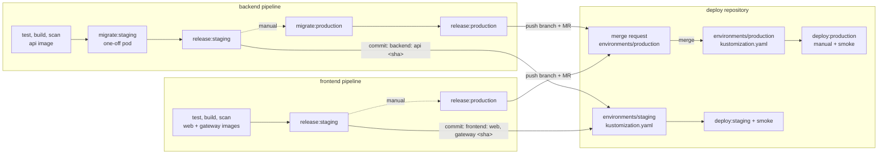

# Deploy

Everything that runs on the Kubernetes clusters of the Product Management system, and the only place that changes
them. Each environment is a folder here; what is committed is what runs (GitOps):

* the application: the API (from [backend](https://gitlab.com/zeiss/backend)), the web app and the gateway (from
  [frontend](https://gitlab.com/zeiss/frontend)), in the namespace `product-management`;
* the shared infrastructure that any service on the cluster can use: PostgreSQL, Redis and the logs (Loki, Grafana,
  Alloy), in the namespace `infra`.

The backend and frontend pipelines build, test and scan their images and then **release** them by committing the new
image tag to this repository. They never apply anything. This repository's pipeline applies.

## Why this layout

* **One source of truth for what runs where.** Every environment is a folder; the image tags in it are what runs.
  "What is in production?" is answered by reading a file, and its history is the release history.
* **Apps build, deploy applies.** Developers change backend and frontend; only this repository (and later Argo CD)
  changes the clusters. App pipelines need no cluster rights except the backend's migration step.
* **Promotion and rollback are git operations.** Staging gets every release automatically; production changes through
  a merge request that someone approves; a rollback is a `git revert`.
* **Ready for Argo CD.** The pipeline's apply step is exactly what an Argo CD Application per environment would do;
  switching only moves who applies (see [Argo CD](#argo-cd-next-step)).
* **Shared infrastructure, plain names.** PostgreSQL, Redis and the logs run once per cluster in the namespace `infra`
  (`postgres`, `redis`, `loki`, `grafana`) and serve every service; a new service gets its own database with
  `scripts/create-database.sh`. Dedicated machines are added as Kubernetes nodes with a role
  (`scripts/add-node.sh`), not as servers outside the cluster.
* **Configuration you can read.** Every setting is a plain env key in the YAML (connection strings without
  passwords, the API address, rate limits); only passwords, the signing key and the accounts are Secrets, and none of
  them is committed.

## Status

| | |
| --- | --- |
| Verified locally (Docker Desktop Kubernetes) | `scripts/infra.sh up`, `scripts/deploy.sh local`: the API, web and gateway with the shared infrastructure, 850k products and a 20M-row stock ledger; all of the assessment's requirements, end-to-end tests (Playwright), load tests (k6) and the log pipeline (Loki, Grafana, 12 alert rules) pass against it |
| Validated, not yet run on a real cluster | `environments/staging` and `environments/production` (rendered and schema-checked by `scripts/validate.sh`), the GitLab pipelines (schema-checked; jobs that need no cluster run on gitlab.com), `scripts/add-node.sh` (dry run) |
| Still to provide per environment | a k3s (or any) cluster, the hosts in `ingress.yaml` and `STAGING_URL` / `PRODUCTION_URL` (now `*.example.com`), the CI/CD variables below, TLS issuer, off-node backups |

## Layout

| Path | What it is |
| --- | --- |
| `apps/backend/` | the API: Deployment (its configuration as env keys), headless Service `api`, autoscaler, disruption budget, NetworkPolicy, and the namespace `product-management` |
| `apps/frontend/` | the web app (`web.yaml`) and the gateway (`gateway.yaml`): Deployments, Services, autoscaler, disruption budgets, NetworkPolicy |
| `environments/local/` | Docker Desktop's Kubernetes: apps + local patches (connection strings to `postgres.infra` / `redis.infra`, Swagger on, gateway as a `LoadBalancer` on http://localhost:8080, `COLLECTOR_UPSTREAM` to `alloy-faro.infra`), the API's keys generated on this machine (`generated/`, never committed) |
| `environments/staging/` | apps + Ingress (TLS) + the registry pull Secret + `images:` with the released tags; **the file the app pipelines update** |
| `environments/production/` | the same; changed only through merge requests |
| `infra/` | `postgres.yaml` (PostgreSQL 18, nightly `pg_dump`), `redis.yaml` (Redis 8), `logs.yaml` (Loki, Grafana with dashboards and 12 alert rules, Alloy), `dashboards/` |
| `scripts/deploy.sh` | deploys an environment: `scripts/deploy.sh <local\|staging\|production> [infra\|apps\|all]` |
| `scripts/infra.sh` | starts, stops and shows the shared infrastructure |
| `scripts/create-database.sh` | gives a service its database, two users and a Secret with their passwords |
| `scripts/add-node.sh` | joins a machine to a k3s cluster as a `database`, `cache` or `apps` node |
| `scripts/local-secrets.sh` | the API's local signing key and demo consumers (and the .NET user-secrets for `dotnet run`) |
| `scripts/validate.sh` | renders and checks every environment and `infra/` (kubeconform and the project's rules) |
| `scripts/smoke.sh` | checks a deployed environment from outside, through its URL |
| `.gitlab-ci.yml` | validate every change; apply staging (automatic) and production (manual); smoke checks; infra (manual) |

## How a change reaches an environment



* **Staging.** On the default branch, the backend pipeline migrates staging's database with the new API image and then
  commits `backend: api <sha>` to `environments/staging/kustomization.yaml` here (the image's `newTag`); the frontend
  pipeline does the same for `web` and `gateway`. Each commit starts this repository's pipeline: `deploy:staging`
  applies `environments/staging` and waits for the rollouts, `smoke:staging` checks it through its URL.
* **Production.** Promotion is a merge request. The app pipelines' manual `release:production` job pushes a branch
  that copies the tag staging runs into `environments/production/kustomization.yaml` and opens a merge request
  ("Release api `<sha>` to production"). Merging it is the release decision; `deploy:production` (manual, protected)
  then applies it. Production's migration runs in the backend pipeline before the merge request is opened.
* **Rollback.** `git revert` the release commit (staging) or the merge (production) on `main`: the pipeline applies the
  previous tags. Schema changes are not rolled back: every migration works with the previous release
  (expand/contract), and a bad migration is fixed forward.
* **History.** `git log environments/staging` is staging's deployment history: who released which commit, when.

## Local quick start

Clone the three repositories side by side (`scripts/deploy.sh local` builds the images from `../backend` and
`../frontend`), with Docker Desktop's Kubernetes enabled (Settings → Kubernetes):

```bash
git clone https://gitlab.com/zeiss/backend.git
git clone https://gitlab.com/zeiss/frontend.git
git clone https://gitlab.com/zeiss/deploy.git
cd deploy
kubectl config use-context docker-desktop

scripts/infra.sh up              # namespace infra: PostgreSQL, Redis, Loki + Grafana + Alloy (and metrics-server)
scripts/deploy.sh local          # the API, web app and gateway → http://localhost:8080
```

Sign in with `viewer`/`viewer`, `clerk`/`clerk` or `manager`/`manager`. The first `scripts/deploy.sh local` also
creates the service's database (`scripts/create-database.sh`) and the API's local keys (`scripts/local-secrets.sh`).

Prerequisites: Docker Desktop with Kubernetes, `kubectl`, `openssl` and `python3`. The images are built in Docker, so
neither .NET nor Node is needed to deploy.

```bash
kubectl diff -k environments/local                         # what differs from the last deploy (nothing, normally)
scripts/validate.sh                                        # needs kubectl, kubeconform, yq, jq; or:
docker run --rm -v "$PWD:/work:ro" -w /work alpine/k8s:1.34.11 scripts/validate.sh
scripts/smoke.sh http://localhost:8080
kubectl -n product-management port-forward deployment/api 5080:8080   # Swagger → http://localhost:5080/swagger
kubectl -n infra port-forward svc/grafana 3000:3000                   # Grafana → http://localhost:3000
```

## `scripts/deploy.sh`

```bash
scripts/deploy.sh <local|staging|production> [infra|apps|all]     # default: apps
```

| Target | Does |
| --- | --- |
| `infra` | `scripts/infra.sh up`: the shared infrastructure in `infra` |
| `apps` | the API, the web app and the gateway from `environments/<environment>` |
| `all` | `infra`, then `apps` |

**local** (context `docker-desktop` only): creates the local keys if missing; builds `product-management/api`,
`web` and `gateway` from `../backend` and `../frontend`, tagged with each checkout's commit (plus `-dirty-<time>` with
uncommitted changes), and records the tags in `environments/local/generated/build/` (not committed) so that
`kubectl diff -k environments/local` compares against exactly what was applied; creates the database on the first
run; copies the shared Redis' password into `redis-credentials`; runs the migrations with the new API image as a
one-off pod in the cluster (as the schema owner, from `database-credentials`); applies `environments/local`; waits
for the rollouts.

**staging, production** (the pipeline, or a laptop whose `kubectl` reaches that cluster): refuses an environment whose
images are still `newTag: unreleased`; creates the registry credential `gitlab-registry` and the API's Secret
`api-secrets` from the variables below when they are set; copies the Redis password; applies the environment exactly
as committed; waits for the rollouts and restarts the API when one of its Secrets changed. It does not migrate: the
backend pipeline does that before it releases an image.

| Variable | For | Effect |
| --- | --- | --- |
| `KUBE_CONTEXT` | all | the `kubectl` context (the GitLab agent's `<project>:<agent>`); default: the current one |
| `BACKEND_DIR`, `FRONTEND_DIR` | local | other checkouts to build (default `../backend`, `../frontend`) |
| `LOGS=off` | local | no log collector: the gateway answers the browser's error reports with 204 |
| `SEED_SAMPLE_DATA` | local | the sample catalogue on an empty database (default `true`) |
| `CI_DEPLOY_USER`, `CI_DEPLOY_PASSWORD` | staging, production | a deploy token with `read_registry` on both registries → Secret `gitlab-registry` |
| `API_SIGNING_KEY`, `API_CONSUMERS` | staging, production | files: the ES256 private key (PEM) and `consumers.json` → Secret `api-secrets` |

## Environments

| | local | staging | production |
| --- | --- | --- | --- |
| Cluster | Docker Desktop (`docker-desktop`) | its k3s cluster, through the GitLab agent or a kubeconfig | its own |
| Images | built on the laptop from `../backend`, `../frontend` | `registry.gitlab.com/zeiss/{backend/api,frontend/web,frontend/gateway}:<sha>`, set by the app pipelines | the same, set by merged merge requests |
| Entry | `LoadBalancer` on http://localhost:8080 | Ingress, TLS by cert-manager: `staging.products.example.com` | `products.example.com` |
| Swagger | on | on (port-forward) | off |
| API keys (`api-secrets`) | `generated/`, made by `scripts/local-secrets.sh` | CI/CD variables `API_SIGNING_KEY`, `API_CONSUMERS` | the same, protected |
| Database, Redis | `postgres.infra`, `redis.infra`; passwords in the cluster (`database-credentials`, `redis-credentials`) | the same | the same |

Replace the `example.*` hosts in `environments/*/ingress.yaml` and `STAGING_URL` / `PRODUCTION_URL` in
`.gitlab-ci.yml` with the real ones; the Ingress needs cert-manager and a ClusterIssuer `letsencrypt`.

**What the app pipelines need from this repository:** a project access token (Settings → Access tokens) with the
role **Maintainer** (to push to the protected `main`) and the scope `write_repository`, stored in the backend and
frontend projects as the masked, protected variable `DEPLOY_REPO_TOKEN`. And the database of each environment, made
once: `scripts/create-database.sh product-management product_management pm_app pm_migrator` against that cluster.

## Shared infrastructure

```bash
scripts/infra.sh up                          # everything: postgres, redis, logs
scripts/infra.sh up postgres redis           # only these two (no logs)
scripts/infra.sh down logs                   # remove a component; its volumes and passwords are kept
scripts/infra.sh down postgres --delete-data # ... and delete its volumes and password too
scripts/infra.sh status                      # pods, services, volumes, and how to reach them
```

* **`up`** creates, once, what must never be committed: the namespace and the random passwords (Secrets
  `postgres-admin` and `redis-auth`), and installs metrics-server (v0.8.0) where the cluster has none (the autoscalers
  need it; k3s ships it, Docker Desktop does not). Then it applies the component and waits until it is ready. A
  changed `redis.conf`, Loki, Grafana or Alloy configuration restarts that component; a changed `postgresql.conf`
  prints how to reload (or, for memory settings, restart) PostgreSQL.
* **`down`** deletes a component's workloads, Services and configuration; its volumes (`data-postgres-0`,
  `postgres-backups`, `data-loki-0`) and password Secrets stay unless `--delete-data` is given.
* Nothing is published on the host: `kubectl -n infra port-forward svc/grafana 3000:3000`, `svc/loki 3100:3100`;
  `kubectl -n infra exec -it statefulset/postgres -- psql -U postgres -d product_management`;
  `kubectl -n infra exec -it deployment/redis -- redis-cli`.

**A service's database.** One PostgreSQL for the platform, one database per service:
`scripts/create-database.sh <service-namespace> <database> [app-user] [migrator-user] [--rotate]`. It creates,
idempotently, the database, the **migrator** user (owns the schema, runs the migrations), the **app** user (rows only;
statements end after 30 s, idle transactions after 60 s), `pg_stat_statements`, and the Secret `database-credentials`
in the service's namespace (`host`, `port`, `database`, `app-user`, `app-password`, `migrator-user`,
`migrator-password`). Passwords are random and kept on later runs; `--rotate` makes new ones (then restart the
service's pods).

**Cache and logs.** Redis is `redis.infra.svc.cluster.local:6379` with one password (`redis-auth`), which
`scripts/deploy.sh` copies into the service's namespace. Alloy collects the stdout of every pod: in Loki they are
`{namespace="<namespace>", app="<app.kubernetes.io/name>"}`. The gateway forwards the browser's error reports to
`alloy-faro.infra.svc.cluster.local:12347`.

**Another Loki** (e.g. Grafana Cloud):
`LOKI_URL=https://<host>/loki/api/v1/push LOKI_USERNAME=<user> LOKI_PASSWORD=<token> scripts/infra.sh up logs`. Then
only Alloy runs in the cluster and pushes there; `scripts/infra.sh up logs` without `LOKI_URL` switches back. Without
logs at all (`scripts/infra.sh up postgres redis`), deploy with `LOGS=off scripts/deploy.sh local`.

**Backups.** The CronJob `postgres-backup` dumps the roles and every database at 02:30 into the volume
`postgres-backups` and keeps 7 days (`kubectl -n infra create job --from=cronjob/postgres-backup postgres-backup-now`
for one now). It protects against mistakes, not against losing the node: production ships the dumps off the node or
uses volume snapshots.

## Nodes

On Docker Desktop everything shares one node. A k3s cluster can give the database and the cache machines of their own:

```bash
scripts/add-node.sh admin@db-1.example.internal database --server https://k3s-1.example.internal:6443
scripts/add-node.sh admin@cache-1.example.internal cache
scripts/add-node.sh admin@apps-1.example.internal apps
scripts/add-node.sh admin@db-1.example.internal database --dry-run      # print the steps only
```

Over ssh it installs the k3s agent (pinned, v1.34.1+k3s1) with the server's join token, labels the node
`infra/role=<role>` and taints `database` and `cache` nodes, so only PostgreSQL (and Redis) run there; both prefer
such a node and run anywhere without one. A volume stays on its node: add the database node before the first
`scripts/infra.sh up postgres`, or move the database with a dump and restore.

## CI/CD (GitLab)

[`.gitlab-ci.yml`](.gitlab-ci.yml):

| Job | When | Does |
| --- | --- | --- |
| `validate:manifests` | every merge request and commit | `scripts/validate.sh`: every environment and `infra/` render and pass kubeconform; components labelled; no committed Secret outside the local generator; staging and production pull with `gitlab-registry` and use registry images |
| `validate:scripts` | every merge request and commit | shellcheck on `scripts/*.sh` |
| `validate:alloy` | every merge request and commit | `alloy validate` and `alloy fmt` on the configuration inside `infra/logs.yaml` |
| `deploy:staging` → `smoke:staging` | `main`, when `environments/staging`, `apps/`, `infra/` or `scripts/deploy.sh` changed | `scripts/deploy.sh staging apps`, then `scripts/smoke.sh $STAGING_URL` |
| `deploy:production` → `smoke:production` | `main`, when `environments/production` or `apps/` changed; **manual** | `scripts/deploy.sh production apps`, then the smoke check |
| `infra:staging`, `infra:production` | `main`, **manual** | `scripts/deploy.sh <environment> infra` |

The smoke check goes through the public URL: `/healthz` (gateway), `/` (web app), an unknown client on
`/api/auth/token` answered `401 invalid_client` by the API and, with `SMOKE_CLIENT_ID` / `SMOKE_CLIENT_SECRET`, a
signed-in `GET /api/categories` (API and database).

CI/CD variables of this project:

| Variable | Scope | What |
| --- | --- | --- |
| `STAGING_ENABLED`, `PRODUCTION_ENABLED` | project | `"true"` creates that environment's jobs; without them the pipeline only validates |
| `KUBE_CONTEXT` | staging, production | `<agent configuration project path>:<agent name>` (the GitLab agent for Kubernetes) |
| `KUBECONFIG` | staging, production | File, instead of `KUBE_CONTEXT`: a kubeconfig whose current context is the cluster |
| `API_SIGNING_KEY` | staging, production; File, protected | the API's ES256 private key (`docker run --rm <api image> generate-signing-key`) |
| `API_CONSUMERS` | staging, production; File, protected | `consumers.json`: client ids, PBKDF2 hashes (`<api image> hash-secret <secret>`), roles |
| `SMOKE_CLIENT_ID`, `SMOKE_CLIENT_SECRET` | staging, production; optional, masked | a viewer consumer for the signed-in smoke check |
| `LOKI_URL`, `LOKI_USERNAME`, `LOKI_PASSWORD` | staging, production; optional | another Loki, for the infra jobs |
| `STAGING_URL`, `PRODUCTION_URL` | in `.gitlab-ci.yml`; override in the project | the environments' public URLs |

The registries are private. Create **one group deploy token** in the `zeiss` group (Settings → Repository → Deploy
tokens) named exactly `gitlab-deploy-token` with the scope `read_registry`: it reads both the backend's and the
frontend's registry, and GitLab passes it to every job of the group's projects as `CI_DEPLOY_USER` /
`CI_DEPLOY_PASSWORD`. `scripts/deploy.sh` stores it in the cluster as the Secret `gitlab-registry`, which the API,
web and gateway Deployments pull with (the backend's migrate job creates the same Secret on a first release). No
database or Redis password is a variable: they are random and live in the cluster.

## Argo CD (next step)

The pipeline applies today; Argo CD can take that over without changing this repository's layout:

1. Install Argo CD in the cluster (`kubectl create namespace argocd` and its pinned install manifest) and give it
   read access to this repository (a deploy token with `read_repository`).
2. One `Application` per environment, pointing at `environments/<environment>` on `main`:

   ```yaml
   apiVersion: argoproj.io/v1alpha1
   kind: Application
   metadata: { name: product-management-staging, namespace: argocd }
   spec:
     project: default
     source: { repoURL: https://gitlab.com/zeiss/deploy.git, targetRevision: main, path: environments/staging }
     destination: { server: https://kubernetes.default.svc, namespace: product-management }
     syncPolicy:
       automated: { prune: true, selfHeal: true }      # staging: every commit is applied
   ```

   Production the same with `path: environments/production` and no `automated` block: a person presses Sync after
   the release merge request is merged.
3. In `.gitlab-ci.yml` remove the deploy and smoke jobs (the pipeline keeps only validate); the Secrets that
   `scripts/deploy.sh` creates from CI/CD variables (`gitlab-registry`, `api-secrets`, `redis-credentials`) move to a
   secrets operator (e.g. External Secrets) or stay a one-off step per environment.
4. Nothing changes in the app pipelines: they still commit tags here, and the migrations stay in the backend
   pipeline, before the release commit. `infra/` can become a third Application with manual sync.
