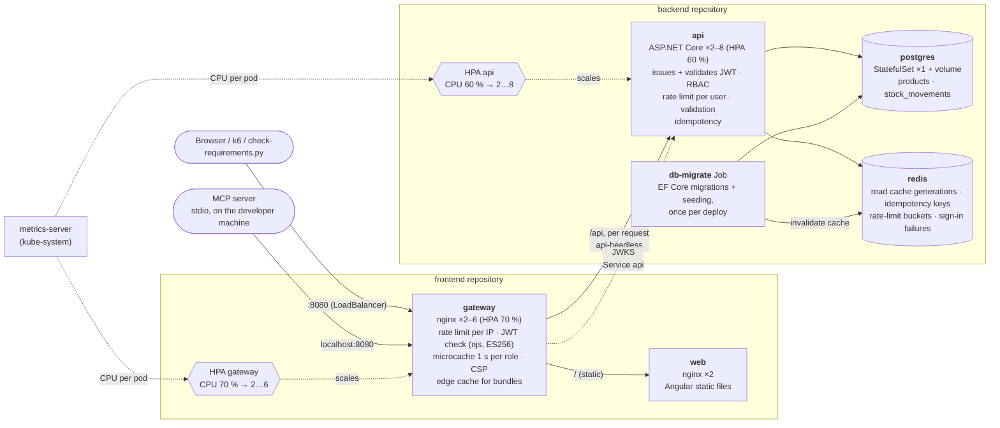
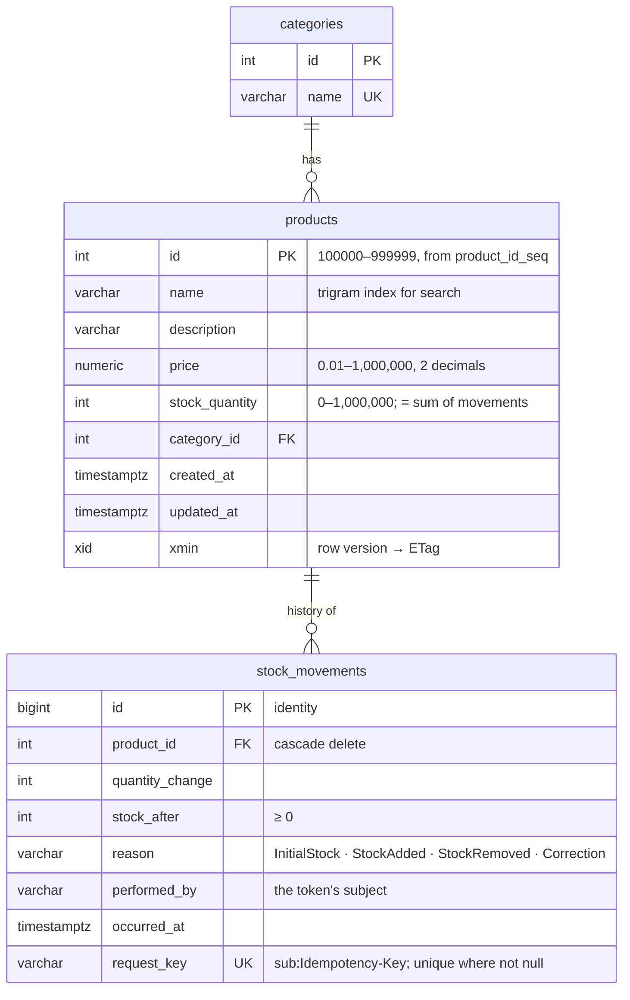

# Architecture

How the system is put together and what every running piece does. The diagrams are Mermaid (rendered by GitHub,
GitLab and VS Code). How requests travel through it, step by step, is in [flows.md](flows.md); decisions and their
reasons are in the [ADRs](adr/README.md).

- [Deployment topology](#deployment-topology)
- [What each component does](#what-each-component-does)
- [Caching](#caching)
- [A read request](#a-read-request)
- [A stock change](#a-stock-change)
- [Scaling](#scaling)
- [Data model](#data-model)

## Deployment topology

Everything runs in the `product-management` namespace. Two repositories, two deployments: the backend
(`backend/deploy/kubernetes.yaml`) and the frontend (`frontend/deploy/kubernetes.yaml`). Their contract is small: the
Service `api-headless`, which the gateway routes `/api` to; the Service `api`, from which the gateway downloads the
API's public signing keys (JWKS); the token issuer and audience the gateway checks; and the `gateway` label that the
API's NetworkPolicy admits.

## What each component does

### Services (the stable addresses you see in Docker Desktop or `kubectl get svc`)

A Service is a fixed name and IP in front of a set of pods. Pods come and go (deploys, scaling, crashes), but the
Service stays the same. Its ClusterIP is reachable only inside the cluster.

| Service        | Type                    | Port | Points at               | Who uses it                                   | What for |
| -------------- | ----------------------- | ---- | ----------------------- | --------------------------------------------- | -------- |
| `gateway`      | LoadBalancer            | 8080 | gateway pods            | you (http://localhost:8080), k6, the MCP server | The only entry from outside. Docker Desktop maps it to localhost. |
| `web`          | ClusterIP               | 8080 | web pods                | gateway                                       | The Angular app's static files (HTML, JS, CSS). |
| `api`          | ClusterIP               | 8080 | api pods                | gateway (JWKS download), port-forward (Swagger) | A single virtual IP for the API. kube-proxy picks a pod **per connection**. |
| `api-headless` | ClusterIP **None**      | 8080 | api pods                | gateway                                       | No virtual IP: DNS returns **every API pod's IP**. nginx re-resolves it every 5 s and balances **per request** to the least busy pod, so new replicas get traffic at once. |
| `postgres`     | ClusterIP               | 5432 | postgres-0              | api, db-migrate                               | The database. |
| `redis`        | ClusterIP               | 6379 | redis pod               | api, db-migrate                               | Shared cache and short-lived coordination state. |

Why two Services for the API: with `api`, a keep-alive connection from nginx stays on one pod and load spreads
badly. With `api-headless`, nginx knows every pod and balances each request itself.

### Workloads

| Object                         | Kind        | What it does |
| ------------------------------ | ----------- | ------------ |
| `gateway`                      | Deployment, 2–6 (HPA) | nginx: the edge. Per-IP rate limit, **verifies every access token** (njs `jwt.js`, ES256 with the API's public key), security headers and CSP, gzip, caches static files (7 days) and API reads (1 s, shared per role), routes `/api` and `/`. |
| `web`                          | Deployment ×2 | nginx serving the built Angular app; long cache for hashed bundles, no cache for `index.html`. |
| `api`                          | Deployment, 2–8 (HPA) | The REST API. Issues tokens and validates them again on every request. Stateless: anything shared (cache generations, idempotency keys, rate-limit buckets, failed sign-ins) is in Redis, so any replica can serve any request. |
| `postgres`                     | StatefulSet ×1 | PostgreSQL 18 with a PersistentVolumeClaim (`data-postgres-0`), so data survives pod restarts. The single source of truth. |
| `redis`                        | Deployment ×1 | Redis 8, memory only (`--save ""`), `volatile-lru`. Losing it costs performance, never correctness (the database's unique request key still stops duplicates). |
| `db-migrate`                   | Job         | Runs `dotnet ProductManagement.Api.dll migrate` once per deployment: waits for PostgreSQL, applies the EF Core migrations and seeding, moves the Redis cache generations on. Replicas never race to migrate. |
| `api` / `gateway` HPA          | HorizontalPodAutoscaler | Add pods when average CPU passes 60 % (API) / 70 % (gateway) of the request; remove them after 3 minutes of lower load. |
| `metrics-server`               | Deployment (kube-system) | Reports pod CPU/memory to the HPAs and to `kubectl top`. Installed by `scripts/cluster-addons.sh`. |
| `k6-<scenario>`                | Job (temporary) | A load test run inside the cluster by `load-tests/run.sh`. |

### Configuration and protection

| Object                          | What it holds / does |
| ------------------------------- | -------------------- |
| Secret `database-credentials`   | PostgreSQL user, password and the API's connection string (pool size 10 per replica). |
| Secret `api-auth`               | The ES256 (P-256) private key that signs access tokens, shared by every API replica. Only the API holds it; verifiers get the public key from `/.well-known/jwks.json`. |
| Secret `api-consumers`          | The registered API consumers (client id, PBKDF2 hash of the secret, roles), mounted as `config/consumers.json`. |
| ConfigMap `api-config`          | Non-secret settings: Redis address, token lifetime, rate limits, sign-in throttle, idempotency lifetimes. |
| Gateway environment             | Per-IP rate limit, upstream addresses, `JWKS_URL`, `JWT_ISSUER`, `JWT_AUDIENCE` (in `frontend/deploy/kubernetes.yaml`). |
| PodDisruptionBudgets            | `api`, `web`, `gateway`: at least one pod stays up during node maintenance. |
| NetworkPolicies                 | PostgreSQL and Redis accept connections only from the API and the migration Job; the API and web pods only from the gateway. |

Secrets in the repository are local-development values. In a real cluster they come from a secret manager.

## Caching

Four layers keep repeated reads away from PostgreSQL: the browser's response cache, the gateway's 1-second
microcache (shared by everyone with the same roles), Redis (counts and page ids, details, histories, versioned by
generations) and, last, the database. What each layer caches, under which key, for how long and what invalidates
it: [flows.md, section 1](flows.md#1-caching-where-the-repeated-work-goes).

## A read request

`GET /api/products?page=1` passes the browser cache, the gateway (token check, then microcache) and the API's
Redis-backed queries; the page's rows are always read from PostgreSQL by primary key, so the stock shown is current.
Step by step: [flows.md, section 4](flows.md#4-read-path-request-by-request); the token check at the edge:
[section 3](flows.md#3-authenticated-request-through-the-gateway).

## A stock change

`POST /api/products/{id}/decrement-stock/{quantity}` with an `Idempotency-Key`: the key is claimed in Redis, the
stock change and its ledger row are one SQL statement, and the ledger row carries the key under a unique index, so a
change is applied exactly once whatever the retries and the number of replicas. Step by step, with every outcome:
[flows.md, section 5](flows.md#5-stock-change-with-an-idempotency-key); create and update with `If-Match`:
[section 6](flows.md#6-create-a-product-update-with-if-match).

## Scaling

The diagram (metrics-server → HPAs → headless DNS → nginx) is in [flows.md, section 10](flows.md#10-autoscaling).

* **The API scales; so does the gateway.** The API is stateless, so adding pods adds capacity (HPA 2–8 at 60 % of
  200m CPU). The gateway verifies tokens and serves the microcache, so it scales too (HPA 2–6 at 70 % of 250m); each
  gateway pod has its own microcache and token cache. The web pods only serve static files (2 for availability).
* **The database is the ceiling.** One PostgreSQL pod. The API HPA's maximum (8) × the pool size (10) =
  80 connections: more would not add throughput, only queueing inside PostgreSQL. Beyond that, capacity comes from
  the database: read replicas for the list and search queries, a bigger instance, or a pooler (PgBouncer). See
  [load-test-results.md](load-test-results.md).
* **Change the range without touching the frontend:**
  `kubectl -n product-management patch hpa api -p '{"spec":{"minReplicas":4}}'`.
* **Watch it:** `kubectl -n product-management get hpa -w` and `kubectl -n product-management top pods`.

## Data model

Indexes that matter at scale (850,000 products, 5 million movements):

| Index | Serves |
| ----- | ------ |
| `products (name, id)` | the default list, ordered by name then id (index scan, no sort). |
| `products USING gin (name gin_trgm_ops)` | `search?name=` with `ILIKE '%…%'` anywhere in the name. |
| `products (stock_quantity, name, id)` | `stock-level?min=&max=`, already in the endpoint's order (0.1 ms instead of 184 ms with an index on stock alone). |
| `stock_movements (product_id, occurred_at DESC, id DESC)` | a product's history, newest first. |
| `stock_movements (request_key) UNIQUE WHERE request_key IS NOT NULL` | exactly-once: a second execution of the same idempotent request (stock change or create) is refused by the database, and its stock change rolled back with it. Built `CONCURRENTLY`. |
