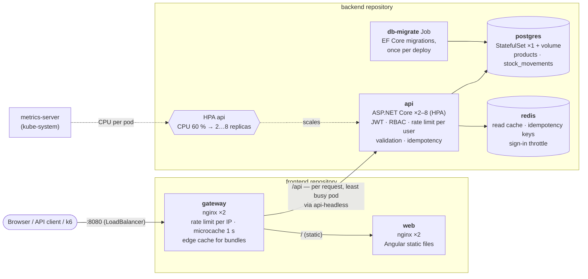
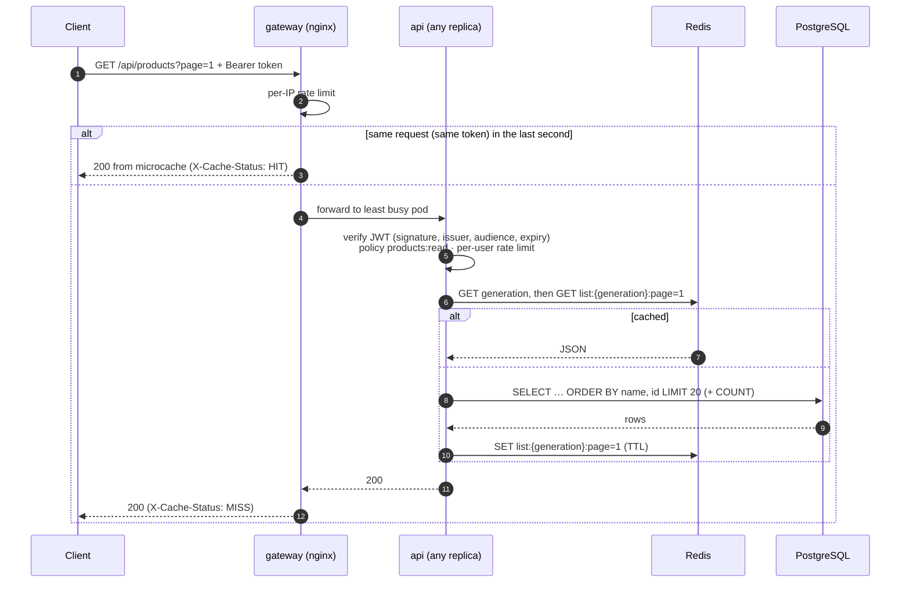
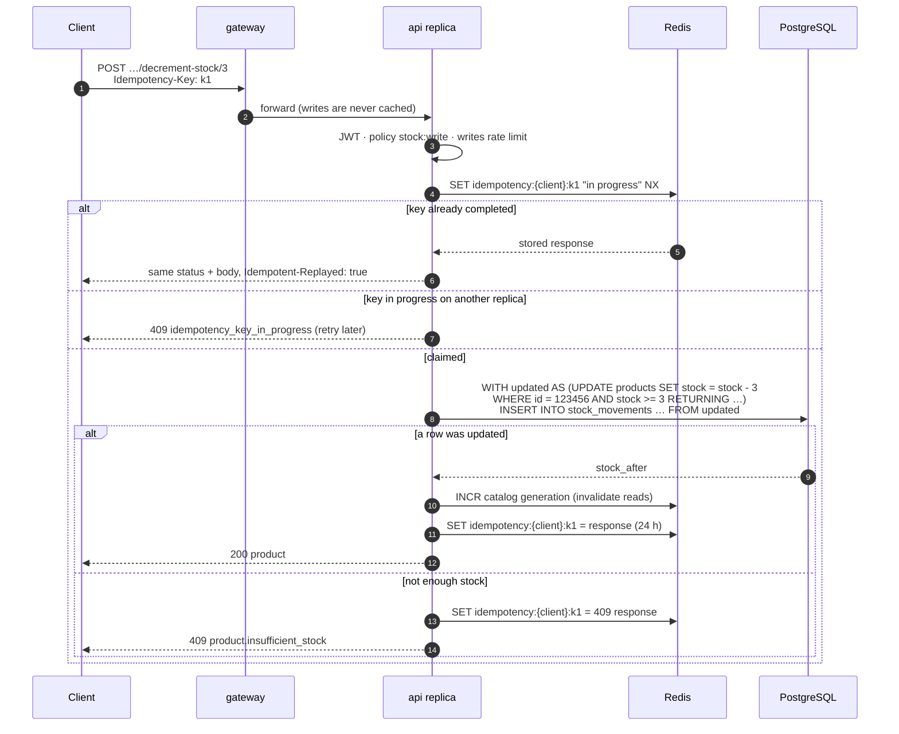
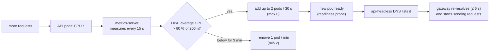
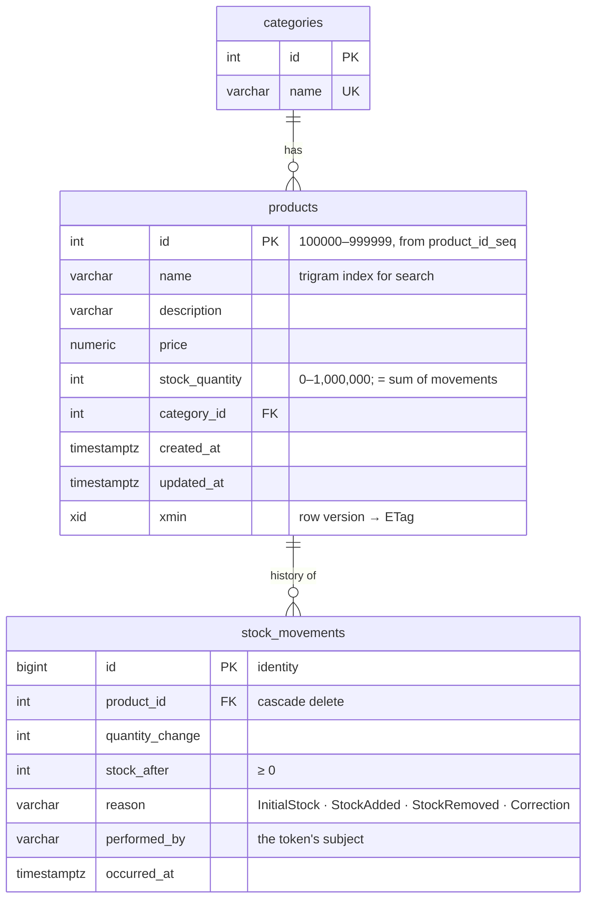

# Architecture

How the system is put together, what every running piece does, and how a request travels through it. The diagrams
are Mermaid (rendered by GitHub, GitLab and VS Code). Decisions and their reasons are in the [ADRs](adr/README.md).

- [Deployment topology](#deployment-topology)
- [What each component does](#what-each-component-does)
- [A read request](#a-read-request)
- [A stock change](#a-stock-change)
- [Scaling](#scaling)
- [Data model](#data-model)

## Deployment topology

Everything runs in the `product-management` namespace. Two repositories, two deployments: the backend
(`backend/deploy/kubernetes.yaml`) and the frontend (`frontend/deploy/kubernetes.yaml`). Their only contract is the
Service name `api-headless`, which the gateway routes `/api` to.

## What each component does

### Services (the stable addresses you see in Docker Desktop or `kubectl get svc`)

A Service is a fixed name and IP in front of a set of pods. Pods come and go (deploys, scaling, crashes), but the
Service stays the same. Its ClusterIP is reachable only inside the cluster.

| Service        | Type                    | Port | Points at               | Who uses it                                   | What for |
| -------------- | ----------------------- | ---- | ----------------------- | --------------------------------------------- | -------- |
| `gateway`      | LoadBalancer            | 8080 | gateway pods            | you (http://localhost:8080), k6               | The only entry from outside. Docker Desktop maps it to localhost. |
| `web`          | ClusterIP               | 8080 | web pods                | gateway                                       | The Angular app's static files (HTML, JS, CSS). |
| `api`          | ClusterIP               | 8080 | api pods                | port-forward (Swagger), tools inside the cluster | A single virtual IP for the API. kube-proxy picks a pod **per connection**. |
| `api-headless` | ClusterIP **None**      | 8080 | api pods                | gateway                                       | No virtual IP: DNS returns **every API pod's IP**. nginx re-resolves it every 5 s and balances **per request** to the least busy pod, so new replicas get traffic at once. |
| `postgres`     | ClusterIP               | 5432 | postgres-0              | api, db-migrate                               | The database. |
| `redis`        | ClusterIP               | 6379 | redis pod               | api                                           | Shared cache and short-lived coordination state. |

Why two Services for the API: with `api`, a keep-alive connection from nginx stays on one pod and load spreads
badly. With `api-headless`, nginx knows every pod and balances each request itself.

### Workloads

| Object                         | Kind        | What it does |
| ------------------------------ | ----------- | ------------ |
| `gateway`                      | Deployment ×2 | nginx: TLS/edge point in production, per-IP rate limit, security headers, gzip, caches static files and API reads for 1 s, routes `/api` and `/`. |
| `web`                          | Deployment ×2 | nginx serving the built Angular app; long cache for hashed bundles, no cache for `index.html`. |
| `api`                          | Deployment, 2–8 (HPA) | The REST API. Stateless: anything shared (cache, idempotency keys, failed sign-ins) is in Redis, so any replica can serve any request. |
| `postgres`                     | StatefulSet ×1 | PostgreSQL 18 with a PersistentVolumeClaim (`data-postgres-0`), so data survives pod restarts. The single source of truth. |
| `redis`                        | Deployment ×1 | Redis 8, memory only (`--save ""`), `volatile-lru`. Losing it costs performance, never correctness. |
| `db-migrate`                   | Job         | Runs `dotnet ProductManagement.Api.dll migrate` once per deployment, before the new API pods start. Replicas never race to migrate. |
| `api` HPA                      | HorizontalPodAutoscaler | Adds API pods when their average CPU passes 60 % of the request, removes them after 3 minutes of lower load. |
| `metrics-server`               | Deployment (kube-system) | Reports pod CPU/memory to the HPA and to `kubectl top`. Installed by `scripts/cluster-addons.sh`. |
| `k6-<scenario>`                | Job (temporary) | A load test run inside the cluster by `load-tests/run.sh`. |

### Configuration and protection

| Object                          | What it holds / does |
| ------------------------------- | -------------------- |
| Secret `database-credentials`   | PostgreSQL user, password and the API's connection string (pool size 20 per replica). |
| Secret `api-auth`               | The JWT signing key, shared by every API replica so any replica accepts any token. |
| Secret `api-consumers`          | The registered API consumers (client id, PBKDF2 hash of the secret, roles), mounted as `config/consumers.json`. |
| ConfigMap `api-config`          | Non-secret settings: Redis address, rate limits, sign-in throttle, idempotency lifetimes. |
| PodDisruptionBudgets            | `api`, `web`, `gateway`: at least one pod stays up during node maintenance. |
| NetworkPolicies                 | PostgreSQL and Redis accept connections only from the API (and the migration Job); the API and web pods only from the gateway. |

Secrets in the repository are local-development values. In a real cluster they come from a secret manager.

## A read request

`GET /api/products?page=1` from a signed-in user. Three layers can answer, each cheaper than the next:

After a write, the user's next read sends `Cache-Control: no-cache`, which bypasses the gateway's microcache. The
write itself moved Redis's generation on, so the API reads fresh data. The user always sees their own change.

## A stock change

`POST /api/products/123456/decrement-stock/3` with an `Idempotency-Key`, the path that has to be correct under any
concurrency:

What makes it safe:

* **No lost updates or overselling.** The check and the change are one SQL statement. PostgreSQL row locks
  serialise concurrent statements on the same product, and the `WHERE stock >= 3` is evaluated on the latest
  committed value ([ADR 0003](adr/0003-atomic-stock-updates.md)).
* **Ledger always matches stock.** The ledger row is inserted by the same statement (a data-modifying CTE), so there
  is never a stock change without its movement, or the other way round ([ADR 0016](adr/0016-stock-ledger.md)).
* **No duplicates from retries.** The idempotency key is claimed atomically in Redis (`SET NX`), which every
  replica shares. A retry, a double click or a copy that reaches another replica is answered from the stored
  response, not executed again ([ADR 0017](adr/0017-idempotency-keys.md)).
* **No duplicate ids.** New products take their id from a PostgreSQL sequence (`100000–999999`, `NO CYCLE`), which
  hands out each value once, whatever the number of replicas ([ADR 0002](adr/0002-product-id-generation.md)).

## Scaling

* **The API scales; the rest doesn't need to.** The API is stateless, so adding pods adds capacity. The gateway and
  web pods do very little work per request (2 each for availability).
* **The database is the ceiling.** One PostgreSQL pod with 2 CPUs. The HPA's maximum (8) × the pool size (20) =
  160 connections, below `max_connections` (300). Beyond that, capacity comes from the database: read replicas for
  the list and search queries, a bigger instance, or a pooler (PgBouncer). See
  [load-test-results.md](load-test-results.md).
* **Change the range without touching the frontend:**
  `kubectl -n product-management patch hpa api -p '{"spec":{"minReplicas":4}}'`.
* **Watch it:** `kubectl -n product-management get hpa api -w` and `kubectl -n product-management top pods`.

## Data model

Indexes that matter at scale (850,000 products, 5 million movements):

| Index | Serves |
| ----- | ------ |
| `products (name, id)` | the default list, ordered by name then id (index scan, no sort). |
| `products USING gin (name gin_trgm_ops)` | `search?name=` with `ILIKE '%…%'` anywhere in the name. |
| `products (stock_quantity)` | `stock-level?min=&max=`. |
| `stock_movements (product_id, occurred_at DESC, id DESC)` | a product's history, newest first. |
