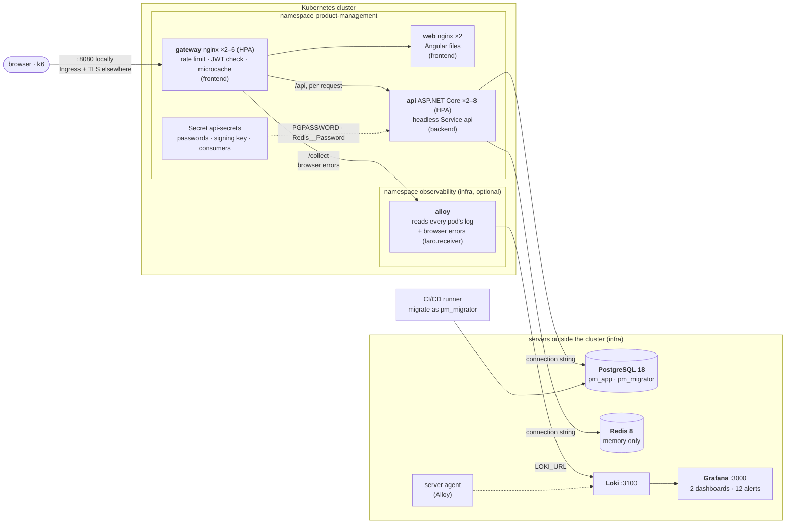
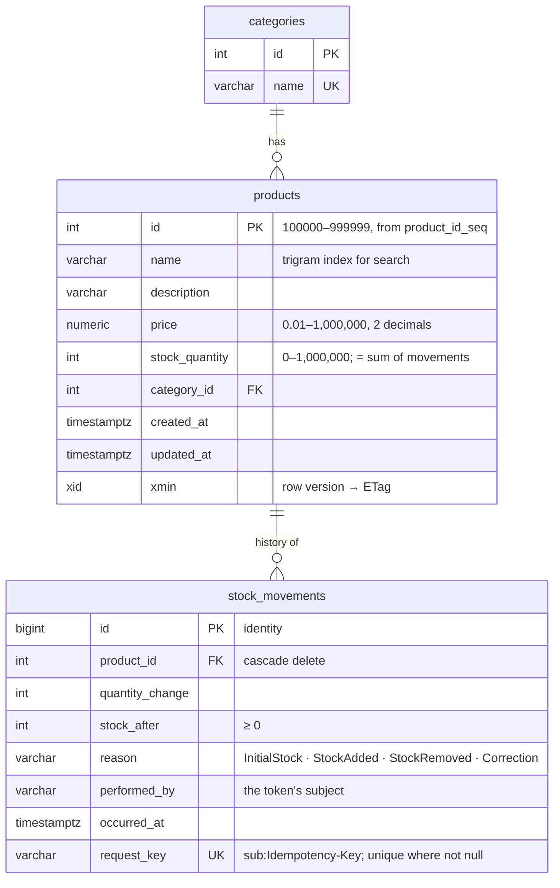

# Architecture

How the system is put together and what every running piece does. The diagrams are Mermaid (rendered by GitLab
and VS Code). How requests travel through it, step by step, is in [flows.md](flows.md); decisions and their
reasons are in the [ADRs](adr/README.md).

- [Deployment topology](#deployment-topology)
- [What each component does](#what-each-component-does)
- [Caching](#caching)
- [A read request](#a-read-request)
- [A stock change](#a-stock-change)
- [Scaling](#scaling)
- [Data model](#data-model)

## Deployment topology

The cluster runs only stateless workloads and a log collector; the data and the logs live on servers outside it
(locally: Docker Compose containers started by `infra/infra.sh`). The deployment is in three parts, each its own
GitLab repository with its own deploy script ([ADR 0021](adr/0021-deployment-layout.md)):

* **infra** (`infra/`): the servers (PostgreSQL, Redis, Loki and Grafana, the server agent) and the cluster's log
  collector (`infra/logs/k8s`, namespace `observability`);
* **backend** (`backend/deploy/`): the API, from a Kustomize base and one overlay per environment
  (`backend/deploy/k8s/overlays/{local,staging,production}`), applied by `backend/deploy/deploy.sh`;
* **frontend** (`frontend/deploy/`): the web app and the gateway, the same way, applied by
  `frontend/deploy/deploy.sh`.

The contract between the API and the web app is small: the Service `api`, to which the gateway routes `/api` and from
which it downloads the API's public signing keys (JWKS); the token issuer and audience the gateway checks; and the
`gateway` label that the API's NetworkPolicy admits. Between the API and the servers there are only the two
connection strings in the backend's overlay (which name the servers directly) and the Secret `api-secrets` with the
passwords.

## What each component does

### Services (the stable addresses you see in Docker Desktop or `kubectl get svc`)

A Service is a fixed name in front of a set of pods. Pods come and go (deploys, scaling, crashes), but the Service
stays the same. The servers outside the cluster have no Service: the API's connection strings name them directly
(`host.docker.internal` locally, their private DNS names elsewhere).

| Service        | Namespace          | Type                    | Port | Points at               | Who uses it                                   | What for |
| -------------- | ------------------ | ----------------------- | ---- | ----------------------- | --------------------------------------------- | -------- |
| `gateway`      | product-management | ClusterIP; `LoadBalancer` in the local overlay | 8080 | gateway pods | you (http://localhost:8080), k6; the Ingress in staging and production | The only entry from outside. |
| `web`          | product-management | ClusterIP               | 8080 | web pods                | gateway                                       | The Angular app's static files (HTML, JS, CSS). |
| `api`          | product-management | ClusterIP **None** (headless) | 8080 | api pods          | gateway                                       | **The API's only Service.** No virtual IP: `api.product-management.svc.cluster.local` returns **every ready API pod's IP**. nginx re-resolves it every 5 s and balances **per request** to the least busy pod, so new replicas get traffic at once. Also where the gateway downloads the JWKS. |
| `alloy-faro`   | observability      | ClusterIP               | 12347 | alloy pod (`faro.receiver`) | gateway (`POST /collect`)              | The browser's error reports; a NetworkPolicy admits only the gateway. |

Why no ordinary ClusterIP Service for the API: it balances per TCP connection, and nginx keeps its connections open,
so they would stay on the first pods and pods added by the autoscaler would get no traffic. For Swagger from a laptop,
port-forward the Deployment (`kubectl -n product-management port-forward deployment/api 5080:8080`).

### Workloads

| Object                         | Where | Kind        | What it does |
| ------------------------------ | ----- | ----------- | ------------ |
| `gateway`                      | cluster | Deployment, 2–6 (HPA) | nginx: the edge. Per-IP rate limit, **verifies every access token** (njs `jwt.js`, ES256 with the API's public key), gives every request a W3C trace id (`trace.js`), security headers and CSP, gzip, caches static files (7 days) and API reads (1 s, shared per role), routes `/api`, `/collect` and `/`. |
| `web`                          | cluster | Deployment ×2 | nginx serving the built Angular app; long cache for hashed bundles, no cache for `index.html`. |
| `api`                          | cluster | Deployment, 2–8 (HPA) | The REST API. Issues tokens and validates them again on every request. Stateless: anything shared (cache generations, idempotency keys, rate-limit buckets, failed sign-ins) is in Redis, so any replica can serve any request. Never migrates the database (`ApplyMigrationsOnStartup=false`). |
| `alloy`                        | cluster, `observability` | Deployment ×1 | Reads every pod's log through the Kubernetes API, parses the gateway's and the API's JSON lines (`trace_id`, `level`) and pushes them to Loki (`LOKI_URL`). Also receives the browser's error reports (`faro.receiver`, from the gateway's `/collect`) and writes them to Loki as `namespace="browser"`. Optional: without it the gateway is deployed with `LOGS=off` and answers `/collect` with 204. |
| `api` / `gateway` HPA          | cluster | HorizontalPodAutoscaler | Add pods when average CPU passes 60 % (API) / 70 % (gateway) of the request; remove them after 3 minutes of lower load. |
| `metrics-server`               | cluster, `kube-system` | Deployment | Reports pod CPU/memory to the HPAs and to `kubectl top`. Installed by `infra/cluster-addons.sh`. |
| `k6-<scenario>`                | cluster | Job (temporary) | A load test run inside the cluster by `backend/load-tests/run.sh`. |
| PostgreSQL 18                  | database server (`pm-postgres`) | server | The single source of truth: products, categories, the stock ledger, the id sequence. Users: `pm_migrator` owns the schema and runs migrations; `pm_app` (the API) reads and writes rows only, 30 s statement timeout. Configuration: `infra/postgres`, `infra/database.yaml`. |
| Redis 8                        | cache server (`pm-redis`) | server | Memory only, `volatile-lru`, password, dangerous commands disabled (`infra/redis`, `infra/redis.yaml`). Losing it costs performance, never correctness (the database's unique request key still stops duplicates; keyed requests are refused while it is down). |
| Loki, Grafana                  | log server (`pm-loki`, `pm-grafana`) | server | Loki stores every log for 14 days (locally in the volume `pm-loki-data`); Grafana shows them: two dashboards (*Product Management*, *Logs*), 12 LogQL alert rules ([guide chapter 8](guide/08-observability.md)). `infra/logs.yaml`; optional, or replaced by another Loki (`LOKI_URL`). |
| server agent                   | each server (`pm-server-agent`) | Alloy | Ships PostgreSQL's and Redis' logs to Loki, joining multi-line statements. |
| migrations                     | CI/CD runner (locally: `backend/deploy/deploy.sh`) | the API image run with `migrate` | Waits for PostgreSQL, applies the EF Core migrations and seeding as `pm_migrator`, moves the Redis cache generations on; once per deployment, before the rollout. |

### Configuration and protection

| Object                          | What it holds / does |
| ------------------------------- | -------------------- |
| API environment                 | Every setting as a plain env entry in `backend/deploy/k8s/base/deployment.yaml` (token lifetime, rate limits, sign-in throttle, idempotency lifetimes, `ApplyMigrationsOnStartup=false`); each overlay's `api.yaml` sets what differs and always `ConnectionStrings__ProductManagement` (user `pm_app`, pool of 10 per replica, no password) and `ConnectionStrings__Redis` (no password). A change rolls the pods. |
| Secret `api-secrets`            | `database-password` → `PGPASSWORD` (Npgsql uses it when the connection string has none, the readiness check's connection too); `redis-password` → `Redis__Password`; `signing-key` → `Authentication__SigningKey`, the ES256 (P-256) private key that signs access tokens (only the API holds it; verifiers get the public key from `/.well-known/jwks.json`); `consumers.json` → the file `/app/config/consumers.json` (client id, PBKDF2 hash of the secret, roles). Locally `api-secrets-<hash>`, generated from `generated/`. |
| Gateway environment             | Per-IP rate limit, `GATEWAY_TRUSTED_PROXIES` (the Ingress controller in staging and production), `JWT_ISSUER`, `JWT_AUDIENCE` (`frontend/deploy/k8s/base/gateway.yaml`); per overlay `API_UPSTREAM`, `JWKS_URL`, `COLLECTOR_UPSTREAM` (`frontend/deploy/k8s/overlays/<env>/gateway.yaml`). |
| Ingress `gateway`               | Staging and production only: HTTPS with a certificate from cert-manager (Let's Encrypt), to the `gateway` Service. |
| PodDisruptionBudgets            | `api`, `web`, `gateway`: at least one pod stays up during node maintenance. |
| NetworkPolicies                 | The API and web pods accept connections only from the gateway; so does Alloy's browser-error receiver. PostgreSQL and Redis are outside the cluster: protected by their credentials (and, in production, TLS and a firewall). |

Secrets in the repository: none. Locally `backend/deploy/local-secrets.sh` generates the API's on each machine
(gitignored); staging and production get theirs from the backend pipeline's CI/CD variables
(`backend/deploy/ci/create-secrets.sh`).

## Caching

Four layers keep repeated reads away from PostgreSQL: the browser's response cache, the gateway's 1-second
microcache (shared by everyone with the same roles), Redis (counts and page ids, details, histories, versioned by
generations) and, last, the database. What each layer caches, under which key, for how long and what invalidates
it: [flows.md, section 1](flows.md#1-caching-where-the-repeated-work-goes).

## A read request

`GET /api/products?page=1` passes the browser cache, the gateway (token check, then microcache) and the API's
Redis-backed queries; the page's rows are always read from PostgreSQL by primary key, so the stock shown is current.
Step by step: [flows.md, section 4](flows.md#4-read-path-request-by-request); the token check at the edge:
[section 3](flows.md#3-authenticated-request-through-the-gateway).

## A stock change

`POST /api/products/{id}/decrement-stock/{quantity}` with an `Idempotency-Key`: the key is claimed in Redis, the
stock change and its ledger row are one SQL statement, and the ledger row carries the key under a unique index, so a
change is applied exactly once whatever the retries and the number of replicas. Step by step, with every outcome:
[flows.md, section 5](flows.md#5-stock-change-with-an-idempotency-key); create and update with `If-Match`:
[section 6](flows.md#6-create-a-product-update-with-if-match).

## Scaling

The diagram (metrics-server → HPAs → headless DNS → nginx) is in [flows.md, section 10](flows.md#10-autoscaling).

* **The API scales; so does the gateway.** The API is stateless, so adding pods adds capacity (HPA 2–8 at 60 % of
  200m CPU). The gateway verifies tokens and serves the microcache, so it scales too (HPA 2–6 at 70 % of 250m); each
  gateway pod has its own microcache and token cache. The web pods only serve static files (2 for availability).
* **The database is the ceiling.** One PostgreSQL server. The API HPA's maximum (8) × (the pool size (10) + the
  readiness check's own connection) = 88 connections, of `max_connections = 200`: more would not add throughput, only
  queueing inside PostgreSQL. Beyond that, capacity comes from
  the database: read replicas for the list and search queries, a bigger instance, or a pooler (PgBouncer). See
  [load-test-results.md](load-test-results.md).
* **Change the range without touching the frontend:**
  `kubectl -n product-management patch hpa api -p '{"spec":{"minReplicas":4}}'`.
* **Watch it:** `kubectl -n product-management get hpa -w` and `kubectl -n product-management top pods`.

## Data model

Indexes that matter at scale (850,000 products, 20 million movements; the full inventory with measurements is in
[ADR 0022](adr/0022-database-at-scale.md) and pinned by `DatabaseAtScaleTests`):

| Index | Serves |
| ----- | ------ |
| `products (name, id)` | the default list, ordered by name then id (index scan, no sort). |
| `products USING gin (name gin_trgm_ops)` | `search?name=` with `ILIKE '%…%'` anywhere in the name. |
| `products (stock_quantity, name, id)` | `stock-level?min=&max=`, already in the endpoint's order (0.1 ms instead of 184 ms with an index on stock alone). |
| `stock_movements (product_id, occurred_at DESC, id DESC)` | a product's history, newest first: the page's ids come from an index-only scan, then only those rows are read (late row lookup: 8–22 ms for the last page of a 100,000-movement history, against 1.3–6.3 s with `OFFSET` on the table). |
| `stock_movements (request_key) UNIQUE WHERE request_key IS NOT NULL` | exactly-once: a second execution of the same idempotent request (stock change or create) is refused by the database, and its stock change rolled back with it. Built `CONCURRENTLY`. |
