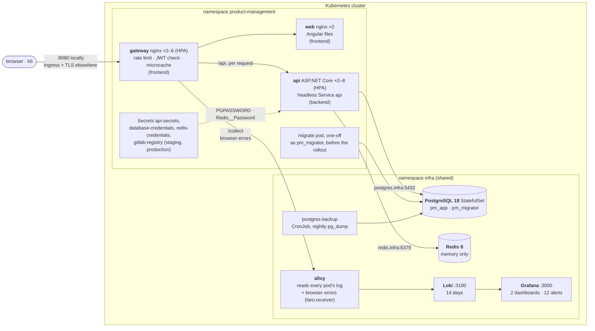
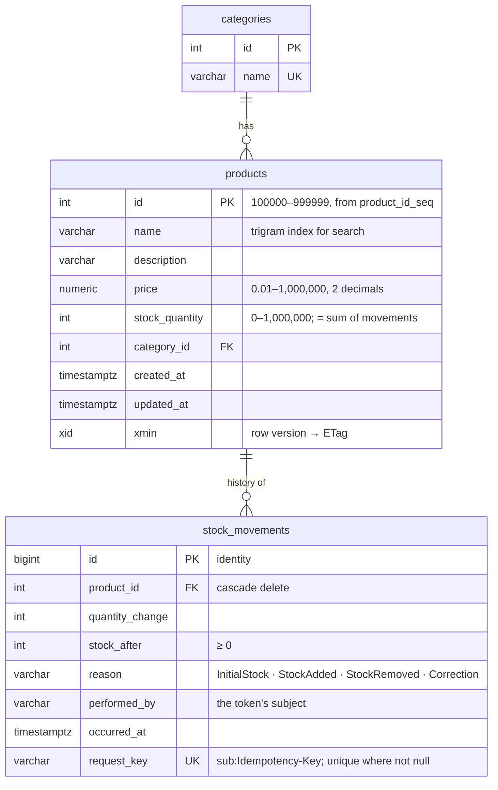

# Architecture

How the system is put together and what every running piece does. The diagrams are Mermaid (rendered by GitLab
and VS Code). How requests travel through it, step by step, is in [flows.md](flows.md); decisions and their
reasons are in the [ADRs](adr/README.md).

- [Deployment topology](#deployment-topology)
- [What each component does](#what-each-component-does)
- [Caching](#caching)
- [A read request](#a-read-request)
- [A stock change](#a-stock-change)
- [Scaling](#scaling)
- [Data model](#data-model)

## Deployment topology

Everything runs in the Kubernetes cluster, in two namespaces: `product-management` holds this application (stateless
pods), and `infra` holds the shared infrastructure that any service on the cluster can use: PostgreSQL, Redis and the
logs. The code is in two GitLab repositories, **backend** (the API) and **frontend** (the web app and the gateway);
everything that runs in a cluster is described by a third, **deploy** (`deploy/`), whose pipeline is the only one that
applies it (GitOps, [ADR 0021](adr/0021-deployment-layout.md)):

* `deploy/apps/backend`, `deploy/apps/frontend`: the applications' manifests, the same in every environment;
* `deploy/environments/{local,staging,production}`: one Kustomize folder per environment with what differs and, in
  staging and production, the released image tags, which the backend and frontend pipelines update by committing;
* `deploy/infra/`: the namespace `infra`, from one manifest per component (`postgres.yaml`, `redis.yaml`,
  `logs.yaml`);
* `deploy/scripts/`: `deploy.sh <environment> [infra|apps|all]` applies them; `infra.sh` the shared infrastructure;
  `create-database.sh` gives a service its database, its two users and their Secret; `add-node.sh` adds k3s nodes
  with a role.

The contract between the API and the web app is small: the Service `api`, to which the gateway routes `/api` and from
which it downloads the API's public signing keys (JWKS); the token issuer and audience the gateway checks; and the
`gateway` label that the API's NetworkPolicy admits. Between the API and the shared infrastructure there are only the
two connection strings in `deploy/environments/<env>/api.yaml` (`postgres.infra.svc.cluster.local:5432`,
`redis.infra.svc.cluster.local:6379`) and two Secrets in the namespace `product-management`: `database-credentials`
(made by `deploy/scripts/create-database.sh`) and `redis-credentials` (a copy of the Redis password, made by
`deploy/scripts/deploy.sh`, and by the backend pipeline's `ci/migrate.sh`).

## What each component does

### Services (the stable addresses you see in Docker Desktop or `kubectl get svc`)

A Service is a fixed name in front of a set of pods. Pods come and go (deploys, scaling, crashes), but the Service
stays the same. Only `gateway` is reachable from outside the cluster; the shared infrastructure's Services are
cluster-internal, and from a laptop they are reached with `kubectl port-forward` or `kubectl exec`
(`deploy/scripts/infra.sh status` prints the commands).

| Service        | Namespace          | Type                    | Port | Points at               | Who uses it                                   | What for |
| -------------- | ------------------ | ----------------------- | ---- | ----------------------- | --------------------------------------------- | -------- |
| `gateway`      | product-management | ClusterIP; `LoadBalancer` in the local environment | 8080 | gateway pods | you (http://localhost:8080), k6; the Ingress in staging and production | The only entry from outside. |
| `web`          | product-management | ClusterIP               | 8080 | web pods                | gateway                                       | The Angular app's static files (HTML, JS, CSS). |
| `api`          | product-management | ClusterIP **None** (headless) | 8080 | api pods          | gateway                                       | **The API's only Service.** No virtual IP: `api.product-management.svc.cluster.local` returns **every ready API pod's IP**. nginx re-resolves it every 5 s and balances **per request** to the least busy pod, so new replicas get traffic at once. Also where the gateway downloads the JWKS. |
| `postgres`     | infra              | ClusterIP               | 5432 | postgres pod (StatefulSet) | api, the migrate pod, the backup CronJob, `create-database.sh` (through `kubectl exec`) | PostgreSQL 18: one database per service. `postgres.infra.svc.cluster.local`. |
| `redis`        | infra              | ClusterIP               | 6379 | redis pod               | api, the migrate pod                          | Redis 8, password protected. `redis.infra.svc.cluster.local`. |
| `loki`         | infra              | ClusterIP               | 3100 | loki pod (StatefulSet)  | alloy (push), grafana (queries); you through a port-forward | The logs, 14 days. |
| `grafana`      | infra              | ClusterIP               | 3000 | grafana pod             | you: `kubectl -n infra port-forward svc/grafana 3000:3000` | Dashboards and alerts. |
| `alloy-faro`   | infra              | ClusterIP               | 12347 | alloy pod (`faro.receiver`) | gateway (`POST /collect`)              | The browser's error reports; a NetworkPolicy (`alloy-ingress`) admits only the gateway pods of `product-management`. |

Why no ordinary ClusterIP Service for the API: it balances per TCP connection, and nginx keeps its connections open,
so they would stay on the first pods and pods added by the autoscaler would get no traffic. For Swagger from a laptop,
port-forward the Deployment (`kubectl -n product-management port-forward deployment/api 5080:8080`).

### Workloads

| Object                         | Namespace | Kind        | What it does |
| ------------------------------ | ----- | ----------- | ------------ |
| `gateway`                      | `product-management` | Deployment, 2–6 (HPA) | nginx: the edge. Per-IP rate limit, **verifies every access token** (njs `jwt.js`, ES256 with the API's public key), gives every request a W3C trace id (`trace.js`), security headers and CSP, gzip, caches static files (7 days) and API reads (1 s, shared per role), routes `/api`, `/collect` and `/`. |
| `web`                          | `product-management` | Deployment ×2 | nginx serving the built Angular app; long cache for hashed bundles, no cache for `index.html`. |
| `api`                          | `product-management` | Deployment, 2–8 (HPA) | The REST API. Issues tokens and validates them again on every request. Stateless: anything shared (cache generations, idempotency keys, rate-limit buckets, failed sign-ins) is in Redis, so any replica can serve any request. Never migrates the database (`ApplyMigrationsOnStartup=false`). |
| `alloy`                        | `infra` | Deployment ×1 | Reads the log of every pod in every namespace through the Kubernetes API (the shared infrastructure's included; only its own is dropped), parses the gateway's and the API's JSON lines (`trace_id`, `level`) and PostgreSQL's multi-line statements, and pushes them to Loki (or to another Loki: `LOKI_URL`). Also receives the browser's error reports (`faro.receiver`, from the gateway's `/collect`) and writes them to Loki as `namespace="browser"`. Optional: without it the gateway is deployed with `LOGS=off` and answers `/collect` with 204. |
| `api` / `gateway` HPA          | `product-management` | HorizontalPodAutoscaler | Add pods when average CPU passes 60 % (API) / 70 % (gateway) of the request; remove them after 3 minutes of lower load. |
| `metrics-server`               | `kube-system` | Deployment | Reports pod CPU/memory to the HPAs and to `kubectl top`. Installed by `deploy/scripts/infra.sh up` when the cluster has none (k3s and most managed clusters ship it). |
| `k6-<scenario>`                | `product-management` | Job (temporary) | A load test run inside the cluster by `tools/load-tests/run.sh`. |
| `postgres`                     | `infra` | StatefulSet ×1 | PostgreSQL 18, the single source of truth: products, categories, the stock ledger, the id sequence. Data on the volume `data-postgres-0` (20 GiB, the cluster's default storage class); `postgresql.conf` from the ConfigMap `postgres-config`; superuser `postgres` with its password in the Secret `postgres-admin` (for `create-database.sh` and people). Users of this service: `pm_migrator` owns the schema and runs migrations; `pm_app` (the API) reads and writes rows only, 30 s statement timeout. Prefers a node labelled `infra/role=database` (`deploy/scripts/add-node.sh`) and tolerates its taint. `deploy/infra/postgres.yaml`. |
| `postgres-backup`              | `infra` | CronJob | Every night at 02:30: the roles (`pg_dumpall --globals-only`) and each database (`pg_dump -Fc`) into the volume `postgres-backups`, kept 7 days. On the same node as the data: protects against mistakes, not against losing the node. `deploy/infra/postgres.yaml`. |
| `redis`                        | `infra` | Deployment ×1 | Redis 8: memory only, `volatile-lru`, password (Secret `redis-auth`), dangerous commands disabled (`deploy/infra/redis.yaml`). A Deployment, not a StatefulSet: nothing to keep. Losing it costs performance, never correctness (the database's unique request key still stops duplicates; keyed requests are refused while it is down). Prefers a node labelled `infra/role=cache`. |
| `loki`, `grafana`              | `infra` | StatefulSet ×1, Deployment ×1 | Loki stores every log for 14 days (volume `data-loki-0`); Grafana shows them: two dashboards (*Product Management*, *Logs*), 12 LogQL alert rules ([guide chapter 8](guide/08-observability.md)), all provisioned from ConfigMaps, so Grafana keeps no data of its own. `deploy/infra/logs.yaml`, `deploy/infra/dashboards/`; optional, or replaced by another Loki (`LOKI_URL`). |
| `migrate-<tag>`                | `product-management` | Pod (temporary) | The API image run with `migrate` (`kubectl run --rm --attach`, by the backend pipeline's migrate jobs, `ci/migrate.sh`, and locally by `deploy/scripts/deploy.sh local`): waits for PostgreSQL, applies the EF Core migrations and seeding as `pm_migrator` (credentials from `database-credentials`), moves the Redis cache generations on; once per release, before it is rolled out. |

### Configuration and protection

| Object                          | What it holds / does |
| ------------------------------- | -------------------- |
| API environment                 | Every setting as a plain env entry in `deploy/apps/backend/deployment.yaml` (token lifetime, rate limits, sign-in throttle, idempotency lifetimes, `ApplyMigrationsOnStartup=false`); each environment's `api.yaml` sets what differs and always `ConnectionStrings__ProductManagement` (user `pm_app`, pool of 10 per replica, no password) and `ConnectionStrings__Redis` (no password). A change rolls the pods. |
| Secret `api-secrets`            | The API's own keys: `signing-key` → `Authentication__SigningKey`, the ES256 (P-256) private key that signs access tokens (only the API holds it; verifiers get the public key from `/.well-known/jwks.json`); `consumers.json` → the file `/app/config/consumers.json` (client id, PBKDF2 hash of the secret, roles). Locally `api-secrets-<hash>`, generated from `deploy/environments/local/generated/`; in staging and production made by `deploy/scripts/deploy.sh` from the deploy project's CI/CD variables `API_SIGNING_KEY`, `API_CONSUMERS`. |
| Secret `gitlab-registry`        | Staging and production only: the credential every pod pulls its image with (`imagePullSecrets`), from the `zeiss` group's deploy token `gitlab-deploy-token` (`read_registry`, reads both registries). Made by `deploy/scripts/deploy.sh` (and by the backend's `ci/migrate.sh` for its migration pod). |
| Secret `database-credentials`   | Made by `deploy/scripts/create-database.sh` (random passwords, kept on re-runs unless `--rotate`): `host`, `port`, `database`, `app-user`, `app-password`, `migrator-user`, `migrator-password`. The API takes `app-password` → `PGPASSWORD` (Npgsql uses it when the connection string has none, the readiness check's connection too); the migrate pod takes the migrator's user and password and the address. |
| Secret `redis-credentials`      | `password` → `Redis__Password`: a copy of the shared Redis' password (`infra/redis-auth`), made by `deploy/scripts/deploy.sh` on every deploy (and by the backend's `ci/migrate.sh`), because a pod can only read the Secrets of its own namespace. |
| Secrets in `infra`              | `postgres-admin` (PostgreSQL's superuser), `redis-auth` (Redis): random, created once by `deploy/scripts/infra.sh up`, kept by `down` unless `--delete-data`; `loki-external` only with `LOKI_URL`. |
| Gateway environment             | Per-IP rate limit, `GATEWAY_TRUSTED_PROXIES` (the Ingress controller in staging and production), `JWT_ISSUER`, `JWT_AUDIENCE` (`deploy/apps/frontend/gateway.yaml`); per environment `API_UPSTREAM`, `JWKS_URL`, `COLLECTOR_UPSTREAM` (`deploy/environments/<env>/gateway.yaml`). |
| Ingress `gateway`               | Staging and production only: HTTPS with a certificate from cert-manager (Let's Encrypt), to the `gateway` Service. |
| PodDisruptionBudgets            | `api`, `web`, `gateway`: at least one pod stays up during node maintenance. |
| NetworkPolicies                 | The API and web pods accept connections only from the gateway; so does Alloy's browser-error receiver. PostgreSQL and Redis have cluster-internal Services only, never published outside the cluster, and are protected by their passwords. |

Secrets in the repositories: none. Locally `deploy/scripts/local-secrets.sh` generates the API's own keys on each
machine (gitignored); staging and production get them from the deploy project's CI/CD variables, which
`deploy/scripts/deploy.sh` turns into `api-secrets`, and the pull credential from the group deploy token. The database
and Redis passwords are never variables: `deploy/scripts/infra.sh` and `deploy/scripts/create-database.sh` generate
them in each cluster.

## Caching

Four layers keep repeated reads away from PostgreSQL: the browser's response cache, the gateway's 1-second
microcache (shared by everyone with the same roles), Redis (counts and page ids, details, histories, versioned by
generations) and, last, the database. What each layer caches, under which key, for how long and what invalidates
it: [flows.md, section 1](flows.md#1-caching-where-the-repeated-work-goes).

## A read request

`GET /api/products?page=1` passes the browser cache, the gateway (token check, then microcache) and the API's
Redis-backed queries; the page's rows are always read from PostgreSQL by primary key, so the stock shown is current.
Step by step: [flows.md, section 4](flows.md#4-read-path-request-by-request); the token check at the edge:
[section 3](flows.md#3-authenticated-request-through-the-gateway).

## A stock change

`POST /api/products/{id}/decrement-stock/{quantity}` with an `Idempotency-Key`: the key is claimed in Redis, the
stock change and its ledger row are one SQL statement, and the ledger row carries the key under a unique index, so a
change is applied exactly once whatever the retries and the number of replicas. Step by step, with every outcome:
[flows.md, section 5](flows.md#5-stock-change-with-an-idempotency-key); create and update with `If-Match`:
[section 6](flows.md#6-create-a-product-update-with-if-match).

## Scaling

The diagram (metrics-server → HPAs → headless DNS → nginx) is in [flows.md, section 10](flows.md#10-autoscaling).

* **The API scales; so does the gateway.** The API is stateless, so adding pods adds capacity (HPA 2–8 at 60 % of
  200m CPU). The gateway verifies tokens and serves the microcache, so it scales too (HPA 2–6 at 70 % of 250m); each
  gateway pod has its own microcache and token cache. The web pods only serve static files (2 for availability).
* **The database is the ceiling.** One PostgreSQL server. The API HPA's maximum (8) × (the pool size (10) + the
  readiness check's own connection) = 88 connections, of `max_connections = 200`: more would not add throughput, only
  queueing inside PostgreSQL. Beyond that, capacity comes from
  the database: read replicas for the list and search queries, a bigger instance, or a pooler (PgBouncer). See
  [load-test-results.md](load-test-results.md).
* **Change the range without touching the frontend:**
  `kubectl -n product-management patch hpa api -p '{"spec":{"minReplicas":4}}'`.
* **Watch it:** `kubectl -n product-management get hpa -w` and `kubectl -n product-management top pods`.

## Data model

Indexes that matter at scale (850,000 products, 20 million movements; the full inventory with measurements is in
[ADR 0022](adr/0022-database-at-scale.md) and pinned by `DatabaseAtScaleTests`):

| Index | Serves |
| ----- | ------ |
| `products (name, id)` | the default list, ordered by name then id (index scan, no sort). |
| `products USING gin (name gin_trgm_ops)` | `search?name=` with `ILIKE '%…%'` anywhere in the name. |
| `products (stock_quantity, name, id)` | `stock-level?min=&max=`, already in the endpoint's order (0.1 ms instead of 184 ms with an index on stock alone). |
| `stock_movements (product_id, occurred_at DESC, id DESC)` | a product's history, newest first: the page's ids come from an index-only scan, then only those rows are read (late row lookup: 8–22 ms for the last page of a 100,000-movement history, against 1.3–6.3 s with `OFFSET` on the table). |
| `stock_movements (request_key) UNIQUE WHERE request_key IS NOT NULL` | exactly-once: a second execution of the same idempotent request (stock change or create) is refused by the database, and its stock change rolled back with it. Built `CONCURRENTLY`. |
