# Flows

Every important flow of the system, end to end, as Mermaid diagrams (rendered by GitLab and VS Code). Each
diagram was drawn from the code as it is now; the links under each one point to the files that implement it and to
the decision record (ADR) that explains why. The static picture (topology, components, data model) is in
[architecture.md](architecture.md).

| # | Flow | Diagram | Main code |
| -: | ---- | ------- | --------- |
| 1 | [Caching: where the repeated work goes](#1-caching-where-the-repeated-work-goes) | flowcharts, sequence, table | `response-cache.ts`, `default.conf.template`, `Caching/` |
| 2 | [Sign-in](#2-sign-in) | sequence | `auth.ts`, `AuthController`, `AccessTokenIssuer` |
| 3 | [Authenticated request through the gateway](#3-authenticated-request-through-the-gateway) | sequence | `jwt.js`, `default.conf.template` |
| 4 | [Read path, request by request](#4-read-path-request-by-request) | sequence | `client-cache-interceptor.ts`, `CachingProductQueries` |
| 5 | [Stock change with an Idempotency-Key](#5-stock-change-with-an-idempotency-key) | sequence | `IdempotencyFilter`, `ProductRepository` |
| 6 | [Create a product, update with If-Match](#6-create-a-product-update-with-if-match) | sequences | `ProductCommandService`, `UnitOfWork` |
| 7 | [Rate limiting](#7-rate-limiting) | flowchart | `SharedTokenBucketRateLimiter`, `RedisDistributedRateLimiter` |
| 8 | [Frontend: the product list screen](#8-frontend-the-product-list-screen) | flowchart | `products-store.ts`, `products-api.ts` |
| 9 | [Deployment and CI/CD](#9-deployment-and-cicd) | flowcharts | `infra.sh`, `deploy.sh` (backend, frontend), `.gitlab-ci.yml` (×3) |
| 10 | [Autoscaling](#10-autoscaling) | flowchart | `hpa.yaml`, `gateway.yaml`, `default.conf.template` |
| 11 | [Load test and verification](#11-load-test-and-verification) | flowcharts | `backend/load-tests/`, `check-requirements.py` |
| 12 | [Logs, from a request to Grafana](#12-logs-from-a-request-to-grafana) | flowchart | `trace.js`, `config.alloy`, `server-agent.alloy`, `browser-errors.ts` |

Names used in the diagrams: **gateway** is the nginx Deployment in front of everything (`frontend/gateway/`),
**API** is any replica of the ASP.NET Core Deployment, reached per request through the headless Service
`api`. Paths are relative to the repository root.

---

## 1. Caching: where the repeated work goes

Thousands of users mostly ask for the same few things: the first pages of the list, popular searches, the low-stock
view. Without caches, every one of those requests repeats the same work all the way down.

### Without caches

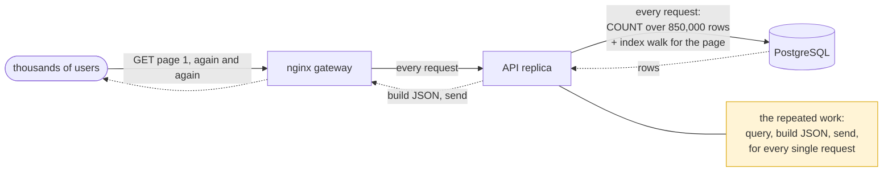

### With our caches

Four layers, in the order a request meets them. A hit at any layer answers from there and the layers to the right
never see the request.

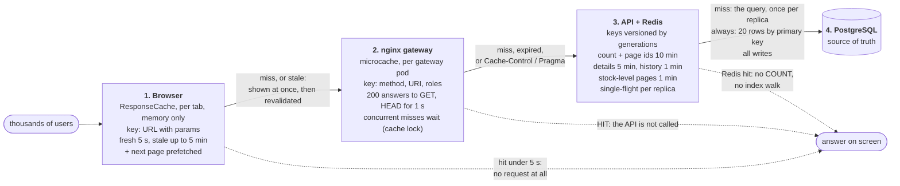

What still reaches PostgreSQL: cache misses (once per key per replica, thanks to single-flight), the read of the
page's rows by primary key for every list or search page that reaches the API (about 1 ms for 20 rows, which is why
the stock shown is always current), and every write.

### What a write invalidates

Redis entries are never deleted: every key embeds the *generations* its value depends on, and a write increments
them right after its commit ([`RedisCatalogCache.InvalidateAsync`](../backend/ProductManagement.Infrastructure/Caching/RedisCatalogCache.cs)).
Entries under an old generation are simply never read again and expire on their own.

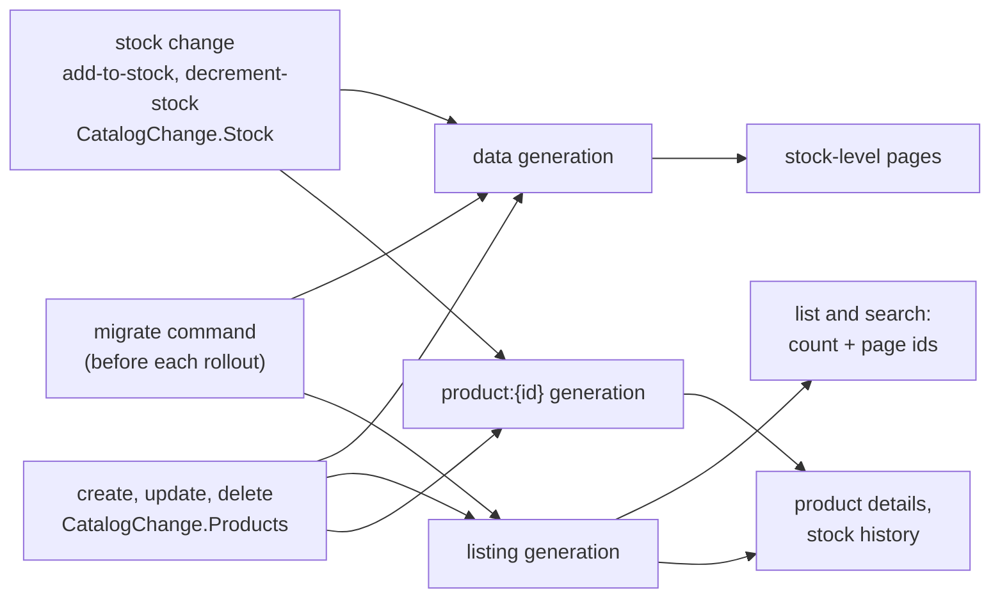

A stock change therefore leaves the full list and every search cached (which products they contain and in which
order did not change); the page still shows the new quantity because its rows are read fresh by primary key.

### 1,000 users open page 1 within the same second

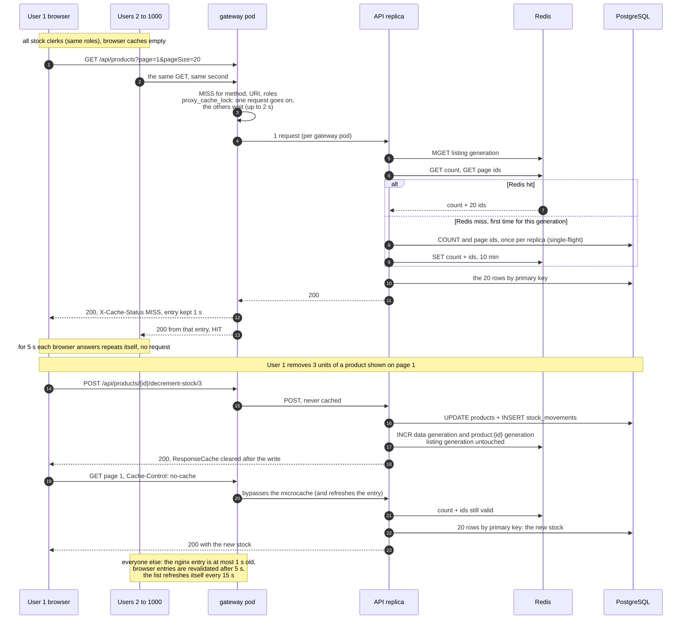

With several gateway pods each one has its own microcache, so up to one request per pod (not per user) reaches the
API for a given key; with several API replicas single-flight collapses misses per replica.

### Layer by layer

| Layer | What is cached | Key | Lifetime | Invalidated by | Measured effect |
| ----- | -------------- | --- | -------- | -------------- | --------------- |
| **Browser** `ResponseCache` + `clientCacheInterceptor` | GET requests that opt in with `CLIENT_CACHE`: product lists, searches, stock-level lists (also the summary counts), stock histories; the next page is prefetched into it. Not cached: product by id, writes. | `req.urlWithParams` | fresh 5 s (answered without a request), stale up to 5 min (shown at once and revalidated); memory only, 200 entries, least recently used out | any POST/PUT/DELETE when it completes (whole cache cleared), sign-out; a request with `Cache-Control` skips the read but stores the answer | Going back to a page already seen, and "next page", need no request. |
| **nginx microcache** (`/api/`) | `200` answers to `GET`/`HEAD`, per gateway pod; writes and the token endpoint are never cached | `$request_method\|$request_uri\|$jwt_scope` (roles from the token `jwt.js` just verified) | 1 s (`proxy_cache_valid 200 1s`); concurrent misses wait for one upstream request (`proxy_cache_lock`, 2 s), an entry being refreshed is served stale (`updating`) | time only; requests with `Cache-Control` or `Pragma` bypass it (the web app sends `no-cache` after the user's own change) | 94–96 % of browse requests answered by nginx; read capacity 5,470 → 18,177 req/s on one laptop once the key became the role instead of the token. |
| **nginx static cache** | the web app's hashed bundles (`.js`, `.css`, fonts, images) | nginx default (URL) | 7 days | new release (new file names); `index.html` is never cached | The web pods serve each bundle about once per gateway pod. |
| **Redis** (`CachingProductQueries`) | list and search: total count and the page's ids | `v{listing}:products:all:count`, `…:ids:p{page}:s{size}` (search: `products:search:{TERM}:…`) | 10 min | listing generation (create, update, delete) | Single-flight removed the stampede of 882 concurrent `COUNT(*)` (~2 s each) seen under load. |
| | stock-level pages (complete) | `v{data}:products:stock:{min}:{max}:p{page}:s{size}` | 1 min | data generation (every write) | |
| | product details | `v{listing}.{product}:product:{id}` | 5 min | listing or that product's generation | |
| | a product's stock history page | `v{listing}.{product}:product:{id}:movements:p{page}:s{size}` | 1 min | listing or that product's generation | |
| **PostgreSQL** | nothing: the source of truth | | | | Still receives misses (once per key per replica), the 20-row primary-key read of every list page that reaches the API, all writes. |

All Redis keys start with `product-management:`. If Redis is unreachable the API reads from PostgreSQL directly
(fail open); a missing generation counter restarts from the clock, so a version is never reused. Numbers from
[load-test-results.md](load-test-results.md). Code:
[`response-cache.ts`](../frontend/src/app/core/http/response-cache.ts),
[`client-cache-interceptor.ts`](../frontend/src/app/core/http/client-cache-interceptor.ts),
[`default.conf.template`](../frontend/gateway/default.conf.template),
[`CachingProductQueries.cs`](../backend/ProductManagement.Infrastructure/Caching/CachingProductQueries.cs),
[`RedisCatalogCache.cs`](../backend/ProductManagement.Infrastructure/Caching/RedisCatalogCache.cs),
[`SingleFlight.cs`](../backend/ProductManagement.Infrastructure/Caching/SingleFlight.cs),
[`CacheOptions.cs`](../backend/ProductManagement.Infrastructure/Caching/CacheOptions.cs). Decisions:
[ADR 0008](adr/0008-redis-cache.md), [ADR 0012](adr/0012-gateway.md), [ADR 0020](adr/0020-edge-token-verification.md),
[ADR 0007](adr/0007-frontend-state.md).

---

## 2. Sign-in

The login page exchanges a registered consumer's client id and secret for an access token. The token endpoint is the
only `/api` location the gateway lets through without a token. The API checks the secret against a PBKDF2 hash
(an unknown client is checked against a dummy hash, so both cases take the same time), counts failures per client IP
in Redis, and signs an ES256 JWT whose header carries the key id (`kid`) the gateway later uses to pick the public
key. The browser only *reads* the claims (user name and roles, to hide actions the user cannot perform); the
signature is verified by the gateway and the API on every request.

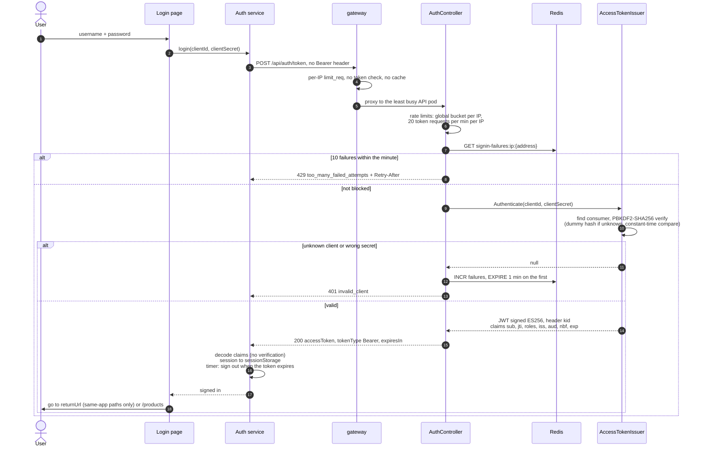

A missing client id or secret is a 400 before any of this. The login page shows "Invalid username or password" for
401 and a wait message for 429. The session lives in `sessionStorage` (survives a reload, gone with the tab); signing
out also clears the browser's response cache. Code: [`login.ts`](../frontend/src/app/features/auth/login/login.ts),
[`auth.ts`](../frontend/src/app/core/auth/auth.ts),
[`AuthController.cs`](../backend/ProductManagement.Api/Controllers/AuthController.cs),
[`AccessTokenIssuer.cs`](../backend/ProductManagement.Api/Security/AccessTokenIssuer.cs),
[`SecretHasher.cs`](../backend/ProductManagement.Api/Security/SecretHasher.cs),
[`TokenSigningKey.cs`](../backend/ProductManagement.Api/Security/TokenSigningKey.cs),
[`RedisFailedAttemptThrottle.cs`](../backend/ProductManagement.Infrastructure/Security/RedisFailedAttemptThrottle.cs).
Decision: [ADR 0009](adr/0009-authentication-authorization.md).

---

## 3. Authenticated request through the gateway

Every other `/api` request is checked at the edge first: `auth_request /_jwt` runs `jwt.js` (nginx njs). A token the
pod has verified before is answered from a shared dictionary; a new one is checked with WebCrypto against the API's
public key, downloaded from the JWKS endpoint when its `kid` is unknown. The verified roles become `X-Jwt-Scope`,
which is part of the microcache key. A rejected token gets a 401 problem-details answer from nginx itself; an accepted
one is validated again by the API (defence in depth) before rate limiting and authorization.

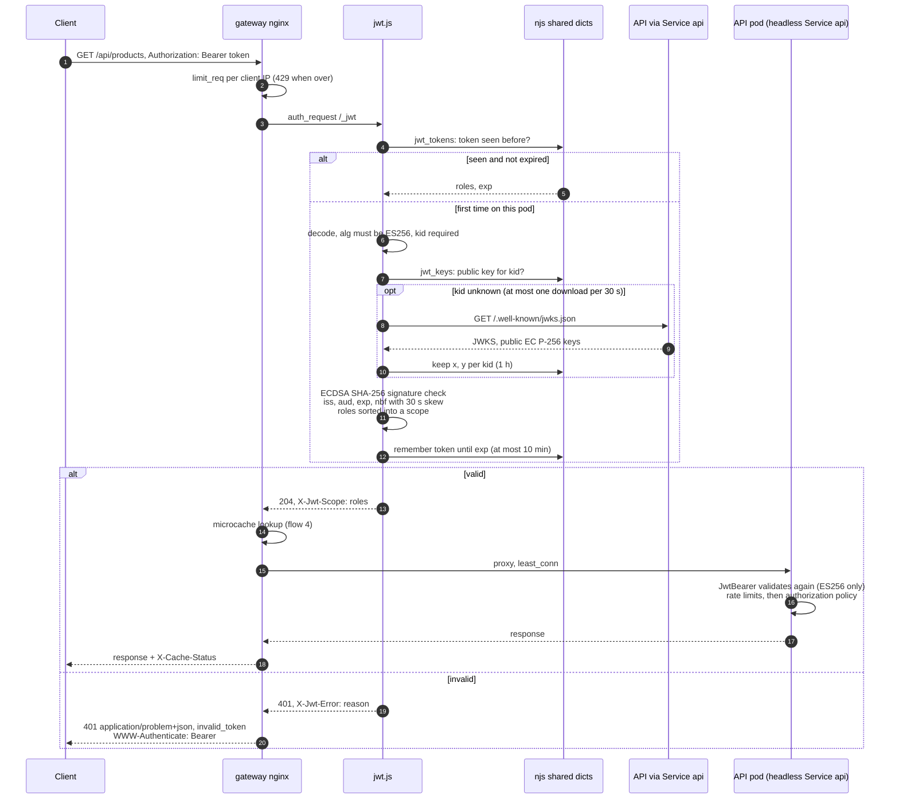

The gateway holds no secret: it can verify tokens, never issue them. The JWKS is fetched over the in-cluster headless
Service `api` (`JWKS_URL` in `frontend/deploy/k8s/overlays/<environment>/gateway.yaml`); `/.well-known/jwks.json` is not routed to the API by the
gateway, so it is not exposed outside the cluster. Code: [`jwt.js`](../frontend/gateway/jwt.js),
[`default.conf.template`](../frontend/gateway/default.conf.template),
[`SecurityServiceCollectionExtensions.cs`](../backend/ProductManagement.Api/Security/SecurityServiceCollectionExtensions.cs),
[`Program.cs`](../backend/ProductManagement.Api/Program.cs) (middleware order: forwarded headers, authentication,
rate limiter, authorization). Decisions: [ADR 0020](adr/0020-edge-token-verification.md),
[ADR 0012](adr/0012-gateway.md), [ADR 0009](adr/0009-authentication-authorization.md).

---

## 4. Read path, request by request

The same layers as [section 1](#1-caching-where-the-repeated-work-goes), in the order the code runs them, for
`GET /api/products?page=1&pageSize=20`. Searches follow the same path with a `products:search:{TERM}` key; stock-level
pages and product details are cached whole (see the table above).

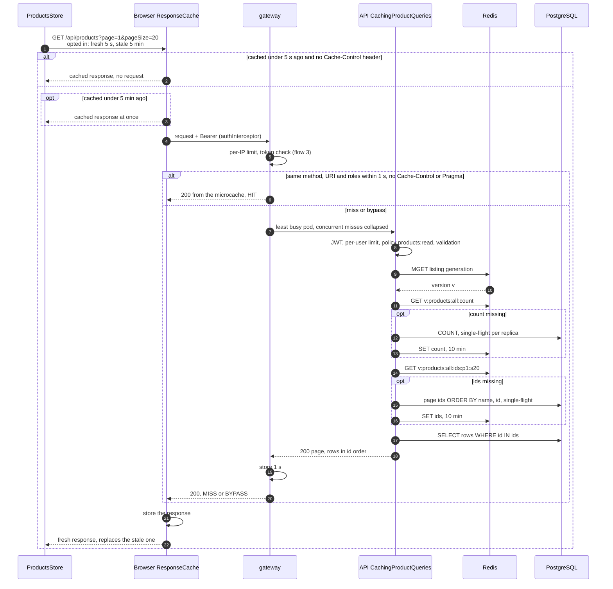

The Redis version is read *before* the database: if a write commits in between, the possibly older result is stored
under the previous version, which nobody reads any more. If Redis is unreachable the version is `null` and the
query goes straight to PostgreSQL. A page beyond the total count skips the ids lookup. Code:
[`products-api.ts`](../frontend/src/app/features/products/data-access/products-api.ts),
[`client-cache-interceptor.ts`](../frontend/src/app/core/http/client-cache-interceptor.ts),
[`ProductsController.cs`](../backend/ProductManagement.Api/Controllers/ProductsController.cs),
[`CachingProductQueries.cs`](../backend/ProductManagement.Infrastructure/Caching/CachingProductQueries.cs),
[`ProductQueries.cs`](../backend/ProductManagement.Infrastructure/Products/ProductQueries.cs). Decisions:
[ADR 0008](adr/0008-redis-cache.md), [ADR 0020](adr/0020-edge-token-verification.md).

---

## 5. Stock change with an Idempotency-Key

`POST /api/products/{id}/decrement-stock/{quantity}` (and `add-to-stock`), the path that must be correct under any
concurrency and any retry. The web app sends one `Idempotency-Key` per user action (`crypto.randomUUID()`: one per
dialog, one per quick +/- click), so a double submit or a retry reaching another replica is applied once. Two guards make that hold: the claim in Redis
(`SET NX`, shared by all replicas) and, as a backstop, the key stored on the ledger row under a unique index, in the
same SQL statement as the stock change.

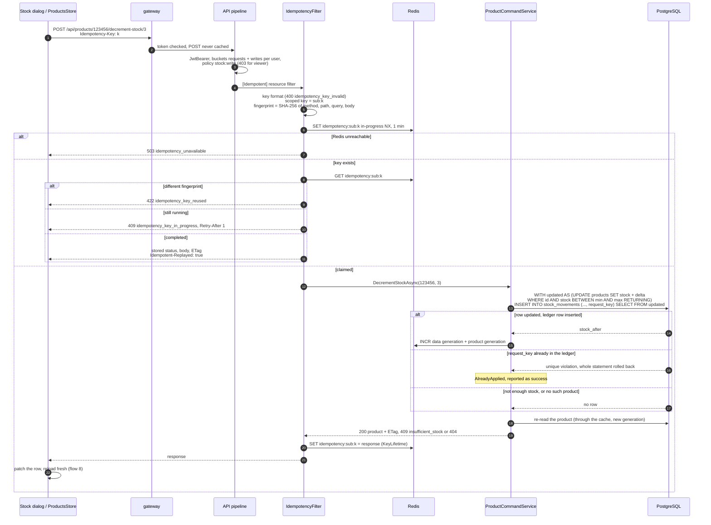

* **No overselling, no lost updates.** Check and change are one statement; PostgreSQL row-locks the product and
  re-evaluates `WHERE stock BETWEEN min AND max` against the latest committed row. The range is computed in C#
  (`StockAdjustment.Plan`: `MinCurrentStock`, `MaxCurrentStock`), so the SQL never overflows ([ADR 0003](adr/0003-atomic-stock-updates.md)).
* **Ledger always matches stock.** The movement is inserted by the same statement (a data-modifying CTE)
  ([ADR 0016](adr/0016-stock-ledger.md)).
* **Exactly once.** A retry is replayed from Redis; if the Redis claim was lost (expired, evicted, or released after
  a cancelled request that had already committed), the unique index `ix_stock_movements_request_key` refuses the
  second ledger row and the stock change is rolled back with it ([ADR 0017](adr/0017-idempotency-keys.md)).
* Responses with status 500 or more, and exceptions, are not stored: the key is deleted so the client can retry.
  `KeyLifetime` is 24 h by default and 1 h in the Kubernetes ConfigMap; the in-progress claim lasts 1 min.
* The re-read after the change is not cancellable: once the change may have committed, the request finishes so its
  outcome can be stored and replayed.

Code: [`IdempotencyFilter.cs`](../backend/ProductManagement.Api/Idempotency/IdempotencyFilter.cs),
[`RedisIdempotencyStore.cs`](../backend/ProductManagement.Infrastructure/Idempotency/RedisIdempotencyStore.cs),
[`ProductCommandService.cs`](../backend/ProductManagement.Core/Products/ProductCommandService.cs),
[`ProductRepository.cs`](../backend/ProductManagement.Infrastructure/Products/ProductRepository.cs),
[`StockMovementConfiguration.cs`](../backend/ProductManagement.Infrastructure/Persistence/Configurations/StockMovementConfiguration.cs),
[`stock-adjust-dialog.ts`](../frontend/src/app/features/products/feature/stock-adjust-dialog/stock-adjust-dialog.ts).

---

## 6. Create a product, update with If-Match

### Create

Only managers (`products:write`). The six-digit id comes from the PostgreSQL sequence `product_id_seq`
(`100000–999999`, `NO CYCLE`), so no two replicas can ever hand out the same id. The product and its `InitialStock`
ledger row are inserted in one transaction; the ledger row carries the request's idempotency key, so a create that
was already applied is answered with the original product instead of a second one.

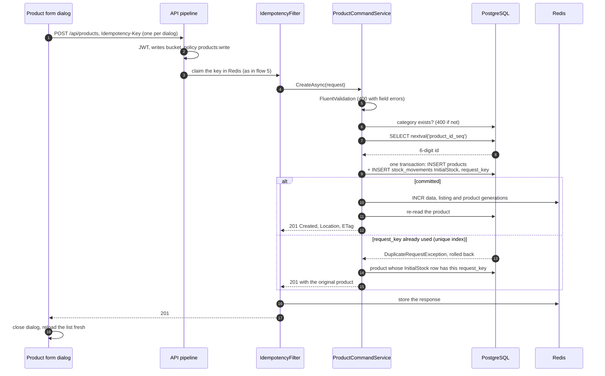

### Update with If-Match

The response of every product read carries `ETag: "<version>"`, the row's PostgreSQL `xmin`. The form sends it back
as `If-Match`; if the product changed in the meantime the API answers 412 and the dialog offers to load the latest
version. Updates are not idempotent-keyed (a PUT is idempotent by nature, and the version check stops a stale replay).

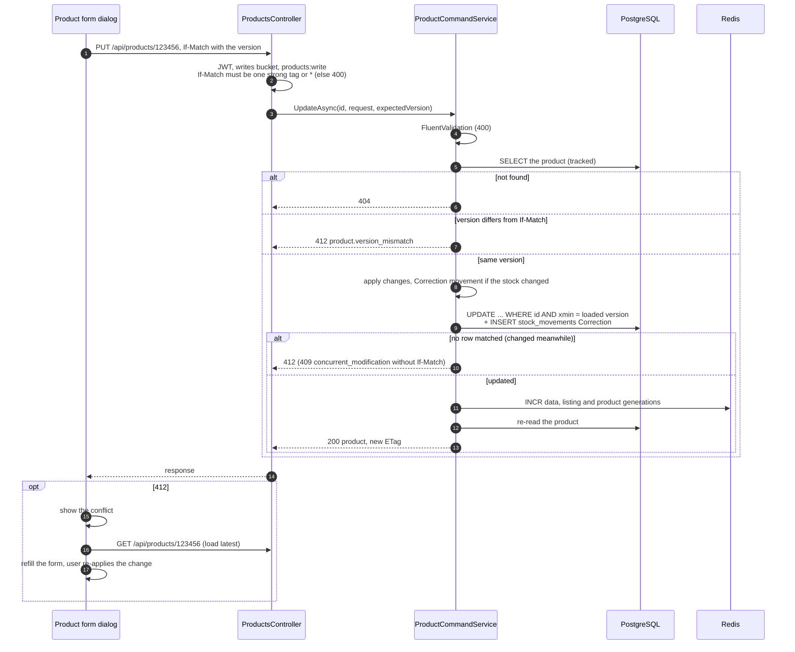

Delete follows the update path (optional `If-Match`, 412/409, then 204; the history goes with the product by cascade).
Code: [`ProductsController.cs`](../backend/ProductManagement.Api/Controllers/ProductsController.cs),
[`EntityTag.cs`](../backend/ProductManagement.Api/Http/EntityTag.cs),
[`ProductCommandService.cs`](../backend/ProductManagement.Core/Products/ProductCommandService.cs),
[`UnitOfWork.cs`](../backend/ProductManagement.Infrastructure/Persistence/UnitOfWork.cs),
[`PostgresProductIdGenerator.cs`](../backend/ProductManagement.Infrastructure/Products/PostgresProductIdGenerator.cs),
[`product-form-dialog.ts`](../frontend/src/app/features/products/feature/product-form-dialog/product-form-dialog.ts).
Decisions: [ADR 0002](adr/0002-product-id-generation.md), [ADR 0004](adr/0004-optimistic-concurrency.md),
[ADR 0017](adr/0017-idempotency-keys.md).

---

## 7. Rate limiting

Two layers. The gateway limits per client IP (coarse, cheap, before any token work). The API limits per signed-in
user (or per IP for anonymous calls) with token buckets kept **in Redis**, so a user's allowance stays the same
whether the autoscaler runs 2 replicas or 8; if Redis is unreachable each replica falls back to its own in-memory
bucket. Sign-in has its own guards (flow 2).

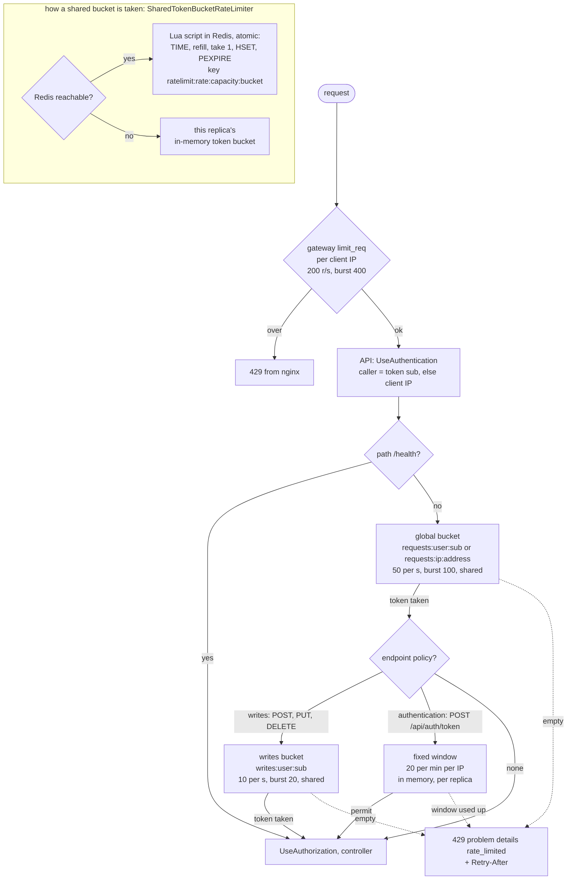

The global bucket is taken first, then the endpoint's own policy if it has one. Anonymous callers are partitioned by
the address in `X-Forwarded-For`, which the API trusts because a NetworkPolicy lets only the gateway reach it. Code:
[`default.conf.template`](../frontend/gateway/default.conf.template),
[`RateLimitingServiceCollectionExtensions.cs`](../backend/ProductManagement.Api/RateLimiting/RateLimitingServiceCollectionExtensions.cs),
[`SharedTokenBucketRateLimiter.cs`](../backend/ProductManagement.Api/RateLimiting/SharedTokenBucketRateLimiter.cs),
[`RedisDistributedRateLimiter.cs`](../backend/ProductManagement.Infrastructure/Security/RedisDistributedRateLimiter.cs);
values as env entries in the API's Deployment (`backend/deploy/k8s/base/deployment.yaml`) and the gateway's. Decision: [ADR 0010](adr/0010-rate-limiting.md).

---

## 8. Frontend: the product list screen

Data flows one way: the page and its actions call the store, the store changes the `query` signal, and
`rxResource` fetches.
Changing the query cancels the request in flight, so an older page can never overwrite a newer one. While loading,
`linkedSignal` keeps the previous page on screen; the table is dimmed only when the user is changing page or filter
(`isChangingPage`), not during a background refresh.

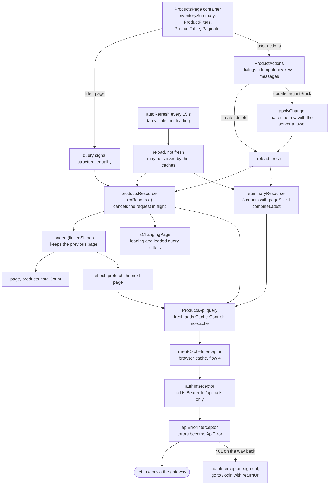

After the user's own change the reload is *fresh* (`Cache-Control: no-cache`), which skips the browser cache read and
the gateway's microcache, so the user always sees the result of what they just did. Background refreshes are not
fresh, so a crowd of open screens is answered by the microcache. An empty name filter queries the plain list. Code:
[`products-store.ts`](../frontend/src/app/features/products/data-access/products-store.ts),
[`products-api.ts`](../frontend/src/app/features/products/data-access/products-api.ts),
[`products-page.ts`](../frontend/src/app/features/products/feature/products-page/products-page.ts),
[`product-actions.ts`](../frontend/src/app/features/products/feature/product-actions.ts),
[`auto-refresh.ts`](../frontend/src/app/shared/util/auto-refresh.ts),
[`app.config.ts`](../frontend/src/app/app.config.ts) (interceptor order),
[`auth-interceptor.ts`](../frontend/src/app/core/auth/auth-interceptor.ts),
[`api-error-interceptor.ts`](../frontend/src/app/core/http/api-error-interceptor.ts). Decision:
[ADR 0007](adr/0007-frontend-state.md).

---

## 9. Deployment and CI/CD

### Deploy to the current kubectl context

Three parts, three scripts, run in this order: `infra/infra.sh up` starts the servers outside the cluster (Docker
Compose, one file per component) and applies the cluster's log collector; `backend/deploy/deploy.sh` deploys the API;
`frontend/deploy/deploy.sh` deploys the web app and the gateway. Each deploy script renders its environment's
Kustomize overlay with this release's images pinned and applies it with `kubectl apply`. Locally they also build the
images, with an immutable tag (the commit, plus a timestamp when the working tree is dirty). Docker Desktop's
Kubernetes uses the locally built images straight from the local Docker engine; any other context needs the images
from a registry (`API_IMAGE`, `WEB_IMAGE`, `GATEWAY_IMAGE`, as the pipelines pass them), and the scripts stop without
them. Once per cluster, `infra/cluster-addons.sh` installs metrics-server.

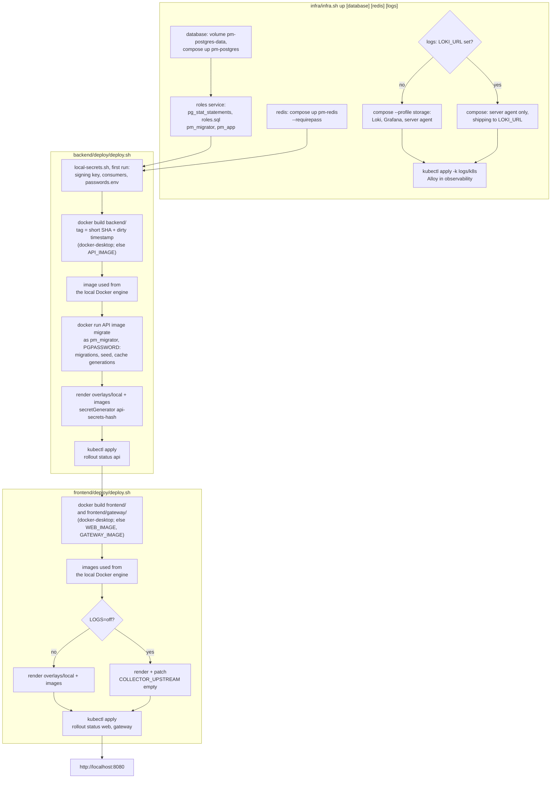

The rendered kustomization goes to `<part>/deploy/k8s/.build/<environment>/kustomization.yaml` (not committed). The
API never migrates at start-up; its database user `pm_app` could not. Code: [`infra.sh`](../infra/infra.sh),
[`database.yaml`](../infra/database.yaml), [`roles.sql`](../infra/postgres/roles.sql),
[`backend/deploy/deploy.sh`](../backend/deploy/deploy.sh), [`local-secrets.sh`](../backend/deploy/local-secrets.sh),
[`frontend/deploy/deploy.sh`](../frontend/deploy/deploy.sh), [`collector.sh`](../frontend/gateway/collector.sh),
[`DatabaseInitializer.cs`](../backend/ProductManagement.Infrastructure/Persistence/DatabaseInitializer.cs).
Decision: [ADR 0021](adr/0021-deployment-layout.md).

### CI/CD pipelines (GitLab)

One pipeline per repository. The backend and the frontend take a commit to staging automatically and to production
after a manual, protected step, once each environment is switched on (`STAGING_ENABLED`, `PRODUCTION_ENABLED`); the
infra only validates automatically, and every deployment of a server is a manual job. They run on gitlab.com; the
staging and production jobs have not yet run against real clusters.

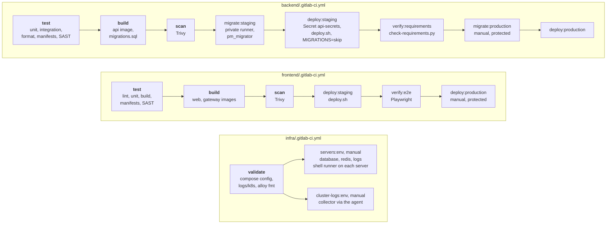

Merge requests stop after scan (validate for infra). The deploy jobs reach the cluster through the GitLab agent for
Kubernetes; only the backend's migrate jobs need the runner inside the private network, and only the infra's server
jobs run on the servers. Code: [`backend/.gitlab-ci.yml`](../backend/.gitlab-ci.yml),
[`deploy-environment.sh`](../backend/deploy/ci/deploy-environment.sh),
[`create-secrets.sh`](../backend/deploy/ci/create-secrets.sh), [`frontend/.gitlab-ci.yml`](../frontend/.gitlab-ci.yml),
[`infra/.gitlab-ci.yml`](../infra/.gitlab-ci.yml); the manifests checks:
[`backend/deploy/ci/validate-manifests.sh`](../backend/deploy/ci/validate-manifests.sh),
[`frontend/deploy/ci/validate-manifests.sh`](../frontend/deploy/ci/validate-manifests.sh). Setup: [guide chapter 12](guide/12-from-zero.md).

---

## 10. Autoscaling

Both the API and the gateway have a HorizontalPodAutoscaler fed by metrics-server. A new API pod gets traffic as
soon as it is ready: the gateway balances over the headless Service `api`, whose DNS lists every ready pod,
and re-resolves it every 5 s. A new gateway pod joins the `gateway` LoadBalancer Service.

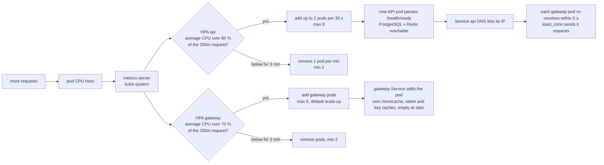

* **The database is the ceiling.** One PostgreSQL server; each API replica has at most 10 pooled connections plus
  one for its readiness check, so 8 replicas give PostgreSQL at most 88 (of `max_connections = 200`). Beyond that, capacity comes from the database (read replicas, a bigger instance, a
  pooler).
* Rate limits per user are shared in Redis (flow 7), so they do not grow with the number of replicas.
* Change a range without touching the other project:
  `kubectl -n product-management patch hpa api -p '{"spec":{"minReplicas":4}}'`.

Code: [`hpa.yaml`](../backend/deploy/k8s/base/hpa.yaml) (HPA `api`), [`service.yaml`](../backend/deploy/k8s/base/service.yaml)
(Service `api`), [`gateway.yaml`](../frontend/deploy/k8s/base/gateway.yaml) (HPA `gateway`),
[`default.conf.template`](../frontend/gateway/default.conf.template) (`resolver valid=5s`, `resolve`, `least_conn`),
[`cluster-addons.sh`](../infra/cluster-addons.sh). Decision:
[ADR 0018](adr/0018-autoscaling-and-scale-testing.md).

---

## 11. Load test and verification

### The teams run: concurrency, retries and the ledger

`seed-bulk.sh` loads the large catalogue; `run.sh teams` runs k6 *inside* the cluster (a Job hitting the gateway
Service) with many virtual users, signed in as the demo accounts, browsing, searching and changing stock, a share of
the changes sent twice with the same `Idempotency-Key`. Afterwards the script compares the number of changes k6 saw applied with the rows the ledger
gained: one applied change must mean exactly one ledger row. Then `verify-data.sh` checks the data invariants.

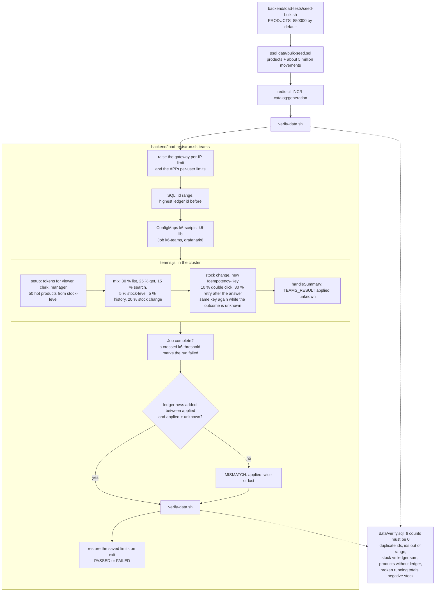

Other scenarios (`smoke`, `load`, `stress`, `spike`, `stock-consistency`, `rate-limit`, `browse`) use the same
`run.sh` Job without the ledger comparison. Every scenario except `rate-limit` raises the API's per-user limits for
the run, and `stress`, `spike`, `browse` and `teams` also the gateway's per-IP limit; the deployed values are saved
first and set back on exit, so no override is left behind. Code:
[`seed-bulk.sh`](../backend/load-tests/seed-bulk.sh), [`run.sh`](../backend/load-tests/run.sh), [`teams.js`](../backend/load-tests/teams.js),
[`verify-data.sh`](../backend/load-tests/verify-data.sh), [`verify.sql`](../backend/load-tests/data/verify.sql). Results:
[load-test-results.md](load-test-results.md). Decisions: [ADR 0015](adr/0015-load-testing.md),
[ADR 0018](adr/0018-autoscaling-and-scale-testing.md).

### The assessment, checked against the running system

`backend/scripts/check-requirements.py` walks the assessment PDF requirement by requirement through the gateway (so the
requests spread over the replicas), with `Cache-Control: no-cache` on every call and retrying on 429.

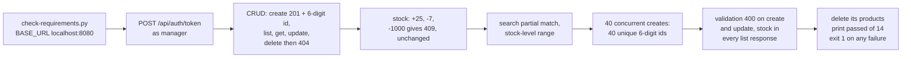

Code: [`check-requirements.py`](../backend/scripts/check-requirements.py).

---

## 12. Logs, from a request to Grafana

The system is observed through its logs alone ([guide chapter 8](guide/08-observability.md)). The gateway keeps a
valid incoming `traceparent` or builds one from its request id, logs the `trace_id`, and passes the header on; the
API's log lines carry the same id. Both write JSON to stdout; collectors push everything to Loki on the log server,
outside the cluster (`LOKI_URL`), which keeps it for 14 days. The whole chain is optional (the infra's `logs`
component): without it the pods still log to stdout and the gateway answers `/collect` with 204. The browser has no stdout anyone can read, so the web app
reports its errors (errors only) with the Grafana Faro SDK to the gateway's `/collect`, which forwards them to Alloy's
`faro.receiver`.

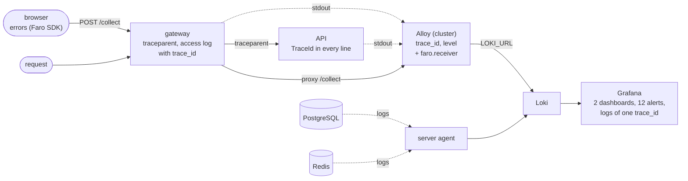

Code: [`browser-errors.ts`](../frontend/src/app/core/observability/browser-errors.ts), [`trace.js`](../frontend/gateway/trace.js), [`LoggingExtensions.cs`](../backend/ProductManagement.Api/Observability/LoggingExtensions.cs),
[`config.alloy`](../infra/logs/k8s/config.alloy), [`server-agent.alloy`](../infra/logs/server-agent.alloy),
[`rules.yaml`](../infra/logs/grafana/provisioning/alerting/rules.yaml).
