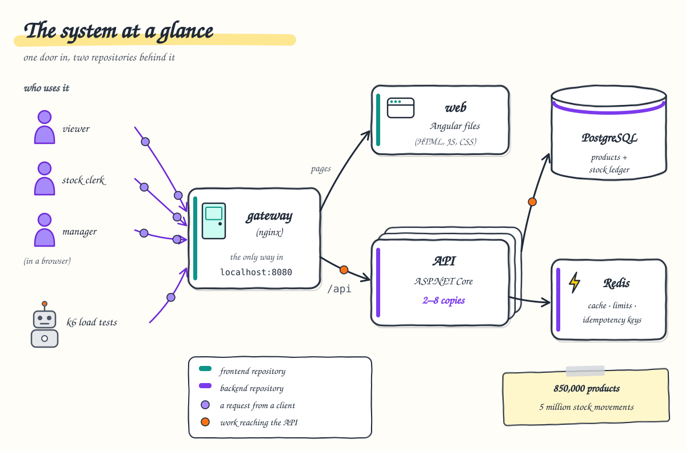

# 1. Overview

**After this chapter you will know** what the system does, who uses it, which pieces it is made of, how the work is
split into three parts (deploy, backend, frontend), the few numbers that describe it, and where to read next.



---

## What the system does

The assessment asks for a product and stock management API with an Angular front end. In one paragraph:

> Products can be created, read, updated and deleted. Stock can be **decreased** and **increased by any quantity**
> (`POST /api/products/{id}/decrement-stock/{quantity}` and `.../add-to-stock/{quantity}`, both answering OK). Products
> can be found by **part of their name** and by a **stock range**. Every product has a **unique six-digit id**, with no
> duplicates even when several API instances run at once. The schema is built with **EF Core code-first migrations**
> and **seeded**. An **Angular UI** uses the API and reflects changes made through it. Everything is **tested**.

All of that is implemented, and `tools/check-requirements.py` checks it against the running system (14 checks;
see [chapter 10](10-testing-and-quality.md)). On top of the PDF, the system was built to the standard of a service
that could go to production: authentication, permissions, rate limits, caching, autoscaling, a stock ledger,
exactly-once writes and load tests. [Chapter 11](11-production-readiness.md) says honestly what is still missing.

## Who uses it

Every caller is a **registered API consumer**: a client id, a secret (stored only as a PBKDF2 hash) and one or more
roles. The local demo consumers' hashes are generated on each machine by
[`deploy/scripts/lib/local-secrets.sh`](../../deploy/scripts/lib/local-secrets.sh) (into the Secret `api-secrets`; never committed); staging and
production get theirs from the secrets of their GitHub environment.

| Consumer | Role | What it may do | Who it represents |
| --- | --- | --- | --- |
| `viewer` / `viewer` | `viewer` | browse, search, see stock history | someone who only looks |
| `clerk` / `clerk` | `stock-clerk` | + add and remove stock | a warehouse clerk |
| `manager` / `manager` | `manager` | + create, edit and delete products | a catalogue manager |

Two kinds of client use these accounts:

* **People**, through the Angular app at http://localhost:8080. The UI hides buttons a role cannot use; the API
  enforces the same rules on every request.
* **Load tests**, k6 scripts run as a Job inside the cluster ([chapter 6](06-scaling-and-capacity.md)).

## The building blocks

Everything runs in Kubernetes, on Docker Desktop's single-node cluster locally (k3s is the target for staging and
production). The application has its own namespace, `product-management`, with stateless workloads only. PostgreSQL,
Redis and the logs (Loki, Grafana and the collector Alloy; optional) are shared infrastructure for any service on the
cluster and run in a second namespace, `infra`, with their data on PersistentVolumeClaims, so the application's
namespace can be deleted and redeployed from Git at any time without touching the data
([chapter 8](08-observability.md) for the logs, [chapter 9](09-deployment-and-operations.md) for the layout).

| Piece | What it is | Its job, in one line |
| --- | --- | --- |
| **gateway** | nginx, 2–6 pods (autoscaled) | The only door: rate limit per IP, token check, 1 s cache for API reads, security headers, routing. |
| **web** | nginx, 2 pods | Serves the built Angular app (HTML, JS, CSS). |
| **api** | ASP.NET Core (.NET 10), 2–8 pods (autoscaled) | The REST API: issues and verifies tokens, permissions, per-user limits, validation, business rules. |
| **PostgreSQL** | PostgreSQL 18, a StatefulSet in `infra` with a 20 GiB volume and a nightly backup | The source of truth: products, categories, the stock ledger, the id sequence. The API connects as `pm_app`, which can read and write rows but not change the schema. |
| **Redis** | Redis 8, a Deployment in `infra`, memory only, password protected | Shared state for the API replicas: read cache, idempotency keys, rate-limit buckets, failed sign-ins. |
| **migrations** | applied by the API itself, when each pod starts, as the schema owner `pm_migrator` | Brings the schema up to date (EF Core migrations, and the sample data where configured) before the pod serves; replicas starting together take turns on a PostgreSQL advisory lock, so they are applied once. No separate job or pod. |
| **HPAs** | two HorizontalPodAutoscalers | Add or remove API and gateway pods based on CPU. |
| **logs** (optional) | Alloy, Loki and Grafana in `infra`; Alloy reads every pod's log, PostgreSQL's and Redis' included | Every log line in one place, the browser's errors included, kept 14 days; two dashboards, twelve alerts, one trace id per request ([chapter 8](08-observability.md)). |

The back end follows clean architecture in three projects: `Core` (the domain rules and the use cases, organised by
feature, no EF Core and no HTTP) ← `Infrastructure` (EF Core, Redis) ← `Api` (HTTP), which also uses `Core` directly
([ADR 0001](../adr/0001-clean-architecture.md)). The front end is split into `core`, `shared` and `features`
([chapter 7](07-frontend.md)).

## Three parts, one place that deploys

The system is one GitHub repository with three folders: backend, frontend and deploy. The two application folders
hold code, tests and Dockerfiles, and each has a GitHub Actions workflow that builds images and publishes SemVer
versions of them (a tag `backend/v1.4.0` or `frontend/v1.4.0`); `deploy/` holds what runs in every environment
(GitOps): the Kubernetes manifests with the chosen versions, the shared infrastructure and the scripts that apply them
(the API then migrates its own database). Only its workflows change the clusters, and they pull new versions in (a
pull release model):

| Part | What it holds | Released or deployed by |
| --- | --- | --- |
| `backend/` | The .NET solution, its Dockerfile and tests; `ci/release-notes.sh` for its GitHub Releases. | the workflow Backend publishes `api:X.Y.Z` for a tag `backend/vX.Y.Z`; `deploy/` picks it up (staging after every release, production by pull request) |
| `frontend/` | The Angular workspace, the web and gateway Dockerfiles, unit and Playwright tests; `ci/release-notes.sh`. | the workflow Frontend publishes `web:X.Y.Z` and `gateway:X.Y.Z` for a tag `frontend/vX.Y.Z`, like the backend |
| `deploy/` | `apps/backend/` (the API's Deployment, with its configuration as environment variables, the headless Service `api`, autoscaler, disruption budget, network policy) and `apps/frontend/` (the web app and the gateway); `environments/<local, staging, production>/` (one Kustomize folder per environment: connection strings, a few settings, the image tags); `infra/` (the shared infrastructure in the namespace `infra`: PostgreSQL in `postgres.yaml` with its settings, StatefulSet and nightly backup, Redis in `redis.yaml`, the logs in `logs.yaml`: Loki, Grafana with its alert rules, Alloy; the dashboards in `dashboards/`); `scripts/` (`deploy.sh`, `infra.sh`, `create-database.sh` for a service's database, users and the Secret `database-credentials`, `versions.sh` and `set-version.sh` for the versions, `add-node.sh` for a k3s node); `argocd/` (prepared for Argo CD). | its workflows (Update staging after every release; Deploy's `deploy-staging` and `deploy-production`) run `scripts/deploy.sh <environment> apps` (apply; the new API pods migrate); locally `deploy/scripts/infra.sh up` and `deploy/scripts/deploy.sh local` |

The documentation (`docs/`) and the tools (`tools/`: the load tests and the requirements check) sit next to the
three, in the same repository.

| Image | Built from | Used by |
| --- | --- | --- |
| `product-management/api` | `backend/Dockerfile` | the API pods (which also apply the migrations when they start) |
| `product-management/web` | `frontend/Dockerfile` | the web pods |
| `product-management/gateway` | `frontend/gateway/Dockerfile` | the gateway pods |

`deploy/scripts/deploy.sh` takes an environment (`local`, `staging` or `production`); the Deploy workflow runs the
same script ([chapter 9](09-deployment-and-operations.md)). The API knows its data stores only
through two connection strings in its environment's `api.yaml` (`postgres.infra.svc.cluster.local:5432`,
`redis.infra.svc.cluster.local:6379`), which hold no password; the passwords come from the Secrets
`database-credentials` (made by `deploy/scripts/lib/create-database.sh`) and `redis-credentials` (copied by
`deploy/scripts/deploy.sh` from the shared Redis' password). Moving to another database or cache, even outside the cluster, changes those
two strings and the passwords, nothing else. The logs are optional: without them the application works the same.

The contract between the API and the web app is small and made of names only:

* the namespace `product-management`;
* the Service `api`, to which the gateway sends `/api` requests and from which it downloads the API's public signing
  key (`/.well-known/jwks.json`);
* the token issuer and audience (`product-management-api`), which the gateway checks;
* the pod label `app.kubernetes.io/name: gateway`, which the API's NetworkPolicy admits.

## The numbers

| What | Value | Source |
| --- | --- | --- |
| Products in the scale dataset | 850,024 | `tools/load-tests/seed-bulk.sh` |
| Stock movements (ledger rows) | about 5 million seeded; grown to 20 million to measure the database at scale | same; [ADR 0022](../adr/0022-database-at-scale.md) |
| Deepest stock-history page of a busy product (SQL), 20 million ledger rows | 1.3–6.3 s before, 8–22 ms after (late row lookup) | [ADR 0022](../adr/0022-database-at-scale.md) |
| Product ids available | 900,000 (100000–999999, never reused) | [ADR 0002](../adr/0002-product-id-generation.md) |
| Read capacity, one 8-CPU laptop | 18,177 requests/s, 0 errors, p95 47 ms | [load-test-results.md](../load-test-results.md#five-digits-tokens-verified-at-the-gateway-microcache-shared-per-role) |
| Worst-case mix (25 % writes, reads spread over all products) | ~2,400 requests/s, 0 errors | same |
| Ten teams, 30 % of stock changes sent twice | 281 requests/s, 0 errors, p95 4.3 ms, no change applied twice | same |
| 300 simultaneous orders for 100 units | exactly 100 succeed, stock ends at 0 | [load-test-results.md](../load-test-results.md#docker-desktop-cluster-final-setup) |
| Automated tests | 390 back end, 187 front end, 22 end-to-end | [chapter 10](10-testing-and-quality.md) |

## Map of the rest of the documentation

| Chapter | Read it to understand |
| --- | --- |
| [2. The request journey](02-request-journey.md) | how one request travels from the browser to PostgreSQL and back, with real headers |
| [3. Caching](03-caching.md) | the four cache layers, what each keeps, and what a write invalidates |
| [4. Security](04-security.md) | sign-in, tokens, the double token check, permissions, rate limits, browser and network protection |
| [5. Stock and consistency](05-stock-and-consistency.md) | unique ids, no overselling, the ledger, edit conflicts, exactly-once retries |
| [6. Scaling and capacity](06-scaling-and-capacity.md) | autoscaling, why the database is the ceiling, what each load test found |
| [7. Front end](07-frontend.md) | the Angular structure, the product page's data flow, what Lighthouse and Playwright found |
| [8. Logs, dashboards and alerts](08-observability.md) | how the system is observed through its logs, and what each alert means |
| [9. Deployment and operations](09-deployment-and-operations.md) | what runs where, the three folders, the environments, CI/CD and releases, day-2 commands |
| [10. Testing and quality](10-testing-and-quality.md) | the test pyramid, what each layer proves, how to run it |
| [11. Production readiness](11-production-readiness.md) | what is done, what the environment must still provide |
| [12. From zero to production](12-from-zero.md) | the runbook for standing up staging and production |
| [13. Reading the code](13-reading-the-code.md) | where each answer is in the code, and what each construct means |

Reference material (decision records, precise sequence diagrams, the component catalogue, raw load-test results) is
listed in the [documentation home](../README.md#reference-material).

## Where to look

* Assessment requirements, one by one: [README "Requirements checklist"](../../README.md#requirements-checklist)
* Component catalogue and data model: [architecture.md](../architecture.md)
* All decisions: [ADR index](../adr/README.md)

## How to verify

```bash
kubectl config use-context docker-desktop
deploy/scripts/infra.sh up                             # PostgreSQL, Redis and the logs, in the namespace infra
deploy/scripts/deploy.sh local                         # database (first run), images, API (migrates), web app, gateway
kubectl -n product-management get pods,svc,hpa         # the pieces in the cluster
deploy/scripts/infra.sh status                         # the shared infrastructure
python3 tools/check-requirements.py                    # the assessment PDF, 14 checks against the running system
open http://localhost:8080                             # sign in as viewer, clerk or manager
```
