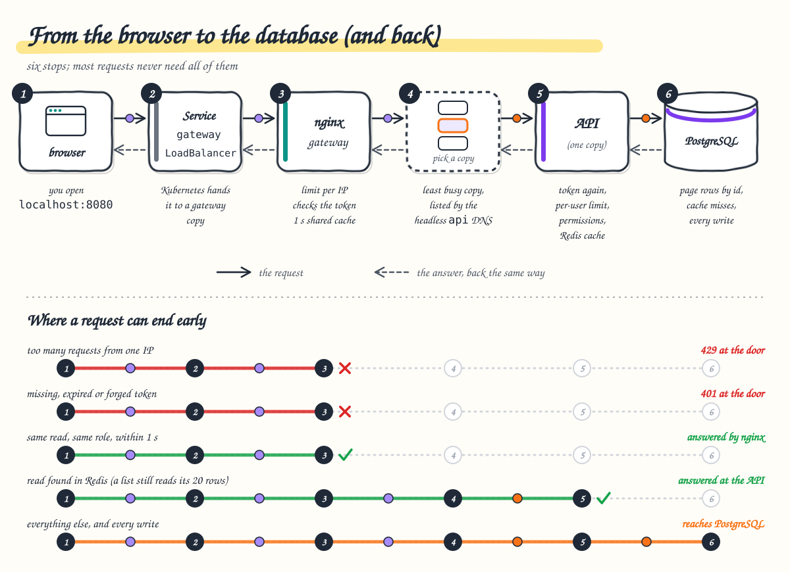

# 2. The request journey

**After this chapter you will know** the few Kubernetes words needed to read the rest of the documentation, why the
gateway is the only way in, why the API's Service is headless, what the API does with each request, every place where a
request can end early, and what one real request looks like on the wire.



---

## Cluster words in plain language

| Word | Meaning here |
| --- | --- |
| **Node** | A machine that runs containers. Docker Desktop's cluster has one node, `docker-desktop`: a Linux VM with 8 CPUs and 8 GB of memory. Everything (including the load generator during load tests) shares it. |
| **Pod** | One running copy of a container, with its own IP address inside the cluster. Pods come and go: a deploy replaces them, the autoscaler adds and removes them. |
| **Deployment** | The recipe that keeps N pods of one kind running (`api`, `gateway`, `web`). |
| **Service** | A fixed name and address in front of a changing set of pods, chosen by label. Other pods use the name (`api`, `web`) and never need to know pod IPs. |
| **ClusterIP** | The default Service type: one virtual IP reachable only inside the cluster. The node's networking (kube-proxy) picks a pod **per TCP connection**. |
| **LoadBalancer** | A Service that is also reachable from outside. Docker Desktop publishes it on `localhost`; a cloud provider would create a real load balancer. Only the `gateway` Service has this type. |
| **Headless Service** | A Service with `clusterIP: None`: no virtual IP. Its DNS name returns the IP of **every ready pod**, so the caller can choose a pod itself. |

The database and cache servers are outside the cluster and have no Service: the API's connection strings name them
directly (locally `host.docker.internal`, your own machine; elsewhere their private DNS names).

What is running at a typical moment (`kubectl -n product-management get pods,svc`; names and addresses vary):

```text
pod/api-66667cc5dd-j2vd5       1/1   Running
pod/api-66667cc5dd-k7n84       1/1   Running
pod/gateway-7b59bd495b-qv4d6   1/1   Running
pod/gateway-7b59bd495b-s9qvf   1/1   Running
pod/web-9546b68d9-gmztg        1/1   Running
pod/web-9546b68d9-whmhj        1/1   Running

service/api       ClusterIP      None            <none>      8080/TCP
service/gateway   LoadBalancer   10.105.26.107   localhost   8080:32141/TCP
service/web       ClusterIP      10.109.64.200   <none>      8080/TCP
```

## The gateway is the only door

`http://localhost:8080` is the `gateway` Service. Every other Service is internal, unreachable from your machine
(Swagger is reached only with `kubectl port-forward deployment/api 5080:8080`). The browser therefore talks to one origin for both the app
and the API, which is why the API needs no CORS in the cluster.

The gateway's routing, from [`default.conf.template`](../../frontend/gateway/default.conf.template):

| Path | What happens |
| --- | --- |
| `/healthz` | answered by nginx itself (`ok`), for Kubernetes probes |
| `/api/auth/token` | per-IP limit, then straight to an API pod: no token needed (this is where tokens come from), never cached |
| `/api/...` (everything else) | per-IP limit, **token verified** by `jwt.js`, then the 1 s microcache, then an API pod |
| `*.js`, `*.css`, fonts, images | to a web pod, kept in the gateway's static cache for 7 days |
| anything else (`/`, `/products`, `/login`) | to a web pod, which serves `index.html` for app routes |

The gateway also adds the security headers (Content-Security-Policy and others, see [chapter 4](04-security.md)),
compresses responses (gzip) and logs every request as one JSON line, including which API pod answered.

## Why the API's Service is headless

nginx keeps connections to its upstreams open and reuses them (`keepalive 64`). With an ordinary ClusterIP Service,
kube-proxy balances **connections**, not requests: a reused connection stays on the pod it first reached, so a new
pod added by the autoscaler would get almost no traffic until old connections closed.

So the API's only Service, **`api`**, is headless: it has no virtual IP. Its DNS name returns every ready API pod, and the
gateway:

* re-resolves it every 5 s (`resolver ... valid=5s` and `server ... resolve`), so new pods join and removed pods
  leave within seconds, without restarting nginx;
* sends **each request** to the pod with the fewest requests in flight (`least_conn`);
* if a pod fails or times out before answering, retries the request once on another pod (`proxy_next_upstream`,
  two tries; nginx does this only for methods that are safe to repeat).

A measurement from the load tests: after scaling the API to four pods, 200 consecutive requests were spread exactly
50/50/50/50 within seconds, with no change on the front-end side ([load-test-results.md](../load-test-results.md#what-the-numbers-say), point 6).

The gateway also downloads the API's public signing key through the same name (`JWKS_URL`). Earlier versions had a
second, ordinary `api` Service for that and for Swagger, next to the headless `api-headless`; the ordinary one was
dropped, the headless one later took the name `api` (`api.product-management.svc.cluster.local:8080`), and Swagger is
reached by port-forwarding the Deployment.

## What the API does with each request

The order is set in [`Program.cs`](../../backend/ProductManagement.Api/Program.cs) and matters:

1. **Forwarded headers.** The client's address is taken from `X-Forwarded-For`. This is safe because a
   NetworkPolicy lets only the gateway reach the API (see [chapter 4](04-security.md) for the caveat on Docker
   Desktop).
2. **Exception handler and status pages.** Any error leaves as `application/problem+json` with an `errorCode`
   ([ADR 0005](../adr/0005-error-handling.md)).
3. **Authentication.** The bearer token is verified again (ES256 only, issuer, audience, lifetime). The gateway
   already checked it; the API does not rely on that.
4. **Rate limiter.** A per-user token bucket shared in Redis (50/s, burst 100), plus a stricter one for writes
   (10/s, burst 20).
5. **Authorization.** The endpoint's permission (`products:read`, `stock:write` or `products:write`).
6. **Controller.** For create and the stock endpoints, the idempotency filter runs first
   ([chapter 5](05-stock-and-consistency.md)). The controller then calls one use case and maps its result to HTTP.
   It has no other logic.
7. **Use case → domain → infrastructure.** Validation, business rules, then Redis and PostgreSQL.

## Where a request can end early

| Where | Why it stops there | What the client gets |
| --- | --- | --- |
| Browser cache | the same list was fetched less than 5 s ago | the cached answer, no request sent |
| Gateway, rate limit | more than 200 requests/s (burst 400) from one IP | `429` |
| Gateway, token check | missing, malformed, forged, expired or foreign token | `401` problem details, from nginx |
| Gateway, microcache | the same GET by a caller with the same roles within 1 s | `200` with `X-Cache-Status: HIT` |
| API, authentication | token rejected by the API's own check | `401` |
| API, rate limit | the user's bucket is empty | `429` + `Retry-After` |
| API, authorization | the role lacks the permission (a viewer deleting) | `403` |
| API, validation | `pageSize=500`, a negative quantity, a malformed body | `400` with the invalid fields |
| API, idempotency | a retry of a request already answered | the original answer, `Idempotent-Replayed: true` |
| API, Redis cache | count and page ids already cached | only the page's rows are read from PostgreSQL |
| PostgreSQL | everything else, and every write | the real data |

## One request, end to end

A stock clerk opens the product list. The browser sends
`GET /api/products?page=1&pageSize=20` with `Authorization: Bearer <token>`. The values below were captured on the
running cluster with `curl`.

**1. The token.** It came from `POST /api/auth/token` with `{"clientId":"clerk","clientSecret":"clerk"}`, which
answered `{"accessToken":"…","tokenType":"Bearer","expiresIn":3600}`. Decoded, its two readable parts are:

```json
{"alg":"ES256","kid":"r0YpCJdnKihElfyRqYOajLPSTUW5T2Ips4BkYFKD1Gc","typ":"JWT"}
{"aud":"product-management-api","iss":"product-management-api","sub":"clerk","roles":"stock-clerk",
 "jti":"fb7b07f0bf7540f09daf7ef00a665f50","iat":1791589059,"nbf":1791589059,"exp":1791592659}
```

**2. Browser.** `ProductsApi.query` marks the request as cacheable; the `clientCacheInterceptor` finds nothing yet,
the `authInterceptor` adds the token, and `fetch` sends it to `localhost:8080`.

**3. Gateway.** The per-IP limit passes. `auth_request /_jwt` runs `jwt.js`: the token is new to this pod, so it
checks that `alg` is `ES256`, fetches the public key for that `kid` (once, then kept for an hour), verifies the
signature, the issuer, the audience and `exp`/`nbf`, and answers `204` with `X-Jwt-Scope: stock-clerk`. The token is
remembered until it expires (at most 10 minutes), so the next request with it skips the cryptography. The microcache
key is `GET|/api/products?page=1&pageSize=20|stock-clerk`. There is no entry yet, so the request goes on.

**4. API pod.** Chosen by `least_conn` among the pods listed by the headless Service `api`. Authentication, rate limiting and
`products:read` pass. `CachingProductQueries` reads the listing generation from Redis, then the cached count and the
20 ids of page 1 (computing and storing them if missing), then reads those 20 rows from PostgreSQL by primary key.

**5. The response:**

```http
HTTP/1.1 200 OK
Server: nginx
Content-Type: application/json; charset=utf-8
X-Cache-Status: MISS
Content-Security-Policy: default-src 'self'; script-src 'self'; style-src 'self' 'unsafe-inline'; img-src 'self' data:; font-src 'self'; connect-src 'self'; object-src 'none'; base-uri 'self'; form-action 'self'; frame-ancestors 'none'
X-Content-Type-Options: nosniff
X-Frame-Options: DENY
Referrer-Policy: strict-origin-when-cross-origin
Permissions-Policy: camera=(), microphone=(), geolocation=(), payment=(), usb=()
Cross-Origin-Opener-Policy: same-origin
Cross-Origin-Resource-Policy: same-origin

{"items":[{"id":100008,"name":"Acetate Round Frame","price":129.00,"stockQuantity":71,
           "categoryName":"Frames","version":309594, ...}, ... 19 more],
 "page":1,"pageSize":20,"totalCount":850024,"totalPages":42502}
```

**6. The same request again.** Six identical requests in a row gave
`EXPIRED, HIT, EXPIRED, HIT, HIT, HIT`. `HIT` means nginx answered from its microcache and the API never saw the
request. `EXPIRED` means the entry was older than 1 s and was refreshed. There are two gateway pods, each with its own
microcache, so consecutive requests can land on different pods and see different states. With
`Cache-Control: no-cache` (which the web app sends right after the user's own change) the answer is `BYPASS`: the
cache is skipped but refreshed.

**7. A single product carries a version.** List responses have no `ETag`; a single product does:

```http
GET /api/products/100004  →  200 OK
ETag: "757"
{"id":100004,"name":"Office Lens Desk","stockQuantity":0,"version":757, ...}
```

`757` is the row's PostgreSQL `xmin`. The edit form sends it back as `If-Match` ([chapter 5](05-stock-and-consistency.md)).

**8. Without a token** the request never reaches the API:

```http
GET /api/products?page=1&pageSize=20  →  401 Unauthorized
Content-Type: application/problem+json
WWW-Authenticate: Bearer error="invalid_token"

{"title":"Unauthorized","status":401,"detail":"A valid access token is required (missing or malformed bearer token).","errorCode":"invalid_token", ...}
```

## Where to look

* Gateway: [`default.conf.template`](../../frontend/gateway/default.conf.template),
  [`jwt.js`](../../frontend/gateway/jwt.js), [`nginx.conf`](../../frontend/gateway/nginx.conf),
  [`security-headers.conf`](../../frontend/gateway/security-headers.conf)
* Services and pods: [`backend/deploy/k8s/base`](../../backend/deploy/k8s/base) (Deployment `api`,
  [`service.yaml`](../../backend/deploy/k8s/base/service.yaml): the headless Service `api`),
  [`frontend/deploy/k8s/base`](../../frontend/deploy/k8s/base) (`gateway`, `web`),
  the connection strings in [`backend/deploy/k8s/overlays/local/api.yaml`](../../backend/deploy/k8s/overlays/local/api.yaml),
  [`infra/infra.sh`](../../infra/infra.sh) (the servers themselves)
* API pipeline: [`Program.cs`](../../backend/ProductManagement.Api/Program.cs),
  [`ProductsController.cs`](../../backend/ProductManagement.Api/Controllers/ProductsController.cs),
  [`CachingProductQueries.cs`](../../backend/ProductManagement.Infrastructure/Caching/CachingProductQueries.cs)
* Decisions: [ADR 0012 gateway](../adr/0012-gateway.md), [ADR 0020 token check at the gateway](../adr/0020-edge-token-verification.md),
  [ADR 0011 Kubernetes](../adr/0011-kubernetes-deployment.md)
* Precise sequence diagrams: [flows.md §3, authenticated request](../flows.md#3-authenticated-request-through-the-gateway)
  and [§4, read path](../flows.md#4-read-path-request-by-request)

## How to verify

```bash
kubectl -n product-management get pods,svc -o wide
kubectl -n product-management get endpointslices -l kubernetes.io/service-name=api   # one address per API pod

TOKEN=$(curl -s -X POST localhost:8080/api/auth/token -H 'Content-Type: application/json' \
  -d '{"clientId":"clerk","clientSecret":"clerk"}' | jq -r .accessToken)
for i in 1 2 3 4 5 6; do
  curl -s -o /dev/null -D - "localhost:8080/api/products?page=1&pageSize=20" -H "Authorization: Bearer $TOKEN" | grep X-Cache
done
curl -s -D - -o /dev/null localhost:8080/api/products/100004 -H "Authorization: Bearer $TOKEN" | grep ETag
curl -s -i localhost:8080/api/products                                   # 401 from the gateway

kubectl -n product-management logs deploy/gateway --tail=5               # JSON access log: upstream pod, cache status
```
