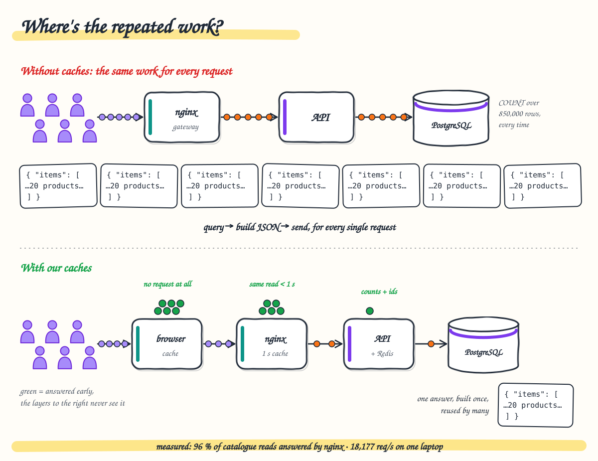
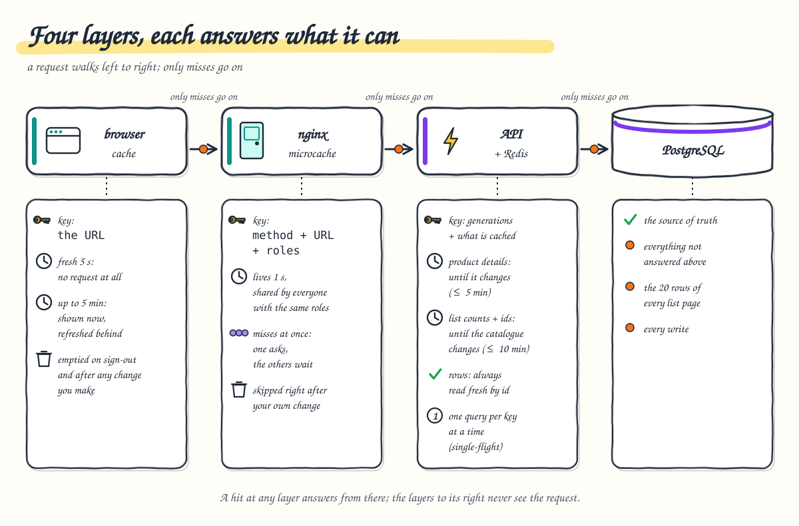
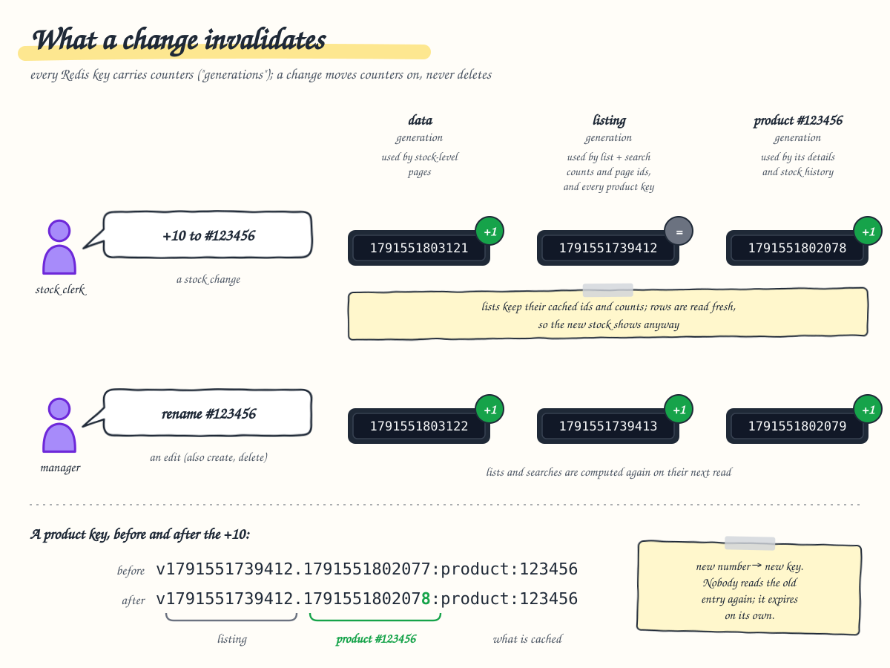

# 3. Caching: where the repeated work goes

**After this chapter you will know** the four places where an answer can come from, what each one keeps, under which
key and for how long, what makes it forget, why the stock shown is always current even though lists are cached, and
what the measurements say each layer is worth.



---

## The problem

Many users mostly ask for the same few things: the first pages of the list, popular searches, the low-stock view.
Without caches every one of those requests repeats the same work all the way down: verify the token, run a
`COUNT(*)` over 850,000 rows, walk an index to the page, build the JSON, send it. Caching is about doing that work
once and reusing the result, without ever showing something wrong.

## The four layers

A request meets the layers in this order. A hit at one layer answers from there, and the layers below never see the
request.



| Layer | What it keeps | Key | Lifetime | Forgotten when |
| --- | --- | --- | --- | --- |
| **1. Browser** (`ResponseCache` + `clientCacheInterceptor`) | GETs that opt in: product lists, searches, stock-level lists, the summary counts, stock histories; the next page is prefetched into it | the URL with its parameters | fresh 5 s (no request at all); stale up to 5 min (shown at once, then refreshed) | any POST, PUT or DELETE completes (whole cache cleared), sign-out; at most 200 entries, least recently used out |
| **2. Gateway microcache** (nginx) | `200` answers to `GET`/`HEAD` under `/api/` | method, URI, the caller's roles (`GET\|/api/products?page=1&pageSize=20\|stock-clerk`) | 1 s | time only; a request with `Cache-Control` or `Pragma` skips it (and refreshes the entry) |
| **3. API + Redis** (`CachingProductQueries`) | counts and page ids of lists and searches; whole stock-level pages; product details; stock-history pages | a name plus the *generations* it depends on (below) | count and ids 10 min, details 5 min, stock-level pages and histories 1 min | a write moves a generation on (below) |
| **4. PostgreSQL** | nothing: the source of truth | | | |

A few details that matter:

* **Browser.** The cache is in memory only, per tab, never written to disk, and emptied at sign-out, so one session's
  data never reaches the next. Product-by-id reads and all writes are never cached here.
* **Gateway.** Each gateway pod has its own microcache. When several requests miss the same key at once, one goes to
  the API and the others wait for it (`proxy_cache_lock`, up to 2 s); an entry being refreshed is served stale
  meanwhile. The key holds the roles, not the token, which is safe only because the gateway has just verified the
  token's signature ([chapter 4](04-security.md)). Every read endpoint returns the same data to everyone allowed to
  call it, so users with the same roles can share an entry.
* **Redis.** Shared by every API replica. All keys start with `product-management:`. If Redis is unreachable the API
  reads from PostgreSQL directly (it "fails open"); the cache is an optimisation, never needed for correctness. A
  Redis command that times out or is cancelled is treated the same way, and logged once as a warning.
* **Conditional GET.** `GET /api/products/{id}` answers `304 Not Modified` (no body) when `If-None-Match` names its
  current `ETag`. That helps clients calling the API directly; through the gateway, the microcache answers repeated
  reads itself and does not pass conditional headers on.

## Lists are cached in two parts, so the stock is always current

A list or search page is cached as **which products and how many** (the count and the page's 20 ids), but the
**rows** are read from PostgreSQL by primary key on every request that reaches the API. Reading 20 rows by primary
key takes about a millisecond; the count and the index walk are the expensive part. So a list stays cached across
stock changes, yet always shows the current quantity.

Stock-level pages (`/api/products/stock-level?min=0&max=10`) are the exception: which products they contain depends on
the stock, so they are cached whole and forgotten on every write.

## What a write invalidates: generations

Redis entries are never deleted. Every key embeds the version numbers ("generations") its value depends on, and a
write increments those numbers right after it commits. Entries under an old number are simply never read again and
expire on their own.



There are three kinds of generation:

| Generation | Moved by | Protects |
| --- | --- | --- |
| **data** (`catalog:generation`) | every write | stock-level pages |
| **listing** (`catalog:listing-generation`) | create, update, delete, bulk seeding, and the `migrate` command when it is given the Redis connection | list and search counts and ids; product details; histories |
| **product** (`catalog:product:{id}:generation`, one per product) | any change to that product, stock included | that product's details and history |

So keys look like these, read from the running Redis: `product-management:v1791571461580:products:all:count` and
`product-management:v1791571461580:products:all:ids:p1:s20` (listing generation 1791571461580), or
`product-management:v1791571461580.<product generation>:product:100004` for a product's details (listing and
product generations joined by a dot). Older entries such as `v1791571461539:...` are still in Redis but nobody asks
for them any more. A stock change on
product 100004 moves the data generation and product 100004's generation, and nothing else: every other product's
details, the full list and every search stay cached.

Two choices make this safe with many replicas:

* **The version is read before the database.** If a write commits in between, the possibly older result is stored
  under the previous version, which nobody reads any more. With "delete the key after writing", a slow reader could
  put the old value back.
* **Invalidation happens after the commit.** Invalidating before would let a concurrent reader re-cache the old state.

A missing generation counter (first use, or evicted) restarts from the clock, not from zero, so a version is never
reused for different data.

## Single-flight: one query per replica, not one per request

When a popular entry is missing, every request in flight would run the same query at the same moment (a "cache
stampede"). `SingleFlight` lets the first request run it and makes the others on the same replica wait for its
result. If that first request fails (for example because its client gave up), a waiting request loads for itself.

## 1,000 users open page 1 within the same second

All of them are stock clerks, so they have the same roles, and their browser caches are empty.

1. All 1,000 browsers send `GET /api/products?page=1&pageSize=20`.
2. On each gateway pod the first request misses; `proxy_cache_lock` holds the others behind it. **One request per
   gateway pod** reaches the API.
3. The API reads the listing generation from Redis, then the count and the 20 ids. If they are missing (first time for
   this generation), one query per replica computes them (single-flight) and stores them for 10 minutes.
4. The API reads the 20 rows by primary key from PostgreSQL and answers.
5. nginx stores the answer for 1 s and serves it to everyone waiting: the first user sees `X-Cache-Status: MISS`,
   the others `HIT`.
6. For the next 5 s each browser answers repeats itself without sending anything.

Then user 1 removes 3 units of a product shown on page 1:

7. The `POST .../decrement-stock/3` is never cached. The API changes the stock and writes the ledger row in one
   statement, then increments the data generation and that product's generation. The listing generation is untouched.
8. User 1's browser empties its cache (a write completed) and reloads page 1 with `Cache-Control: no-cache`. That
   skips the browser cache and the microcache.
9. The API finds the count and ids still valid in Redis and reads the 20 rows by primary key: user 1 sees the new
   stock immediately.
10. Everyone else sees it within about a second if their request reaches the API (the nginx entry is at most 1 s old),
    after at most 5 s from their own browser cache, and at the latest at the list's automatic refresh every 15 s.

## What the measurements say

From [load-test-results.md](../load-test-results.md):

| Change | Before | After |
| --- | --- | --- |
| Gateway microcache, keyed per token, steady 150 req/s | | 38 % of product GETs answered by nginx, p95 3.6 ms |
| Microcache keyed per role (tokens verified at the gateway), read capacity on one laptop | 5,470 req/s, 48 % answered by nginx, p95 793 ms | **18,177 req/s, 96 % answered by nginx, p95 47 ms**, 0 errors |
| Lists cached as count + ids, rows always fresh (ten teams, 850,000 products) | 123 req/s, 11.9 % errors, PostgreSQL saturated | 281 req/s, 0 errors, p95 13.4 ms (with the index and pool fixes of [chapter 6](06-scaling-and-capacity.md)) |
| Single-flight | 882 concurrent `COUNT(*)` over 850,000 rows at ~2 s each when an entry expired | one per key per replica |
| Per-product generations | a stock change invalidated every product's details | only that product's |

The cost: a user may see data up to 1 s old from the microcache, or up to 5 s old from their own browser cache, but
never after their own change (the `no-cache` reload), and lists never show an outdated stock quantity from Redis.

## Where to look

* Browser: [`response-cache.ts`](../../frontend/src/app/core/http/response-cache.ts),
  [`client-cache-interceptor.ts`](../../frontend/src/app/core/http/client-cache-interceptor.ts),
  [`products-api.ts`](../../frontend/src/app/features/products/data-access/products-api.ts) (`fresh` adds `Cache-Control: no-cache`)
* Gateway: [`default.conf.template`](../../frontend/gateway/default.conf.template) (`location ^~ /api/`)
* API: [`CachingProductQueries.cs`](../../backend/ProductManagement.Infrastructure/Caching/CachingProductQueries.cs),
  [`ICatalogCache.cs`](../../backend/ProductManagement.Infrastructure/Caching/ICatalogCache.cs),
  [`RedisCatalogCache.cs`](../../backend/ProductManagement.Infrastructure/Caching/RedisCatalogCache.cs),
  [`SingleFlight.cs`](../../backend/ProductManagement.Infrastructure/Caching/SingleFlight.cs),
  [`CacheOptions.cs`](../../backend/ProductManagement.Infrastructure/Caching/CacheOptions.cs),
  [`CacheInvalidatingUnitOfWork.cs`](../../backend/ProductManagement.Infrastructure/Caching/CacheInvalidatingUnitOfWork.cs),
  [`CacheInvalidatingProductRepository.cs`](../../backend/ProductManagement.Infrastructure/Caching/CacheInvalidatingProductRepository.cs),
  [`ProductQueries.cs`](../../backend/ProductManagement.Infrastructure/Products/ProductQueries.cs) (`PageAsync`)
* Decisions: [ADR 0008 Redis cache](../adr/0008-redis-cache.md), [ADR 0012 gateway](../adr/0012-gateway.md),
  [ADR 0020 shared microcache](../adr/0020-edge-token-verification.md), [ADR 0007 front-end state](../adr/0007-frontend-state.md)
* Precise diagrams: [flows.md §1 caching](../flows.md#1-caching-where-the-repeated-work-goes) (including
  [the 1,000-users sequence](../flows.md#1000-users-open-page-1-within-the-same-second)) and
  [§4 read path](../flows.md#4-read-path-request-by-request)

## How to verify

```bash
# Gateway microcache: MISS / HIT / EXPIRED / BYPASS (see chapter 2 for TOKEN)
curl -s -o /dev/null -D - "localhost:8080/api/products?page=1" -H "Authorization: Bearer $TOKEN" | grep X-Cache
curl -s -o /dev/null -D - "localhost:8080/api/products?page=1" -H "Authorization: Bearer $TOKEN" -H 'Cache-Control: no-cache' | grep X-Cache

# Redis: the generations and some cached entries
# (Redis runs in the namespace infra: infra/infra.sh up redis; redis-cli in the pod finds the password in REDISCLI_AUTH)
kubectl -n infra exec deployment/redis -- redis-cli GET product-management:catalog:listing-generation
kubectl -n infra exec deployment/redis -- redis-cli --scan --pattern 'product-management:v*:products:all:*' | head

# Automated proof
cd backend && dotnet test --project ProductManagement.Api.IntegrationTests \
  --filter-class ProductManagement.Api.IntegrationTests.Products.CacheTests     # 5 tests, real Redis + PostgreSQL (Docker)
cd frontend && npm run test:ci                                                  # includes the response-cache and interceptor specs
```

In the browser's developer tools (Network tab), going back to a page already seen sends no request, and "next page"
is usually already loaded by the prefetch.
