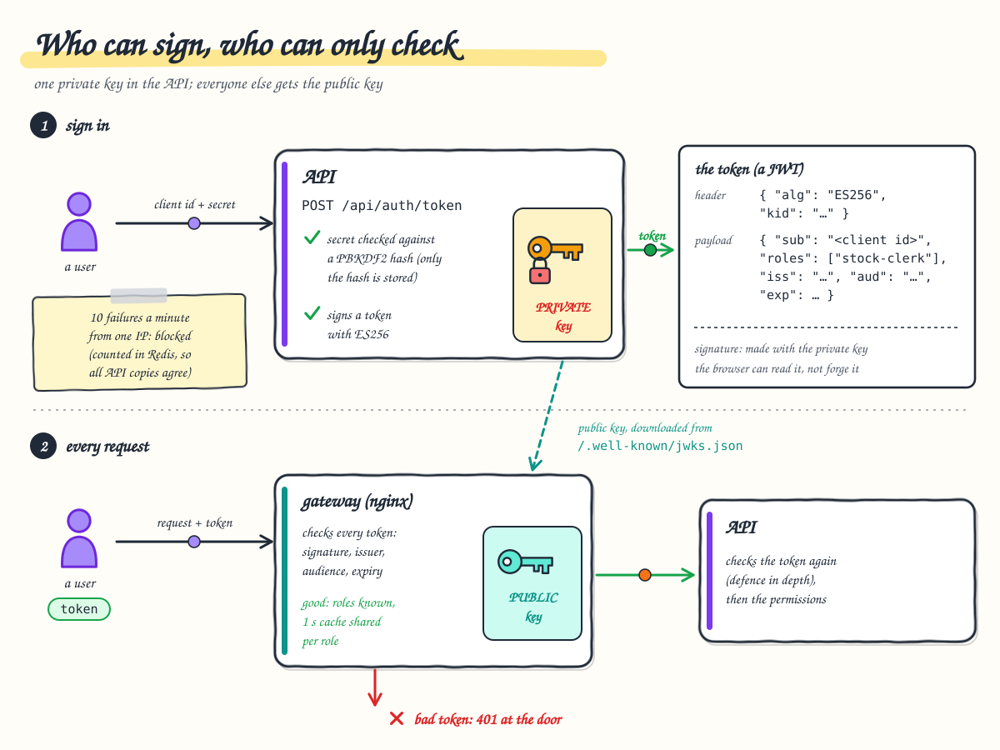

# 4. Security

**After this chapter you will know** how a caller signs in, what a token contains and who can verify it, why tokens
are checked twice, how roles become permissions, how the rate limits work across replicas, what protects the browser,
the network and the containers, and what still has to come from the production environment.



---

## Sign-in: consumers and secrets

There is no user database and no external identity provider. The callers are a small, known set of **API
consumers** ([chapter 1](01-overview.md#who-uses-it)), each with a client id, roles and a secret stored only as a
salted **PBKDF2-HMAC-SHA256** hash (100,000 iterations):

```text
"ClientId": "clerk",
"SecretHash": "pbkdf2-sha256$100000$<salt, Base64>$<hash, Base64>",
"Roles": ["stock-clerk"]
```

A new hash is made with `dotnet ProductManagement.Api.dll hash-secret <secret>`. The consumers are mounted into the
API pods from the Secret `api-secrets` (key `consumers.json`) as `/app/config/consumers.json`.

Signing in is `POST /api/auth/token` with `{"clientId":"clerk","clientSecret":"clerk"}`:

1. The gateway lets this one `/api` path through without a token (it is where tokens come from), applies its per-IP
   limit and never caches it.
2. The API applies a fixed window of 20 token requests per minute per IP (per replica).
3. It asks Redis whether this IP has failed 10 times in the current minute. If so: `429 too_many_failed_attempts`
   with `Retry-After`, **even with the right secret**.
4. It looks up the consumer and verifies the secret against the hash with a constant-time comparison. An unknown
   client id is checked against a dummy hash, so "unknown client" and "wrong secret" take the same time and give the
   same answer: `401 invalid_client`.
5. A failure increments `signin-failures:ip:<address>` in Redis (the one-minute window starts at the first failure).
   Because the counter is in Redis, ten failures spread over several replicas still add up to ten.
6. On success the API answers `{"accessToken":"…","tokenType":"Bearer","expiresIn":3600}`.

The login page then keeps the session in `sessionStorage` (survives a reload, gone with the tab), schedules a sign-out
when the token expires, and reads the roles only to hide buttons. It never verifies the token; it cannot, and it does
not need to.

## Tokens: ES256, `kid` and JWKS

The token is a JWT signed with **ES256** (ECDSA on the P-256 curve with SHA-256). A real one, decoded:

```json
{"alg":"ES256","kid":"r0YpCJdnKihElfyRqYOajLPSTUW5T2Ips4BkYFKD1Gc","typ":"JWT"}
{"iss":"product-management-api","aud":"product-management-api","sub":"clerk","roles":"stock-clerk",
 "jti":"fb7b07f0bf7540f09daf7ef00a665f50","iat":1791589059,"nbf":1791589059,"exp":1791592659}
```

* **Asymmetric on purpose.** Only the API holds the private key (Secret `api-secrets`, key `signing-key`), so only the API can issue tokens.
  Anyone can verify them with the public key, which the API publishes at `/.well-known/jwks.json`. The gateway
  therefore verifies tokens without holding any secret.
* **`kid`** (key id) is the RFC 7638 thumbprint of the public key. A verifier uses it to pick the right key, which is
  what makes a key rotation possible without downtime.
* **Lifetime** is one hour (`Authentication__AccessTokenLifetime`). There is no revocation list: a stolen token is
  valid until it expires. A `jti` deny-list in Redis is the documented next step if that is ever needed.
* The JWKS endpoint is not routed by the gateway, so it is not reachable from outside the cluster; the gateway fetches
  it over the in-cluster headless Service `api`.

A new signing key: `dotnet ProductManagement.Api.dll generate-signing-key` (locally, `FORCE=1 backend/deploy/local-secrets.sh`
then `backend/deploy/deploy.sh`).

## Verified twice: at the gateway and in the API

**At the gateway** (`jwt.js`, nginx's JavaScript module), for every `/api` request except the token endpoint:

* the header must be `Bearer <three base64url parts>`;
* `alg` must be `ES256` and `kid` present, so `alg: none` and an HS256 token "signed" with the public key are refused
  before any cryptography;
* the public key for that `kid` comes from a shared cache; an unknown `kid` triggers at most one JWKS download per
  30 s (so random `kid` values cannot make the gateway hammer the API);
* signature, issuer, audience, `exp` and `nbf` are checked, with 30 s of clock tolerance;
* the token is remembered until it expires (at most 10 minutes), so later requests skip the signature check;
* the roles become the request's scope, which is part of the microcache key ([chapter 3](03-caching.md)).

A rejected token gets `401` with `errorCode: invalid_token` from nginx; the API never sees it.

**In the API** (ASP.NET Core JWT bearer), again: ES256 only, issuer, audience, lifetime, the same 30 s tolerance.
The gateway is a filter and an optimisation, not the authority. The API stays correct even if something reaches it
without passing the gateway.

Why check at the gateway at all? Two reasons: bad tokens die at the edge at no cost to the API, and, more importantly,
the microcache can be shared by everyone with the same role, because the gateway knows the role is genuine. That
change took read capacity from 5,470 to 18,177 requests/s on the same laptop ([ADR 0020](../adr/0020-edge-token-verification.md)).

## Permissions

Endpoints require a **permission**, never a role. The mapping lives in one place,
[`Policies.cs`](../../backend/ProductManagement.Api/Security/Policies.cs):

| Role | `products:read` | `stock:write` | `products:write` |
| --- | :-: | :-: | :-: |
| `viewer` | ✓ | | |
| `stock-clerk` | ✓ | ✓ | |
| `manager` | ✓ | ✓ | ✓ |

* `products:read`: every `GET` (lists, search, stock level, a product, its history, categories).
* `stock:write`: `add-to-stock` and `decrement-stock`.
* `products:write`: create, update, delete.

**Secure by default:** a fallback policy requires a signed-in user on any endpoint that forgot to declare one. Only the
token endpoint, the JWKS document, the health probes and the OpenAPI document are explicitly anonymous. The front end
has the same mapping (`auth.ts`) only to hide buttons. A 30-case integration test checks every role against every
operation.

## Rate limits

| Where | Partition | Limit | Shared across pods? |
| --- | --- | --- | --- |
| Gateway, `/api/` | client IP | 200 requests/s, burst 400 | no (per gateway pod) |
| API, every request | user (`sub`), or IP if anonymous | 50/s, burst 100 | **yes, in Redis** |
| API, writes (POST, PUT, DELETE) | user | 10/s, burst 20 | **yes, in Redis** |
| API, `POST /api/auth/token` | client IP | 20 per minute | no (per replica); the failed-attempt counter is shared |

The API's buckets are token buckets taken atomically by a Lua script in Redis. They used to be in memory, per
replica, and a load test showed why that is wrong with an autoscaler: with 6 replicas a single user at 300 requests/s
got no `429` at all (6 × 50/s). With the buckets in Redis the same run accepts about 72/s (50/s plus the burst) and
answers the rest `429` with `Retry-After`. If Redis is unreachable, each replica falls back to its own in-memory
bucket ([ADR 0010](../adr/0010-rate-limiting.md)).

Caveat: on Docker Desktop all traffic reaches the gateway from the same address, so the per-IP limit is effectively
global there. In production the load balancer must preserve client IPs (`externalTrafficPolicy: Local` or the PROXY
protocol).

## Browser security

Every response through the gateway carries ([`security-headers.conf`](../../frontend/gateway/security-headers.conf)):

| Header | Effect |
| --- | --- |
| `Content-Security-Policy: default-src 'self'; script-src 'self'; ...; frame-ancestors 'none'` | Only this origin may provide scripts, styles, fonts, images and API calls; no inline scripts; the page cannot be framed. An injected `<script>` does nothing, which matters because the token is in `sessionStorage`. |
| `X-Content-Type-Options: nosniff`, `X-Frame-Options: DENY`, `Referrer-Policy` | the classic hardening headers |
| `Permissions-Policy: camera=(), microphone=(), geolocation=(), payment=(), usb=()` | the app can never ask for these |
| `Cross-Origin-Opener-Policy` / `Cross-Origin-Resource-Policy: same-origin` | isolation from other origins |

`style-src` allows `'unsafe-inline'` because Angular adds component styles as `<style>` elements; styles cannot run
code. There are **no third-party requests**: the font is self-hosted, so no user's address is sent to Google
([ADR 0019](../adr/0019-content-security-policy.md)). The browser's error reports go to the same origin
(`POST /collect`, so `connect-src 'self'` still holds) and carry the user id but never the token, form values, query
strings or a session id ([chapter 8](08-observability.md#browser-errors)). The browser's response cache is memory-only
and cleared at sign-out. The API's error responses never include stack traces; the `traceId` in each problem response links it to
the logs.

## Network

| Policy | Accepts connections from |
| --- | --- |
| `api-ingress` | the gateway pods, port 8080 (which is why the API may trust `X-Forwarded-For`) |
| `web-ingress` | the gateway pods, port 8080 |
| `alloy-ingress` (namespace `observability`) | the gateway pods, port 12347: the browser-error receiver, so the gateway's per-IP limit on `/collect` cannot be bypassed from inside the cluster |

**Important:** a NetworkPolicy is only enforced if the cluster's network plugin supports it. **Docker Desktop's
built-in Kubernetes does not enforce them**: from a `web` pod, `nc -z <api pod IP> 8080` succeeds although
`api-ingress` admits only the gateway. Production clusters with Calico or Cilium (k3s ships a policy controller too) do
enforce them. On Docker Desktop the policies document the intended isolation but do not provide it.

PostgreSQL and Redis run outside the cluster ([chapter 9](09-deployment-and-operations.md#what-runs-where)), so their
access control is the servers' job, not a NetworkPolicy's: PostgreSQL requires its user and password, Redis requires
a password (`--requirepass`). In production add TLS and a firewall that admits only the cluster's nodes and the CI
runners.

**Least privilege in the database** ([`roles.sql`](../../infra/postgres/roles.sql)). The API connects as
`pm_app`, which may read and write rows and draw ids from the sequence, nothing else: `CREATE TABLE` fails with "permission
denied for schema public", `ALTER` and `DROP` with "must be owner", so a bug or an injected query cannot change the schema. Its sessions end a statement after
30 s and a transaction left idle after 60 s. Only the migration step, outside the cluster, uses the schema owner
`pm_migrator`; the cluster holds no credential that can change the schema. On the cache server, `FLUSHALL`, `FLUSHDB`
and `DEBUG` are disabled ([`redis.conf`](../../infra/redis/redis.conf)).

## Containers

| Workload | Runs as | Read-only root filesystem | Capabilities | Seccomp `RuntimeDefault` |
| --- | --- | :-: | --- | :-: |
| api | non-root (1654) | ✓ | all dropped, no privilege escalation | ✓ |
| web | non-root (101) | ✓ | all dropped, no privilege escalation | ✓ |
| gateway | non-root (101) | no: nginx renders its configuration at start-up | all dropped, no privilege escalation | ✓ |

Every container has CPU and memory requests and limits. The database and cache servers are plain containers started
by `infra/infra.sh` (Docker Compose) with CPU and memory limits; on a real system they are dedicated servers or managed
services, hardened by whoever runs them.

## Secrets

No password, key or secret hash is committed. The API reads one Secret, `api-secrets`: `database-password` (becomes
`PGPASSWORD`), `redis-password` (`Redis__Password`), `signing-key` and `consumers.json`. The connection strings in the
overlays hold no password at all. Locally, `backend/deploy/local-secrets.sh` (run by `backend/deploy/deploy.sh`)
generates a new signing key, the demo consumers' hashes and a `passwords.env` with the local database and Redis
passwords once per machine, into the gitignored `backend/deploy/k8s/overlays/local/generated/` (mode 600), from which
the local overlay generates the Secret; the signing key and consumers also go to the .NET user-secrets for
`dotnet run`. The server passwords in the infra's Compose files are **local development defaults** and say so
(`infra/database.yaml`, `infra/redis.yaml`; overridable by environment variables). Only the `local` overlay produces a
Secret, and CI fails if one appears in staging or production (`backend/deploy/ci/validate-manifests.sh`). For those,
the pipeline creates `api-secrets` from protected, masked CI/CD variables (`backend/deploy/ci/create-secrets.sh`),
each environment with its own signing key and consumer secrets; a secret
manager (External Secrets or Vault) is the next step for audit and automatic rotation. The API refuses to start with a missing or
malformed signing key, or with a consumer whose secret hash is malformed (options validated at start-up).

## What is still environment work

* **TLS** in front of the gateway (ingress or load balancer with cert-manager), then `Strict-Transport-Security`.
* **A secret manager** and fresh keys and secrets.
* **Client IPs preserved** at the load balancer so the per-IP limits apply per caller.
* **A network plugin that enforces NetworkPolicies**, and Pod Security admission (`restricted`).
* **Token revocation** (`jti` deny-list) if one-hour tokens are too long for the business.

## Where to look

* Sign-in: [`AuthController.cs`](../../backend/ProductManagement.Api/Controllers/AuthController.cs),
  [`TokenService.cs`](../../backend/ProductManagement.Api/Security/TokenService.cs),
  [`AccessTokenIssuer.cs`](../../backend/ProductManagement.Api/Security/AccessTokenIssuer.cs),
  [`SecretHasher.cs`](../../backend/ProductManagement.Api/Security/SecretHasher.cs),
  [`RedisFailedAttemptThrottle.cs`](../../backend/ProductManagement.Infrastructure/Security/RedisFailedAttemptThrottle.cs)
* Tokens: [`TokenSigningKey.cs`](../../backend/ProductManagement.Api/Security/TokenSigningKey.cs),
  [`SecurityServiceCollectionExtensions.cs`](../../backend/ProductManagement.Api/Security/SecurityServiceCollectionExtensions.cs),
  [`AuthenticationOptionsValidator.cs`](../../backend/ProductManagement.Api/Security/AuthenticationOptionsValidator.cs)
* Gateway: [`jwt.js`](../../frontend/gateway/jwt.js), [`default.conf.template`](../../frontend/gateway/default.conf.template),
  [`security-headers.conf`](../../frontend/gateway/security-headers.conf)
* Permissions and limits: [`Policies.cs`](../../backend/ProductManagement.Api/Security/Policies.cs),
  [`RateLimitingServiceCollectionExtensions.cs`](../../backend/ProductManagement.Api/RateLimiting/RateLimitingServiceCollectionExtensions.cs),
  [`SharedTokenBucketRateLimiter.cs`](../../backend/ProductManagement.Api/RateLimiting/SharedTokenBucketRateLimiter.cs),
  [`RedisDistributedRateLimiter.cs`](../../backend/ProductManagement.Infrastructure/Security/RedisDistributedRateLimiter.cs)
* Front end: [`auth.ts`](../../frontend/src/app/core/auth/auth.ts),
  [`auth-interceptor.ts`](../../frontend/src/app/core/auth/auth-interceptor.ts) (adds the token to `/api` calls only)
* Manifests: [`backend/deploy/k8s/base`](../../backend/deploy/k8s/base) (the API's Deployment reads `api-secrets`),
  [`frontend/deploy/k8s/base`](../../frontend/deploy/k8s/base),
  [`overlays/local/kustomization.yaml`](../../backend/deploy/k8s/overlays/local/kustomization.yaml) (the local
  `secretGenerator`), [`backend/deploy/local-secrets.sh`](../../backend/deploy/local-secrets.sh),
  [`backend/deploy/ci/create-secrets.sh`](../../backend/deploy/ci/create-secrets.sh)
* Servers: [`infra/database.yaml`](../../infra/database.yaml), [`infra/redis.yaml`](../../infra/redis.yaml),
  [`roles.sql`](../../infra/postgres/roles.sql), [`redis.conf`](../../infra/redis/redis.conf)
* Decisions: [ADR 0009](../adr/0009-authentication-authorization.md), [ADR 0010](../adr/0010-rate-limiting.md),
  [ADR 0019](../adr/0019-content-security-policy.md), [ADR 0020](../adr/0020-edge-token-verification.md)
* Precise diagrams: [flows.md §2 sign-in](../flows.md#2-sign-in),
  [§3 authenticated request](../flows.md#3-authenticated-request-through-the-gateway),
  [§7 rate limiting](../flows.md#7-rate-limiting)

## How to verify

```bash
# Wrong secret, then the right one
curl -s -X POST localhost:8080/api/auth/token -H 'Content-Type: application/json' -d '{"clientId":"clerk","clientSecret":"nope"}'
curl -s -X POST localhost:8080/api/auth/token -H 'Content-Type: application/json' -d '{"clientId":"clerk","clientSecret":"clerk"}'

# A clerk may not delete: 403 from the API (the token is valid, the permission is missing)
curl -s -i -X DELETE localhost:8080/api/products/100004 -H "Authorization: Bearer $TOKEN"

# No token, or a malformed one: 401 from the gateway, with the reason in "detail"
curl -s -i localhost:8080/api/products
curl -s -i localhost:8080/api/products -H "Authorization: Bearer abc.def.ghi"

# Security headers
curl -s -I localhost:8080/ | grep -i -E 'content-security|permissions|x-frame|cross-origin'

# Automated: the role × operation matrix, forged tokens, throttling, shared limits
cd backend && dotnet test --solution ProductManagement.sln          # Security/*Tests in Api.IntegrationTests
cd frontend && npm run e2e                                           # auth.spec.ts, edge.spec.ts
```
