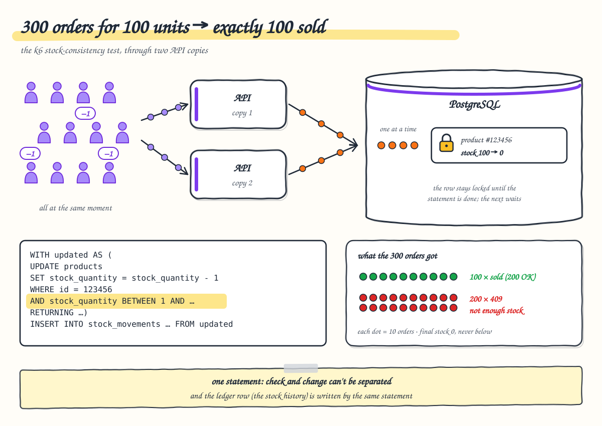
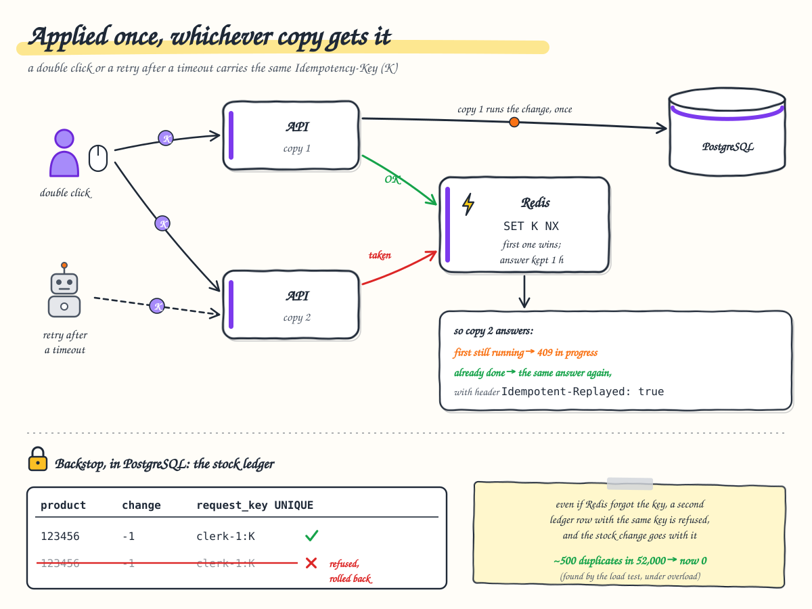

# 5. Stock and consistency

**After this chapter you will know** how the system keeps its promises when many requests arrive at once on several
API replicas: ids that are never duplicated, stock that never goes below zero, a history that always adds up, edits
that never silently overwrite each other, and retries that are never applied twice. It also tells the story of the
one consistency bug the load tests found, and how it was fixed.



---

## Unique six-digit ids from a PostgreSQL sequence

Ids come from the sequence `product_id_seq`, created by the first migration:
`START 100000, MINVALUE 100000, MAXVALUE 999999, NO CYCLE`. Before inserting a product the API runs
`SELECT nextval('product_id_seq')`.

* `nextval()` is atomic and **not transactional**: two API replicas asking at the same moment always get different
  numbers, and a rolled-back transaction leaves a gap instead of handing the number out again.
* `NO CYCLE`: after 999999 the sequence raises an error instead of starting over, so an id is never reused, not even
  after a delete. The API turns that error into `503 product.ids_exhausted`: nothing in the request can fix it, it
  must alert as a server-side failure, and a retry with the same `Idempotency-Key` stays allowed once the range is
  widened.
* The database repeats the rule with a check constraint (`id BETWEEN 100000 AND 999999`), and the domain refuses any
  other value.

Why not the alternatives? Random numbers with a retry collide (with 900,000 values, a 50 % chance of a collision is
reached after about 1,100 products); `MAX(id)+1` races between replicas and reuses deleted ids; GUIDs and Snowflake
ids are not six digits. The cost: 900,000 ids in total. Going to seven digits is a one-line migration
([ADR 0002](../adr/0002-product-id-generation.md)).

Proof: two API instances creating products in parallel never produce a duplicate (integration test); 40 concurrent
creates through the gateway give 40 unique ids (`check-requirements.py`); 850,024 products, all unique
(`verify-data.sh`).

## Stock changes: one conditional statement

`POST /api/products/100004/decrement-stock/3` does not read the product, subtract and save. It runs **one SQL
statement** that checks and changes at the same time:

```sql
WITH updated AS (
    UPDATE products
    SET stock_quantity = stock_quantity + @delta, updated_at = @now        -- @delta = -3
    WHERE id = @id
      AND stock_quantity BETWEEN @min AND @max                            -- 3 AND 1,000,000
    RETURNING id, stock_quantity
)
INSERT INTO stock_movements
    (product_id, quantity_change, stock_after, reason, performed_by, occurred_at, request_key)
SELECT id, @delta, stock_quantity, 'StockRemoved', @user, @now, @requestKey FROM updated
RETURNING stock_after;
```

PostgreSQL locks the product's row for the statement and re-checks the `WHERE` against the latest committed value.
Simultaneous orders for the same product therefore queue on that row, and each one sees the result of the one before.
When the condition fails, no row is updated, nothing is inserted, and the API answers `409
product.insufficient_stock` with the quantity requested and the quantity available.

**The rule stays in the domain.** `StockAdjustment.Plan(delta, ...)` computes the range the current stock must be in
for the change to be allowed, and the SQL only applies it:

| Request | Delta | Current stock must be between | So that the result is |
| --- | ---: | --- | --- |
| remove 3 | −3 | 3 and 1,000,000 | ≥ 0 |
| add 25 | +25 | 0 and 999,975 | ≤ 1,000,000 |
| add 2,000,000 | | no current stock allows it | refused without touching the database |

Computing the range in C# also means the SQL never evaluates `stock + delta` and cannot overflow.

**The result:** 300 simultaneous orders for one unit each, on a product with 100 units, through two replicas:
exactly 100 succeed, 200 get `409`, and the stock ends at 0 (load test `stock-consistency`). The integration test
`ConcurrentDecrements_NeverOversell` does the same with 60 orders on 25 units.

Why not "read, change, save" with optimistic concurrency? Under load most of those requests would conflict and have
to retry (work that grows with the square of the number of clients), and clients would see failures on requests that
could have succeeded ([ADR 0003](../adr/0003-atomic-stock-updates.md)).

## The stock ledger: stock = sum of movements

Every change of stock writes one row in `stock_movements`: how much, the stock after it, why, who (the token's `sub`)
and when.

| Reason | Written by |
| --- | --- |
| `InitialStock` | creating a product (in the same transaction as the product) |
| `StockAdded` / `StockRemoved` | `add-to-stock` / `decrement-stock` (in the same statement as the change, above) |
| `Correction` | an edit that overwrote the stock field (in the same transaction as the edit) |

Because the movement is written in the same statement or transaction as the change, there is never a change without
its movement, and `stock_after` is the exact value the row lock produced. For every product, its stock equals the sum
of its movements. `tools/load-tests/verify-data.sh` checks that, and five other invariants, on all 850,000 products after
every load test; every count has always been 0 ([ADR 0016](../adr/0016-stock-ledger.md)). In the UI, *Stock history*
shows a product's movements, newest first.

## Edits: optimistic concurrency with `xmin`, ETag and If-Match

Editing a product is a "read, change, save", so two people can edit the same product at once. To stop the second save
from silently overwriting the first:

1. Every product read returns its version, PostgreSQL's `xmin` system column, which changes on every write (stock
   changes included). It travels as `"version": 757` in the body and `ETag: "757"` in the header.
2. The edit form sends it back: `PUT /api/products/100004` with `If-Match: "757"`.
3. The API compares it with the stored version (412 if already different), and EF Core also puts it in the `UPDATE`'s
   `WHERE`, so a change committed in between is caught too.
4. On a mismatch the answer is `412 product.version_mismatch`; the dialog explains that someone else changed the
   product and offers to load the latest version.

`If-Match` is optional so the API is easy to try with curl or Swagger; without it a conflicting save gets
`409 product.concurrent_modification`. The UI always sends it. `DELETE` works the same way
([ADR 0004](../adr/0004-optimistic-concurrency.md)).

## Retries: idempotency keys



A client times out and retries, a user double-clicks, a network drops the answer: the same request arrives twice,
possibly on **two different replicas at the same moment**. A per-replica memory of "requests already seen" cannot help.

The fix is the `Idempotency-Key` header, accepted by create and both stock endpoints. The web app sends a new
`crypto.randomUUID()` per user action (one per dialog, one per quick +/− click) and reuses it if it retries.

**Guard 1: a claim in Redis**, shared by every replica:

1. The key must be 1–128 characters of `A–Z a–z 0–9 - _ . :`, else `400 idempotency_key_invalid`.
2. It is scoped to the caller: `clerk:6f1c…` (so consumers can never see or block each other's keys).
3. A fingerprint of the request is taken: SHA-256 of method, path, query and body.
4. `SET product-management:idempotency:clerk:6f1c… <in progress> NX` with a 1-minute expiry. Redis runs one command at
   a time, so of two simultaneous copies exactly one wins.
5. The winner runs the request and stores the answer (status, body, `ETag`, `Location`) under the key: 1 hour in the
   cluster (`Idempotency__KeyLifetime`), 24 hours by default.

The copies get:

| Situation | Answer |
| --- | --- |
| the first one has finished | the stored answer, with `Idempotent-Replayed: true`; nothing runs |
| the first one is still running | `409 idempotency_key_in_progress`, `Retry-After: 1` |
| same key, different request | `422 idempotency_key_reused`; also when Redis has forgotten the key: the database finds the ledger row holding it and compares product, quantity and reason (the same change is answered as applied, once) |
| Redis unreachable, or a Redis command timed out or cancelled | `503 idempotency_unavailable`: refusing is better than risking a duplicate |

Answers with status 500 or more are not stored, so the client can retry them with the same key.

**Guard 2: the request key in the ledger.** The scoped key is also written into the movement row
(`stock_movements.request_key`) under a **unique index** (only for rows that have a key). If the same request ever runs
a second time, the `INSERT` fails and PostgreSQL rolls back the whole statement, the stock change included. The API
reports the original success. For a create, the duplicate insert is rolled back and the API answers with the product
the first execution created.

## The bug the load test found

At first only guard 1 existed. A capacity run at more than 1,000 requests/s showed about **500 duplicates in 52,000
stock changes**. What happened:

1. Under overload, clients timed out and the gateway closed their connections.
2. The API noticed the cancellation **after** the stock change had committed.
3. The cancelled request was treated as failed, and its Redis claim was released.
4. The client's retry claimed the key again and the change ran a second time.

The fix moved the last line of defence into the database: the unique request key in the ledger row, written by the
same statement as the stock change (guard 2). The re-read of the product after a change is also no longer
cancellable: once a change may have committed, the request finishes so its outcome can be stored and replayed. Every
run since has been exact. In the final "teams" run, 16,880 changes were applied and the ledger gained exactly 16,880
rows, with 4,991 replayed copies and 1,753 simultaneous copies, none applied twice
([ADR 0017](../adr/0017-idempotency-keys.md), [load-test-results.md](../load-test-results.md#capacity-how-far-one-laptop-goes-docker-desktop-8-cpus-for-everything)).

## Where to look

* Ids: [`ProductIdSequence.cs`](../../backend/ProductManagement.Infrastructure/Products/ProductIdSequence.cs),
  [`PostgresProductIdGenerator.cs`](../../backend/ProductManagement.Infrastructure/Products/PostgresProductIdGenerator.cs)
* Stock rule and ledger: [`StockAdjustment.cs`](../../backend/ProductManagement.Core/Products/StockAdjustment.cs),
  [`StockMovement.cs`](../../backend/ProductManagement.Core/Products/StockMovement.cs),
  [`Product.cs`](../../backend/ProductManagement.Core/Products/Product.cs),
  [`ProductRules.cs`](../../backend/ProductManagement.Core/Products/ProductRules.cs),
  [`StockCommandService.cs`](../../backend/ProductManagement.Core/Products/StockCommandService.cs),
  [`ProductRepository.cs`](../../backend/ProductManagement.Infrastructure/Products/ProductRepository.cs)
* Edits: [`ProductCommandService.cs`](../../backend/ProductManagement.Core/Products/ProductCommandService.cs),
  [`EntityTag.cs`](../../backend/ProductManagement.Api/Http/EntityTag.cs),
  [`ProductConfiguration.cs`](../../backend/ProductManagement.Infrastructure/Persistence/Configurations/ProductConfiguration.cs) (`xmin`)
* Idempotency: [`IdempotencyFilter.cs`](../../backend/ProductManagement.Api/Idempotency/IdempotencyFilter.cs),
  [`IdempotencyKey.cs`](../../backend/ProductManagement.Api/Idempotency/IdempotencyKey.cs),
  [`RequestFingerprint.cs`](../../backend/ProductManagement.Api/Idempotency/RequestFingerprint.cs),
  [`RedisIdempotencyStore.cs`](../../backend/ProductManagement.Infrastructure/Idempotency/RedisIdempotencyStore.cs),
  [`StockMovementConfiguration.cs`](../../backend/ProductManagement.Infrastructure/Persistence/Configurations/StockMovementConfiguration.cs) (the unique index)
* Decisions: [ADR 0002](../adr/0002-product-id-generation.md), [ADR 0003](../adr/0003-atomic-stock-updates.md),
  [ADR 0004](../adr/0004-optimistic-concurrency.md), [ADR 0016](../adr/0016-stock-ledger.md),
  [ADR 0017](../adr/0017-idempotency-keys.md)
* Precise diagrams: [flows.md §5 stock change with an Idempotency-Key](../flows.md#5-stock-change-with-an-idempotency-key)
  and [§6 create and update with If-Match](../flows.md#6-create-a-product-update-with-if-match)

## How to verify

```bash
tools/load-tests/run.sh stock-consistency       # 300 orders for 100 units across replicas: exactly 100, stock 0
tools/load-tests/verify-data.sh                 # six invariants, every count must be 0
python3 tools/check-requirements.py             # includes 40 concurrent creates → 40 unique six-digit ids

cd backend && dotnet test --project ProductManagement.Api.IntegrationTests \
  --filter-class ProductManagement.Api.IntegrationTests.Products.ConcurrencyTests
cd backend && dotnet test --project ProductManagement.Api.IntegrationTests \
  --filter-class ProductManagement.Api.IntegrationTests.Products.IdempotencyTests
```

By hand, with a clerk's token (this changes data):

```bash
KEY=$(uuidgen)
for i in 1 2; do
  curl -s -D - -o /dev/null -X POST localhost:8080/api/products/100001/add-to-stock/5 \
    -H "Authorization: Bearer $TOKEN" -H "Idempotency-Key: $KEY" | grep -i -E '^HTTP|replayed|etag'
done                                     # the second answer is the same, with Idempotent-Replayed: true
```

In the app, open the same product's *Edit* in two tabs and save both: the second gets the conflict message (412).
