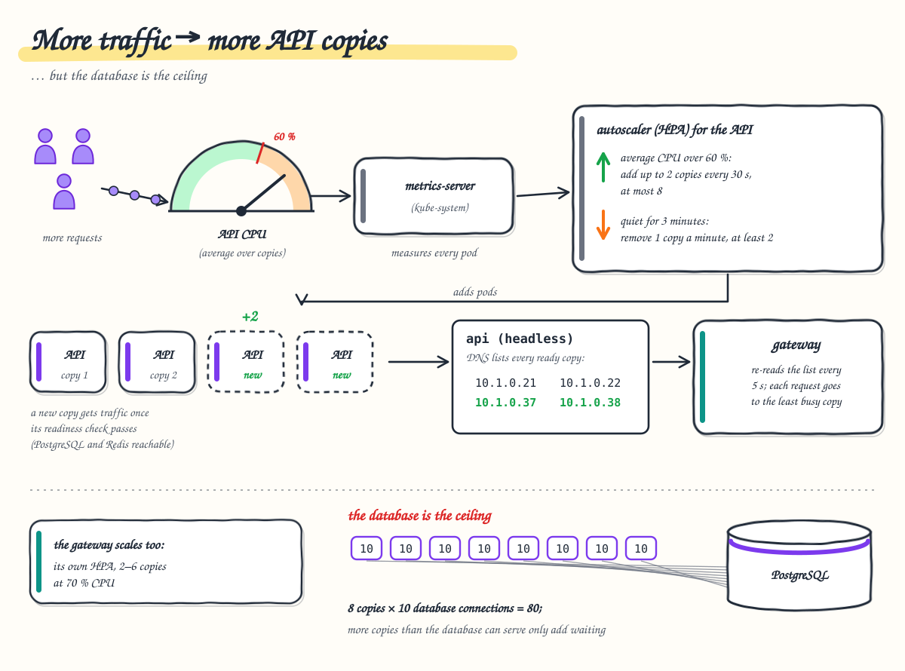

# 6. Scaling and capacity

**After this chapter you will know** how the API and the gateway add and remove pods on their own, why adding API
pods stops helping at some point, how the system was tested at scale, what each load test found and how it was
fixed, how far one laptop goes, and which levers come next.



---

## Autoscaling

Two HorizontalPodAutoscalers (HPAs) watch CPU through **metrics-server** (installed by `infra/infra.sh up`
where the cluster lacks it, as on Docker Desktop; k3s and most managed clusters ship it).

| | API | Gateway |
| --- | --- | --- |
| Replicas | 2 to 8 | 2 to 6 |
| Target | average CPU 60 % of the 200m request | average CPU 70 % of the 250m request |
| Scale up | immediately, up to 2 pods every 30 s | Kubernetes defaults |
| Scale down | after 3 minutes of lower load, 1 pod per minute | after 3 minutes of lower load |

Scaling up is fast and scaling down slow on purpose: adding capacity late costs errors, removing it late only costs a
little CPU. The Deployments do not set `replicas`, so `kubectl apply` never resets the count the HPA chose.

A new API pod gets traffic as soon as it passes its readiness probe (`/health/ready`: PostgreSQL and Redis
reachable): it appears in the DNS answer of the headless Service `api` and every gateway pod picks it up within 5 s
([chapter 2](02-request-journey.md#why-the-apis-service-is-headless)). The API is stateless (anything
shared is in Redis or PostgreSQL), so any pod can serve any request. Each new gateway pod starts with an empty
microcache and token cache.

The readiness probe is tolerant: it waits up to 3 s and needs 6 failures in a row (30 s) before taking a pod out of
rotation. With the 1 s default, a slow (not down) database made every replica fail its probe at once and flap in and
out of the load balancer under load: a cascading outage caused by the probe itself. The probe's database check is a
`SELECT 1` over a pool of its own (one connection, 2 s timeouts), not the request pool: a replica whose 10 request
connections are all busy is busy, not broken, and stays ready
(`Readiness_StaysHealthy_WhileEveryRequestConnectionIsBusy`).

## Why the database is the ceiling

There is one PostgreSQL server (4 CPUs and 3 GiB, `max_connections=200`; a StatefulSet in the shared namespace `infra`, see [chapter 9](09-deployment-and-operations.md#what-runs-where)). Each API pod has a connection pool of at most **10**, plus one for its readiness check, so
at the HPA's maximum the database sees at most **8 × (10 + 1) = 88** connections. A database serves only a few queries per CPU
core at a time; more connections than that do not add throughput, they make every query slower. Excess requests wait
in the API's pool instead, which is cheaper. This was measured: 6 replicas × 20 connections on 2 database cores queued
even primary-key reads for seconds.

So adding API pods helps until the database is busy. After that, capacity comes from the database side: a bigger
instance, read replicas for lists and searches, a connection pooler (PgBouncer).

## The bulk dataset

`backend/load-tests/seed-bulk.sh` loads **850,024 products** and about **5.1 million stock movements** (about 1 GB), so every
query is measured at a realistic size. The indexes that matter at that size:

| Index | Serves | Measured |
| --- | --- | --- |
| `products (name, id)` | the default list, ordered by name | no sort per request |
| `products USING gin (name gin_trgm_ops)` | `search?name=` (contains, case-insensitive) | index-assisted `ILIKE '%…%'` |
| `products (stock_quantity, name, id)` | `stock-level?min=&max=` | 0.1 ms instead of 184 ms |
| `stock_movements (product_id, occurred_at DESC, id DESC)` | a product's history, newest first | index range scan |
| `stock_movements (request_key)` unique, partial | exactly-once ([chapter 5](05-stock-and-consistency.md)) | |

The two large indexes were added by migrations that build them `CONCURRENTLY`, so the tables keep accepting writes
while they build.

## The load-test scenarios

All scenarios are k6 scripts run **inside** the cluster as a Job (`backend/load-tests/run.sh <scenario>`), so they measure the
gateway, the API, Redis, PostgreSQL and token verification, not a port-forward tunnel.

| Scenario | What it does | What it checks |
| --- | --- | --- |
| `smoke` | one virtual user calls every endpoint | everything answers; run after every deployment |
| `load` | realistic mix at a steady rate (`RATE=150`) | the SLO: p95 below 300 ms, no errors |
| `stress` | steps up the rate (`PEAK=2000`) | where latency and errors start to degrade |
| `spike` | 20 → 500 requests/s in 10 s, reads | absorbed without errors |
| `stock-consistency` | 300 simultaneous orders for 100 units | exactly 100 succeed, 200 × `409`, stock 0 |
| `rate-limit` | one user at ~300 requests/s | `429` + `Retry-After`, the rest served |
| `teams` | many teams on 850,000 products: browse, search, read histories, change stock (half on 50 hot products), 30 % of changes sent twice with the same key | ledger rows added = changes applied; data invariants; with `PEAK=` it becomes a capacity staircase |
| `browse` | read-only browsing with a hot set (first pages, popular products and searches, the low-stock view) | read capacity |

The virtual users sign in as the three demo accounts (reads as viewer, clerk or manager; stock changes as clerk or
manager), so every scenario except `rate-limit` raises the API's per-user limits for the run and restores them
afterwards: the tests measure capacity with a few accounts, not many distinct users. `stress`, `spike`, `browse` and
`teams` also raise the gateway's per-IP limit (all k6 traffic comes from one pod IP). `rate-limit` tests the real limits.

## What the tests found, and the fixes

These runs were made while PostgreSQL and Redis ran as pods in the application's namespace. They later ran for a
while as Docker containers on the same machine, and now run as pods again, in the shared namespace `infra`, with the
same settings and on the same CPUs, so the conclusions hold; the CPU figures quoted for PostgreSQL are those of the
pod at the time.

### Ten teams on 850,000 products: 123 → 281 requests/s

Target 300 iterations/s for 4 minutes, PostgreSQL limited to 2 CPUs at the time.

| Run | Requests/s | Errors | p95 | What it revealed | Fix |
| --- | ---: | ---: | ---: | --- | --- |
| 1 | 123 | 11.9 % | 15.9 s | Every stock change invalidated every cached list, and each list ran `COUNT(*)` over 850,000 rows. PostgreSQL saturated; the 1 s readiness probe made replicas flap. | Lists cached as count + ids with rows always fresh ([chapter 3](03-caching.md)); tolerant readiness probe. |
| 2 | 211 | 6.6 % | 8.5 s | Still saturated. The HPA went to 6 replicas, but 6 × 20 connections queued on 2 cores. `EXPLAIN ANALYZE`: the stock-level page took 184 ms. | Index `(stock_quantity, name, id)` (0.1 ms); counts cached once per list; pool of 10 per replica. |
| 3 | **281** | **0 %** | **13.4 ms** | Within targets: PostgreSQL at 15–20 % of its CPU. | |

After the gateway started verifying tokens (below), the same run gave p95 **4.3 ms**. In every run the ledger matched
the changes applied ([chapter 5](05-stock-and-consistency.md#the-bug-the-load-test-found)).

### Worst-case capacity: 925 → 2,500 → about 2,400 requests/s

The `teams` mix as a staircase (`PEAK=4000`, then `6000`): 25 % writes, reads spread uniformly over 850,000
products, so caches rarely help.

| Run | Average req/s | Errors | Found | Fix |
| --- | ---: | ---: | --- | --- |
| to 4,000 | 925 | 8.8 % | PostgreSQL at 2/2 CPUs; about 500 changes applied twice | the unique request key in the ledger ([chapter 5](05-stock-and-consistency.md#the-bug-the-load-test-found)) |
| to 4,000 | 778 | 18.9 % | `pg_stat_statements`: 882 concurrent `COUNT(*)` at ~2 s each (cache stampedes), lock waits | single-flight, per-product generations, PostgreSQL 4 CPUs |
| to 6,000 | **2,500** | **0 %** | the node: 7.7 of 8 CPUs busy | |
| to 6,000, final | 2,365 | **0 %** | the same; 135,076 changes → exactly 135,076 ledger rows | |

Along the way Redis was OOM-killed at 2,500 requests/s (192 MiB memory limit, 128 MB `maxmemory`, holding a day of
idempotency answers); it now has 256 MB within a 384 MiB limit and keeps answers for 1 hour. The restart also proved guard 2: the ledger stayed exact.

### Read capacity: 5,470 → 18,177 requests/s

The `browse` scenario at a constant target rate:

| Run | Sustained req/s | Errors | p95 | Answered by nginx |
| --- | ---: | ---: | ---: | ---: |
| microcache keyed per token, target 10,000/s | 5,470 | 0.01 % | 793 ms | 48 % |
| microcache keyed per role, target 10,000/s | 9,712 | 0 % | 7 ms | 94 % |
| per role, target 20,000/s | 17,359 | 0 % | 79 ms | 92 % |
| per role, shared rate limits (final) | **18,177** | **0 %** | 47 ms | 96 % |

With ten users there were ten copies of every cache entry when the key held the token. Verifying tokens at the
gateway made a per-role key safe, so one entry serves everyone with the same role
([ADR 0020](../adr/0020-edge-token-verification.md)).

### Rate limits that grew with the autoscaler

With 6 replicas, the `rate-limit` scenario (one user at 300 requests/s) saw no `429` at all: each replica allowed
50/s. The per-user buckets moved to Redis; the same run now accepts about 72/s and refuses 4,566 requests with `429`
([chapter 4](04-security.md#rate-limits)).

## What limits capacity on one laptop

Everything shares one node with 8 CPUs: the gateway, the API pods, PostgreSQL, Redis **and the load generator**. At
the top of each run the node itself is saturated, not one tier. At 20,000 requests/s k6 alone used 2.3 CPUs and could
not start 5–10 % of the requests it wanted to send. The absolute numbers are therefore a lower bound for a real
cluster; the comparisons between runs, and the correctness checks, are the point.

## The next levers

In order of expected effect for a write-heavy peak:

1. **More nodes**, with PostgreSQL on a node of its own (`infra/add-node.sh <host> database`). The API and the gateway already scale out.
2. **Read replicas** for lists and searches; the primary only for writes.
3. **PgBouncer** in transaction mode, sized to the database, when there are many API pods.
4. **Keyset pagination** (`?after=`): today a deep page costs time proportional to its depth (page 40,000 takes about
   0.5 s); keyset makes it constant.
5. **Monthly partitions** for `stock_movements`, which grows without bound.

## Where to look

* HPAs, pools and probes: [`backend/deploy/k8s/base`](../../backend/deploy/k8s/base) (`hpa.yaml`, the probes in
  `deployment.yaml`), the connection string with `Maximum Pool Size=10`
  ([`overlays/local/api.yaml`](../../backend/deploy/k8s/overlays/local/api.yaml)),
  [`DatabaseHealthCheck.cs`](../../backend/ProductManagement.Infrastructure/Persistence/DatabaseHealthCheck.cs),
  [`frontend/deploy/k8s/base/gateway.yaml`](../../frontend/deploy/k8s/base/gateway.yaml) (HPA `gateway`), [`infra/postgres.yaml`](../../infra/postgres.yaml) (PostgreSQL's CPUs, memory, `pg_stat_statements`)
* Load tests: [`backend/load-tests/run.sh`](../../backend/load-tests/run.sh), [`teams.js`](../../backend/load-tests/teams.js),
  [`browse.js`](../../backend/load-tests/browse.js), [`seed-bulk.sh`](../../backend/load-tests/seed-bulk.sh),
  [`verify-data.sh`](../../backend/load-tests/verify-data.sh), [`data/verify.sql`](../../backend/load-tests/data/verify.sql)
* All numbers: [load-test-results.md](../load-test-results.md)
* Decisions: [ADR 0015 load testing](../adr/0015-load-testing.md), [ADR 0018 autoscaling and scale testing](../adr/0018-autoscaling-and-scale-testing.md)
* Precise diagrams: [flows.md §10 autoscaling](../flows.md#10-autoscaling),
  [§11 load test and verification](../flows.md#11-load-test-and-verification)

## How to verify

```bash
infra/infra.sh up                                      # installs metrics-server where the cluster has none
kubectl -n product-management get hpa -w               # in a second terminal: watch the replica counts
kubectl -n product-management top pods

backend/load-tests/seed-bulk.sh                        # 850,000 products, ~5 million movements (minutes)
RATE=300 backend/load-tests/run.sh teams               # many teams; compares ledger rows with changes applied
PEAK=6000 K6_CPU=3 backend/load-tests/run.sh teams     # worst-case capacity staircase (limits lifted, then restored)
RATE=20000 K6_CPU=4 backend/load-tests/run.sh browse   # read capacity at a constant rate
backend/load-tests/run.sh rate-limit                   # one user over the limit: 429 + Retry-After

# The slowest queries, as used to find the bottlenecks
kubectl -n infra exec statefulset/postgres -- psql -U postgres -d product_management -c \
  "SELECT calls, round(total_exec_time) AS ms, left(query, 80) FROM pg_stat_statements ORDER BY total_exec_time DESC LIMIT 5"
```
