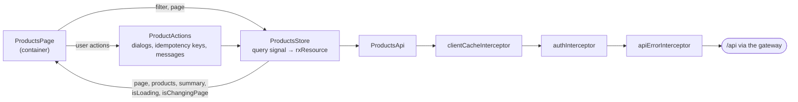

# 7. Front end

**After this chapter you will know** how the Angular app is organised and which folder may depend on which, how the
product page gets its data and stays current, how loading feels fast without hiding what is on screen, how
accessibility is handled, how the browser's errors are reported (and what is never sent), and what the Lighthouse and
Playwright audits found and how each finding was fixed.

---

## The technology in one line each

* **Angular 22**: standalone components (no NgModules), zoneless change detection (no zone.js), `OnPush` by default,
  **signals** for state.
* **Tailwind CSS 4** for the look, **Angular CDK** for accessible behaviour (dialogs with focus trap and focus
  restore) instead of Angular Material ([ADR 0013](../adr/0013-ui-tailwind-cdk.md)).
* **Vitest** for unit and component tests, **Playwright** for end-to-end tests, **Lighthouse** for audits.
* The `products` page is lazy-loaded: its code is downloaded only when visited.

## The layers

| Folder | Holds | May use | Never |
| --- | --- | --- | --- |
| `core/` | app-wide services: `auth/` (session, guard, interceptor), `http/` (`ApiError`, error interceptor, browser `ResponseCache` + `clientCacheInterceptor`), `config/` (API base URL), `notifications/`, `observability/` (browser errors: `ReportingErrorHandler`, `BrowserErrors`) | Angular, `shared/` | features |
| `shared/ui/` | presentational building blocks: `AppDialog`, `ConfirmDialog`, `Icon`, `Paginator`, `ProgressBar`, `ToastOutlet` | inputs and outputs only | services, stores |
| `shared/util/` | "inject functions" (Angular's equivalent of React hooks): `autoRefresh()` | Angular's `inject` | components |
| `shared/` (other) | `pipes/` (`signedNumber`), `forms/` (validators, messages), `models/` (`PagedResponse`) | | |
| `features/auth/login/` | the sign-in page | `core/` | |
| `features/products/data-access/` | `ProductsApi`, `CategoriesApi` (HTTP), `ProductsStore` (state), models | `core/`, `shared/` | components |
| `features/products/feature/` | `ProductsPage` (container), `ProductActions` (what the user can do), the dialogs (form, stock adjust, stock history) | everything above | |
| `features/products/ui/` | presentational: `InventorySummary`, `ProductFilters`, `ProductTable`, `StockStatus`, the `movementReason` pipe | inputs and outputs only | services, the store |

Rules that keep each piece with one reason to change:

* `ui/` components only take `input()`s and emit `output()`s. They are trivial to test and reuse.
* `feature/` orchestrates: the page wires the store and `ProductActions` to the `ui/` components.
* `data-access/` knows HTTP and state, nothing about components.
* Across folders, imports go through the folder's `index.ts` ("barrel"); inside a folder, files import each other
  directly.

The products page itself is 25 lines of TypeScript and a 70-line template: it only connects pieces.

## How the product page gets its data



* **One-way data flow.** Components call store methods (`setFilter`, `setPage`, `reload`, `adjustStock`...). The
  store changes its `query` signal, and `rxResource` fetches. Changing the query **cancels the request in flight**, so
  paging quickly can never let an older page overwrite a newer one. Re-applying the same filter does not send a
  request (the query signal compares by value).
* **No flashing.** A `linkedSignal` keeps the last loaded page on screen while the next one loads, or if it fails.
* **The summary cards** (total, low stock, out of stock) come from the same list endpoints with `pageSize=1`, using
  only `totalCount`, so there is no special statistics endpoint and the counts are cached like any other read.
* **After the user's own change** (`update`, `adjustStock`) the store patches the row with the server's answer at once,
  then reloads **fresh** (`Cache-Control: no-cache`), which skips the browser cache and the gateway microcache: the
  user always sees the result of what they just did. Create and delete reload fresh too.
* **Changes made by others** appear through `autoRefresh()` every 15 s, only while the tab is visible and no request is
  loading. These background reloads are not fresh, so many open screens are answered by the caches.
* **`ProductActions`** holds everything the user can do: it opens the right dialog through `AppDialog`, generates one
  `Idempotency-Key` per action (`crypto.randomUUID()`), and reports success or failure as a toast. The quick +/−
  buttons in the table move 1, 5, 10, 25 or 100 units per click (selected in the *Stock* column header); *Adjust
  stock* takes any amount.

## Browser cache and prefetch

The browser cache is described with the other layers in [chapter 3](03-caching.md). In short: lists seen in the last
5 s are answered without a request, lists seen in the last 5 minutes are shown at once and refreshed in the
background, and once a page has loaded the store **prefetches the next page**, so "Next" is usually instant. The cache
lives in memory only and is emptied after any write and at sign-out.

## Browser errors

A JavaScript error in a user's browser leaves no trace on any server, so the app reports its own errors to the same
Loki as every other log, with Grafana Faro ([chapter 8](08-observability.md#browser-errors) has the whole pipeline).
The code is in `core/observability/`:

* **`ReportingErrorHandler`** replaces Angular's `ErrorHandler`. It receives what Angular catches (templates,
  lifecycle hooks, effects) and, through `provideBrowserGlobalErrorListeners`, every uncaught error and unhandled
  promise rejection. It still logs each error to the console, as Angular's default does, and passes it to
  `BrowserErrors`.
* **`BrowserErrors`** loads the Faro SDK **after the first render**, as its own lazy chunk (about 37 kB transferred);
  the initial bundle grew by about 1.9 kB (the handler and the loader). Errors raised before the chunk arrives are
  queued (up to 10) and sent then. `console.error` calls are reported too; every other console level, and Faro's
  performance, web-vitals, user-action and session instrumentation, are off. If the chunk cannot be loaded or the
  collector is down, reports are lost and the app works as before: reporting never throws.
* **Where it goes:** `POST /collect` on the same origin, so the CSP stays `connect-src 'self'`; the gateway forwards
  it to the collector in the cluster.
* **What is sent:** the error type, message and (minified) stack trace, the app's name and release (`APP_VERSION`,
  the image tag, given to the build), the route **without its query string or fragment** (also removed from the
  stack's URLs), the browser's name, version and OS and whether it is a phone, and the signed-in user's id.
* **What is never sent:** the access token, form values, query strings, the full user-agent string, the language, the
  screen size, a session id (nothing is written to the browser's storage), or the value of a rejection that is not an
  `Error` (only its type). A message the code puts in an error is sent as it is, so error messages must not contain
  personal data.
* **Off in dev mode** (the dev server and the unit tests: nothing listens on `/collect` there); production builds
  always report.

## Loading without hiding the screen

* A thin **progress bar** at the top of the table while anything loads. Its space is always reserved, so showing it
  never moves the layout.
* While the user changes page or filter, the current rows stay and are **dimmed**, but only after **150 ms**
  (`delay-150`), so the many answers that come from a cache never flash. A background refresh of the same page does not
  dim anything (`isChangingPage` tells the two cases apart).
* The table region has **`aria-busy`** while loading, so screen readers wait for the new content.
* The product table has a visually hidden `<caption>`, so screen readers announce what the table holds.
* After a `412` (someone else changed the product), the edit dialog reloads it with `ProductsStore.latest(id)`, which
  calls `ProductsApi.getById(id, fresh = true)`: `Cache-Control: no-cache` skips the gateway's microcache, so the
  user sees the real latest version, not a copy up to a second old.
* The summary cards reserve their height from the first frame (three stacked cards on phones, one row on wider
  screens), so their arrival does not push the table down.

## Accessibility

* **Every dialog is opened by `AppDialog`**, which gives it a role (`dialog`, or `alertdialog` for the delete
  confirmation), an accessible name (`aria-labelledby` pointing at the dialog's title) and the CDK's focus trap and
  focus restore. Dialog components render only their content and have no role of their own: one dialog, one name.
* Form fields have labels and show server-side validation errors next to the right field.
* Animations respect `prefers-reduced-motion`.
* Lighthouse Accessibility: **100** on mobile and desktop.

## What the audits found, and the fixes

**Lighthouse** runs as a *user flow* (`npm run audit:lighthouse`) over the real journey: the login page, signing in,
the product list signed in, paging through five pages, the stock history dialog. Current scores:

| | Performance | Accessibility | Best Practices | SEO |
| --- | --- | --- | --- | --- |
| Mobile | 97–100 | 100 | 100 | 63 |
| Desktop | 99–100 | 100 | 100 | 63 |

SEO 63 is deliberate: this is an internal application and `robots.txt` tells search engines to stay out.

**Playwright** runs 11 scenarios on a desktop viewport and a phone viewport (22 tests) against the running system. Its
fixture fails any test in which the page reports a Content-Security-Policy violation or an uncaught error; the one
scenario that throws an error on purpose (`browser-errors.spec.ts`) checks only for CSP violations and reads its error
back from Loki (`LOKI_URL`, by default `http://localhost:3100`: `kubectl -n infra port-forward svc/loki 3100:3100`);
it is skipped when no Loki is reachable (e.g. `LOGS=off`).

| Finding | Found by | Cause | Fix |
| --- | --- | --- | --- |
| Dialogs without a name, and nested dialog roles | Lighthouse (Accessibility 96) | each dialog component declared its own role inside the CDK's dialog container | `AppDialog` opens every dialog with one role and an `aria-labelledby`; components have no role (now 100) |
| On phones the page was **2.4× wider** than the screen | Playwright, mobile | the table header's screen-reader-only text ("Actions") is absolutely positioned; with no positioned ancestor it escaped the table's horizontal scroll container and widened the whole page | the scroll container is `relative`, so it becomes the containing block and clips that text |
| Dialogs taller than a phone screen (the *Create* button unreachable) | Playwright, mobile | the product form is taller than a phone screen (844 px in the test) and the panel did not scroll | dialog panels are limited to `100dvh − 2rem` and scroll inside |
| Layout shift after signing in | Lighthouse | the summary cards appeared after the data and pushed the table down | the cards reserve their height from the first frame (CLS 0) |
| **Critical-CSS inlining**, tried and reverted | Lighthouse, measured | inlining needs a small inline script (blocked by the CSP) and in this app covers only the empty shell; on a slow phone the app rendered before the full stylesheet arrived and the page jumped (CLS 0.14) | turned off (`inlineCritical: false`): one render-blocking 7 kB stylesheet is the better trade, and `script-src 'self'` needs no exceptions ([ADR 0019](../adr/0019-content-security-policy.md)) |
| `robots.txt` (and any missing file) returned the app's `index.html` | Lighthouse | the SPA fallback served `index.html` for every unknown path | the web server serves `index.html` only for paths without a file extension; a missing file is a real `404` |

## Where to look

* Structure and scripts: [`frontend/README.md`](../../frontend/README.md)
* State and data: [`products-store.ts`](../../frontend/src/app/features/products/data-access/products-store.ts),
  [`products-api.ts`](../../frontend/src/app/features/products/data-access/products-api.ts),
  [`product-actions.ts`](../../frontend/src/app/features/products/feature/product-actions.ts),
  [`products-page.ts`](../../frontend/src/app/features/products/feature/products-page/products-page.ts),
  [`products-page.html`](../../frontend/src/app/features/products/feature/products-page/products-page.html),
  [`auto-refresh.ts`](../../frontend/src/app/shared/util/auto-refresh.ts),
  [`app.config.ts`](../../frontend/src/app/app.config.ts) (interceptor order)
* Browser errors: [`reporting-error-handler.ts`](../../frontend/src/app/core/observability/reporting-error-handler.ts),
  [`browser-errors.ts`](../../frontend/src/app/core/observability/browser-errors.ts),
  [`e2e/browser-errors.spec.ts`](../../frontend/e2e/browser-errors.spec.ts)
* UI building blocks: [`app-dialog.ts`](../../frontend/src/app/shared/ui/dialog/app-dialog.ts),
  [`progress-bar.ts`](../../frontend/src/app/shared/ui/progress-bar/progress-bar.ts),
  [`product-table.html`](../../frontend/src/app/features/products/ui/product-table/product-table.html),
  [`tailwind.css`](../../frontend/src/tailwind.css) (dialog panel height)
* Web server: [`frontend/nginx.conf`](../../frontend/nginx.conf) (SPA fallback, cache headers)
* Audits: [`e2e/`](../../frontend/e2e) (Playwright specs and `lighthouse-flow.mjs`), reports in `frontend/e2e/reports/`
* Decisions: [ADR 0007 front-end state](../adr/0007-frontend-state.md), [ADR 0013 Tailwind and CDK](../adr/0013-ui-tailwind-cdk.md),
  [ADR 0019 CSP](../adr/0019-content-security-policy.md)
* Precise diagram: [flows.md §8 the product list screen](../flows.md#8-frontend-the-product-list-screen)

## How to verify

```bash
cd frontend
npm ci
npm run lint && npm run format:check
npm run test:ci                          # 187 Vitest tests
npm run e2e                              # 22 Playwright tests against http://localhost:8080 (deploy first)
npm run audit:lighthouse                 # mobile; FORM_FACTOR=desktop npm run audit:lighthouse for desktop
npm start                                # dev server on :4200, /api proxied to :5080 (port-forward the api Service)
```
