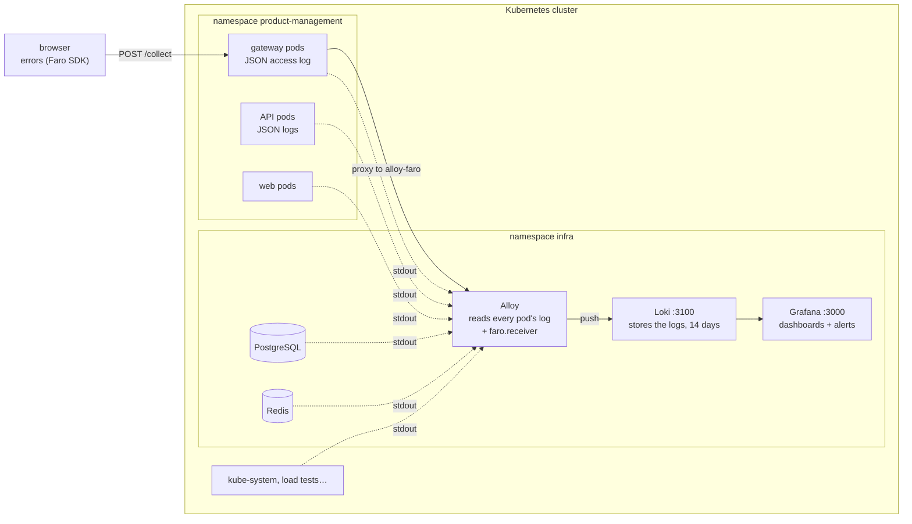
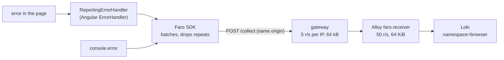

# 8. Logs, dashboards and alerts

**After this chapter you will know** which logs are collected, from where, how they reach Grafana and how long they
are kept; how the browser's errors get there too, and what they contain; why the system is observed through logs
alone and why that runs in the cluster itself; what the two dashboards tell you; which alerts exist and what to do when one
fires; how to follow one request from the gateway to the API by its `trace_id`; and what we would add next.


Where each log comes from and where it goes:



---

## One signal: logs

The system is observed through its **logs only**, all in one store (Loki) and one tool (Grafana). That is a
deliberate trade-off:

* **The gateway's access log already holds the important numbers.** nginx writes one JSON line per request with
  the method, URI, status, total time, the API replica that answered and how long it took, the microcache result and
  the verified user. Request rate, error ratio, latency percentiles, cache efficiency and "who is getting errors"
  are all LogQL queries over those lines. They are exact to the request: no sampling, no averaging.
* **One pipeline, few moving parts.** One collector, one store, one UI, all in the cluster's shared namespace `infra`.
  Nothing in the application code knows about any of them: the API and the gateway write JSON to stdout, as they would
  anywhere. The browser is the one exception: it has no stdout anyone can read, so the web app sends its errors
  ([below](#browser-errors)).
* **Correlation still works.** Every request gets a W3C trace id at the gateway, written into the gateway's line and
  carried into every API log line of that request ([below](#following-one-request)).
* **The assessment does not require observability.** This is operational hygiene, so it is kept proportionate. What
  logs cannot give (span-level timing inside the API, runtime metrics, database internals) is listed under
  [What we would add next](#what-we-would-add-next) with how to add it.

## What is collected, and from where

| Source | Collected by | Labels in Loki | Parsed on the way in |
| --- | --- | --- | --- |
| **The browser** (the Angular app): its errors only ([below](#browser-errors)) | the **Faro SDK** in the page posts them to the gateway's `/collect`, which forwards them to Alloy's `faro.receiver` in the cluster | `namespace="browser"`, `app="browser"`, `level="error"` | yes: JSON per error |
| **Every pod** in the cluster, in every namespace: gateway, API, web, load tests (k6 Jobs), kube-system | **Alloy** (a Deployment in the namespace `infra`), reading pod logs through the Kubernetes API and pushing to the Loki next to it (`http://loki.infra.svc.cluster.local:3100/loki/api/v1/push`, or another Loki through `LOKI_URL`) | `namespace`, `app` (the pod's `app.kubernetes.io/name`, else its container name), `pod`, `container`, `service_name` | see below |
| **The shared infrastructure**: PostgreSQL, Redis, Loki, Grafana and the nightly backup | the same **Alloy**: they are pods in the namespace `infra` like any other (only Alloy's own lines are dropped, so they do not feed back into it) | `namespace="infra"`, `app` = `postgres`, `redis`, `loki`, `grafana`, `postgres-backup` | PostgreSQL: a statement written over several lines is joined into one entry; otherwise plain text lines |

Two log formats are parsed so they can be filtered without reading every line:

| Stream | Indexed label | Structured metadata (filterable per line) | Line |
| --- | --- | --- | --- |
| `{app="gateway"}` | | `trace_id`, `status`, `user` | JSON per request: `method`, `uri`, `status`, `duration` (s), `upstream`, `upstream_duration`, `cache` (microcache), `user`, `trace_id`, `request_id` |
| `{app="api"}` | `level` (`Information`, `Warning`, `Error`, `Critical`) | `trace_id`, `category` (the logger) | JSON per log call: `Timestamp`, `LogLevel`, `Category`, `Message`, `State`, `Scopes` (holding `TraceId`), `Exception` |
| `{namespace="browser"}` | `level` (always `error`) | `page`, `user`, `app_version`, `browser` | JSON per error: `type`, `value` (the message), `stacktrace`, `page_url`, `user_id`, `app_name`, `app_version`, `browser_name`, `browser_version`, `browser_os`, `browser_mobile` |

The API logs writes (product created, updated, deleted, stock adjusted), warnings and errors; reads that succeed write
nothing, so for them the gateway line is the whole story. PostgreSQL logs statements slower than 250 ms, lock waits
longer than 1 s, checkpoints and errors (the `postgresql.conf` in [`deploy/infra/postgres.yaml`](../../deploy/infra/postgres.yaml)).

## Where the logs live, and for how long

Everything ends up in one place: **Loki**, a StatefulSet in the namespace `infra`. Nothing is stored in the
application's pods or in the browser; the collector only forwards.

| Source | Collector | Query it with |
| --- | --- | --- |
| Browser (errors only) | Faro SDK → gateway `POST /collect` → Alloy `faro.receiver` (cluster) | `{namespace="browser"}` |
| Gateway, web, API pods (and load tests, kube-system) | Alloy, through the Kubernetes API | `{namespace="product-management", app="gateway"}` (or `"web"`, `"api"`) |
| PostgreSQL, Redis, Loki, Grafana, the nightly backup | the same Alloy, through the Kubernetes API | `{namespace="infra", app="postgres"}` (or `"redis"`, `"loki"`, `"grafana"`, `"postgres-backup"`) |

Loki keeps its data on the PersistentVolumeClaim `data-loki-0` (10 GiB, mounted at `/loki`: chunks, index, compactor
state). Its configuration is the ConfigMap `loki-config` in [`deploy/infra/logs.yaml`](../../deploy/infra/logs.yaml): the image's
default single-process configuration plus **retention of 14 days** (`limits_config.retention_period: 336h`). Loki's
compactor looks for older data every 10 minutes and deletes it two hours after marking it. Without that setting Loki
keeps everything until the disk is full. Fourteen days covers "what happened last week" and keeps the volume bounded; the
same period applies to every source. Check it with:

```bash
kubectl -n infra port-forward svc/loki 3100:3100 &   # Loki is not published outside the cluster
curl -s localhost:3100/config | grep -E 'retention_period|retention_enabled'
#   retention_enabled: true
#   retention_period: 2w
```

## Why the logs run in the cluster

Loki, Grafana and Alloy are the infra's `logs` component: `deploy/scripts/infra.sh up logs` applies
[`deploy/infra/logs.yaml`](../../deploy/infra/logs.yaml) to the current `kubectl` context, in the shared namespace `infra`, next to
PostgreSQL and Redis:

| Workload | What | Data |
| --- | --- | --- |
| `loki` (StatefulSet, `grafana/loki:3.5.5`) | stores the logs, Service `loki:3100` | PVC `data-loki-0`, 14 days |
| `grafana` (Deployment, `grafana/grafana:12.2.0`) | the data source, the two dashboards and the twelve alert rules, all provisioned from ConfigMaps; Service `grafana:3000` | none (`emptyDir`): a new pod starts with the same dashboards and rules |
| `alloy` (Deployment, `grafana/alloy:v1.10.2`) | reads every pod's log in every namespace through the Kubernetes API, and receives the browser's error reports (Service `alloy-faro:12347`) | none: if it restarts, the pods keep logging to stdout and it reads them again |

One place for everything, one command to set it up, and nothing for a service to do: a new service's pods appear in
Loki as `{namespace="<its namespace>", app="<its app.kubernetes.io/name>"}` as soon as they log. The database and the
cache are pods too, so their logs need no agent of their own.

The price: monitoring exists for the bad day, and here it shares the cluster's fate. A failed upgrade or a node out of
memory can take down the application **and** the means to find out why, and an alert such as "the gateway has received
nothing for 15 minutes" is evaluated by the same cluster that may be failing. For a single local cluster that is the
right trade; in production the logs can go to a Loki outside the cluster (another cluster, or Grafana Cloud) with one
setting, `LOKI_URL` ([below](#what-changes-in-production)).

**The logs are optional.** Without the `logs` component (`deploy/scripts/infra.sh up postgres redis`, or
`deploy/scripts/infra.sh down logs` later, which keeps Loki's volume unless given `--delete-data`) the application works the
same: the pods still write to stdout (`kubectl -n product-management logs deployment/api`), and the application is
deployed with
`LOGS=off deploy/scripts/deploy.sh local`, so the gateway answers the browser's `POST /collect` with 204 and drops the
reports instead of failing with 502 (`frontend/gateway/collector.sh` writes either the proxy or the `return 204` at
start-up, from `COLLECTOR_UPSTREAM`). **Another Loki** (e.g. Grafana Cloud):
`LOKI_URL=https://<host>/loki/api/v1/push LOKI_USERNAME=... LOKI_PASSWORD=... deploy/scripts/infra.sh up logs` stores the three
values in the Secret `loki-external`, removes Loki and Grafana from the cluster (Loki's volume is kept) and applies
only Alloy, which pushes there. Running `deploy/scripts/infra.sh up logs` without `LOKI_URL` switches back.

## Browser errors

A JavaScript error in a user's browser leaves no trace on any server: the request that loaded the page succeeded, and
the gateway and the API see nothing wrong. So the web app reports its own errors, with
[Grafana Faro](https://grafana.com/oss/faro/) (`@grafana/faro-web-sdk`, pinned), Grafana's browser SDK, into the same
Loki as everything else.



**What is reported:** errors only.

* uncaught errors and unhandled promise rejections (Angular's `provideBrowserGlobalErrorListeners` sends both to the
  `ErrorHandler`);
* errors Angular catches itself (templates, lifecycle hooks, effects), through the same `ErrorHandler`, replaced by
  [`ReportingErrorHandler`](../../frontend/src/app/core/observability/reporting-error-handler.ts), which still logs
  each error to the browser console as Angular's default does;
* `console.error` calls (Faro's console instrumentation, all other levels off). The handler's own console line is
  written to the original console, so an error is never reported twice.

No performance timings, web vitals, user actions, page views or sessions: the question here is "what broke for whom",
and the rest would cost every user bandwidth and privacy for questions the system does not ask. Faro's own error
instrumentation is off too, because Angular already routes those errors to the handler.

**What each report contains:** the error type, message and stack trace (minified bundle, line and column: production
builds have no source maps), the app's name and release (`app_version`, the image tag, passed to the build as
`APP_VERSION`), the route **without its query string or fragment** (also removed from stack-frame URLs), the browser's
name, version and OS and whether it is a phone, and the signed-in user's id (the token's `sub`, e.g. `manager`;
empty on the sign-in page).

**What is never sent:** the access token, form values, query strings, the full user-agent string, the language, the
screen size, a session id (session tracking is off: nothing is written to the browser's storage), or the value of a
rejection that is not an `Error` (only its type). A message the code itself puts in an error is sent as it is, so
code must not put personal data in error messages.

**How it reaches Loki:** the SDK posts JSON batches to `/collect` on the same origin, so the Content-Security-Policy
stays `connect-src 'self'` and no CORS is involved. The gateway
([`default.conf.template`](../../frontend/gateway/default.conf.template), `location = /collect`) accepts POST only,
bodies up to 64 kB, 5 requests/s per client IP (burst 20), no token (errors happen on the sign-in page too), no
caching, and proxies to `alloy-faro.infra.svc.cluster.local:12347`. There Alloy's `faro.receiver` (the ConfigMap
`alloy-config` in [`deploy/infra/logs.yaml`](../../deploy/infra/logs.yaml)) checks the size again, applies a global limit of
50 requests/s (burst 100, to protect Loki when every browser fails at once after a bad release: a sample is enough),
keeps exceptions only (anything else posted to `/collect` is dropped), and writes one JSON line per error with the
labels above. Who and where are **structured metadata**, not labels, so one user or page does not create a stream of
its own. A NetworkPolicy (`alloy-ingress`) lets only the gateway pods of the namespace `product-management` reach the
receiver, so the gateway's per-IP limit cannot be bypassed from inside the cluster.

**Cost to the page:** none at first paint. The SDK is about 37 kB compressed, so it is not in the initial bundle: it is
a separate chunk loaded after the first render, and errors raised before it arrives are queued (up to 10) and sent
then. The initial bundle grew by about 2 kB (the handler and the loader). If the chunk cannot be loaded or the
collector is down, reports are lost and the app works as before; reporting never throws.

**Where it is off:** in dev mode (the dev server and the unit tests): nothing listens on `/collect` there. Production
builds always report.

**Example**, from the end-to-end test (`frontend/e2e/browser-errors.spec.ts`, which throws a real error in the page
and reads it back from Loki):

```text
labels    {namespace="browser", app="browser", level="error"}
metadata  page=http://localhost:8080/products  user=manager  app_version=46a913f-dirty-20261010112233  browser=Chrome Headless
line      {"kind":"exception","type":"Error","value":"e2e browser error 1d91dc75-…","page_url":"http://localhost:8080/products",
           "user_id":"manager","browser_name":"Chrome Headless","browser_version":"154.0.0.0","browser_os":"Mac OS 10.15.7",
           "app_name":"product-management-web","app_version":"46a913f-dirty-20261010112233","stacktrace":"Error: e2e browser error …"}
```

The page was `/products?search=not-sent`; the query string is in neither the page nor the stack trace.

## Opening Grafana

```bash
deploy/scripts/infra.sh up logs                          # once; deploy/scripts/infra.sh up starts all of the infra
kubectl -n infra port-forward svc/grafana 3000:3000      # Grafana is not published outside the cluster
open http://localhost:3000                               # anonymous admin locally: no login
```

* **Dashboards → Product Management → Product Management: production overview** (`/d/product-management`): the
  numbers (traffic, errors, latency, cache), the database and the cache.
* **Dashboards → Product Management → Logs — where everything goes** (`/d/logs`): every log line, frontend, backend
  and shared infrastructure side by side ([below](#the-logs-dashboard)). Each dashboard links to the other, keeping the
  time range and the `trace_id`.
* **Alerting → Alert rules**: the twelve rules below, in the folder *Product Management*.
* **Explore** (data source *Loki*): any LogQL query.

Everything in Grafana comes from files in the deploy repository, mounted from ConfigMaps and loaded at start-up: the Loki
data source (`grafana-datasources`), the dashboard provider (`grafana-dashboard-provider`) and the alert rules,
contact point and policy (`grafana-alerting`), all in [`deploy/infra/logs.yaml`](../../deploy/infra/logs.yaml); the dashboards are
JSON files of their own in [`deploy/infra/dashboards/`](../../deploy/infra/dashboards/)
([`product-management.json`](../../deploy/infra/dashboards/product-management.json),
[`logs.json`](../../deploy/infra/dashboards/logs.json)), which `deploy/scripts/infra.sh up logs` loads into the ConfigMap
`grafana-dashboards`. After changing any of them run `deploy/scripts/infra.sh up logs`: it applies the ConfigMaps and restarts
Grafana when one changed (Grafana also re-reads the dashboard folder every 30 s).
Changes made in the UI are not saved back to the files, and Grafana has no volume: a restart forgets them.

## The Logs dashboard

`/d/logs`, **Logs — where everything goes**: the raw lines rather than the numbers, in three columns side by side.

* **At the top**: where each source's logs come from, how they are labelled, where they are stored and for how long
  (the table [above](#where-the-logs-live-and-for-how-long)); log lines per source over time (a source that drops to
  zero has stopped logging, or its collector stopped sending); browser errors and API errors in the range.
* **Frontend**: browser errors (type, message, route, user, browser and version, release; expand a line for the stack
  trace), the web pods' access log (the Angular files served) and nginx's own lines, and the gateway's access log
  (status, method, URI, time, user, `trace_id`).
* **Backend**: API lines per level, and the API's lines (level, category, message, exception, `trace_id`).
* **Shared infrastructure**: PostgreSQL, Redis, and the warnings and errors of Loki and Grafana (their info lines are
  one per query).

Three variables apply to the panels: **search** (any text, case-insensitive, in every panel), **API level** (the API
panels) and **trace_id**: with one set, every panel keeps only the lines of that request, so the gateway line and the
API lines of one request are next to each other, and the other panels are empty (the browser, PostgreSQL and Redis
have no trace id).

## The production overview, row by row

Two variables at the top: **URIs** (*API calls*, the default, or *Everything*, which adds the web app's files) and
**trace_id** (for the last row). Purple marks on the graphs are API replica starts (rollouts, autoscaling, restarts).

**At a glance** (over the selected time range): requests per second, 5xx ratio, p95 latency, microcache hit ratio,
API error lines, slow SQL statements. Colours follow the alert thresholds.

**Traffic and errors (gateway access log)**

| Panel | What it tells you |
| --- | --- |
| Requests/s by status class | 2xx, 3xx, 4xx, 5xx. 4xx is mostly expected; 5xx never is. |
| 5xx ratio | The `GatewayHighErrorRate` signal; the dashed line is its 2 % threshold. |
| 4xx by status | 401 (token rejected at the gateway, [chapter 4](04-security.md)), 404, 409 (not enough stock, or a duplicate request still in flight), 412 (edit based on an old version, [chapter 5](05-stock-and-consistency.md)), 429 (rate limited), 499 (the client gave up). |
| Requests/s by route | Top 10 method + path, with ids replaced by `{id}` and the query string removed (`GET /api/products/{id}/stock-movements`). |
| Requests by user, errors by user | Who generates the traffic, and who gets the errors: one user with many 401s or 429s is a client problem, not a system one. |

**Latency and microcache (gateway access log)**

| Panel | What it tells you |
| --- | --- |
| Latency p50 / p95 / p99 | Total time nginx took to answer: token check, microcache, waiting for and running the API. Dashed: the 500 ms threshold of `GatewayHighLatency`. |
| p95 latency by route, slowest routes | Which route is slow. Long tails on writes usually mean row-lock waits or a full connection pool ([chapter 6](06-scaling-and-capacity.md)). |
| Microcache answers, hit ratio | How API reads were answered by the 1-second microcache ([chapter 3](03-caching.md)): `HIT` never reached the API, `BYPASS` asked for fresh data. |

**API (application logs)**: warnings and errors per logger category (warnings from `RedisCatalogCache` or
`RedisDistributedRateLimiter` mean Redis is slow or unreachable and the API is falling back; `HealthChecks` errors
mean a dependency failed its check), the API's error lines with their exceptions, and the gateway's 5xx and nginx
error lines (upstream timeouts, refused connections).

**Database (PostgreSQL logs)**: per minute, slow statements (over 250 ms), lock waits and deadlocks, `ERROR`
and `FATAL`/`PANIC` lines; checkpoints by trigger (`wal` checkpoints closer than 30 s apart mean `max_wal_size` is too
small for the write rate); the slowest statements of the range; the raw warning and error lines.

**Cache (Redis logs)**: warning-level lines and persistence errors (normally none: Redis is quiet unless
something is wrong), and the raw log.

**Follow one request**: the gateway's line and every API line carrying the `trace_id` typed at the top.

## Alerts

Grafana evaluates the rules every minute, all as LogQL over Loki, in four groups (*Gateway*, *Browser*, *API*,
*Database and cache*; the ConfigMap `grafana-alerting` in [`deploy/infra/logs.yaml`](../../deploy/infra/logs.yaml)). A rule must stay
true for its *for* duration before it fires. Each alert has a `severity`, a summary, a description with the measured value, a
link to its dashboard panel and a `runbook_url` pointing at its section below. Notifications are grouped per rule and
go to the contact point defined there, a **placeholder** webhook to a local port where nothing listens: replace it in
production (the notification policy next to it already routes by severity).

| Alert | Condition (LogQL over the last minutes) | For | Severity |
| --- | --- | --- | --- |
| [GatewayHighErrorRate](#gatewayhigherrorrate) | more than 2 % of gateway answers are 5xx, with at least 30 requests in 5 min | 5 min | critical |
| [GatewayHighLatency](#gatewayhighlatency) | p95 of API requests at the gateway above 500 ms, with at least 30 requests in 5 min | 10 min | warning |
| [GatewayNoTraffic](#gatewaynotraffic) | no gateway access-log line in 10 min | 5 min | warning |
| [RateLimitSurge](#ratelimitsurge) | more than 10 % of answers are 429, and more than 300 in 5 min | 10 min | warning |
| [ApiErrorLogs](#apierrorlogs) | more than 10 API lines at Error/Critical in 5 min | 2 min | warning |
| [DatabaseUnreachable](#databaseunreachable) | more than 10 failed database health checks in the API's logs in 5 min | 2 min | critical |
| [RedisUnreachable](#redisunreachable) | more than 20 API warnings about Redis in 5 min | 5 min | warning |
| [PostgresFatal](#postgresfatal) | any `FATAL`/`PANIC`, "could not connect" or "No space left on device" line in 5 min | at once | critical |
| [PostgresSlowStatements](#postgresslowstatements) | more than 100 statements over 250 ms in 10 min | 10 min | warning |
| [PostgresLockWaits](#postgreslockwaits) | any lock wait over 1 s or deadlock in 10 min | at once | warning |
| [RedisLogErrors](#redislogerrors) | any warning-level or persistence error line in the Redis log in 10 min | at once | warning |
| [BrowserErrors](#browsererrors) | more than 10 errors reported by browsers in 5 min | 5 min | warning |

A stopped PostgreSQL or Redis writes no logs, so its absence is caught from the other side: a dead database shows up as
`DatabaseUnreachable` (the API's health checks fail every 10 s per replica) and `GatewayHighErrorRate`; a dead gateway
or a broken log pipeline as `GatewayNoTraffic`.

These rules fired for real while the database was being rebuilt for this chapter: PostgreSQL restarting produced
`FATAL: the database system is not yet accepting connections` lines (`PostgresFatal`), and the API's health checks
failed meanwhile (`DatabaseUnreachable`). Both resolved on their own once it was up.

### Runbooks

Every query below can be pasted into **Explore** with the Loki data source.

#### GatewayHighErrorRate

**Means:** users get errors: more than 2 % of the gateway's answers are 5xx.

**Confirm:**

```logql
sum by (status) (count_over_time({namespace="product-management", app="gateway"} | status=~"5.." [5m]))
{namespace="product-management", app="gateway"} |~ `"status":5[0-9][0-9]|\[error\]`
```

**Likely causes:** `502`/`504` = no API replica answered within 30 s or none is ready (a rollout without enough ready
replicas, the API down, PostgreSQL unreachable); `500`/`503` = the API failed (its error lines have the exception and
the `trace_id`); a bad release (do the errors start at an *API replica started* mark?).

**Do:** if it started with a rollout, roll back: `git revert` the release commit in the deploy repository (its
pipeline applies the previous tag), or at once `kubectl -n product-management rollout undo deployment/api` until the
revert is applied. If the
database is the cause, see [DatabaseUnreachable](#databaseunreachable). Otherwise take one failing request's
`trace_id` and read its API lines.

#### GatewayHighLatency

**Means:** the p95 of API requests at the gateway has been above 500 ms for 10 minutes. Users notice; nothing fails
yet.

**Confirm:**

```logql
topk(5, quantile_over_time(0.95, {namespace="product-management", app="gateway"} | json uri, duration | uri=~"/api/.*"
  | label_format path=`{{ regexReplaceAll "/[0-9]+" (regexReplaceAll "\\?.*" .uri "") "/{id}" }}`
  | unwrap duration [10m]) by (method, path))
sum(count_over_time({namespace="infra", app="postgres"} |= "duration:" [10m]))
```

**Likely causes:** slow SQL statements (the second query; their text is in the PostgreSQL row); requests waiting for a
database connection (PostgreSQL is the ceiling, [chapter 6](06-scaling-and-capacity.md)); CPU saturation with the
autoscaler at its maximum; Redis timeouts making the API fall back to PostgreSQL (warnings from `RedisCatalogCache`).

**Do:** find the slow route, then its slow statements; add replicas only if CPU is the limit (if the database is,
more replicas make it worse).

#### GatewayNoTraffic

**Means:** not a single request has reached the gateway for 15 minutes: the gateway is down or unreachable, or its
logs no longer reach Loki. Locally it is expected when nobody uses the system.

**Confirm:**

```bash
kubectl -n product-management get pods -l app.kubernetes.io/name=gateway
curl -s -o /dev/null -w '%{http_code}\n' localhost:8080/healthz
kubectl -n infra get pods; kubectl -n infra logs deployment/alloy --tail 20
```

**Likely causes:** gateway pods not running, the load balancer or DNS in front of it broken, or Alloy unable to push
(Loki down, its volume full, or the external Loki at `LOKI_URL` unreachable).

**Do:** if `/healthz` answers, the problem is the log pipeline: check Loki (`kubectl -n infra logs statefulset/loki
--tail 20`), then restart Alloy (`kubectl -n infra rollout restart deployment/alloy`). Otherwise restore the
gateway (`kubectl -n product-management rollout status deploy/gateway`, events, last crash logs).

#### RateLimitSurge

**Means:** more than 10 % of requests are refused with 429 for 10 minutes.

**Confirm:**

```logql
topk(10, sum by (user) (count_over_time({namespace="product-management", app="gateway"} | status="429" [10m])))
```

**Likely causes:** one client looping without back-off, a load test aimed at the wrong environment, limits too low for
real traffic after a launch, or Redis unreachable so each API replica applies its own share of the limit (warning
"Shared rate limits unavailable").

**Do:** identify the client by `user` (anonymous = per IP at the gateway). Contact or block it if it misbehaves; raise
the limits ([chapter 4](04-security.md)) only for legitimate traffic.

#### ApiErrorLogs

**Means:** the API wrote more than 10 lines at Error or Critical in 5 minutes.

**Confirm:**

```logql
sum by (category) (count_over_time({namespace="product-management", app="api", level=~"Error|Critical"} [15m]))
{namespace="product-management", app="api", level=~"Error|Critical"}
```

**Likely causes:** by category: `GlobalExceptionHandler` = unhandled exceptions (a bug, or a dependency failing
mid-request); `HealthChecks` = a dependency is down (see the next two runbooks); `EntityFrameworkCore` = failed SQL.

**Do:** open a line, read the exception, follow its `trace_id` to the gateway line (which user, which request). Fix or
roll back.

#### DatabaseUnreachable

**Means:** the API's database health check keeps failing: replicas are marked not ready, writes and uncached reads
fail. PostgreSQL may be down, overloaded or refusing connections.

**Confirm:**

```logql
{namespace="product-management", app="api", level=~"Error|Critical"} |= "Health check database"
{namespace="infra", app="postgres"} |~ "FATAL|PANIC|ERROR"
```

```bash
deploy/scripts/infra.sh status
kubectl -n infra get pods -l app.kubernetes.io/name=postgres; kubectl -n infra describe pod postgres-0 | tail -20
kubectl -n infra logs statefulset/postgres --tail 50       # add --previous after a crash
```

**Likely causes:** the pod stopped or is restarting (out of memory, volume full, a node problem); connections
exhausted (`FATAL: sorry, too many clients already`); a password rotated (`create-database.sh … --rotate`) without
restarting the API (`FATAL: password authentication failed`); a single slow check under heavy load (a few failures,
then recovery).

**Do:** if the pod is gone or stuck, `deploy/scripts/infra.sh up postgres` (or
`kubectl -n infra rollout restart statefulset/postgres`); the data is on its volume (`data-postgres-0`). Volume full:
free space or grow the volume first. Authentication: the API reads its password from the Secret
`database-credentials`, so restart it after a rotation (`kubectl -n product-management rollout restart
deployment/api`).

#### RedisUnreachable

**Means:** the API keeps warning that Redis is unavailable. Most of the API keeps working: it reads from PostgreSQL
(slower) and counts rate limits per replica. Requests that carry an `Idempotency-Key` are refused with `503
idempotency_unavailable` rather than risk running twice. A Redis command that times out, is cancelled or is abandoned
counts as Redis being unavailable, with the same fallbacks, and is logged once as a warning.

**Confirm:**

```logql
{namespace="product-management", app="api", level="Warning"} |~ "Redis unreachable|Cache unavailable|Shared rate limits unavailable"
{namespace="product-management", app="api", level="Warning"} |~ "Idempotency store|Redis unavailable"
```

```bash
kubectl -n infra get pods -l app.kubernetes.io/name=redis
kubectl -n infra logs deployment/redis --tail 50
```

**Likely causes:** the pod stopped or restarted (memory limit), Redis overloaded (timeouts are 500 ms), the password
in `infra/redis-auth` changed without an application deploy (`deploy/scripts/deploy.sh`, which copies it into the
API's Secret `redis-credentials`).

**Do:** `deploy/scripts/infra.sh up redis` (or `kubectl -n infra rollout restart deployment/redis`). Nothing to restore: it is a
cache. Watch the database row until it is back.

#### PostgresFatal

**Means:** PostgreSQL logged `FATAL` or `PANIC`: refused or dropped connections, a crash, or a full disk.

**Confirm:**

```logql
{namespace="infra", app="postgres"} |~ "FATAL:|PANIC:|could not connect|No space left on device"
```

**Likely causes:** read the message: `the database system is starting up / shutting down` (a restart: resolves by
itself), `too many clients already` (connections exhausted), `password authentication failed` (wrong credentials
somewhere), `No space left on device` (volume full), `PANIC` (crash, then automatic recovery).

**Do:** restarts need nothing; for the others see [DatabaseUnreachable](#databaseunreachable).

#### PostgresSlowStatements

**Means:** more than 100 statements took longer than 250 ms in 10 minutes.

**Confirm:**

```logql
topk(10, max_over_time({namespace="infra", app="postgres"} |= "duration:"
  | regexp `duration: (?P<ms>[0-9.]+) ms\s+(?:statement|execute|bind|parse)[^:]*: (?P<stmt>.{0,120})`
  | unwrap ms [30m]) by (stmt))
```

**Likely causes:** a query without a usable index after a code change, a bulk job (seeding, data migration) running
during traffic, table bloat, or simply more load than PostgreSQL can take (4 CPUs, 3 GiB).

**Do:** run `EXPLAIN (ANALYZE, BUFFERS)` on the statement; add or fix the index; move bulk jobs out of peak hours.

#### PostgresLockWaits

**Means:** a session waited more than 1 s (`deadlock_timeout`) for a lock, or PostgreSQL found a deadlock and aborted
one of the transactions (the API answered an error for it).

**Confirm:**

```logql
{namespace="infra", app="postgres"} |~ "still waiting for|deadlock detected|acquired .* after"
```

The lines that follow name the process holding the lock and the statement.

**Likely causes:** two code paths locking the same rows in different orders (a bulk update against single-row stock
changes), a long transaction left open, a migration taking a table lock during traffic.

**Do:** one occurrence is not an incident; recurring ones are a bug: lock rows in the same order (by id), shorten the
transaction, run migrations that lock tables outside peak hours.

#### RedisLogErrors

**Means:** Redis logged a warning (`#` level) or a persistence/configuration error.

**Confirm:**

```logql
{namespace="infra", app="redis"}
```

**Likely causes:** start-up warnings about the node (memory overcommit), a configuration problem after an upgrade.
Out-of-memory errors are returned to clients, not logged: they show up as `RedisUnreachable`/cache warnings in the API.

**Do:** read the line; fix the configuration (the ConfigMap `redis-config` in
[`deploy/infra/redis.yaml`](../../deploy/infra/redis.yaml)) and run `deploy/scripts/infra.sh up redis`, which restarts Redis when it changed.

#### BrowserErrors

**Means:** users' browsers reported more than 10 errors in 5 minutes, for 5 minutes: the web app is failing for
someone. The gateway, the API and the database may look perfectly healthy.

**Confirm:** the **Browser errors** panel of the Logs dashboard, or:

```logql
sum by (app_version) (count_over_time({namespace="browser"} [30m]))
topk(10, sum by (page) (count_over_time({namespace="browser"} [30m])))
count(sum by (user) (count_over_time({namespace="browser"} | user!="" [30m])))
{namespace="browser"} | json value, browser_version | line_format `{{.value}}  {{.page}}  {{.user}}  {{.browser}} {{.browser_version}}`
```

**Likely causes:** by release (`app_version`): errors that start with a new release are a bug in it; by browser: one
browser or version only (an API it lacks); by page: one screen broken; by user: one user (a browser extension, an
outdated tab) rather than everyone; `console.error: …` lines: an error the code handled but logged; an
`ApiError`/`HttpErrorResponse`: an API failure the page did not handle (find the request in the gateway log at the same
time and user).

**Do:** if it started with a release and affects many users, roll the web app back (`git revert` the release commit
in the deploy repository, or at once `kubectl -n product-management rollout undo deployment/web`) and fix it; otherwise reproduce it with the browser and
page from the report (the stack trace points at the minified bundle of that release).

## Following one request

nginx gives every request a W3C trace context (`frontend/gateway/trace.js`): it keeps a valid incoming `traceparent`
header, or builds one from its random 32-hex-character request id. It writes the trace id into the access-log line
(`trace_id`) and sends the `traceparent` header to the API. ASP.NET Core continues that trace for the request, and
the API's logger adds its `TraceId` to every line written while handling it; Alloy lifts it into the `trace_id`
structured metadata. So one id finds the gateway line and every API line of a request, whichever pods served it.

**A real example** from Loki, a product created by `tools/check-requirements.py`:

| Where | Line |
| --- | --- |
| Gateway (pod `gateway-7cf987bcc9-v64xv`) | `"trace_id":"24bd3191b2a50b27242c7f072cedc852","user":"manager","method":"POST","uri":"/api/products","status":201,"duration":0.046,"upstream":"10.1.1.131:8080","upstream_duration":"0.045"` |
| API (pod `api-58bdd8698b-jmkqq`) | `Information ProductManagement.Application.Products.ProductCommandService: Created product 950819 with 10 unit(s) in stock` (trace_id `24bd3191b2a50b27242c7f072cedc852`) |

(Captured before the back-end projects were merged: the same line now has the category
`ProductManagement.Core.Products.ProductCommandService`.)

Over a run of the requirements check, every gateway line for a successful write had matching API lines (40 of 40
checked). Successful reads, 4xx answers (a 409 for missing stock included) and 429s have only the gateway line,
because the API writes nothing for them.

To do it yourself:

1. Find the request in the gateway log (Explore → Loki), for example slow writes:

   ```logql
   {namespace="product-management", app="gateway"} | json | method=~"POST|PUT|DELETE" | duration > 0.5
   ```

2. Copy its `trace_id` into the **trace_id** box of the dashboard: the last row shows the gateway line and the API
   lines side by side. Or expand any gateway or API line in Explore: the `trace_id` field has a link
   **All logs of this request**, which runs:

   ```logql
   {namespace="product-management"} | trace_id="24bd3191b2a50b27242c7f072cedc852"
   ```

A client that already traces (another service, a test) can send its own `traceparent`; the gateway keeps it, so its
trace id appears in our logs too:

```bash
TRACE=$(openssl rand -hex 16)
curl -s -o /dev/null -H "traceparent: 00-$TRACE-$(openssl rand -hex 8)-01" -H "Authorization: Bearer $TOKEN" \
  -X POST "localhost:8080/api/products/$ID/add-to-stock/1"
echo "$TRACE"      # then search for it
```

## What we would add next

Logs answer "what happened to this request" and "how is the traffic doing". They do not show where the time goes
**inside** the API, how the .NET runtime behaves, or what PostgreSQL and Redis look like from the inside. When that is
needed, in this order:

| Addition | What it gives | How |
| --- | --- | --- |
| **Traces** | Per-request spans: the API's handling, every SQL statement and Redis call with its duration, linked to the same `trace_id` already in the logs | OpenTelemetry SDK in the API (ASP.NET Core, HttpClient, Npgsql, StackExchange.Redis instrumentation), OTLP to Tempo (or Grafana Cloud). Sample 10–20 % of requests, or tail-sample (keep every slow or failed trace) in an OpenTelemetry Collector. The gateway already propagates `traceparent`. |
| **Application metrics** | Request rate and latency histograms without parsing logs; GC, thread pool, connection-pool usage and waits | The same SDK's metrics, OTLP to Prometheus/Mimir. |
| **Database and cache metrics** | Connections vs `max_connections`, cache hit ratio, transactions, locks, deadlocks, database size; Redis memory vs `maxmemory`, hit ratio, evictions | `prometheus.exporter.postgres` and `prometheus.exporter.redis` in Alloy, which already runs next to them in `infra`, remote-written to Prometheus; or the managed service's own metrics. |
| **Pod and node metrics** | Restarts, OOM kills, CPU throttling, which logs cannot show | kube-state-metrics and the kubelet's cAdvisor, scraped by Alloy. |

The applications would not change their logging; the dashboards would gain rows and the alerts would move from
counting log lines to thresholds on metrics, which are cheaper to evaluate at high traffic.

## What changes in production

| Here (local) | In production |
| --- | --- |
| Grafana with anonymous admin access, reached by `kubectl port-forward`, no volume | SSO (OIDC with the company identity provider), roles from groups, behind an Ingress; a database (`GF_DATABASE_*`, e.g. on the platform's PostgreSQL) so what people make in the UI survives a restart. |
| Loki and Grafana in the same cluster as the application | A Loki outside it (another cluster or Grafana Cloud: `LOKI_URL`), so the logs and the alerts survive a failing cluster. |
| One Loki pod with its data on a 10 GiB volume, 14 days' retention | Loki with object storage (S3, Azure Blob) and the retention the company requires (e.g. 30 days, longer for audit), or Grafana Cloud Logs. |
| Browser errors with minified stack traces | Source maps uploaded to the collector (`faro.receiver` `sourcemaps`), not served to browsers, so stack traces show the TypeScript source. |
| Alerts to a placeholder webhook | The pager (PagerDuty, Opsgenie, Grafana OnCall) for `severity=critical`, the team channel (Slack, Teams) for `warning`, keys from the secret store. |
| One Alloy pod reading logs through the Kubernetes API | A DaemonSet reading `/var/log/pods` on each node, which scales with the cluster. |
| Plain HTTP pushes to the Loki in the same namespace | To a Loki outside the cluster: TLS and authentication (tenant id, token; `LOKI_USERNAME`, `LOKI_PASSWORD`) on the push endpoint, reachable only from the private network. |

## Where to look

* The logs component: [`deploy/scripts/infra.sh`](../../deploy/scripts/infra.sh) (`up_logs`: the dashboards ConfigMap, `LOKI_URL`,
  restarts after a configuration change), [`deploy/infra/logs.yaml`](../../deploy/infra/logs.yaml), in three parts:
  * Loki: its configuration (storage, retention), Service and StatefulSet with its volume
  * Grafana: the data source, the dashboard provider, the alert rules, contact point and policy, its Deployment
  * Alloy: what it may read (ServiceAccount, ClusterRole), its configuration (labels, `LOKI_URL`, JSON parsing of the
    API and gateway lines, PostgreSQL's multi-line statements, the browser errors' `faro.receiver`), its Deployment,
    the Service `alloy-faro` and the NetworkPolicy `alloy-ingress`
* The dashboards: [`deploy/infra/dashboards/`](../../deploy/infra/dashboards/)
  ([`product-management.json`](../../deploy/infra/dashboards/product-management.json), [`logs.json`](../../deploy/infra/dashboards/logs.json))
* Gateway: [`trace.js`](../../frontend/gateway/trace.js) (trace context), [`default.conf.template`](../../frontend/gateway/default.conf.template)
  (`log_format json`, `location = /collect`), [`collector.sh`](../../frontend/gateway/collector.sh) (`/collect` with or without a collector)
* Web app: [`core/observability`](../../frontend/src/app/core/observability) (`BrowserErrors`, `ReportingErrorHandler`)
* API: [`LoggingExtensions.cs`](../../backend/ProductManagement.Api/Observability/LoggingExtensions.cs)
  (JSON logs with the trace id in their scope)
* What PostgreSQL and Redis log: their configuration ConfigMaps in [`deploy/infra/postgres.yaml`](../../deploy/infra/postgres.yaml)
  (`log_min_duration_statement`, `log_lock_waits`, `log_checkpoints`, `log_line_prefix`) and
  [`deploy/infra/redis.yaml`](../../deploy/infra/redis.yaml)

## How to verify

```bash
deploy/scripts/infra.sh status                       # loki-0, grafana and alloy running in the namespace infra
kubectl -n infra port-forward svc/grafana 3000:3000 & # Grafana and Loki on this machine, for the commands below
kubectl -n infra port-forward svc/loki 3100:3100 &
curl -s localhost:3000/api/health                    # Grafana up
python3 tools/check-requirements.py                  # some traffic

# Both dashboards and the twelve alert rules are provisioned and healthy
curl -s 'localhost:3000/api/search?tag=product-management' | python3 -m json.tool | grep '"title"'
curl -s localhost:3000/api/prometheus/grafana/api/v1/rules | python3 -c 'import json,sys
for g in json.load(sys.stdin)["data"]["groups"]:
    for r in g["rules"]: print(r["name"], r["state"], r["health"])'

# What reaches Loki: labels and apps; and how long it is kept
curl -s localhost:3100/loki/api/v1/label/app/values
curl -s localhost:3100/config | grep -E 'retention_period|retention_enabled'

# Browser errors: a real error thrown in the page, read back from Loki at LOKI_URL (default http://localhost:3100,
# the port-forward above; skipped where no Loki answers)
(cd frontend && npx playwright test e2e/browser-errors.spec.ts)
curl -s -G localhost:3100/loki/api/v1/query_range --data-urlencode 'query={namespace="browser"}' --data-urlencode limit=5

# Gateway ↔ API correlation: the trace ids of the last writes, and the API lines carrying them
for id in $(curl -s -G localhost:3100/loki/api/v1/query_range --data-urlencode limit=3 \
    --data-urlencode 'query={app="gateway"} | json | method=~"POST|PUT|DELETE" | status=~"2.."' \
    | python3 -c 'import json,sys; [print(json.loads(v[1])["trace_id"]) for s in json.load(sys.stdin)["data"]["result"] for v in s["values"]]'); do
  echo "== $id"
  curl -s -G localhost:3100/loki/api/v1/query_range --data-urlencode "query={app=\"api\"} | trace_id=\"$id\"" \
    | python3 -c 'import json,sys; [print(json.loads(v[1])["Message"]) for s in json.load(sys.stdin)["data"]["result"] for v in s["values"]]'
done
```
