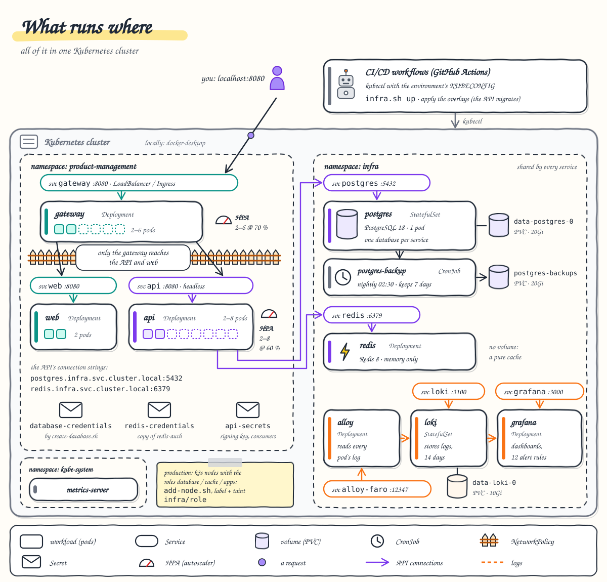

# 9. Deployment and operations

**After this chapter you will know** what runs where (everything in Kubernetes: the application in its namespace,
the shared PostgreSQL, Redis and logs in the namespace `infra`), how the system is split into three repositories
(backend, frontend, and deploy, which describes every environment), how the manifests are split into the apps and
one folder per environment, where the configuration and the passwords come from, what each script does step by step,
how and why migrations run before the rollout, inside the cluster and as which database user, how the CI/CD pipelines
release by committing to the deploy repository (GitOps), and the commands for day-to-day operation: rollouts,
rollbacks, secret rotation, scaling, backups and restores, troubleshooting, resetting data and
running load tests.



---

## The layout: three parts

The system is in three GitLab repositories, each with its own pipeline: backend, frontend and deploy
([ADR 0021](../adr/0021-deployment-layout.md), revision of 2026-10-10). The backend and the frontend hold only code,
tests, Dockerfiles and the scripts their pipelines run; everything that describes what runs in a cluster is in the
deploy repository (GitOps):

```text
deploy/                             gitlab.com/zeiss/deploy: every environment, and the only pipeline that applies
├── apps/backend/                   the API, the same everywhere: namespace, deployment.yaml (configuration as env keys),
│                                   service.yaml (`api`, headless), hpa.yaml, pdb.yaml, network-policy.yaml
├── apps/frontend/                  web.yaml, gateway.yaml (the namespace object is only in apps/backend)
├── environments/local/             kustomization.yaml + api.yaml, gateway.yaml patches; the Secret api-secrets
│                                   generated from generated/ (gitignored), the built image tags in generated/build
├── environments/staging/           kustomization.yaml (both apps, the `images:` with the released tags) + api.yaml,
├── environments/production/        gateway.yaml, registry.yaml patches and ingress.yaml
├── infra/                          the shared infrastructure, namespace `infra`, for every service on the cluster
│   ├── postgres.yaml               PostgreSQL 18: StatefulSet, Service, settings (postgresql.conf inline), nightly pg_dump
│   ├── redis.yaml                  Redis 8: Deployment, Service, settings (redis.conf inline)
│   ├── logs.yaml                   Loki, Grafana (data source, alert rules), Alloy (every pod's logs, the browser's errors)
│   └── dashboards/                 the two Grafana dashboards (JSON), loaded by infra.sh into a ConfigMap
├── scripts/
│   ├── deploy.sh                   deploy.sh <local|staging|production> [infra|apps|all]   (default apps)
│   ├── infra.sh                    infra.sh up|down|status [postgres] [redis] [logs] [--delete-data]
│   ├── create-database.sh          one database per service, with its two users and the Secret database-credentials
│   ├── add-node.sh                 joins a machine to a k3s cluster as a database, cache or apps node
│   ├── local-secrets.sh            the local signing key and demo consumers, generated once per machine
│   ├── validate.sh                 renders and checks every environment and infra/ (the pipeline's validate job)
│   └── smoke.sh                    the smoke check of a deployed environment, through its public URL
└── .gitlab-ci.yml

backend/                            gitlab.com/zeiss/backend: the API; ci/migrate.sh, ci/release.sh, .gitlab-ci.yml
frontend/                           gitlab.com/zeiss/frontend: the web app, gateway/ (the gateway image), e2e/,
                                    ci/release.sh, .gitlab-ci.yml
```

Locally the three sit side by side (the monorepo, or three clones), and `deploy/scripts/deploy.sh local` builds the
images from `../backend` and `../frontend` (`BACKEND_DIR`, `FRONTEND_DIR` to point elsewhere). Deploy in this order;
each step only needs what the one before it started:

```bash
deploy/scripts/infra.sh up        # PostgreSQL, Redis, Loki + Grafana + Alloy in the namespace infra
deploy/scripts/deploy.sh local    # secrets (first run), the database (first run), 3 images, migrations, rollout
                                  # → http://localhost:8080   (deploy.sh local all: both steps)
```

`deploy.sh local` runs `create-database.sh` itself the first time; in staging and production that is a separate,
deliberate step (below).

**What connects the parts.** Only addresses and Secrets, written in the environment's files:

| From | To | Where it is set |
| --- | --- | --- |
| the API | PostgreSQL, Redis | `ConnectionStrings__ProductManagement` (`postgres.infra.svc.cluster.local:5432`, user `pm_app`) and `ConnectionStrings__Redis` (`redis.infra.svc.cluster.local:6379`) in `deploy/environments/<env>/api.yaml` |
| the migration pod | PostgreSQL, Redis | the database's host, port, name and the migrator user from the Secret `database-credentials`; Redis at `redis.infra.svc.cluster.local:6379` |
| the API | the database and Redis passwords | the Secrets `database-credentials` (made by `create-database.sh`) and `redis-credentials` (copied from `infra/redis-auth` by `deploy.sh`, and by the backend's `ci/migrate.sh`) |
| the gateway | the API | `API_UPSTREAM`, `JWKS_URL` in `deploy/environments/<env>/gateway.yaml`: the Service `api.product-management.svc.cluster.local:8080` |
| the gateway | the log collector (optional) | `COLLECTOR_UPSTREAM` in the same file: `alloy-faro.infra.svc.cluster.local:12347`, or `""` with `LOGS=off` |
| infra (Alloy) | Loki | the Loki in `infra` by default; `LOKI_URL` for any other Loki |

The namespace `product-management` is one object, in `apps/backend`, and every environment includes both apps.
`create-database.sh` creates it too if it is missing, so it can run before the first deployment.

**Base and environments.** `deploy/apps/<app>` holds everything that runs in the cluster, the same in every
environment; `deploy/environments/<env>` holds one `kustomization.yaml` for both apps and only what differs, as one
strategic-merge patch per Deployment (`api.yaml`, `gateway.yaml`) plus, in staging and production, the pull Secret
(`registry.yaml`), the Ingress and the released image tags. `kubectl kustomize` is built into `kubectl`, so nothing
else is installed. `deploy/scripts/validate.sh` checks that every environment renders, is valid against the
Kubernetes schemas and sets what it must: the API's both connection strings, the gateway's `API_UPSTREAM`,
`JWKS_URL` and `COLLECTOR_UPSTREAM`, no Secret outside `local` (and there only the generated `api-secrets`), the pull
Secret and registry images with a tag in staging and production. It checks `infra/` with `kubeconform` too.

**Configuration is plain environment variables in the Deployment.** The API's settings are `env` entries in
`deploy/apps/backend/deployment.yaml` (ASP.NET Core reads `Section__Key` as `Section:Key`): token lifetime, rate
limits, sign-in throttle, idempotency lifetimes, `Database__ApplyMigrationsOnStartup=false`, `OpenApi__Enabled`. An
environment's `api.yaml` sets only what differs, and always the two connection strings. Because the values are in the pod
template, changing one rolls the pods like a code change, and `kubectl rollout undo` restores the old configuration
with the old code. The gateway works the same way (`GATEWAY_RATE_LIMIT_*`, `GATEWAY_TRUSTED_PROXIES`, `JWT_*` in
`apps/frontend`; the addresses in the environments).

**Three Secrets, no password in a connection string or a pipeline variable.** The API reads:

| Secret | Key | Becomes in the API | Made by |
| --- | --- | --- | --- |
| `database-credentials` | `app-password` | `PGPASSWORD`: Npgsql uses it when the connection string has no password (the readiness check's own connection too) | `deploy/scripts/create-database.sh`, once per environment: a random password, kept on every re-run |
| `redis-credentials` | `password` | `Redis__Password`: the API sets it on the Redis connection, over any password in the connection string | `deploy/scripts/deploy.sh` on every deploy (and the backend's `ci/migrate.sh`): a copy of `infra/redis-auth`, because a pod can only read Secrets of its own namespace |
| `api-secrets` | `signing-key` | `Authentication__SigningKey`: the ES256 private key that signs tokens | locally `generated/signing-key.pem`; staging and production the deploy project's CI/CD variable `API_SIGNING_KEY` (File) |
| `api-secrets` | `consumers.json` | the file `/app/config/consumers.json`: client ids, PBKDF2 hashes, roles | locally `generated/consumers.json`; staging and production `API_CONSUMERS` (File) |

The database and Redis passwords are random, created in the cluster (`infra.sh` makes `postgres-admin` and
`redis-auth`, `create-database.sh` the users' passwords) and never leave it: no file, no pipeline variable holds
them. `api-secrets` holds only the API's own keys. Locally `deploy/scripts/local-secrets.sh` writes the two files into
`deploy/environments/local/generated/` (gitignored, mode 600) once per machine, and the environment's
`secretGenerator` makes `api-secrets-<hash>` from them: a changed file gives the Secret a new name, which changes the
Deployment and rolls the pods. In staging and production the repository contains no Secret; `deploy/scripts/deploy.sh`
creates `api-secrets` from the deploy project's CI/CD variables, and the registry credential `gitlab-registry` from
the group deploy token.

**The shared infrastructure runs in the cluster.** PostgreSQL, Redis and the logs (Loki, Grafana, Alloy) run in
Kubernetes like the application, in one namespace, `infra`, shared by every service on the cluster: one PostgreSQL
with one database per service (`deploy/scripts/create-database.sh`), one Redis (services separate their keys by prefix), and
one log pipeline that collects every pod's log without the service doing anything. The same files run on Docker
Desktop, on a single k3s machine and on a production cluster, where `deploy/scripts/add-node.sh` gives PostgreSQL and Redis
nodes of their own ([chapter 12](12-from-zero.md)). Kubernetes restarts, schedules and passes the passwords for them
as for any workload; their data is on PersistentVolumeClaims that `infra.sh down` never deletes
([ADR 0021, update](../adr/0021-deployment-layout.md)). A managed database or cache instead is a host name in the
environment's `api.yaml` (its comments say how, with TLS).

**Logs are optional.** The `logs` component (Loki, Grafana, Alloy) can be left out:
`deploy/scripts/infra.sh up postgres redis` and `LOGS=off deploy/scripts/deploy.sh local` (in staging or production,
`COLLECTOR_UPSTREAM: ""` in the environment's `gateway.yaml`). The application works the same; the pods log to stdout (`kubectl logs`) and the gateway answers the browser's error reports with 204. With
`LOKI_URL=… deploy/scripts/infra.sh up logs` the logs go to another Loki instead (no Loki or Grafana in the cluster).

## Where the local deployment runs

`deploy/scripts/infra.sh up` and `deploy/scripts/deploy.sh local` deploy the whole system on one machine, on a
Kubernetes that can run images built there without a registry. Three platforms, the same scripts (plain bash with
tools that behave the same in their GNU and BSD versions; `.gitattributes` keeps the scripts' line endings LF on
Windows):

| | macOS | Windows | Ubuntu server (22.04, 24.04) |
| --- | --- | --- | --- |
| Kubernetes | Docker Desktop's (context `docker-desktop`) | Docker Desktop's, WSL 2 backend (context `docker-desktop`) | k3s v1.34.1+k3s1, one node (context `default`) |
| Prepared by | enabling Kubernetes in Docker Desktop | the same, plus WSL integration for Ubuntu; the scripts run in the Ubuntu shell | `deploy/scripts/setup-ubuntu.sh`: Docker Engine 29.9.0, kubectl v1.34.1, k3s, `git`/`openssl`/`python3`/`curl`/`jq` (about 1.5 minutes) |
| How the images reach the cluster | the cluster runs on the Docker engine that built them | the same | `docker save … \| sudo k3s ctr images import -`: k3s has a containerd of its own; tags kept, `imagePullPolicy: IfNotPresent` |
| Gateway (`LoadBalancer`) | http://localhost:8080 | http://localhost:8080 | k3s' ServiceLB on the node's address: http://&lt;server-ip&gt;:8080 (and localhost on the server) |
| Volumes | `hostpath` | `hostpath` | `local-path` (a directory on the server; `postgres-backups` binds at the first backup) |
| metrics-server | installed by `infra.sh up` | the same | k3s' own (`infra.sh up` waits for it instead of installing a second) |
| NetworkPolicies | not enforced | not enforced | enforced (k3s' network policy controller) |
| Verified | every change | not run (scripts checked for macOS-only commands) | a fresh Ubuntu 24.04 VM (Multipass, 4 CPUs, 8 GB): setup, `infra.sh up`, `deploy.sh local`, smoke check, 14/14 requirement checks and 22/22 Playwright tests from the Mac, a start over from nothing |

`deploy.sh local` decides how to deliver the images from the context (`docker-desktop`) or from a node that reports
k3s (`v1.34.1+k3s1`) and is named like the machine it runs on; `LOCAL_CLUSTER=docker-desktop|k3s` overrides it, and
any other cluster is refused with an explanation (a remote cluster needs registry images: staging or production).
Two things the Ubuntu run brought to light and that are fixed for every platform: a commit hash made only of digits
(`1186184`) was a YAML number in the generated `kustomization.yaml` (the tags are quoted now), and
`crypto.randomUUID()`, which the web app used for idempotency keys, exists only in secure contexts (HTTPS or
`localhost`), so creating a product over `http://<server-ip>:8080` failed; the web app now falls back to
`crypto.getRandomValues()` (`shared/util/idempotency-key.ts`).

## What runs where

**Namespace `infra`** (the deploy repository's `infra/`, applied by `deploy/scripts/infra.sh up`):

| Object | Kind | Component | What it does |
| --- | --- | --- | --- |
| `postgres` | StatefulSet (1 pod, `postgres-0`) + Service | postgres ([`postgres.yaml`](../../deploy/infra/postgres.yaml)) | PostgreSQL 18 at `postgres.infra.svc.cluster.local:5432`, data on the PVC `data-postgres-0` (20 GiB), 4 CPUs and 3 GiB, 1 GiB `/dev/shm`, `max_connections=200`, `shared_buffers=768MB`, `pg_stat_statements` preloaded, slow statements (> 250 ms), lock waits, checkpoints and autovacuum runs logged; sized from the measurements in [ADR 0022](../adr/0022-database-at-scale.md). The settings are the ConfigMap `postgres-config`; a `preStop` hook makes a fast shutdown |
| `postgres-backup` | CronJob + PVC `postgres-backups` (20 GiB) | postgres | every night at 02:30: `pg_dumpall --globals-only` and `pg_dump -Fc` of every database into `/backups/<date-time>/`, 7 days kept (below, "Backups and restores") |
| `postgres-admin` | Secret | postgres | the superuser `postgres`'s random password, for `create-database.sh`, the backups and people; never for a service |
| `redis` | Deployment (1 pod, `Recreate`) + Service | redis ([`redis.yaml`](../../deploy/infra/redis.yaml)) | Redis 8 at `redis.infra.svc.cluster.local:6379`, password from the Secret `redis-auth` (`--requirepass`), memory only (no volume), `maxmemory 256mb`, `volatile-lru` (only keys with an expiry can be evicted), `FLUSHALL`/`FLUSHDB`/`DEBUG` disabled |
| `loki` | StatefulSet + Service | logs ([`logs.yaml`](../../deploy/infra/logs.yaml)) | Loki 3.5.5 at `loki:3100`, 14 days' retention, data on the PVC `data-loki-0` (10 GiB) |
| `grafana` | Deployment + Service | logs | Grafana 12.2.0 at `grafana:3000`, no volume: the Loki data source, the two dashboards ([`dashboards/`](../../deploy/infra/dashboards)) and the 12 alert rules are provisioned from ConfigMaps ([chapter 8](08-observability.md)); anonymous administrator, reached only through a port-forward |
| `alloy` | Deployment + ServiceAccount, ClusterRole `infra-alloy` (read pods and their logs) | logs | Grafana Alloy: reads the log of every pod in every namespace through the Kubernetes API (PostgreSQL, Redis, Loki and Grafana included) and pushes it to Loki as `{namespace, app}`; receives the browser's error reports at the Service `alloy-faro:12347`, which a NetworkPolicy (`alloy-ingress`) reserves for the gateway pods of `product-management` |

The shared infrastructure's own logs are `{namespace="infra", app="postgres"}` (or `redis`, `loki`, `grafana`,
`postgres-backup`).

**Database users** (made by [`create-database.sh`](../../deploy/scripts/create-database.sh), one pair per service):
`pm_migrator` owns the schema `public` and is used only by the migration pod; `pm_app` is the API's user, with
`CONNECT` and `USAGE` only. What `pm_app` may do on the tables is granted by the service's own migration
`GrantAppPermissions`, which runs as `pm_migrator`: read and write rows and draw ids from the sequences, on today's
tables and every later one (`ALTER DEFAULT PRIVILEGES`), nothing else (`CREATE TABLE`: "permission denied for schema
public"; `ALTER`, `DROP`: "must be owner"). A statement of `pm_app` is cancelled after 30 s and a transaction left
idle after 60 s. The superuser `postgres` is used by the infra scripts and by people, never by an application.

**Namespace `product-management`:**

| Object | Kind | App (made by) | What it does |
| --- | --- | --- | --- |
| `database-credentials` | Secret | platform (`create-database.sh`) | `host`, `port`, `database`, `app-user`, `app-password`, `migrator-user`, `migrator-password`. The API reads only `app-password`; the migration pod the migrator's keys. |
| `redis-credentials` | Secret | platform (`deploy.sh`, the backend's `ci/migrate.sh`) | The shared Redis' password, copied from `infra/redis-auth` on every deploy and migration. |
| `api-secrets` (locally `api-secrets-<hash>`) | Secret | backend (local `secretGenerator` / `deploy.sh` from CI/CD variables) | The signing key and the consumers (above). |
| `gitlab-registry` | Secret (staging, production) | platform (`deploy.sh`, the backend's `ci/migrate.sh`) | The registry credential every pod pulls with: the group deploy token `gitlab-deploy-token` (`read_registry`), which reads both projects' registries. |
| `api` | Deployment (no fixed count) | backend | The API pods, with their configuration as env keys. Rolling update with `maxUnavailable: 0`, a 5 s `preStop` pause, startup, readiness and liveness probes, 5 old ReplicaSets kept. Pool of 10 database connections per pod, plus one for the readiness check. |
| `api` | Service (headless, `clusterIP: None`) | backend | **The API's only Service.** `api.product-management.svc.cluster.local` lists every ready API pod; the gateway balances over them per request and downloads the public signing key from it ([chapter 2](02-request-journey.md#why-the-apis-service-is-headless)). |
| `api` | HorizontalPodAutoscaler | backend | 2–8 pods at 60 % CPU ([chapter 6](06-scaling-and-capacity.md)). |
| `api` | PodDisruptionBudget | backend | At least one pod stays up during node maintenance. |
| `api-ingress` | NetworkPolicy | backend | Only the gateway may connect. |
| `migrate-<tag>` | Pod (only while it runs) | backend (the backend pipeline's `ci/migrate.sh`; locally `deploy.sh`) | The migrations, once per deployment (below); deleted when it ends. |
| `web` | Deployment (2 pods) + Service + PDB | frontend | nginx serving the Angular build. |
| `web-ingress` | NetworkPolicy | frontend | Only the gateway may connect. |
| `gateway` | Deployment (no fixed count) + PDB + HPA | frontend | The nginx gateway, 2–6 pods at 70 % CPU. |
| `gateway` | Service | frontend | Port 8080. Locally type `LoadBalancer` (`localhost:8080` on Docker Desktop, the server's address on k3s). |
| `gateway` | Ingress | frontend (staging, production: `environments/<env>/ingress.yaml`) | HTTPS for `staging.products.example.com` / `products.example.com`, certificate from cert-manager (Let's Encrypt). |

**`kube-system`:** metrics-server, which feeds the two HPAs and `kubectl top`. k3s and most managed clusters ship
it; where it is missing (Docker Desktop), `deploy/scripts/infra.sh up` installs it (v0.8.0).

The application namespace holds no data: everything that must survive is in `infra`, on the PVCs `data-postgres-0`,
`postgres-backups` and `data-loki-0`, and in the Secrets `postgres-admin` and `redis-auth`.

## The deploy scripts, step by step

### `deploy/scripts/infra.sh`

`deploy/scripts/infra.sh up|down|status [postgres] [redis] [logs] [--delete-data]`; no component means all three, in
that order. It applies the files in `deploy/infra/` to the current `kubectl` context. `deploy.sh <env> infra` runs
`infra.sh up` (the deploy pipeline's manual `infra:<env>` jobs).

`up` first creates the namespace `infra` and, when the cluster has no metrics API, installs metrics-server (on Docker
Desktop with `--kubelet-insecure-tls`, because its kubelet's certificate does not name the node). Then, per component:

| Component | `up` | `down` |
| --- | --- | --- |
| `postgres` | the Secret `postgres-admin` with a random password if it does not exist → `kubectl apply -f postgres.yaml` → wait for the StatefulSet (up to 15 minutes: crash recovery takes as long as it takes). When `postgresql.conf` changed it prints the reload command (`SELECT pg_reload_conf()`) or, for `shared_buffers`, `max_connections` and `shared_preload_libraries`, the restart command | deletes the StatefulSet, the CronJob and its Jobs, the Service and the ConfigMap |
| `redis` | the Secret `redis-auth` with a random password if it does not exist → `kubectl apply -f redis.yaml` → restarts Redis when `redis.conf` changed (the cache starts empty) → waits | deletes the Deployment, the Service and the ConfigMap |
| `logs` | without `LOKI_URL`: the ConfigMap `grafana-dashboards` from `dashboards/` → `kubectl apply -f logs.yaml` → restarts Loki, Grafana and Alloy when a ConfigMap changed → waits. With `LOKI_URL`: the Secret `loki-external` (URL, `LOKI_USERNAME`, `LOKI_PASSWORD`), removes Loki and Grafana (Loki's PVC is kept), applies only Alloy (`-l app.kubernetes.io/name=alloy`), which pushes there. `up logs` without `LOKI_URL` switches back | deletes the workloads, Services, ConfigMaps, the ServiceAccount, the NetworkPolicy and the ClusterRole(Binding) |

**What `down` keeps.** The PersistentVolumeClaims (`data-postgres-0`, `postgres-backups`, `data-loki-0`) and the
password Secrets (`postgres-admin`, `redis-auth`, `loki-external`) stay, and `down` prints them; `up` brings the
component back with its data and passwords. `down <component> --delete-data` deletes them too, without asking.
For `postgres` that is the data, the backups and the administrator's password; the services' `database-credentials`
then name users that no longer exist, so run `create-database.sh` again for each service after the next
`up postgres`.

`up` never changes an existing password Secret: PostgreSQL stores its administrator's password when it first creates
its data directory. `status` lists the pods, Services and PVCs of `infra` and prints the port-forward and `exec`
commands of "Day-2 operations" below.

### `deploy/scripts/create-database.sh`

`deploy/scripts/create-database.sh <service-namespace> <database> [app-user] [migrator-user] [--rotate]`: one PostgreSQL for
the platform, one database per service. For the product-management API:

```bash
deploy/scripts/create-database.sh product-management product_management pm_app pm_migrator
```

`deploy.sh local` runs exactly this on the first deploy (when `database-credentials` is missing); in staging and
production nothing runs it for you: an operator with access to the cluster runs it once per environment. Without the user names it uses `<database>_app` and `<database>_migrator`. It runs `psql` inside the PostgreSQL pod
(`kubectl -n infra exec statefulset/postgres`), so nothing but `kubectl` is needed, and passes the passwords on
stdin. Idempotently, it:

1. creates the two users (if missing) and sets their passwords: the ones already in the service's Secret, or new
   random ones the first time or with `--rotate`;
2. sets the app user's guard rails: `statement_timeout = 30s`, `idle_in_transaction_session_timeout = 60s`;
3. creates the database (if missing), revokes it from `PUBLIC`, grants `CONNECT` to both users and `CREATE` to the
   migrator (for trusted extensions such as `pg_trgm`);
4. in the database: creates `pg_stat_statements`, makes the migrator the owner of the schema `public`, removes
   `CREATE` on it from `PUBLIC`, grants `USAGE` to the app user, and hands tables and sequences owned by anyone else
   (e.g. after a restore as the administrator) to the migrator;
5. writes the Secret `<service-namespace>/database-credentials` (`host`, `port`, `database`, `app-user`,
   `app-password`, `migrator-user`, `migrator-password`), creating the namespace if needed.

The users and the database are the platform's; what the app user may do on the service's tables is the service's own
migrations' business (here `GrantAppPermissions`). After `--rotate`, restart the service's pods so they read the new
Secret (it prints the command).

### `deploy/scripts/deploy.sh`

`deploy/scripts/deploy.sh <local|staging|production> [infra|apps|all]`; `apps` (the default) is the API, the web app
and the gateway, `infra` runs `infra.sh up`, `all` both. It selects the cluster first (`KUBE_CONTEXT`, else the
current context of `KUBECONFIG`), and refuses `local` on a cluster that cannot run images built on this machine (only
Docker Desktop's and a k3s on this machine can) and staging or production on `docker-desktop`. It needs the shared
PostgreSQL and Redis running.

**`local`** builds and applies what is in the sibling checkouts:

1. **Local secrets** (first run only): `deploy/scripts/local-secrets.sh` creates what is missing in
   `deploy/environments/local/generated/` (signing key, demo consumers), and the API's .NET user-secrets for
   `dotnet run` when `../backend` is there.
2. **Images:** builds `../backend` → `product-management/api:<tag>`, `../frontend` → `product-management/web:<tag>`
   (with `APP_VERSION=<tag>`, the release the browser reports with its errors) and `../frontend/gateway` →
   `product-management/gateway:<tag>` with Docker; on k3s copies them into its containerd
   (`docker save | sudo k3s ctr images import -`); and writes their tags into `deploy/environments/local/generated/build/`
   (not committed), so `kubectl diff -k deploy/environments/local` compares with exactly what was applied.
3. **The shared Secrets:** creates the database the first time (`create-database.sh`, when `database-credentials` is
   missing in `product-management`), and copies the password of `infra/redis-auth` into `redis-credentials`.
4. **Migrations:** runs the new API image once with `migrate`, in a one-off pod in the cluster, as `pm_migrator`
   (below).
5. **Rollout:** `kubectl apply -k deploy/environments/local`, then waits for `api`, `web` and `gateway`; restarts the
   API when one of its Secrets changed.

**`staging`, `production`** apply what is committed, nothing else (the deploy pipeline's `deploy:<env>` jobs):

1. renders `deploy/environments/<env>` and **refuses** it while an image still has `newTag: unreleased` (the
   placeholder before the first release of that app): run the backend and frontend pipelines on `main` first;
2. checks that `database-credentials` exists (if not, it stops and prints the `create-database.sh` command);
3. creates the Secret `gitlab-registry` from `CI_DEPLOY_USER` / `CI_DEPLOY_PASSWORD` (the group deploy token) and
   `api-secrets` from the files `API_SIGNING_KEY` and `API_CONSUMERS`, when they are set (otherwise it keeps the
   existing ones, and stops if there are none);
4. copies `infra/redis-auth` into `redis-credentials`;
5. applies the rendered environment, waits for the three rollouts and restarts the API when one of its Secrets
   changed. The migrations are not run here: the backend pipeline ran them before it released the image.

| Variable | Effect |
| --- | --- |
| `KUBE_CONTEXT` | the kubectl context (the GitLab agent's `<project>:<agent>`); default: the current context |
| `BACKEND_DIR`, `FRONTEND_DIR` | local: the checkouts to build (default `../backend`, `../frontend`) |
| `LOCAL_CLUSTER` | local: `docker-desktop` or `k3s`, when the detection is wrong |
| `LOGS=off` | local: a patch that sets the gateway's `COLLECTOR_UPSTREAM` to `""`: its `collector.sh` then makes `/collect` answer 204 and drop the reports instead of proxying to a collector that is not there |
| `SEED_SAMPLE_DATA` | local: sample catalogue on an empty database (default `true`) |
| `CI_DEPLOY_USER`, `CI_DEPLOY_PASSWORD`, `CI_REGISTRY` | staging, production: the registry credential (GitLab passes the group deploy token by itself) |
| `API_SIGNING_KEY`, `API_CONSUMERS` | staging, production: files with the API's ES256 private key (PEM) and `consumers.json` |

### `deploy/scripts/validate.sh` and `deploy/scripts/smoke.sh`

`validate.sh` renders `environments/local`, `staging` and `production` and checks them (`kubeconform -strict`
against the Kubernetes 1.34 schemas, the labels, the settings each must set, no Secret where there must be none),
then `infra/` the same way; it never touches a cluster. `smoke.sh <base url>` checks a deployed environment from
outside, through the gateway, retrying each step for up to a minute: `GET /healthz` 200, `GET /` 200 with the web
app, and `POST /api/auth/token` with an unknown client, 401 `invalid_client` (the gateway reaches the API; the API's
`/health/ready` is not routed through the gateway). With `SMOKE_CLIENT_ID` and `SMOKE_CLIENT_SECRET` (a viewer
consumer) it also signs in and reads `GET /api/categories`. Both run on a laptop too:
`deploy/scripts/smoke.sh http://localhost:8080`.

**What a deploy does not do.** `kubectl apply` does not prune: an object removed from the manifests stays in the
cluster until it is deleted by hand (`kubectl delete <kind> <name>`), in each environment. Locally the old
`api-secrets-<hash>` Secrets also stay (they let `kubectl rollout undo` go back to the previous keys); delete old ones
with `kubectl -n product-management get secrets` and `kubectl delete secret`.

## Clean deploy

**Locally, from nothing.** This removes the application, the shared infrastructure with its volumes and passwords,
and the local keys, then deploys again; an empty database gets the 24-product sample catalogue from the migrations.

```bash
kubectl config use-context docker-desktop          # on the Ubuntu server (k3s): default
kubectl delete namespace product-management --ignore-not-found
deploy/scripts/infra.sh down --delete-data
rm -rf deploy/environments/local/generated
deploy/scripts/infra.sh up
deploy/scripts/deploy.sh local
deploy/scripts/smoke.sh http://localhost:8080
```

Keeping the data and rebuilding only the application is just the last two commands. On the Ubuntu VM the whole block
took 103 s.

**A new environment, the first time:** cluster (k3s, nodes joined with `add-node.sh`), the GitLab variables and the
group deploy token, `infra:<environment>` then `create-database.sh`, `STAGING_ENABLED` / `PRODUCTION_ENABLED`, then
a backend and a frontend release; the deploy pipeline refuses the `unreleased` tags until both have released. The
step-by-step list is in the deploy repository's README ("Clean deploy") and, with every variable, in
[chapter 12](12-from-zero.md).

## Image tags

* **Local:** `deploy.sh local` tags each image with its checkout's short commit hash (`git rev-parse --short HEAD`),
  plus `-dirty-<timestamp>` when the working tree has uncommitted changes, so two different builds never share a tag.
  On Docker Desktop (context `docker-desktop`) the cluster runs on the same Docker engine that built the images, so
  nothing is pushed; on k3s they are copied into its containerd with their tags. That is why `local` runs only on
  those two. The tags are written quoted (`newTag: "1186184"`): a hash made only of digits is otherwise a YAML
  number. A folder that is not a git checkout gets `dev-<timestamp>`.
* **Staging and production:** the pipelines tag images with the commit's short SHA and push them to the project's
  registry (`registry.gitlab.com/zeiss/backend/api`, `.../frontend/web`, `.../frontend/gateway`). The tag that runs is
  the `newTag` in `deploy/environments/<env>/kustomization.yaml`, written by the app pipelines' release jobs; nothing
  else decides it.

## Migrations run before the rollout, with the image being deployed

The API image being deployed runs once, with the argument `migrate`
([`ApiCommandLine.cs`](../../backend/ProductManagement.Api/Hosting/ApiCommandLine.cs)), as the schema owner, in a
one-off pod in the namespace `product-management`. In staging and production the backend pipeline does it
(`migrate:<env>`, [`backend/ci/migrate.sh`](../../backend/ci/migrate.sh)) before it releases the image; locally
`deploy/scripts/deploy.sh local` does it before it applies:

```bash
kubectl -n product-management run migrate-<tag> --rm --attach --restart=Never --quiet \
  --image=product-management/api:<tag> --overrides='{ "spec": { "containers": [{ "args": ["migrate"], "env": [ … ] }] } }'
#   DB_HOST, DB_PORT, DB_NAME, DB_USER   ← Secret database-credentials (host, port, database, migrator-user)
#   PGPASSWORD                           ← Secret database-credentials (migrator-password)
#   ConnectionStrings__ProductManagement = Host=$(DB_HOST);Port=$(DB_PORT);Database=$(DB_NAME);Username=$(DB_USER);GSS Encryption Mode=Disable
#   ConnectionStrings__Redis = redis.infra.svc.cluster.local:6379,  Redis__Password ← Secret redis-credentials (password)
```

The kubelet assembles the connection string from the variables above it, so no password is on a command line or in
a manifest. The pod runs as non-root, without a service account token, and in staging and production pulls the image
with the Secret `gitlab-registry`.

**Why a pod in the cluster.** The database is reachable only inside the cluster (its Service has no address outside
it). `kubectl run --rm --attach` streams the migration's output into the script's terminal (or the pipeline's job log),
returns its exit code, so a failed migration stops the release before any API pod changes, and deletes
the pod when it ends: no Job manifest to keep, no port-forward, nothing left behind.

The migration waits for PostgreSQL (up to 30 attempts, 2 s apart), applies the EF Core migrations, seeds the sample
data into an empty database, and moves the Redis cache generations on (the data may have changed underneath the
cache). Then it exits, and only then is the new image released: locally applied at once; in staging and production
`release:<env>` writes its tag into the deploy repository, whose pipeline then rolls it out. The schema is therefore
always at least as new as the code that runs.

* **The code that migrates is exactly the code being deployed**, and it runs once per deployment, not once per pod.
  The API pods start with `ApplyMigrationsOnStartup=false` and read only `pm_app`'s password, which cannot change the
  schema. The migrator's password sits in the same namespace (`database-credentials`), read only by the migration pod.
* **Large indexes are built `CONCURRENTLY`** by the migrations that add them, and storage parameters (the per-table
  autovacuum settings of [ADR 0022](../adr/0022-database-at-scale.md)) are instant `ALTER TABLE … SET`, so the tables
  keep accepting writes.
* **It needs only the database** (and Redis, optionally). The `migrate` command builds a plain host with the
  infrastructure services, without the web server, authentication or rate limiting, so it is never given the key that
  signs access tokens.
* **The app user's rights are a migration too** (`GrantAppPermissions`): it runs as the schema owner, so its
  `ALTER DEFAULT PRIVILEGES` also covers the tables later migrations create. It uses the well-known name `pm_app`
  (a compiled migration cannot read configuration) and does nothing where that role does not exist (the tests'
  Testcontainers database).
* **Expand/contract.** The old pods keep running while the migration applies, and during the rollout old and new
  pods run side by side. A migration must therefore keep working with the version still running (add first, remove in
  a later release). A rollback never undoes a migration; a bad one is fixed forward.

## CI/CD pipelines

One GitLab pipeline per repository (backend, frontend, deploy), the only CI/CD. The flow is GitOps: the backend and
frontend pipelines test, build and scan their images and *release* them by committing the new image tag to the deploy
repository; they never apply anything to a cluster. The deploy repository's pipeline is the only one that changes the
clusters: it applies what its `main` holds and smoke-checks it.

```text
backend   test → build → scan → migrate:staging → release:staging ──┐  commit "backend: api <sha>"
frontend  test → build → scan ─────────────────→ release:staging ──┤  commit "frontend: web, gateway <sha>"
                                                                    ▼
deploy    main: environments/staging changed → deploy:staging → smoke:staging

backend   migrate:production (manual) → release:production ──┐  merge request "Release api <sha> to production"
frontend  release:production (manual) ───────────────────────┤  merge request "Release web, gateway <sha> to ..."
                                                              ▼  (merged by a person)
deploy    main: environments/production changed → deploy:production (manual) → smoke:production
```

Every step a pipeline runs is a script in that repository that also runs on a laptop. The jobs that touch a cluster
(the backend's migrate jobs, the deploy repository's deploy and infra jobs) reach it through the GitLab agent for
Kubernetes (`KUBE_CONTEXT`), so no cluster API is exposed to the runners, or with a kubeconfig (a File variable
`KUBECONFIG`). The staging and production jobs exist only once the environment is switched on (project or group
variables `STAGING_ENABLED` / `PRODUCTION_ENABLED` = `true`); until then a pipeline on `main` stops, green, after scan
(deploy: after validate). The pods pull the private images with the Secret `gitlab-registry`, made from the zeiss
group's deploy token `gitlab-deploy-token` (`read_registry`), which reads both registries.

*Backend* ([`backend/.gitlab-ci.yml`](../../backend/.gitlab-ci.yml)):

| Stage | Jobs | Runs on |
| --- | --- | --- |
| test | `test:backend` (`dotnet format --verify-no-changes`, Release build with warnings as errors, every test suite, the integration and acceptance tests with PostgreSQL and Redis from Testcontainers on Docker-in-Docker, JUnit), GitLab SAST and secret detection | merge requests, `main`, tags |
| build | `build:api` → `$CI_REGISTRY_IMAGE/api:<short sha>`; `migrations:sql` (`dotnet restore`, then the idempotent SQL of every migration, for review in the merge request) | merge requests, `main`, tags |
| scan | `scan:api`: Trivy, fails on fixable critical vulnerabilities | merge requests, `main`, tags |
| staging | `migrate:staging` (`ci/migrate.sh` in the `alpine/k8s` image: selects the cluster, the Secret `gitlab-registry` from the deploy token, `redis-credentials`, then the migration pod with the release's image, as `pm_migrator`) → `release:staging` (`ci/release.sh staging`: commits the new `api` tag to `environments/staging/kustomization.yaml` on the deploy repository's `main`, with `DEPLOY_REPO_TOKEN`; starts again from the new `main` if it moved meanwhile) | `main` with `STAGING_ENABLED`, automatic |
| production | `migrate:production` (**manual**, protected environment) → `release:production` (pushes a branch to the deploy repository and opens the merge request "Release api <sha> to production") | `main` with `STAGING_ENABLED` and `PRODUCTION_ENABLED` |

*Frontend* ([`frontend/.gitlab-ci.yml`](../../frontend/.gitlab-ci.yml)):

| Stage | Jobs | Runs on |
| --- | --- | --- |
| test | `test:frontend` (`npm run lint`, `format:check`, `test:ci`, `build`), SAST and secret detection | merge requests, `main`, tags |
| build | `build:web`, `build:gateway` → `$CI_REGISTRY_IMAGE/{web,gateway}:<short sha>` | merge requests, `main`, tags |
| scan | `scan:web`, `scan:gateway` (Trivy) | merge requests, `main`, tags |
| staging | `release:staging` (`ci/release.sh staging`: commits the new `web` and `gateway` tags to the deploy repository) | `main` with `STAGING_ENABLED`, automatic |
| production | `release:production` (**manual**, protected environment: opens the merge request in the deploy repository) | `main` with `STAGING_ENABLED` and `PRODUCTION_ENABLED` |

The end-to-end tests (Playwright, `frontend/e2e/`) are not a pipeline job: they need the whole running system. Run
them by hand against an environment (`BASE_URL=<environment url> npm run e2e`, [`frontend/README.md`](../../frontend/README.md)).

*Deploy* ([`deploy/.gitlab-ci.yml`](../../deploy/.gitlab-ci.yml)):

| Stage | Jobs | Runs on |
| --- | --- | --- |
| validate | `validate:manifests` (`scripts/validate.sh`: every environment and `infra/`; extracts the inline Alloy configuration), `validate:scripts` (`shellcheck` on `scripts/*.sh`), `validate:alloy` (`alloy validate` and `alloy fmt` on that configuration) | merge requests, `main` |
| staging | `deploy:staging` (`scripts/deploy.sh staging apps`) → `smoke:staging` (`scripts/smoke.sh $STAGING_URL`), automatic when a commit changes `environments/staging`, `apps/`, `infra/` or `scripts/deploy.sh`; `infra:staging` (**manual**, `scripts/deploy.sh staging infra`) | `main` with `STAGING_ENABLED` |
| production | `deploy:production` (**manual**, protected environment) → `smoke:production`, when a commit changes `environments/production`, `apps/` or `scripts/deploy.sh`; `infra:production` (**manual**) | `main` with `PRODUCTION_ENABLED` |

With the environment-scoped `LOKI_URL` (and `LOKI_USERNAME` / `LOKI_PASSWORD`) the infra jobs make Alloy push to that
Loki. No pipeline creates a database: `create-database.sh` is a separate, deliberate step, once per service and
environment, run by an operator with access to the cluster.

**Releases and rollbacks are commits.** `git log environments/staging` in the deploy repository is staging's
deployment history (one commit per release: "backend: api <sha>"); production changes only through merged merge
requests, so merging is the release decision. A rollback is `git revert` of the release commit (or the merge) on the
deploy repository's `main`: its pipeline applies the previous tags. Migrations are never rolled back (expand/contract,
below).

Runners: every job of the three pipelines runs on gitlab.com's shared runners. None needs to reach the database: the
migrations run inside the cluster, and the jobs reach the cluster only through `kubectl`. The pipelines run on
gitlab.com; the staging and production jobs have not yet run against real clusters. Setting them up (the agent or a
kubeconfig, environments, every variable per project, the tokens, or one machine of our own) is
[chapter 12](12-from-zero.md).

## Day-2 operations

All commands run from the folder that holds the three repositories (`backend/`, `frontend/`, `deploy/`) and the local
`tools/`, and assume `kubectl config use-context docker-desktop`.

**See what is running**

```bash
kubectl -n product-management get pods -o wide
kubectl -n product-management get hpa
kubectl -n product-management top pods                       # needs metrics-server
kubectl -n product-management get events --sort-by=.lastTimestamp | tail -20
deploy/scripts/infra.sh status                               # the shared infrastructure: pods, Services, PVCs
```

**Reach the shared infrastructure from a laptop.** Nothing in `infra` is published outside the cluster; only the
application is (`http://localhost:8080`). For the rest:

```bash
kubectl -n infra port-forward svc/grafana 3000:3000          # Grafana → http://localhost:3000
kubectl -n infra port-forward svc/loki 3100:3100             # Loki's API → http://localhost:3100 (the browser-errors e2e test)
kubectl -n infra exec -it statefulset/postgres -- psql -U postgres -d product_management
kubectl -n infra exec -it deployment/redis -- redis-cli      # the password is already set in the pod (REDISCLI_AUTH)
```

**Logs.** In Grafana (through the port-forward, [chapter 8](08-observability.md)), or directly (this works with the
logs component down too):

```bash
kubectl -n product-management logs -l app.kubernetes.io/name=api --tail=20 --prefix
kubectl -n product-management logs -l app.kubernetes.io/name=gateway --tail=20   # access log: upstream pod, cache status, trace_id
kubectl -n infra logs statefulset/postgres --tail 50                            # slow statements, lock waits, errors
kubectl -n infra logs deployment/redis --tail 50
```

**Roll out a change.** Locally, run the script again; it applies what changed:

```bash
deploy/scripts/deploy.sh local            # after changing the API, the web app, the gateway or their manifests
deploy/scripts/infra.sh up postgres       # after changing postgres.yaml (postgresql.conf): then the reload or restart it prints
deploy/scripts/infra.sh up redis          # after changing redis.yaml (restarts Redis: the cache starts empty)
deploy/scripts/infra.sh up logs           # after changing logs.yaml or a dashboard
kubectl diff -k deploy/environments/local                    # what differs from the last deploy (nothing, after one)
kubectl -n product-management rollout status deployment/api
```

In staging and production a change is a commit: code goes through the app pipelines' release jobs, a manifest or
setting through a merge request in the deploy repository, whose pipeline applies it (`infra/` through the manual
`infra:<env>` jobs).

**Change a setting.** Edit the env entry in `deploy/apps/backend/deployment.yaml` (every environment) or in
`deploy/environments/<env>/api.yaml` (one environment), then deploy (locally `deploy.sh local`; elsewhere merge it
into the deploy repository's `main`). To try a value without a deploy,
`kubectl -n product-management set env deployment/api RateLimiting__RequestsPerSecond=100` rolls the pods with it;
the next deploy puts the file's value back.

**Roll back.** In staging and production, revert in the deploy repository: `git revert <release commit>` (or the
production merge commit) on `main`, through a merge request or directly; the pipeline applies the previous tags and
smoke-checks them, and the repository still says what runs. Locally, or in an emergency before the revert lands (each
Deployment keeps 5 old ReplicaSets, each with its own image and configuration):

```bash
kubectl -n product-management rollout history deployment/api
kubectl -n product-management rollout undo deployment/api
kubectl -n product-management rollout undo deployment/gateway
```

A rollback does not undo database migrations; that is why migrations must stay compatible with the previous version.
A `rollout undo` in staging or production lasts only until the next deploy job applies `main` again, so follow it
with the revert.

**Rotate a secret.** Secrets are read when a pod starts, so every rotation ends with a restart of the pods that read
it.

* *The API's own keys* (`API_SIGNING_KEY`, `API_CONSUMERS`), staging and production: change the deploy project's
  CI/CD variable and re-run its last `deploy:<env>` job. `deploy.sh` updates `api-secrets` and, as its content
  changed, runs `kubectl rollout restart deployment/api`. Locally: `FORCE=1 deploy/scripts/local-secrets.sh` (a new
  signing key and consumer hashes: everyone signs in again), then `deploy/scripts/deploy.sh local`.
* *The database users' passwords* (any environment, from a machine with access to the cluster):

  ```bash
  deploy/scripts/create-database.sh product-management product_management pm_app pm_migrator --rotate
  kubectl -n product-management rollout restart deployment/api
  ```

  The new passwords are set in PostgreSQL and in `database-credentials` at once. Open connections survive (PostgreSQL
  checks passwords only when a connection opens), but new connections of not-yet-restarted pods fail until the
  restart, so run the two together. The migrator's password is read by the next migration pod.
* *The Redis password:* a new random one, then Redis and every service that copies it:

  ```bash
  kubectl -n infra delete secret redis-auth
  deploy/scripts/infra.sh up redis     # a new redis-auth, and restarts Redis with it (the cache starts empty)
  deploy/scripts/deploy.sh local       # copies it into redis-credentials and, as it changed, restarts the API
                                       # (staging, production: re-run the deploy repository's deploy:<env> job)
  ```

  Between the Redis restart and the API's, the API cannot reach Redis: the cache and the shared rate limits fall
  back, and idempotent writes answer 503 ([chapter 12](12-from-zero.md#rotate-secrets) has the order for production).

**Scale.** The HPAs own the replica counts, so `kubectl scale` is undone within seconds. Change the range instead
(for good: in `deploy/apps/backend/hpa.yaml`, or `minReplicas`/`maxReplicas` of the gateway's HPA in
`deploy/apps/frontend/gateway.yaml`):

```bash
kubectl -n product-management patch hpa api -p '{"spec":{"minReplicas":4,"maxReplicas":8}}'
kubectl -n product-management get hpa api -w
```

Keep `maxReplicas × (10 + 1)` connections (the request pool plus the readiness check's own connection) within what
PostgreSQL can serve: 8 × 11 = 88 of its 200, which other services' databases on the same server share
([chapter 6](06-scaling-and-capacity.md#why-the-database-is-the-ceiling)). More machines for the pods: on k3s,
`deploy/scripts/add-node.sh <user@host> apps` ([chapter 12](12-from-zero.md)).

**Swagger UI** (enabled in the local and staging environments)

```bash
kubectl -n product-management port-forward deployment/api 5080:8080   # http://localhost:5080/swagger, then Authorize with a token
```

**Database users.** `deploy/scripts/create-database.sh` is idempotent: run it again after a restore, or when in doubt, and it
re-applies the users' passwords from the Secret, their guard rails and the schema's ownership. The app user's rights on
the tables come from the migrations: `deploy/scripts/deploy.sh local` (or the backend's `migrate:<env>` job)
re-applies them on an empty database.

**Backups and restores.** The CronJob `postgres-backup` dumps every database each night at 02:30 into the PVC
`postgres-backups` (`/backups/<date-time>/globals.sql` and `<database>.dump`), keeping 7 days. The dumps sit on the
same node as the data: they protect against mistakes (a dropped table, a bad migration), not against losing the node
or its disk; production ships them elsewhere ([chapter 12](12-from-zero.md)).

```bash
kubectl -n infra create job --from=cronjob/postgres-backup postgres-backup-now     # a backup now
kubectl -n infra logs job/postgres-backup-now                                      # what it wrote
kubectl -n infra get jobs -l app.kubernetes.io/name=postgres-backup               # the last runs
```

To restore one database, start a pod with the backups' volume and the administrator's password, and `pg_restore`
from it (`--clean --if-exists` drops and recreates the dump's objects, with their owners and grants):

```bash
kubectl -n infra apply -f - <<'EOF'
apiVersion: v1
kind: Pod
metadata:
  name: postgres-restore
spec:
  restartPolicy: Never
  securityContext: { runAsUser: 70, runAsGroup: 70, fsGroup: 70 }
  tolerations:
    - { key: infra/role, operator: Equal, value: database, effect: NoSchedule }
  containers:
    - name: restore
      image: postgres:18-alpine
      command: [sleep, "3600"]
      env:
        - { name: PGHOST, value: postgres }
        - { name: PGUSER, value: postgres }
        - name: PGPASSWORD
          valueFrom: { secretKeyRef: { name: postgres-admin, key: password } }
      volumeMounts:
        - { name: backups, mountPath: /backups, readOnly: true }
  volumes:
    - name: backups
      persistentVolumeClaim: { claimName: postgres-backups }
EOF
kubectl -n infra wait --for=condition=Ready pod/postgres-restore
kubectl -n infra exec postgres-restore -- ls -l /backups
# No writes meanwhile: without its autoscaler (whose minimum cannot be 0), the API scales to zero
kubectl -n product-management delete hpa api && kubectl -n product-management scale deployment/api --replicas=0
kubectl -n infra exec postgres-restore -- \
  pg_restore -d product_management --clean --if-exists /backups/<date-time>/product_management.dump
kubectl -n infra delete pod postgres-restore
deploy/scripts/create-database.sh product-management product_management pm_app pm_migrator   # ownership and passwords
deploy/scripts/deploy.sh local              # the migration moves the cache generations on; the HPA is back
kubectl -n product-management scale deployment/api --replicas=2
```

Restoring into a new database first (`pg_restore -d <new database>` after `CREATE DATABASE`) leaves the current one
untouched until the dump has been checked, e.g. with `PG_DATABASE=<new database> tools/load-tests/verify-data.sh`.

**Reset the data.** One service's database (the others on the server stay):

```bash
kubectl -n infra exec statefulset/postgres -- psql -U postgres -c 'DROP DATABASE product_management WITH (FORCE)'
deploy/scripts/create-database.sh product-management product_management pm_app pm_migrator   # empty database, same users
deploy/scripts/deploy.sh local              # the migrations re-create the schema and the sample data
```

Everything in PostgreSQL, including its backups and the administrator's password:

```bash
deploy/scripts/infra.sh down postgres --delete-data
deploy/scripts/infra.sh up postgres
deploy/scripts/create-database.sh product-management product_management pm_app pm_migrator
deploy/scripts/deploy.sh local
```

**Bulk data and load tests**

```bash
tools/load-tests/seed-bulk.sh                     # adds 850,000 products and ~5 million movements (minutes)
PRODUCTS=0 LEDGER_ROWS=20000000 tools/load-tests/seed-bulk.sh   # grows the ledger to 20 million rows (~20 minutes)
tools/load-tests/verify-data.sh                   # data invariants, all must be 0
tools/load-tests/run.sh smoke                     # any scenario: smoke, load, stress, spike, stock-consistency, rate-limit, teams, browse
```

The data scripts reach PostgreSQL with `kubectl -n infra exec -i statefulset/postgres -- psql -U postgres` and Redis
with `kubectl -n infra exec -i deployment/redis -- redis-cli` (override with `PSQL`, `REDIS_CLI`, `PG_USER`,
`PG_DATABASE`). `run.sh` raises the API's rate limits (and, for some scenarios, the gateway's) with `kubectl set env`
for the run, after saving the deployed values, and always sets those values back at the end. The autoscalers need
metrics-server, which `deploy/scripts/infra.sh up` installs where it is missing. The load tests and
`tools/check-requirements.py` are local tools, in no GitLab repository and no pipeline.

**Troubleshooting**

| Symptom | Look at |
| --- | --- |
| API pods not ready | `kubectl -n product-management describe pod -l app.kubernetes.io/name=api`, then `kubectl -n product-management logs deployment/api`; readiness includes the database (`SELECT 1`), so check it: `deploy/scripts/infra.sh status`, `kubectl -n infra logs statefulset/postgres --tail 50` |
| `deploy.sh` stops: "No Secret database-credentials" | the database was not created in this cluster: `deploy/scripts/create-database.sh product-management product_management pm_app pm_migrator` |
| `deploy.sh` stops: "No Secret infra/redis-auth" | the shared Redis is not running: `deploy/scripts/infra.sh up redis` (or the `infra:<env>` job) |
| `deploy.sh` stops: "images that were never released (newTag: unreleased)" | an app has not been released to that environment yet: run the backend and frontend pipelines on `main` (staging), or merge their release merge requests (production) |
| `deploy.sh` stops: "No Secret gitlab-registry" or "No Secret api-secrets" | the deploy project's variables: the group deploy token `gitlab-deploy-token`, `API_SIGNING_KEY` / `API_CONSUMERS` for that environment ([chapter 12](12-from-zero.md)) |
| `release:*` job fails to push | `DEPLOY_REPO_TOKEN` in that app project: a project access token of `zeiss/deploy`, Maintainer, `write_repository`, protected and masked (so only protected branches see it) |
| The API cannot reach the database or Redis | the connection strings it runs with: `kubectl -n product-management get deployment api -o jsonpath='{.spec.template.spec.containers[0].env}'`; whether the Services answer: `kubectl -n product-management run nettest --rm -it --restart=Never --image=busybox:1.37 -- nc -zv postgres.infra.svc.cluster.local 5432` (and `redis.infra.svc.cluster.local 6379`) |
| Password authentication failed | the users' passwords no longer match `database-credentials` (e.g. after `down postgres --delete-data`): `deploy/scripts/create-database.sh …` again (it sets the Secret's passwords on the users), then `kubectl -n product-management rollout restart deployment/api`. Redis `WRONGPASS`: `deploy/scripts/deploy.sh <env>` copies `redis-auth` again and restarts the API |
| Migration step fails | its output in `deploy.sh local`'s terminal (or the backend's `migrate:*` job log); nothing is released; the pod is gone afterwards. A pod that never starts: `kubectl -n product-management get events --sort-by=.lastTimestamp` (image pull, missing Secret) |
| `postgres-0` Pending | `kubectl -n infra describe pod postgres-0`: its volume lives on one node, so the pod can only start there (the node is down, or tainted for another role) |
| `502` on `/api` | no ready API pod: `kubectl -n product-management get endpointslices -l kubernetes.io/service-name=api` |
| `502` on `/collect` in the browser console | no log collector: `deploy/scripts/infra.sh up logs`, or deploy with `LOGS=off` |
| `ImagePullBackOff` | staging, production: the tag in `deploy/environments/<env>/kustomization.yaml` must exist in the registry, and the Secret `gitlab-registry` must hold the group deploy token (`read_registry`) |
| `smoke:*` fails | its log says which step: `/healthz` (gateway, Ingress, TLS), `/` (web), the `invalid_client` 401 (the API behind the gateway), the signed-in read (`SMOKE_CLIENT_ID` / `SMOKE_CLIENT_SECRET`, the database). Run `deploy/scripts/smoke.sh <url>` from a laptop to repeat it |
| HPA shows `<unknown>` | metrics-server: `deploy/scripts/infra.sh up` installs it where missing, then `kubectl top pods` |

## Where to look

* Deploy scripts: [`deploy/scripts/deploy.sh`](../../deploy/scripts/deploy.sh),
  [`infra.sh`](../../deploy/scripts/infra.sh), [`create-database.sh`](../../deploy/scripts/create-database.sh),
  [`add-node.sh`](../../deploy/scripts/add-node.sh), [`local-secrets.sh`](../../deploy/scripts/local-secrets.sh),
  [`validate.sh`](../../deploy/scripts/validate.sh), [`smoke.sh`](../../deploy/scripts/smoke.sh)
* Application manifests: [`deploy/apps/backend`](../../deploy/apps/backend)
  ([`deployment.yaml`](../../deploy/apps/backend/deployment.yaml), [`service.yaml`](../../deploy/apps/backend/service.yaml)),
  [`deploy/apps/frontend`](../../deploy/apps/frontend); the environments
  [`local`](../../deploy/environments/local/kustomization.yaml),
  [`staging`](../../deploy/environments/staging/kustomization.yaml) ([`api.yaml`](../../deploy/environments/staging/api.yaml)),
  [`production`](../../deploy/environments/production/kustomization.yaml);
  [`gateway/collector.sh`](../../frontend/gateway/collector.sh)
* Shared infrastructure: [`deploy/infra/postgres.yaml`](../../deploy/infra/postgres.yaml),
  [`redis.yaml`](../../deploy/infra/redis.yaml), [`logs.yaml`](../../deploy/infra/logs.yaml),
  [`dashboards`](../../deploy/infra/dashboards)
* Migrations: [`ApiCommandLine.cs`](../../backend/ProductManagement.Api/Hosting/ApiCommandLine.cs),
  [`DatabaseInitializer.cs`](../../backend/ProductManagement.Infrastructure/Persistence/DatabaseInitializer.cs),
  [`Persistence/Migrations`](../../backend/ProductManagement.Infrastructure/Persistence/Migrations)
  (the app user's rights: [`GrantAppPermissions`](../../backend/ProductManagement.Infrastructure/Persistence/Migrations/20261010164241_GrantAppPermissions.cs)),
  [`backend/ci/migrate.sh`](../../backend/ci/migrate.sh)
* CI/CD: [`backend/.gitlab-ci.yml`](../../backend/.gitlab-ci.yml), [`frontend/.gitlab-ci.yml`](../../frontend/.gitlab-ci.yml),
  [`deploy/.gitlab-ci.yml`](../../deploy/.gitlab-ci.yml); the release script
  [`backend/ci/release.sh`](../../backend/ci/release.sh) (the same in [`frontend/ci`](../../frontend/ci/release.sh))
* Each repository on its own: [`backend/README.md`](../../backend/README.md), [`frontend/README.md`](../../frontend/README.md),
  [`deploy/README.md`](../../deploy/README.md)
* Decisions: [ADR 0021 deployment layout](../adr/0021-deployment-layout.md) (which supersedes most of
  [ADR 0011](../adr/0011-kubernetes-deployment.md)), [ADR 0006 PostgreSQL](../adr/0006-postgresql.md)
* Diagrams: [flows.md §9 deployment and CI/CD](../flows.md#9-deployment-and-cicd),
  [architecture.md](../architecture.md#deployment-topology)

## How to verify

```bash
deploy/scripts/deploy.sh local all             # infra, the database (first run), images, migrations, apply
deploy/scripts/infra.sh status
kubectl diff -k deploy/environments/local && echo "no drift"
kubectl -n infra get statefulset,deployment,cronjob,pvc
kubectl -n product-management get deploy,svc,hpa,pdb,networkpolicy,secret
kubectl -n product-management get svc api -o jsonpath='{.spec.clusterIP}'; echo      # None: headless
kubectl -n product-management get deploy api -o jsonpath='{.spec.template.spec.containers[0].image}'; echo   # the exact tag

# No password in the API's configuration: the connection strings have none, the passwords come from Secrets
kubectl -n product-management get deploy api -o jsonpath='{range .spec.template.spec.containers[0].env[*]}{.name}={.value}{"\n"}{end}' | grep -i -E 'connection|password'

# The API's database user cannot change the schema (its password goes over stdin, never on a command line)
kubectl -n product-management get secret database-credentials -o go-template='{{ index .data "app-password" | base64decode }}' \
  | kubectl -n infra exec -i statefulset/postgres -- sh -c 'PGPASSWORD="$(cat)" psql -h localhost -U pm_app -d product_management \
      -c "BEGIN" -c "DROP TABLE products" -c "ROLLBACK"'          # ERROR: must be owner of table products

# Every environment and infra/ render and are valid (what the deploy pipeline's validate job runs)
docker run --rm -v "$PWD/deploy:/work:ro" -w /work alpine/k8s:1.34.11 scripts/validate.sh

# The smoke check the pipeline runs after a deployment, here against the local one
deploy/scripts/smoke.sh http://localhost:8080

# Without logs: /collect answers 204
deploy/scripts/infra.sh down logs && LOGS=off deploy/scripts/deploy.sh local
curl -s -o /dev/null -w '%{http_code}\n' -X POST localhost:8080/collect -H 'Content-Type: application/json' -d '{}'   # 204
```
