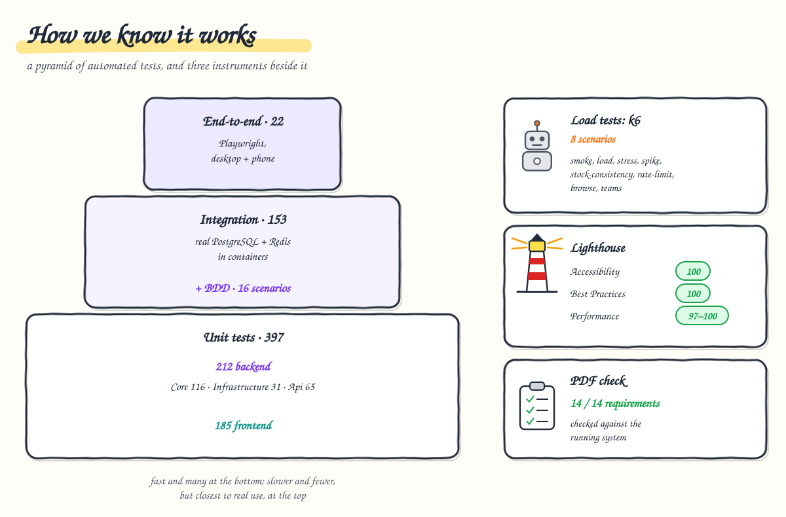

# 10. Testing and quality

**After this chapter you will know** which kinds of tests exist, how many there are, what each kind can and cannot
prove, one real example of each, how to run every one of them, and the project agents that run or review it all.



---

## The pyramid, with current counts

| Level | Suite | Tests | Runs against |
| --- | --- | ---: | --- |
| Unit | `UnitTests`, folder `Core/` | 116 | the domain as plain objects; the use cases with substitutes (NSubstitute) for their ports; validators |
| Unit | `UnitTests`, folder `Infrastructure/` | 38 | registration, cache decorators, single-flight, in-memory fallbacks, Redis failures and cancellations, the migrations' connection |
| Unit | `UnitTests`, folder `Api/` | 65 | token service, secret hashing, options validation, idempotency keys, rate-limit buckets, ETags |
| Integration | `Api.IntegrationTests` | 155 | the real API over HTTP, with **real PostgreSQL and Redis** in Docker (Testcontainers) |
| Acceptance (BDD) | `Api.AcceptanceTests` | 16 | Gherkin scenarios (Reqnroll) against the same real stack |
| **Back end total** | | **390** | `dotnet test` |
| Unit / component | front end (Vitest) | **187** (35 spec files) | Angular components, services and the store, in a simulated DOM |
| End-to-end | Playwright | **22** | the running system (gateway, API, Redis, PostgreSQL) in a real browser: 11 scenarios × desktop and phone; the browser-errors scenario also reads Loki and is skipped when no Loki is reachable (e.g. `LOGS=off`) |
| Requirements | `tools/check-requirements.py` | 14 checks | the running system, through the gateway |
| Audit | Lighthouse user flow | 5 steps × 2 form factors | the running system, signed in |
| Load | k6 scenarios | 8 | the running cluster, from inside it ([chapter 6](06-scaling-and-capacity.md)) |

## What each kind proves

The back end has one unit-test project, `ProductManagement.UnitTests`, with a folder per project under test (`Core/`,
`Infrastructure/`, `Api/`, each mirroring that project's folders); the paragraphs below follow those folders.

**Domain unit tests** (`Core/`) prove the business rules in isolation: six-digit ids, price precision, stock range, a failed
update leaving no partial change, the stock rule at its edges (including deltas that would overflow naive
arithmetic). Example: `Update_WithInvalidData_LeavesTheProductUnchanged`
([`ProductTests.cs`](../../backend/ProductManagement.UnitTests/Core/Products/ProductTests.cs)). They cannot prove
anything about the database.

**Use-case unit tests** (`Core/`) prove the use cases orchestrate correctly: validation first, no id consumed by an invalid
request, version checks, conflicts mapped to 409/412, stock errors carrying the available quantity. Example:
`Create_RecordsTheInitialStockInTheLedgerInTheSameSave`
([`ProductCommandServiceTests.cs`](../../backend/ProductManagement.UnitTests/Core/Products/ProductCommandServiceTests.cs)).

**Infrastructure unit tests** (`Infrastructure/`) prove the wiring and the cache's own logic: the API refuses to start without Redis
outside development, falls back to in-memory stores in development, rejects invalid options, invalidates only after a
successful commit, collapses concurrent misses, and connects the migrations as the migrator (unpooled, with a long
command timeout). Example: `WithoutRedis_WhenRedisIsRequired_RefusesToStart`
([`InfrastructureRegistrationTests.cs`](../../backend/ProductManagement.UnitTests/Infrastructure/InfrastructureRegistrationTests.cs)).

**API unit tests** (`Api/`) prove the security and HTTP building blocks: hashing, sign-in outcomes, key validation, request
fingerprints, shared token buckets, `If-Match` parsing. Example: `ABlockedCaller_IsRefusedWithoutCheckingTheCredentials`
([`TokenServiceTests.cs`](../../backend/ProductManagement.UnitTests/Api/Security/TokenServiceTests.cs)).

**Integration tests** are where the hard promises are proven, because they depend on the real engines (sequences, row
locks, `xmin`, `ILIKE`, Redis atomicity), which in-memory fakes would hide. Several tests run **two API instances**
against the same PostgreSQL and Redis, like two replicas.

| Area | What is proven | Example |
| --- | --- | --- |
| Concurrency | 60 parallel orders on 25 units → exactly 25 succeed; no lost updates; two instances never produce a duplicate id | `ConcurrentDecrements_NeverOversell` ([`ConcurrencyTests.cs`](../../backend/ProductManagement.Api.IntegrationTests/Products/ConcurrencyTests.cs)) |
| Idempotency | 20 simultaneous copies over two instances run once; a retry on the other instance is replayed; a retry after Redis lost the claim is still not applied twice; no Redis → refused | `ARetryWhoseClaimRedisHasLost_IsStillNotAppliedTwice` ([`IdempotencyTests.cs`](../../backend/ProductManagement.Api.IntegrationTests/Products/IdempotencyTests.cs)) |
| Ledger | every kind of change recorded; ledger sum = stock under concurrency | [`StockLedgerTests.cs`](../../backend/ProductManagement.Api.IntegrationTests/Products/StockLedgerTests.cs) |
| Cache | hits, invalidation visible across instances, lists kept across stock changes yet showing the current stock, 404s not cached, works with Redis down | `StockChanges_KeepListsCached_WhileTheyStillShowTheCurrentStock` ([`CacheTests.cs`](../../backend/ProductManagement.Api.IntegrationTests/Products/CacheTests.cs)) |
| Security | token endpoint (valid, invalid, missing, throttled, failures adding up across two instances); the 30-case role × operation matrix; missing, expired, foreign and forged tokens, `alg: none`, HS256 signed with the public key; JWKS without the private part | [`Security/`](../../backend/ProductManagement.Api.IntegrationTests/Security) |
| Rate limits | per user, shared by two instances, stricter for writes, `Retry-After` | [`RateLimitingTests.cs`](../../backend/ProductManagement.Api.IntegrationTests/Security/RateLimitingTests.cs) |
| Migrations at startup | two instances starting at once on an empty database (with the users of `create-database.sh`) both start and apply the schema once; it is owned by `pm_migrator`, and afterwards the API is connected as `pm_app` only | `TwoInstancesStartingTogether_OnAnEmptyDatabase_BothStart_AndMigrateItOnce` ([`MigrationsAtStartupTests.cs`](../../backend/ProductManagement.Api.IntegrationTests/Persistence/MigrationsAtStartupTests.cs)) |
| Contract | every endpoint, problem details with stable `errorCode`s, the OpenAPI document | [`ApiBehaviourTests.cs`](../../backend/ProductManagement.Api.IntegrationTests/ApiBehaviourTests.cs) |

**Acceptance tests (BDD)** state the behaviour in the business's words and run it against the real stack. Example
scenario, "Simultaneous orders never oversell", in
[`StockManagement.feature`](../../backend/ProductManagement.Api.AcceptanceTests/Features/StockManagement.feature).
They add readability, not new coverage.

**Front-end tests** prove the API client contract (URLs, `If-Match`, `Idempotency-Key`, the cache bypass after the
user's own changes), the browser cache, the store, the session and permissions, the dialogs, the role-specific UI and
the browser error reporting (errors only, no query string or token sent, never throws, off in dev mode).
Example: "reports a page change while the new page loads, but not a background refresh of the same page"
([`products-store.spec.ts`](../../frontend/src/app/features/products/data-access/products-store.spec.ts)).

**End-to-end tests** prove that the whole system works together in a browser, per role, on a desktop and on a phone,
with no CSP violation or uncaught error. Example: "create, find, change stock by 10, see the history, edit and delete"
([`products.spec.ts`](../../frontend/e2e/products.spec.ts)). They found two phone-only bugs that no other test could
see ([chapter 7](07-frontend.md#what-the-audits-found-and-the-fixes)). One scenario follows a real error thrown in the
page through the gateway's `/collect` and Alloy into Loki, and checks that the route's query string and the token were
not sent ([`browser-errors.spec.ts`](../../frontend/e2e/browser-errors.spec.ts)); it needs a Loki
(`LOKI_URL`, by default `http://localhost:3100`: the infra's `logs` component through
`kubectl -n infra port-forward svc/loki 3100:3100`) and is skipped where there is none.

**`check-requirements.py`** proves the assessment PDF against the running system, one requirement at a time, through
the gateway (so the requests spread over the replicas): CRUD, add 25 and remove 7, refuse to go below zero, partial
search, stock range, 40 concurrent creates → 40 unique six-digit ids, validation on create and update, stock in every
list response. It creates its own products and deletes them at the end. Result: **14/14**.

**Lighthouse** measures performance, accessibility and best practices on the signed-in journey: Accessibility 100,
Best Practices 100, Performance 97–100 (mobile and desktop); SEO 63 on purpose (internal app, `robots.txt` disallows
indexing).

**Load tests** prove behaviour under concurrency and volume that no functional test reaches: correctness across
replicas, capacity, and that the data invariants hold afterwards ([chapter 6](06-scaling-and-capacity.md)).

## How to run them

```bash
# Back end: 390 tests. Docker must be running (Testcontainers starts PostgreSQL and Redis).
cd backend && dotnet test --solution ProductManagement.sln
cd backend && dotnet test --project ProductManagement.UnitTests                 # one project: 219 unit tests, no Docker
cd backend && dotnet test --project ProductManagement.UnitTests --filter-namespace "ProductManagement.UnitTests.Core*"   # one folder: 116

# Front end: 187 tests, lint and format (ESLint and Prettier also cover e2e/)
cd frontend && npm ci && npm run lint && npm run format:check && npm run test:ci

# Against the running system (deploy first: deploy/scripts/infra.sh up, deploy/scripts/deploy.sh local)
python3 tools/check-requirements.py                          # 14 checks
cd frontend && npm run e2e                                   # 22 Playwright tests; report in e2e/reports/playwright
cd frontend && npm run audit:lighthouse                      # mobile; FORM_FACTOR=desktop for desktop
tools/load-tests/run.sh smoke                                # or any of the 8 scenarios
tools/load-tests/verify-data.sh                              # data invariants
```

On macOS with Homebrew, the .NET SDK may need
`export PATH="/opt/homebrew/opt/dotnet/bin:$PATH" DOTNET_ROOT=/opt/homebrew/opt/dotnet/libexec`.

CI runs the back-end and front-end tests, lint and format checks on every merge request and commit
([chapter 9](09-deployment-and-operations.md#cicd-pipelines)); the back-end job also fails on unformatted code
(`dotnet format --verify-no-changes`). The checks that need a running system (the requirements check, the
end-to-end tests, Lighthouse and the load tests) are not pipeline jobs: they are run by hand against an environment,
the end-to-end tests with `BASE_URL=<environment URL> npm run e2e`.

## Where to look

* Test projects: [`backend/ProductManagement.UnitTests`](../../backend/ProductManagement.UnitTests) (folders `Core/`,
  `Infrastructure/`, `Api/`), `backend/ProductManagement.Api.IntegrationTests/`,
  `backend/ProductManagement.Api.AcceptanceTests/`; shared test infrastructure (Testcontainers fixture, token
  helpers, API client): [`backend/ProductManagement.Testing`](../../backend/ProductManagement.Testing)
* BDD: [`Features/`](../../backend/ProductManagement.Api.AcceptanceTests/Features)
* Front end: `frontend/src/**/*.spec.ts`; end-to-end: [`frontend/e2e/`](../../frontend/e2e),
  [`playwright.config.ts`](../../frontend/playwright.config.ts)
* Requirement check: [`tools/check-requirements.py`](../../tools/check-requirements.py)
* Decisions: [ADR 0006 PostgreSQL, tested against the real engine](../adr/0006-postgresql.md),
  [ADR 0015 load testing](../adr/0015-load-testing.md)
* Precise diagram of the requirement check: [flows.md §11](../flows.md#the-assessment-checked-against-the-running-system)

## How to verify

Ask the `quality-gate` agent to run everything and report, or run the commands above and compare the totals with the
table at the top of this chapter.
